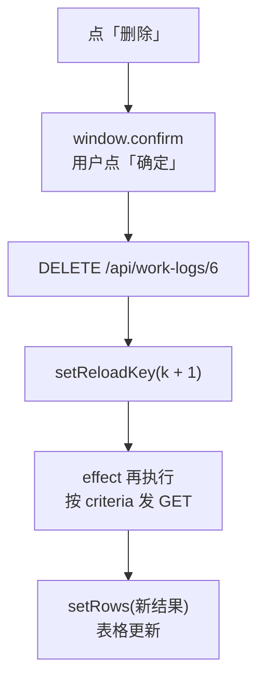

# 第 16B 章 综合实战（二）：删除前确认，删除后按原条件重新查询

## 这一章做什么

给中间表格的每一行加「删除」按钮。点了先弹出确认框，写明要删的是哪一条；确认后删除，再**按生效的条件**重新查询，表格更新。

本章结束时：

- 点第一行「市妇幼保健院」的「删除」，弹出确认框，第一行是「确定删除这条记录吗？」，空一行后是「市妇幼保健院，维修，2026-11-03 至 2026-11-03」。点「取消」什么都不发生。
- 点「确定」后，这一行的按钮变成「删除中…」，所有删除按钮都禁用；半秒后表格变成「共 5 条」。
- 先按「维修」查询，再删一条，表格重新查询时仍然只查「维修」。
- 两个浏览器标签页同时开着这个页面，在一个里删掉某条后，另一个再删同一条：显示「删除失败：工作记录 4 不存在，可能已经被删除」，表格随即刷新，那一行消失。

本章有三个新东西：**浏览器确认框 `window.confirm`**、**删除后「重新查询」而不是「从表格里去掉一行」**、**用计数器 `reloadKey` 让 effect 按原条件再执行一次**。

## 开始之前

- 需要已经会的：第 16A 章的全部内容。删除中禁用按钮、`try / catch / finally` 在第 12C 章用过。
- 起点代码：仓库 `code/ch16A/price-list`（不含练习答案）。两个终端分别运行 `npm run mock` 和 `npm run dev`。删除的数据在内存里，想恢复初始的 6 条，重启模拟接口即可。
- 预计耗时：40 分钟。

## 一、原理

### 1.1 浏览器确认框 `window.confirm`

**白话定义**：`window.confirm('文字')` 弹出浏览器自带的对话框，显示这段文字和「确定」「取消」两个按钮。用户点「确定」，函数返回 `true`；点「取消」，返回 `false`。

它有一个和别的函数都不一样的地方：**弹出期间，代码停在这一行不往下走，页面上也点不了别的东西**，直到用户做出选择。所以可以这样写：

```ts
const ok = window.confirm('确定删除这条记录吗？')
if (!ok) {
  return
}
// 能走到这里，说明用户点了「确定」
```

不用回调，也不用 `await`，读起来就是从上往下的普通流程。

**业务场景**：删除是不可撤销的操作，误点一下数据就没了。弹一次确认，并在确认文字里写清楚删的是哪一条（医院、工作种类、日期），用户能在最后一刻发现点错了行。文字里的 `\n` 是换行。

**反例（什么时候不该用）**：

| 情况 | 为什么不用 `confirm` |
| --- | --- |
| 要自定义外观、按钮文字（比如「删除」「再想想」） | 对话框由浏览器画，样式和按钮文字都改不了 |
| 要在对话框里填内容（比如填删除原因） | `confirm` 只有两个按钮 |
| 不可撤销性很低的操作（比如取消一个勾选） | 每次都弹会让用户养成不看就点「确定」的习惯，真正危险的操作也就拦不住了 |

这些情况要自己用组件做一个对话框，本教程不讲。这个页面只需要「确定 / 取消」，用 `confirm` 最简单。

### 1.2 删除后，表格怎么变：去掉一行，还是重新查询

删除产品时（第 5B 章，第 12A 章接上接口后也一样），用的是「从列表里去掉一行」：

```ts
setProducts((prev) => prev.filter((p) => p.id !== id))
```

这个页面改用「重新查询」：删除成功后，按生效的条件再发一次 GET，用后端返回的结果替换表格。两种做法比较：

| | 从表格里去掉一行 | 重新查询 |
| --- | --- | --- |
| 请求次数 | 1 次（DELETE） | 2 次（DELETE + GET） |
| 表格和后端是否一致 | 只反映**你自己**的删除 | 反映后端此刻的真实数据，包括别人刚做的修改 |
| 别人已经删了这条时 | 后端返回 404，你的表格还留着这一行 | 404 后照样重新查询，那一行消失 |
| 适合 | 数据只有自己在改，并且表格就是「全部数据」 | 表格是「按条件查出来的结果」，多人同时在用 |

工作记录页的表格是「按条件查出来的结果」，第 16C 章新增的记录也要靠重新查询才能判断「它符不符合当前条件」。三处操作（查询、删除、录入）都用重新查询，表格只有一个来源，就是后端按 `criteria` 返回的结果，不会出现「前端以为的表格」和「后端真实的数据」对不上。多一次 GET 的代价，对这种几十、几百行的表格可以忽略。

### 1.3 怎样让 effect 按原条件再执行一次

第 16A 章的查询写在 `useEffect(..., [criteria])` 里，只有 `criteria` 变了才执行。删除后条件没变，怎么让它再执行一次？

**不能用 `setCriteria(criteria)`**。把同一个对象再设一次，第 4D 章讲过，React 发现新值和当前值是同一个，跳过更新，effect 不会执行。实测：删除请求发出去了，但没有随后的 GET，标题停在「查询中…」，删掉的那一行还在表格里。

**办法是加一个计数器 state，放进依赖数组**：

```ts
const [reloadKey, setReloadKey] = useState(0)

useEffect(() => {
  // ……按 criteria 查询……
}, [criteria, reloadKey])

// 要重新查询时：
setReloadKey((k) => k + 1)
```

`reloadKey` 的值本身没有意义，effect 里也不读它。它的唯一作用是「变一下」：每加 1，依赖数组里就有一项变了，effect 按当前的 `criteria` 再执行一次。用更新函数 `(k) => k + 1`（第 4C 章），连着触发两次也不会少加。



## 二、实现思路和方法

### 2.1 谁负责什么

| 组件 | 做什么 | 不做什么 |
| --- | --- | --- |
| `ResultTable` | 每行显示「删除」按钮；点了调用 `onDelete(这一行)` | 不弹确认框、不调接口：它只负责显示 |
| `WorkLogPage` | 弹确认框、调删除接口、显示失败原因、触发重新查询 | 无 |

确认和删除放在父组件，因为删除之后要做的「重新查询」需要父组件里的 `criteria` 和 `reloadKey`。表格只报告「用户点了哪一行」。

`onDelete` 传的是**整条记录**而不只是 `id`：确认框要显示医院、工作种类、日期。如果只传 `id`，父组件还得自己去 `rows` 里找这一条。

### 2.2 新加的 state

都在 `WorkLogPage` 里：

| state | 类型 | 作用 |
| --- | --- | --- |
| `reloadKey` | `number` | 1.3 节的计数器 |
| `deletingId` | `number \| null` | 正在删除的记录 id，没有在删时是 `null`。表格用它显示「删除中…」并禁用按钮 |
| `actionError` | `string` | 删除失败的原因，显示在表格上方 |

`deletingId` 不为 `null` 时，**所有**删除按钮都禁用，而不只是正在删的那一行。一次只允许删一条，免得用户连点几行，几个删除请求和重新查询交错在一起，提示信息也分不清是哪一条的。

### 2.3 删除失败时也要重新查询

删除可能失败：网络断了，或者这条记录已经被别人删了（后端返回 404）。失败时显示原因，**然后照样重新查询**。如果是 404，重新查询后那一行就不见了，表格和后端重新一致；如果是网络问题，重新查询大概率也失败，表格位置会显示「查询失败」，用户就知道是连接出了问题。

所以 `setReloadKey` 写在 `try / catch / finally` 的**后面**，不管成功失败都会执行。

### 2.4 新的查询开始时，清掉删除失败的提示

删除失败的提示针对的是那一次删除。用户接着点「查询」时，这条提示已经过时，`handleSearch` 里先把 `actionError` 清空。

## 三、代码实现

### 3.1 接口函数：加 `deleteWorkLog`

用下面的内容整个替换 `src/pages/WorkLogPage/workLogApi.ts`，改动在文件末尾，用 🟨 标出：

```ts
// src/pages/WorkLogPage/workLogApi.ts
// 工作记录的接口函数。组件只调用这些函数，不自己拼地址、不自己判断状态码
import { toApiError } from '../../api.ts'
import type { WorkLog, WorkLogQuery } from './workLogTypes.ts'

const BASE = import.meta.env.VITE_API_BASE

// 把查询条件变成查询字符串，例如 start=2026-10-01&workType=%E7%BB%B4%E4%BF%AE
function toQueryString(query: WorkLogQuery): string {
  const params = new URLSearchParams()
  // 只放有值的条件。空的不放，后端就按「不限」处理
  if (query.start !== '') params.set('start', query.start)
  if (query.end !== '') params.set('end', query.end)
  if (query.workType !== '') params.set('workType', query.workType)
  // 医院名称去掉首尾空格再发。中文、&、#、空格这些字符由 URLSearchParams 负责编码
  const hospital = query.hospital.trim()
  if (hospital !== '') params.set('hospital', hospital)
  return params.toString()
}

// GET /api/work-logs?...：按条件查询，返回符合条件的记录
export async function searchWorkLogs(query: WorkLogQuery): Promise<WorkLog[]> {
  const qs = toQueryString(query)
  // 一个条件都没有时，地址后面不留一个孤零零的 ?
  const url = qs === '' ? `${BASE}/work-logs` : `${BASE}/work-logs?${qs}`
  const response = await fetch(url)
  if (!response.ok) {
    throw await toApiError(response)
  }
  const rows: WorkLog[] = await response.json()
  return rows
}

// 🟨 第 16B 章：DELETE /api/work-logs/3。成功返回 204，没有内容，所以不调用 response.json()
export async function deleteWorkLog(id: number): Promise<void> {
  const response = await fetch(`${BASE}/work-logs/${id}`, { method: 'DELETE' })
  if (!response.ok) {
    // 404（记录已经不在了）等情况，抛出带服务器原因的 ApiError
    throw await toApiError(response)
  }
}
```

删除成功返回 204，没有响应内容。这时调用 `response.json()` 会报错，所以函数不返回任何东西（`Promise<void>`）。

### 3.2 表格：加「删除」列

用下面的内容整个替换 `src/pages/WorkLogPage/ResultTable.tsx`：

```tsx
// src/pages/WorkLogPage/ResultTable.tsx
// 中间的「查询结果」表格。只负责显示：数据从 props 来，自己没有 state
// 🟨 第 16B 章：点「删除」时不自己调接口，而是通知父组件，由父组件确认、删除、重新查询
import type { WorkLog } from './workLogTypes.ts'
import styles from './WorkLogPage.module.css'

type ResultTableProps = {
  rows: WorkLog[]
  // 🟨 第 16B 章：正在删除的那条记录的 id，没有在删除时是 null
  deletingId: number | null
  // 🟨 第 16B 章：传整条记录而不只是 id：父组件弹确认框时要显示医院、日期
  onDelete: (row: WorkLog) => void
}

export function ResultTable({ rows, deletingId, onDelete }: ResultTableProps) {
  if (rows.length === 0) {
    return <p className="empty">没有符合条件的记录</p>
  }

  return (
    <table className={styles.table}>
      <thead>
        <tr>
          <th>开始日期</th>
          <th>结束日期</th>
          <th>工作种类</th>
          <th>医院名称</th>
          {/* 🟨 第 16B 章：多一列放删除按钮 */}
          <th>操作</th>
        </tr>
      </thead>
      <tbody>
        {/* 表格里不显示 id，但 key 要用它：只有 id 能唯一区分一条记录 */}
        {rows.map((w) => (
          <tr key={w.id}>
            <td>{w.startDate}</td>
            <td>{w.endDate}</td>
            <td>{w.workType}</td>
            <td>{w.hospitalName}</td>
            {/* 🟨 第 16B 章：有一条正在删除时，所有删除按钮都禁用，一次只删一条；正在删的那条显示「删除中…」 */}
            <td>
              <button type="button" disabled={deletingId !== null} onClick={() => onDelete(w)}>
                {deletingId === w.id ? '删除中…' : '删除'}
              </button>
            </td>
          </tr>
        ))}
      </tbody>
    </table>
  )
}
```

| 代码 | 说明 |
| --- | --- |
| `onDelete: (row: WorkLog) => void` | 回调 props 的类型：调用时传一条记录，不关心返回值 |
| `onClick={() => onDelete(w)}` | 要传参数，所以包一层箭头函数（第 4C 章） |
| `disabled={deletingId !== null}` | 有任何一条在删，所有按钮都禁用 |
| `deletingId === w.id ? '删除中…' : '删除'` | 只有正在删的那一行显示「删除中…」 |

### 3.3 父组件：确认、删除、重新查询

用下面的内容整个替换 `src/pages/WorkLogPage/WorkLogPage.tsx`：

```tsx
// src/pages/WorkLogPage/WorkLogPage.tsx
// 工作记录页：上、中、下三个 panel 的父组件（第 16A、16B 章先做上、中两个）。
// 「生效的查询条件」和「表格数据」放在这里：第 16B、16C 章的删除和录入也要让表格重新查询
import { useEffect, useState } from 'react'
import { QueryPanel } from './QueryPanel.tsx'
import { ResultTable } from './ResultTable.tsx'
// 🟨 第 16B 章：多导入 deleteWorkLog
import { deleteWorkLog, searchWorkLogs } from './workLogApi.ts'
import { EMPTY_QUERY } from './workLogTypes.ts'
import type { WorkLog, WorkLogQuery } from './workLogTypes.ts'

export function WorkLogPage() {
  // 最后一次点「查询」时的条件。输入框里正在改、还没点查询的内容不在这里，在 QueryPanel 里
  const [criteria, setCriteria] = useState<WorkLogQuery>(EMPTY_QUERY)
  const [rows, setRows] = useState<WorkLog[]>([])
  // 页面一打开就要查询，所以初始值是 true
  const [loading, setLoading] = useState(true)
  const [error, setError] = useState('')
  // 🟨 第 16B 章：重新查询计数器。值本身没有意义，只要它一变，下面的 useEffect 就按 criteria 再查一次
  const [reloadKey, setReloadKey] = useState(0)
  // 🟨 第 16B 章：正在删除的记录 id，删除失败的原因
  const [deletingId, setDeletingId] = useState<number | null>(null)
  const [actionError, setActionError] = useState('')

  // criteria 变了就按新条件查询。组件第一次显示时也会执行一次，这就是「页面一打开就自动查询」
  // 🟨 第 16B 章：reloadKey 变了也查询，条件还是 criteria，这就是「删除后按原条件重新查询」
  useEffect(() => {
    // 连点两次「查询」时，先发的请求可能后回来。旧请求的结果用 ignore 丢掉（第 7C 章）
    let ignore = false

    async function load() {
      try {
        const data = await searchWorkLogs(criteria)
        if (!ignore) {
          setRows(data)
          setError('')
        }
      } catch (err) {
        if (!ignore) {
          setError(err instanceof Error ? err.message : String(err))
        }
      } finally {
        // finally：成功、失败都会执行，「查询中」在这里关掉
        if (!ignore) {
          setLoading(false)
        }
      }
    }

    load()
    return () => {
      ignore = true
    }
  }, [criteria, reloadKey])

  function handleSearch(next: WorkLogQuery) {
    // 🟨 第 16B 章：开始新的查询时，清掉上一次删除失败的提示
    setActionError('')
    // 「查询中」在事件处理函数里打开，查询结果回来后在 load 里关掉
    setLoading(true)
    // next 每次都是新对象：条件和上次一模一样，React 也认为 criteria 变了，会再查一次（第 4D 章）
    setCriteria(next)
  }

  // 🟨 第 16B 章：确认 → 删除 → 重新查询
  async function handleDelete(row: WorkLog) {
    // 浏览器自带的确认框。代码停在这一行，等用户点：「确定」返回 true，「取消」返回 false
    const ok = window.confirm(`确定删除这条记录吗？\n\n${row.hospitalName}，${row.workType}，${row.startDate} 至 ${row.endDate}`)
    if (!ok) {
      return
    }
    setActionError('')
    setDeletingId(row.id)
    try {
      await deleteWorkLog(row.id)
    } catch (err) {
      setActionError(`删除失败：${err instanceof Error ? err.message : String(err)}`)
    } finally {
      setDeletingId(null)
    }
    // 成功、失败都重新查询：失败可能是因为记录已经被别人删了，表格里那一行本来就该消失
    setLoading(true)
    setReloadKey((k) => k + 1)
  }

  return (
    <section>
      <QueryPanel onSearch={handleSearch} />
      <div className="panel">
        {/* 查询期间表格保留上一次的结果，只在标题上提示，避免表格闪一下变空 */}
        <h2>查询结果{loading ? '（查询中…）' : `（共 ${rows.length} 条）`}</h2>
        {/* 🟨 第 16B 章：删除失败的原因显示在表格上方 */}
        {actionError && <p className="error">{actionError}</p>}
        {error ? (
          <p className="error">查询失败：{error}</p>
        ) : (
          <ResultTable rows={rows} deletingId={deletingId} onDelete={handleDelete} />
        )}
      </div>
    </section>
  )
}
```

`handleDelete` 按顺序做六件事：

| 步骤 | 代码 | 说明 |
| --- | --- | --- |
| 1 | `window.confirm(...)` | 用户点「取消」就 `return`，后面都不执行，也不发请求 |
| 2 | `setActionError('')`、`setDeletingId(row.id)` | 清掉上一次的失败提示；表格显示「删除中…」并禁用按钮 |
| 3 | `await deleteWorkLog(row.id)` | 发 DELETE，等结果 |
| 4 | `catch` 里 `setActionError(...)` | 失败时记下原因，比如后端的「工作记录 4 不存在，可能已经被删除」 |
| 5 | `finally` 里 `setDeletingId(null)` | 成功、失败都恢复按钮 |
| 6 | `setLoading(true)`、`setReloadKey((k) => k + 1)` | 不管成功失败，按生效的条件重新查询 |

第 6 步的 `setLoading(true)` 和第 16A 章 `handleSearch` 里的一样：在事件里打开「查询中」，effect 的 `finally` 负责关掉。

## 四、运行和验证

重启一次模拟接口，让数据恢复成 6 条，然后刷新页面。实测结果：

| 操作 | 页面 | 模拟接口终端 |
| --- | --- | --- |
| 点第一行（市妇幼保健院）的「删除」 | 弹出「确定删除这条记录吗？」，空一行后是「市妇幼保健院，维修，2026-11-03 至 2026-11-03」 | 没有请求 |
| 点「取消」 | 对话框关闭，表格还是「共 6 条」 | 没有请求 |
| 再点「删除」，点「确定」 | 这一行显示「删除中…」，6 个删除按钮全部禁用；半秒后标题变成「共 5 条」，那一行消失 | `DELETE /api/work-logs/6`，紧接着 `GET /api/work-logs` |
| 工作种类选「维修」点「查询」，再删第一行（县中医院） | 「共 2 条」变成「共 1 条」，剩下的仍然是维修：市第二人民医院 | `DELETE /api/work-logs/5`，紧接着 `GET /api/work-logs?workType=%E7%BB%B4%E4%BF%AE`，带着原来的条件 |
| 另开一个标签页打开同一页面。在第一个标签页删掉第一行，再到第二个标签页删同一行 | 第二个标签页显示「删除失败：工作记录 4 不存在，可能已经被删除」，表格从 4 条变成 3 条 | 两次 `DELETE /api/work-logs/4`，每次后面跟一个 `GET` |

最后一行说明了 2.3 节：失败后的重新查询，让第二个标签页的表格和后端重新一致。

## ⚠ 常见问题

| 现象 | 原因 | 怎么改 |
| --- | --- | --- |
| 删除后标题一直是「查询中…」，删掉的那一行还在。模拟接口终端只有 `DELETE`，后面没有 `GET`。`npx tsc -b` 报 `TS6133: 'setReloadKey' is declared but its value is never read.` | 用 `setCriteria(criteria)` 想触发重新查询，同一个对象被 React 跳过（1.3 节） | 用计数器：`setReloadKey((k) => k + 1)` |
| 同样的现象，`npx tsc -b` 报 `TS6133: 'reloadKey' is declared but its value is never read.` | 加了 `reloadKey`，但忘了放进 `useEffect` 的依赖数组。effect 里不读 `reloadKey`，所以 `npm run lint` 不会提醒你 | 依赖数组写 `[criteria, reloadKey]` |
| 想在确认框里显示医院名称，但 `onDelete` 只拿到 `id` | 表格只交出了 `id` | 让 `onDelete` 交出整条记录 `onDelete(w)`，类型写 `(row: WorkLog) => void` |

## 🎯 动手练习

**练习：删除成功的提示**

删除成功后，在表格上方显示绿色的「已删除：市妇幼保健院，维修，2026-11-03 至 2026-11-03」。下一次点「查询」或开始新的删除时，这条提示消失。删除失败时不显示它。

验收标准：

- 删除第一行后，表格上方出现「已删除：……」，表格是「共 5 条」。
- 接着点「查询」，提示消失。

卡住了看文末参考答案。

## 📌 小结

confirm 返回 true 才删；删后不改表格，加 reloadKey 让 effect 按原条件重查。

## 下一章

页面还差下面的录入表单。第 16C 章做录入：前端校验、后端校验、保存后按生效的条件重新查询，并处理「新记录不符合当前条件」的情况。

---

<!-- 以下是参考答案，先自己动手，卡住了再往下翻 -->


## 参考答案

### 练习

思路：再加一个 state `actionMessage`。`await deleteWorkLog(...)` 的下一行能执行到，说明没有抛错，删除成功了，在这里设置提示；失败时直接跳到 `catch`，不会执行这一行。`handleSearch` 和 `handleDelete` 开头都清空它。提示用全局的 `success` 类显示成绿色。

```tsx
// src/pages/WorkLogPage/WorkLogPage.tsx
// 练习做完后的版本，🟨 标出练习改动的地方
// 工作记录页：上、中、下三个 panel 的父组件（第 16A、16B 章先做上、中两个）。
// 「生效的查询条件」和「表格数据」放在这里：第 16B、16C 章的删除和录入也要让表格重新查询
import { useEffect, useState } from 'react'
import { QueryPanel } from './QueryPanel.tsx'
import { ResultTable } from './ResultTable.tsx'
import { deleteWorkLog, searchWorkLogs } from './workLogApi.ts'
import { EMPTY_QUERY } from './workLogTypes.ts'
import type { WorkLog, WorkLogQuery } from './workLogTypes.ts'

export function WorkLogPage() {
  // 最后一次点「查询」时的条件。输入框里正在改、还没点查询的内容不在这里，在 QueryPanel 里
  const [criteria, setCriteria] = useState<WorkLogQuery>(EMPTY_QUERY)
  const [rows, setRows] = useState<WorkLog[]>([])
  // 页面一打开就要查询，所以初始值是 true
  const [loading, setLoading] = useState(true)
  const [error, setError] = useState('')
  const [reloadKey, setReloadKey] = useState(0)
  const [deletingId, setDeletingId] = useState<number | null>(null)
  const [actionError, setActionError] = useState('')
  // 🟨 练习：删除成功的提示
  const [actionMessage, setActionMessage] = useState('')

  // criteria 变了就按新条件查询。组件第一次显示时也会执行一次，这就是「页面一打开就自动查询」
  useEffect(() => {
    // 连点两次「查询」时，先发的请求可能后回来。旧请求的结果用 ignore 丢掉（第 7C 章）
    let ignore = false

    async function load() {
      try {
        const data = await searchWorkLogs(criteria)
        if (!ignore) {
          setRows(data)
          setError('')
        }
      } catch (err) {
        if (!ignore) {
          setError(err instanceof Error ? err.message : String(err))
        }
      } finally {
        // finally：成功、失败都会执行，「查询中」在这里关掉
        if (!ignore) {
          setLoading(false)
        }
      }
    }

    load()
    return () => {
      ignore = true
    }
  }, [criteria, reloadKey])

  function handleSearch(next: WorkLogQuery) {
    setActionError('')
    // 🟨 练习：开始新的查询时，上一次的删除提示也清掉
    setActionMessage('')
    // 「查询中」在事件处理函数里打开，查询结果回来后在 load 里关掉
    setLoading(true)
    // next 每次都是新对象：条件和上次一模一样，React 也认为 criteria 变了，会再查一次（第 4D 章）
    setCriteria(next)
  }

  async function handleDelete(row: WorkLog) {
    // 浏览器自带的确认框。代码停在这一行，等用户点：「确定」返回 true，「取消」返回 false
    const ok = window.confirm(`确定删除这条记录吗？\n\n${row.hospitalName}，${row.workType}，${row.startDate} 至 ${row.endDate}`)
    if (!ok) {
      return
    }
    setActionError('')
    // 🟨 练习：开始新的删除时，清掉上一次的提示
    setActionMessage('')
    setDeletingId(row.id)
    try {
      await deleteWorkLog(row.id)
      // 🟨 练习：能走到这一行，说明 deleteWorkLog 没有抛错，删除成功了
      setActionMessage(`已删除：${row.hospitalName}，${row.workType}，${row.startDate} 至 ${row.endDate}`)
    } catch (err) {
      setActionError(`删除失败：${err instanceof Error ? err.message : String(err)}`)
    } finally {
      setDeletingId(null)
    }
    // 成功、失败都重新查询：失败可能是因为记录已经被别人删了，表格里那一行本来就该消失
    setLoading(true)
    setReloadKey((k) => k + 1)
  }

  return (
    <section>
      <QueryPanel onSearch={handleSearch} />
      <div className="panel">
        {/* 查询期间表格保留上一次的结果，只在标题上提示，避免表格闪一下变空 */}
        <h2>查询结果{loading ? '（查询中…）' : `（共 ${rows.length} 条）`}</h2>
        {actionError && <p className="error">{actionError}</p>}
        {/* 🟨 练习：删除成功的提示 */}
        {actionMessage && <p className="success">{actionMessage}</p>}
        {error ? (
          <p className="error">查询失败：{error}</p>
        ) : (
          <ResultTable rows={rows} deletingId={deletingId} onDelete={handleDelete} />
        )}
      </div>
    </section>
  )
}
```
