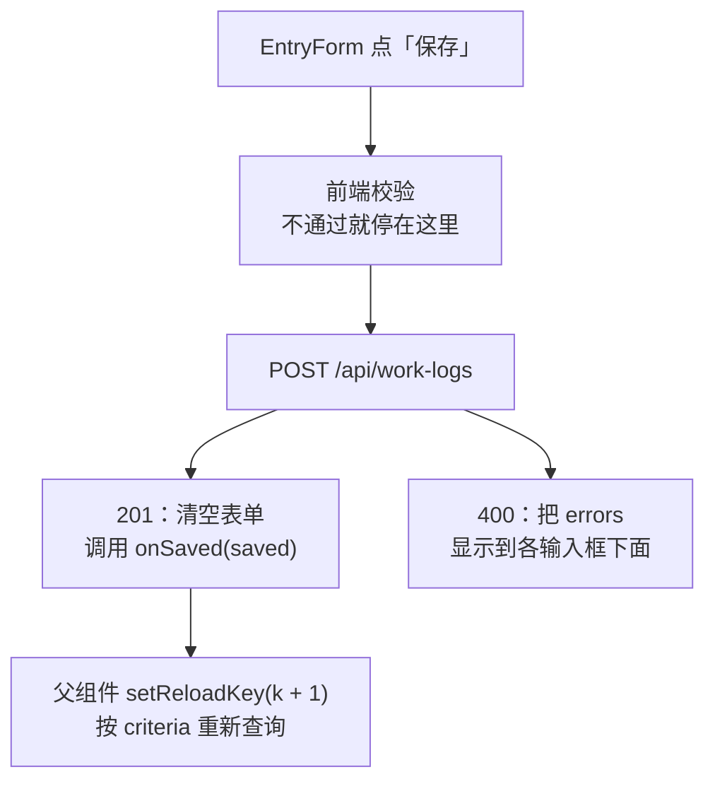

# 第 16C 章 综合实战（三）：录入表单，保存后按原条件重新查询

## 这一章做什么

做页面最下面的「录入工作记录」：开始日期、结束日期两个日期框，工作种类下拉框（安装、维修、其它，没有「全部」），医院名称文本框，一个「保存」按钮。保存成功后清空表单，中间的表格按生效的条件重新查询。

本章结束时：

- 什么都不填点「保存」，三个输入项下面分别出现「请选择开始日期」「请选择结束日期」「请填写医院名称」，不发请求。
- 结束日期早于开始日期，结束日期下面出现「结束日期不能早于开始日期」。
- 填一条已经存在的记录（2026-10-08、2026-10-09、安装、市中心医院），后端拒绝，医院名称下面出现「市中心医院 在 2026-10-08 已经有一条「安装」记录」。
- 填一条新记录保存，表单清空，表格从「共 6 条」变成「共 7 条」，新记录在第一行。
- 先按「安装」查询，再录一条「维修」记录：保存成功，表格还是只有安装的记录。

本章有三个新东西：**前端校验和后端校验的分工**、**录入表单自己调接口、只把「数据变了」告诉父组件**、**保存后的新记录不一定出现在表格里**。

## 开始之前

- 需要已经会的：第 16A、16B 章；派生值做校验、`triedSubmit`（第 6C 章）；后端返回的字段错误显示到输入框下面（第 13C 章）。
- 起点代码：仓库 `code/ch16B/price-list`（不含练习答案）。两个终端分别运行 `npm run mock` 和 `npm run dev`。模拟接口第 16A 章已经有新增接口，本章不用改后端。
- 预计耗时：50 分钟。

## 一、原理

### 1.1 前端校验和后端校验，各管什么

第 6C 章做过前端校验，第 13C 章接过后端校验。录入表单两边都要有，但它们管的事情不一样：

| | 前端校验 | 后端校验 |
| --- | --- | --- |
| 什么时候生效 | 点「保存」的一瞬间，不发请求 | 请求到了后端才知道 |
| 能检查什么 | 只能看到这个表单里填的内容：必填、日期先后、长度 | 全部都能查，而且**能看到库里已有的数据** |
| 能不能被绕过 | 能。有人不经过页面直接发请求，前端校验根本不执行 | 不能，所有请求都要经过它 |
| 作用 | 让用户马上知道哪里填错了，少发无用的请求 | 保证存进去的数据一定合法 |

所以规则是：**后端把所有规则都检查一遍；前端把「只看表单就能判断」的规则也检查一遍，图的是快**。「同一家医院同一天已经有一条同种工作」这种要看已有数据的规则，只能后端做，前端只负责把后端说的原因显示到对应的输入框下面。

模拟接口里的新增规则（第 16A 章的 `workLogs.ts`）：

| 字段 | 规则 | 前端也查吗 |
| --- | --- | --- |
| `startDate` | 必须是真实存在的日期 | 查「有没有选」。日期框保证了格式 |
| `endDate` | 必须是真实存在的日期，不能早于开始日期 | 查「有没有选」和先后 |
| `workType` | 必须是安装、维修、其它之一 | 不用查：下拉框只能选这三种 |
| `hospitalName` | 去掉首尾空格后不能为空，不超过 50 个字 | 查 |
| 整条记录 | 同一天、同一种工作、同一家医院不能重复 | **只有后端能查** |

后端返回 400 时，响应里的 `errors` 按字段名给出原因，例如 `{ "hospitalName": "市中心医院 在 2026-10-08 已经有一条「安装」记录" }`。字段名和请求里的字段名一致，前端按名字找到对应的输入框。

### 1.2 表单自己保存，只告诉父组件「数据变了」

第 16B 章的删除，接口是在父组件里调的。这一章的保存，接口放在表单 `EntryForm` 里调。为什么不一样？

| | 删除（第 16B 章） | 保存（本章） |
| --- | --- | --- |
| 过程中的状态 | 只有「哪一条在删」「失败原因」，显示在表格上 | 四个输入框的值、每个字段的错误、「保存中」、提示文字，全在表单上 |
| 这些状态谁用 | 表格用 | 只有表单自己用 |
| 父组件需要知道什么 | 删的是哪一条，以及要不要重新查询 | 只需要知道「保存成功了，数据变了」 |

状态放在用它的组件里。保存过程的状态都是表单自己的，接口也就由表单调用。成功后表单调用父组件给的 `onSaved(saved)`，父组件做的事和删除后一样：`setReloadKey((k) => k + 1)`，按生效的条件重新查询。



### 1.3 保存成功的记录，不一定出现在表格里

表格显示的是「按生效的条件查出来的结果」（第 16B 章 1.2 节）。新记录保存后，表格重新查询，新记录**符合条件才出现**。

实测：先按工作种类「安装」查询，表格是「共 2 条」；然后录一条「维修」记录，保存成功，表单下面显示「已保存：县中医院，维修，2026-11-12 至 2026-11-12」，表格重新查询后还是「共 2 条」，因为新记录是维修，不符合「安装」。

这是对的：表格的意义就是「当前条件下有哪些记录」。如果为了让用户看见，把新记录直接塞进表格（像第 5B 章那样往数组里加一项），表格里就会出现一条不符合条件的记录，排序也可能不对，下一次查询它又消失，用户反而糊涂。所以保存后的提示要写清楚保存了什么，让用户不看表格也知道保存成功了。练习 2 再进一步：告诉用户「刚保存的记录不符合当前条件，所以没有显示」。

## 二、实现思路和方法

### 2.1 `EntryForm` 的 state

| state | 初始值 | 作用 |
| --- | --- | --- |
| `startDate`、`endDate` | `''` | 两个日期框 |
| `workType` | `'安装'` | 录入时必须选一种，所以类型是 `WorkType`，没有 `''` |
| `hospitalName` | `''` | 医院名称 |
| `triedSubmit` | `false` | 点过「保存」才显示前端校验的错误（第 6C 章） |
| `saving` | `false` | 等后端响应期间禁用「保存」按钮，防止重复提交 |
| `serverErrors` | `{}` | 后端返回的逐个字段的错误 |
| `message`、`messageIsError` | `''`、`false` | 表单下面的一句话：成功的提示，或失败的原因；`messageIsError` 决定显示成红色还是绿色 |

前端校验的结果（`startError`、`endError`、`hospitalError`、`isValid`）**不是 state**，是派生值：每次渲染从四个输入值现算，永远和输入框一致。

### 2.2 每个字段显示哪条错误

一个字段可能同时有前端错误和后端错误。规则和第 13C 章相同：

1. 点过「保存」、并且前端检查出错误 → 显示前端的错误。
2. 否则，后端对这个字段有错误 → 显示后端的错误。
3. 用户改了这个字段 → 清掉后端对它的错误。那条错误针对的是改之前的值，改了就不一定对了。

写成两个小函数：`errorOf(字段名, 前端错误)` 决定显示哪条；`clearServerError(字段名)` 在 `onChange` 里清掉旧的后端错误。

### 2.3 保存成功后做什么

| 动作 | 原因 |
| --- | --- |
| 清空两个日期和医院名称，`triedSubmit` 设回 `false` | 方便接着录下一条；`triedSubmit` 不复位的话，空表单会立刻满屏错误提示 |
| 工作种类**不清空** | 连续录同一种工作时不用每次重选 |
| 显示「已保存：医院，工作种类，开始 至 结束」 | 1.3 节：新记录不一定出现在表格里，提示要写清楚 |
| 调用 `onSaved(saved)` | 让父组件重新查询 |

`saved` 用后端返回的记录，而不是表单里填的值。后端可能做了处理，比如去掉医院名称首尾的空格（实测提交 `"  县人民医院 "`，后端存成 `"县人民医院"`）。

## 三、代码实现

### 3.1 类型：加 `WorkLogInput`

用下面的内容整个替换 `src/pages/WorkLogPage/workLogTypes.ts`：

```ts
// src/pages/WorkLogPage/workLogTypes.ts
// 工作记录页用到的类型。只有这个页面用，所以放在页面自己的文件夹里，不放进全书共用的 src/types.ts

// 工作种类只有三种。写成字面量联合类型，代码里写错一个字 TypeScript 就会报错
export type WorkType = '安装' | '维修' | '其它'

// 下拉框的选项从这个数组生成。标注成 WorkType[]，数组里也不能写错字
export const WORK_TYPES: WorkType[] = ['安装', '维修', '其它']

// 一条工作记录，字段和后端返回的 JSON 一一对应。日期是 'YYYY-MM-DD' 格式的字符串
export type WorkLog = {
  id: number
  startDate: string
  endDate: string
  workType: WorkType
  hospitalName: string
}

// 🟨 第 16C 章：新增时提交的内容：WorkLog 去掉 id。id 由服务器分配
export type WorkLogInput = Omit<WorkLog, 'id'>

// 查询条件。每一项都是字符串，空字符串表示「不限」。工作种类多一个 ''，代表下拉框里的「全部」
export type WorkLogQuery = {
  start: string
  end: string
  workType: WorkType | ''
  hospital: string
}

// 四个条件都不限。页面刚打开时用它查询，所以一打开就列出全部记录
export const EMPTY_QUERY: WorkLogQuery = { start: '', end: '', workType: '', hospital: '' }
```

`Omit<WorkLog, 'id'>` 的意思是「`WorkLog` 去掉 `id` 这个字段」（第 12A 章的 `ProductInput` 也是这样写的）。新增时还没有 `id`，由后端分配。

### 3.2 接口函数：加 `createWorkLog`

用下面的内容整个替换 `src/pages/WorkLogPage/workLogApi.ts`：

```ts
// src/pages/WorkLogPage/workLogApi.ts
// 工作记录的接口函数。组件只调用这些函数，不自己拼地址、不自己判断状态码
import { toApiError } from '../../api.ts'
// 🟨 第 16C 章：多导入 WorkLogInput
import type { WorkLog, WorkLogInput, WorkLogQuery } from './workLogTypes.ts'

const BASE = import.meta.env.VITE_API_BASE

// 把查询条件变成查询字符串，例如 start=2026-10-01&workType=%E7%BB%B4%E4%BF%AE
function toQueryString(query: WorkLogQuery): string {
  const params = new URLSearchParams()
  // 只放有值的条件。空的不放，后端就按「不限」处理
  if (query.start !== '') params.set('start', query.start)
  if (query.end !== '') params.set('end', query.end)
  if (query.workType !== '') params.set('workType', query.workType)
  // 医院名称去掉首尾空格再发。中文、&、#、空格这些字符由 URLSearchParams 负责编码
  const hospital = query.hospital.trim()
  if (hospital !== '') params.set('hospital', hospital)
  return params.toString()
}

// GET /api/work-logs?...：按条件查询，返回符合条件的记录
export async function searchWorkLogs(query: WorkLogQuery): Promise<WorkLog[]> {
  const qs = toQueryString(query)
  // 一个条件都没有时，地址后面不留一个孤零零的 ?
  const url = qs === '' ? `${BASE}/work-logs` : `${BASE}/work-logs?${qs}`
  const response = await fetch(url)
  if (!response.ok) {
    throw await toApiError(response)
  }
  const rows: WorkLog[] = await response.json()
  return rows
}

export async function deleteWorkLog(id: number): Promise<void> {
  const response = await fetch(`${BASE}/work-logs/${id}`, { method: 'DELETE' })
  if (!response.ok) {
    // 404（记录已经不在了）等情况，抛出带服务器原因的 ApiError
    throw await toApiError(response)
  }
}

// 🟨 第 16C 章：POST /api/work-logs。成功返回 201 和保存后的记录（带上服务器分配的 id）
export async function createWorkLog(input: WorkLogInput): Promise<WorkLog> {
  const response = await fetch(`${BASE}/work-logs`, {
    method: 'POST',
    headers: { 'Content-Type': 'application/json' },
    body: JSON.stringify(input),
  })
  if (!response.ok) {
    // 校验失败时是 400，ApiError 的 fieldErrors 里是逐个字段的原因
    throw await toApiError(response)
  }
  const saved: WorkLog = await response.json()
  return saved
}
```

和第 12A 章的 `createProduct` 结构相同：`POST`、写明 `Content-Type`、请求体用 `JSON.stringify`。失败时抛出 `ApiError`，它的 `fieldErrors` 就是后端响应里的 `errors`。

### 3.3 下面：`EntryForm`

新建 `src/pages/WorkLogPage/EntryForm.tsx`：

```tsx
// src/pages/WorkLogPage/EntryForm.tsx
// 下面的「录入工作记录」panel。自己负责校验和调用新增接口，保存成功后通知父组件重新查询
import { useState } from 'react'
import type { SubmitEvent } from 'react'
import { ApiError } from '../../api.ts'
import { createWorkLog } from './workLogApi.ts'
import { WORK_TYPES } from './workLogTypes.ts'
import type { WorkLog, WorkLogInput, WorkType } from './workLogTypes.ts'

type EntryFormProps = {
  // 保存成功后调用，参数是服务器返回的那条记录（带 id）
  onSaved: (saved: WorkLog) => void
}

export function EntryForm({ onSaved }: EntryFormProps) {
  const [startDate, setStartDate] = useState('')
  const [endDate, setEndDate] = useState('')
  // 录入时必须选一种，没有「全部」，默认「安装」
  const [workType, setWorkType] = useState<WorkType>('安装')
  const [hospitalName, setHospitalName] = useState('')
  // 点过一次「保存」才显示前端校验的错误，免得一打开页面就满屏错误提示（第 6C 章）
  const [triedSubmit, setTriedSubmit] = useState(false)
  // 正在等服务器响应。这期间禁用保存按钮，防止重复提交
  const [saving, setSaving] = useState(false)
  // 服务器返回的逐个字段的错误，例如 { hospitalName: '市中心医院 在 2026-10-08 已经有一条「安装」记录' }
  const [serverErrors, setServerErrors] = useState<Record<string, string>>({})
  // 表单下方的一句话：保存成功的提示，或者保存失败的原因
  const [message, setMessage] = useState('')
  const [messageIsError, setMessageIsError] = useState(false)

  // 前端校验，都是派生值：每次渲染从 state 现算，永远和输入框一致
  const name = hospitalName.trim()
  const startError = startDate === '' ? '请选择开始日期' : ''
  // 两个日期都是 'YYYY-MM-DD'，字符串比较就是日期先后比较
  const endError =
    endDate === '' ? '请选择结束日期' : startDate !== '' && endDate < startDate ? '结束日期不能早于开始日期' : ''
  const hospitalError = name === '' ? '请填写医院名称' : name.length > 50 ? '医院名称不能超过 50 个字' : ''
  const isValid = startError === '' && endError === '' && hospitalError === ''

  // 每个字段最终显示哪条错误：前端检查到的优先，没有时显示服务器给的（第 13C 章）
  function errorOf(field: string, clientError: string): string {
    return triedSubmit && clientError ? clientError : (serverErrors[field] ?? '')
  }

  // 改了某个字段，就清掉服务器对这个字段的旧错误：那条错误针对的是改之前的值
  function clearServerError(field: string) {
    setServerErrors((prev) => {
      const next = { ...prev }
      delete next[field]
      return next
    })
  }

  async function handleSubmit(e: SubmitEvent<HTMLFormElement>) {
    e.preventDefault()
    setTriedSubmit(true)
    if (!isValid) {
      setMessage('')
      return
    }
    const input: WorkLogInput = { startDate, endDate, workType, hospitalName: name }
    setSaving(true)
    setServerErrors({})
    setMessage('')
    try {
      const saved = await createWorkLog(input)
      // 清空表单，方便接着录下一条。工作种类保留：连续录同一种工作时不用每次重选
      setStartDate('')
      setEndDate('')
      setHospitalName('')
      setTriedSubmit(false)
      setMessageIsError(false)
      setMessage(`已保存：${saved.hospitalName}，${saved.workType}，${saved.startDate} 至 ${saved.endDate}`)
      // 通知父组件：数据变了。父组件按生效的条件重新查询，表格才会更新
      onSaved(saved)
    } catch (err) {
      setMessageIsError(true)
      if (err instanceof ApiError) {
        setServerErrors(err.fieldErrors)
        setMessage(Object.keys(err.fieldErrors).length > 0 ? '保存失败，请修改标红的项' : `保存失败：${err.message}`)
      } else {
        // 网络断了等情况，fetch 抛出的是普通错误，没有 fieldErrors
        setMessage(`保存失败：${err instanceof Error ? err.message : String(err)}`)
      }
    } finally {
      setSaving(false)
    }
  }

  const startMessage = errorOf('startDate', startError)
  const endMessage = errorOf('endDate', endError)
  const hospitalMessage = errorOf('hospitalName', hospitalError)

  return (
    // 借用全局的 product-form 样式：每个 label 占一行，错误提示紧跟在下面
    <form className="panel product-form" onSubmit={handleSubmit}>
      <h2>录入工作记录</h2>
      <label>
        开始日期{' '}
        <input
          type="date"
          value={startDate}
          onChange={(e) => {
            setStartDate(e.target.value)
            clearServerError('startDate')
          }}
        />
      </label>
      {startMessage && <span className="error">{startMessage}</span>}
      <label>
        结束日期{' '}
        <input
          type="date"
          value={endDate}
          onChange={(e) => {
            setEndDate(e.target.value)
            clearServerError('endDate')
          }}
        />
      </label>
      {endMessage && <span className="error">{endMessage}</span>}
      <label>
        工作种类{' '}
        {/* 和查询条件的下拉框一样，要把 string 换成 WorkType；这里找不到时退回「安装」 */}
        <select
          value={workType}
          onChange={(e) => {
            setWorkType(WORK_TYPES.find((t) => t === e.target.value) ?? '安装')
            clearServerError('workType')
          }}
        >
          {WORK_TYPES.map((t) => (
            <option key={t} value={t}>
              {t}
            </option>
          ))}
        </select>
      </label>
      {serverErrors.workType && <span className="error">{serverErrors.workType}</span>}
      <label>
        医院名称{' '}
        <input
          value={hospitalName}
          onChange={(e) => {
            setHospitalName(e.target.value)
            clearServerError('hospitalName')
          }}
        />
      </label>
      {hospitalMessage && <span className="error">{hospitalMessage}</span>}
      <button type="submit" disabled={saving}>
        {saving ? '保存中…' : '保存'}
      </button>
      {message && <p className={messageIsError ? 'error' : 'success'}>{message}</p>}
    </form>
  )
}
```

| 代码 | 说明 |
| --- | --- |
| `const name = hospitalName.trim()` | 校验和提交都用去掉首尾空格后的名称，只填空格算没填 |
| `endDate < startDate` | 两个都是 `YYYY-MM-DD`，字符串比较就是日期比较（第 16A 章 1.3 节）。开始日期没选时不比，只提示开始日期没选 |
| `if (!isValid) { ...; return }` | 前端校验不通过，不发请求 |
| `setServerErrors({})`、`setMessage('')` | 每次提交前清掉上一次的后端错误和提示 |
| `err instanceof ApiError` | 后端返回了错误（第 13C 章）。有 `fieldErrors` 时说「请修改标红的项」，没有时显示 `message` |
| `finally { setSaving(false) }` | 成功、失败都恢复按钮 |
| `className="panel product-form"` | 借用全局的 `product-form` 样式：每个 `label` 占一行，错误提示紧跟在下面 |
| 下拉框 `?? '安装'` | 和查询条件的下拉框一样要把 `string` 换成 `WorkType`；这里没有「全部」，找不到时退回「安装」 |

### 3.4 父组件：放上 `EntryForm`

用下面的内容整个替换 `src/pages/WorkLogPage/WorkLogPage.tsx`：

```tsx
// src/pages/WorkLogPage/WorkLogPage.tsx
// 工作记录页：上、中、下三个 panel 的父组件。
// 「生效的查询条件」和「表格数据」放在这里：第 16B、16C 章的删除和录入也要让表格重新查询
import { useEffect, useState } from 'react'
import { QueryPanel } from './QueryPanel.tsx'
// 🟨 第 16C 章：下面的录入表单
import { EntryForm } from './EntryForm.tsx'
import { ResultTable } from './ResultTable.tsx'
import { deleteWorkLog, searchWorkLogs } from './workLogApi.ts'
import { EMPTY_QUERY } from './workLogTypes.ts'
import type { WorkLog, WorkLogQuery } from './workLogTypes.ts'

export function WorkLogPage() {
  // 最后一次点「查询」时的条件。输入框里正在改、还没点查询的内容不在这里，在 QueryPanel 里
  const [criteria, setCriteria] = useState<WorkLogQuery>(EMPTY_QUERY)
  const [rows, setRows] = useState<WorkLog[]>([])
  // 页面一打开就要查询，所以初始值是 true
  const [loading, setLoading] = useState(true)
  const [error, setError] = useState('')
  const [reloadKey, setReloadKey] = useState(0)
  const [deletingId, setDeletingId] = useState<number | null>(null)
  const [actionError, setActionError] = useState('')

  // criteria 变了就按新条件查询。组件第一次显示时也会执行一次，这就是「页面一打开就自动查询」
  useEffect(() => {
    // 连点两次「查询」时，先发的请求可能后回来。旧请求的结果用 ignore 丢掉（第 7C 章）
    let ignore = false

    async function load() {
      try {
        const data = await searchWorkLogs(criteria)
        if (!ignore) {
          setRows(data)
          setError('')
        }
      } catch (err) {
        if (!ignore) {
          setError(err instanceof Error ? err.message : String(err))
        }
      } finally {
        // finally：成功、失败都会执行，「查询中」在这里关掉
        if (!ignore) {
          setLoading(false)
        }
      }
    }

    load()
    return () => {
      ignore = true
    }
  }, [criteria, reloadKey])

  function handleSearch(next: WorkLogQuery) {
    setActionError('')
    // 「查询中」在事件处理函数里打开，查询结果回来后在 load 里关掉
    setLoading(true)
    // next 每次都是新对象：条件和上次一模一样，React 也认为 criteria 变了，会再查一次（第 4D 章）
    setCriteria(next)
  }

  async function handleDelete(row: WorkLog) {
    // 浏览器自带的确认框。代码停在这一行，等用户点：「确定」返回 true，「取消」返回 false
    const ok = window.confirm(`确定删除这条记录吗？\n\n${row.hospitalName}，${row.workType}，${row.startDate} 至 ${row.endDate}`)
    if (!ok) {
      return
    }
    setActionError('')
    setDeletingId(row.id)
    try {
      await deleteWorkLog(row.id)
    } catch (err) {
      setActionError(`删除失败：${err instanceof Error ? err.message : String(err)}`)
    } finally {
      setDeletingId(null)
    }
    // 成功、失败都重新查询：失败可能是因为记录已经被别人删了，表格里那一行本来就该消失
    setLoading(true)
    setReloadKey((k) => k + 1)
  }

  // 🟨 第 16C 章：录入表单保存成功后调用。和删除一样，按生效的条件重新查询
  function handleSaved() {
    setLoading(true)
    setReloadKey((k) => k + 1)
  }

  return (
    <section>
      <QueryPanel onSearch={handleSearch} />
      <div className="panel">
        {/* 查询期间表格保留上一次的结果，只在标题上提示，避免表格闪一下变空 */}
        <h2>查询结果{loading ? '（查询中…）' : `（共 ${rows.length} 条）`}</h2>
        {actionError && <p className="error">{actionError}</p>}
        {error ? (
          <p className="error">查询失败：{error}</p>
        ) : (
          <ResultTable rows={rows} deletingId={deletingId} onDelete={handleDelete} />
        )}
      </div>
      {/* 🟨 第 16C 章：下面的 panel */}
      <EntryForm onSaved={handleSaved} />
    </section>
  )
}
```

`handleSaved` 和删除后的重新查询一模一样：先 `setLoading(true)`，再 `setReloadKey((k) => k + 1)`。`EntryForm` 的 `onSaved` 类型是 `(saved: WorkLog) => void`，`handleSaved` 不需要参数也可以传进去：TypeScript 允许回调少接收参数。练习 2 会用上这个参数。

## 四、运行和验证

重启模拟接口，让数据恢复成 6 条，刷新页面。实测结果：

| 操作 | 录入表单 | 表格 | 模拟接口终端 |
| --- | --- | --- | --- |
| 什么都不填，点「保存」 | 三处错误：「请选择开始日期」「请选择结束日期」「请填写医院名称」 | 不变 | 没有请求 |
| 开始 2026-11-10，结束 2026-11-09，医院「县人民医院」 | 只剩结束日期下面「结束日期不能早于开始日期」 | 不变 | 没有请求。上一步点过一次「保存」，所以错误随输入实时变化，不用再点 |
| 开始 2026-10-08，结束 2026-10-09，安装，市中心医院，点「保存」 | 按钮先变成「保存中…」并禁用；随后医院名称下面出现「市中心医院 在 2026-10-08 已经有一条「安装」记录」，最下面「保存失败，请修改标红的项」 | 不变 | `POST /api/work-logs` |
| 在医院名称末尾加一个空格 | 医院名称下面的后端错误消失 | 不变 | 没有请求 |
| 开始 2026-11-10，结束 2026-11-11，维修，县人民医院，点「保存」 | 「已保存：县人民医院，维修，2026-11-10 至 2026-11-11」；日期和医院名称清空，工作种类还是「维修」 | 「共 7 条」，第一行就是新记录 | `POST /api/work-logs`，紧接着 `GET /api/work-logs` |
| 查询条件选「安装」点「查询」，再录一条 2026-11-12、维修、县中医院 | 「已保存：县中医院，维修，2026-11-12 至 2026-11-12」 | 还是「共 2 条」安装记录 | `POST`，紧接着 `GET /api/work-logs?workType=%E5%AE%89%E8%A3%85` |

第四行之后，最下面的「保存失败，请修改标红的项」还在，因为它是上一次保存的结果，下次点「保存」时会被清掉。

## ⚠ 常见问题

| 现象 | 原因 | 怎么改 |
| --- | --- | --- |
| 保存成功、提示也出来了，表格却还是原来的条数 | `EntryForm` 里没有调用 `onSaved(saved)`，父组件不知道数据变了 | 保存成功后调用 `onSaved(saved)` |
| 保存成功后表格条数没变，但 `onSaved` 确实调用了 | 新记录不符合生效的条件（1.3 节） | 正常现象。要让用户明白，看练习 2 |
| 重复的记录前端拦不住，每次都要等后端说 | 「是否重复」要看已有的全部数据，前端看不到 | 正常现象，这类规则只能后端检查（1.1 节） |

## 🎯 动手练习

**练习 1：结束日期自动填成同一天**

大多数工作当天完成。选开始日期时，如果结束日期还空着，自动填成同一天；结束日期已经有值时不动它。

验收标准：

- 刷新页面，开始日期选 2026-11-20，结束日期自动变成 2026-11-20。
- 接着把开始日期改成 2026-11-21，结束日期还是 2026-11-20（不再跟着变）。

**练习 2：告诉用户新记录为什么没出现**

保存成功、表格重新查询完成后，如果表格里找不到刚保存的那条，在表格上方显示「刚保存的记录不符合当前查询条件，所以表格里没有显示」。重新点「查询」后这句话消失。

验收标准：

- 按「安装」查询，录一条「维修」记录：表格上方出现这句话。
- 再录一条「安装」记录：这句话消失，表格多了这条记录。

卡住了看文末参考答案。

## 📌 小结

后端查全部规则，前端先查能查的；表单自己保存，成功后 onSaved 让父组件重查。

## 下一章

本教程到此结束。这个工作记录页把全书的主要技术串在一起：受控输入框和表单、`useEffect` 加载数据、回调 props 和状态提升、查询字符串、增删查接口和错误显示。日常业务里「条件 + 表格 + 录入」的页面，都可以按这三章的结构来做：生效的条件和表格数据放在父组件，查询由 effect 跟着条件触发，删除和保存后用计数器按原条件重新查询。

---

<!-- 以下是参考答案，先自己动手，卡住了再往下翻 -->


## 参考答案

### 练习 1

思路：在开始日期的 `onChange` 里多判断一次。`endDate` 是这次渲染时的值，也就是用户改开始日期这一刻结束日期的内容；它是空的才填。

```tsx
// src/pages/WorkLogPage/EntryForm.tsx
// 练习 1 做完后的版本，🟨 标出练习改动的地方
// 下面的「录入工作记录」panel。自己负责校验和调用新增接口，保存成功后通知父组件重新查询
import { useState } from 'react'
import type { SubmitEvent } from 'react'
import { ApiError } from '../../api.ts'
import { createWorkLog } from './workLogApi.ts'
import { WORK_TYPES } from './workLogTypes.ts'
import type { WorkLog, WorkLogInput, WorkType } from './workLogTypes.ts'

type EntryFormProps = {
  // 保存成功后调用，参数是服务器返回的那条记录（带 id）
  onSaved: (saved: WorkLog) => void
}

export function EntryForm({ onSaved }: EntryFormProps) {
  const [startDate, setStartDate] = useState('')
  const [endDate, setEndDate] = useState('')
  // 录入时必须选一种，没有「全部」，默认「安装」
  const [workType, setWorkType] = useState<WorkType>('安装')
  const [hospitalName, setHospitalName] = useState('')
  // 点过一次「保存」才显示前端校验的错误，免得一打开页面就满屏错误提示（第 6C 章）
  const [triedSubmit, setTriedSubmit] = useState(false)
  // 正在等服务器响应。这期间禁用保存按钮，防止重复提交
  const [saving, setSaving] = useState(false)
  // 服务器返回的逐个字段的错误，例如 { hospitalName: '市中心医院 在 2026-10-08 已经有一条「安装」记录' }
  const [serverErrors, setServerErrors] = useState<Record<string, string>>({})
  // 表单下方的一句话：保存成功的提示，或者保存失败的原因
  const [message, setMessage] = useState('')
  const [messageIsError, setMessageIsError] = useState(false)

  // 前端校验，都是派生值：每次渲染从 state 现算，永远和输入框一致
  const name = hospitalName.trim()
  const startError = startDate === '' ? '请选择开始日期' : ''
  // 两个日期都是 'YYYY-MM-DD'，字符串比较就是日期先后比较
  const endError =
    endDate === '' ? '请选择结束日期' : startDate !== '' && endDate < startDate ? '结束日期不能早于开始日期' : ''
  const hospitalError = name === '' ? '请填写医院名称' : name.length > 50 ? '医院名称不能超过 50 个字' : ''
  const isValid = startError === '' && endError === '' && hospitalError === ''

  // 每个字段最终显示哪条错误：前端检查到的优先，没有时显示服务器给的（第 13C 章）
  function errorOf(field: string, clientError: string): string {
    return triedSubmit && clientError ? clientError : (serverErrors[field] ?? '')
  }

  // 改了某个字段，就清掉服务器对这个字段的旧错误：那条错误针对的是改之前的值
  function clearServerError(field: string) {
    setServerErrors((prev) => {
      const next = { ...prev }
      delete next[field]
      return next
    })
  }

  async function handleSubmit(e: SubmitEvent<HTMLFormElement>) {
    e.preventDefault()
    setTriedSubmit(true)
    if (!isValid) {
      setMessage('')
      return
    }
    const input: WorkLogInput = { startDate, endDate, workType, hospitalName: name }
    setSaving(true)
    setServerErrors({})
    setMessage('')
    try {
      const saved = await createWorkLog(input)
      // 清空表单，方便接着录下一条。工作种类保留：连续录同一种工作时不用每次重选
      setStartDate('')
      setEndDate('')
      setHospitalName('')
      setTriedSubmit(false)
      setMessageIsError(false)
      setMessage(`已保存：${saved.hospitalName}，${saved.workType}，${saved.startDate} 至 ${saved.endDate}`)
      // 通知父组件：数据变了。父组件按生效的条件重新查询，表格才会更新
      onSaved(saved)
    } catch (err) {
      setMessageIsError(true)
      if (err instanceof ApiError) {
        setServerErrors(err.fieldErrors)
        setMessage(Object.keys(err.fieldErrors).length > 0 ? '保存失败，请修改标红的项' : `保存失败：${err.message}`)
      } else {
        // 网络断了等情况，fetch 抛出的是普通错误，没有 fieldErrors
        setMessage(`保存失败：${err instanceof Error ? err.message : String(err)}`)
      }
    } finally {
      setSaving(false)
    }
  }

  const startMessage = errorOf('startDate', startError)
  const endMessage = errorOf('endDate', endError)
  const hospitalMessage = errorOf('hospitalName', hospitalError)

  return (
    // 借用全局的 product-form 样式：每个 label 占一行，错误提示紧跟在下面
    <form className="panel product-form" onSubmit={handleSubmit}>
      <h2>录入工作记录</h2>
      <label>
        开始日期{' '}
        <input
          type="date"
          value={startDate}
          onChange={(e) => {
            setStartDate(e.target.value)
            clearServerError('startDate')
            // 🟨 练习 1：结束日期还空着，就先填成同一天。大多数工作当天完成，省得再选一次
            // 这里读到的 endDate 是这次渲染的值，正好就是用户改开始日期这一刻结束日期的内容
            if (endDate === '') {
              setEndDate(e.target.value)
            }
          }}
        />
      </label>
      {startMessage && <span className="error">{startMessage}</span>}
      <label>
        结束日期{' '}
        <input
          type="date"
          value={endDate}
          onChange={(e) => {
            setEndDate(e.target.value)
            clearServerError('endDate')
          }}
        />
      </label>
      {endMessage && <span className="error">{endMessage}</span>}
      <label>
        工作种类{' '}
        {/* 和查询条件的下拉框一样，要把 string 换成 WorkType；这里找不到时退回「安装」 */}
        <select
          value={workType}
          onChange={(e) => {
            setWorkType(WORK_TYPES.find((t) => t === e.target.value) ?? '安装')
            clearServerError('workType')
          }}
        >
          {WORK_TYPES.map((t) => (
            <option key={t} value={t}>
              {t}
            </option>
          ))}
        </select>
      </label>
      {serverErrors.workType && <span className="error">{serverErrors.workType}</span>}
      <label>
        医院名称{' '}
        <input
          value={hospitalName}
          onChange={(e) => {
            setHospitalName(e.target.value)
            clearServerError('hospitalName')
          }}
        />
      </label>
      {hospitalMessage && <span className="error">{hospitalMessage}</span>}
      <button type="submit" disabled={saving}>
        {saving ? '保存中…' : '保存'}
      </button>
      {message && <p className={messageIsError ? 'error' : 'success'}>{message}</p>}
    </form>
  )
}
```

### 练习 2

思路：父组件记住刚保存的记录的 `id`（`onSaved` 传来的 `saved` 正好用上）。「找不到」是派生值：重新查询结束（`loading` 为 `false`）后，`rows` 里没有这个 `id`。不能在 `handleSaved` 里马上判断，那时重新查询还没开始，`rows` 还是旧的。点「查询」时把记住的 `id` 清掉，提示随之消失。

实测：按「安装」查询后录一条维修记录，表格上方出现提示；再录一条安装记录，提示消失，表格从 2 条变成 3 条。

```tsx
// src/pages/WorkLogPage/WorkLogPage.tsx
// 练习 2 做完后的版本，🟨 标出练习改动的地方
// 工作记录页：上、中、下三个 panel 的父组件。
// 「生效的查询条件」和「表格数据」放在这里：第 16B、16C 章的删除和录入也要让表格重新查询
import { useEffect, useState } from 'react'
import { QueryPanel } from './QueryPanel.tsx'
import { EntryForm } from './EntryForm.tsx'
import { ResultTable } from './ResultTable.tsx'
import { deleteWorkLog, searchWorkLogs } from './workLogApi.ts'
import { EMPTY_QUERY } from './workLogTypes.ts'
import type { WorkLog, WorkLogQuery } from './workLogTypes.ts'

export function WorkLogPage() {
  // 最后一次点「查询」时的条件。输入框里正在改、还没点查询的内容不在这里，在 QueryPanel 里
  const [criteria, setCriteria] = useState<WorkLogQuery>(EMPTY_QUERY)
  const [rows, setRows] = useState<WorkLog[]>([])
  // 页面一打开就要查询，所以初始值是 true
  const [loading, setLoading] = useState(true)
  const [error, setError] = useState('')
  const [reloadKey, setReloadKey] = useState(0)
  const [deletingId, setDeletingId] = useState<number | null>(null)
  const [actionError, setActionError] = useState('')
  // 🟨 练习 2：最近一次录入成功的记录 id，没有时是 null
  const [lastSavedId, setLastSavedId] = useState<number | null>(null)

  // criteria 变了就按新条件查询。组件第一次显示时也会执行一次，这就是「页面一打开就自动查询」
  useEffect(() => {
    // 连点两次「查询」时，先发的请求可能后回来。旧请求的结果用 ignore 丢掉（第 7C 章）
    let ignore = false

    async function load() {
      try {
        const data = await searchWorkLogs(criteria)
        if (!ignore) {
          setRows(data)
          setError('')
        }
      } catch (err) {
        if (!ignore) {
          setError(err instanceof Error ? err.message : String(err))
        }
      } finally {
        // finally：成功、失败都会执行，「查询中」在这里关掉
        if (!ignore) {
          setLoading(false)
        }
      }
    }

    load()
    return () => {
      ignore = true
    }
  }, [criteria, reloadKey])

  function handleSearch(next: WorkLogQuery) {
    setActionError('')
    // 🟨 练习 2：换了条件查询，提示就不再有意义
    setLastSavedId(null)
    // 「查询中」在事件处理函数里打开，查询结果回来后在 load 里关掉
    setLoading(true)
    // next 每次都是新对象：条件和上次一模一样，React 也认为 criteria 变了，会再查一次（第 4D 章）
    setCriteria(next)
  }

  async function handleDelete(row: WorkLog) {
    // 浏览器自带的确认框。代码停在这一行，等用户点：「确定」返回 true，「取消」返回 false
    const ok = window.confirm(`确定删除这条记录吗？\n\n${row.hospitalName}，${row.workType}，${row.startDate} 至 ${row.endDate}`)
    if (!ok) {
      return
    }
    setActionError('')
    setDeletingId(row.id)
    try {
      await deleteWorkLog(row.id)
    } catch (err) {
      setActionError(`删除失败：${err instanceof Error ? err.message : String(err)}`)
    } finally {
      setDeletingId(null)
    }
    // 成功、失败都重新查询：失败可能是因为记录已经被别人删了，表格里那一行本来就该消失
    setLoading(true)
    setReloadKey((k) => k + 1)
  }

  // 🟨 练习 2：用上 onSaved 传来的 saved，记住它的 id
  function handleSaved(saved: WorkLog) {
    setLastSavedId(saved.id)
    setLoading(true)
    setReloadKey((k) => k + 1)
  }

  // 🟨 练习 2：派生值。重新查询完成后，表格里找不到刚保存的那条，说明它不符合生效的条件
  const savedHidden = lastSavedId !== null && !loading && !rows.some((r) => r.id === lastSavedId)

  return (
    <section>
      <QueryPanel onSearch={handleSearch} />
      <div className="panel">
        {/* 查询期间表格保留上一次的结果，只在标题上提示，避免表格闪一下变空 */}
        <h2>查询结果{loading ? '（查询中…）' : `（共 ${rows.length} 条）`}</h2>
        {actionError && <p className="error">{actionError}</p>}
        {/* 🟨 练习 2 */}
        {savedHidden && <p className="empty">刚保存的记录不符合当前查询条件，所以表格里没有显示</p>}
        {error ? (
          <p className="error">查询失败：{error}</p>
        ) : (
          <ResultTable rows={rows} deletingId={deletingId} onDelete={handleDelete} />
        )}
      </div>
      <EntryForm onSaved={handleSaved} />
    </section>
  )
}
```
