# 第 1-1 章 安装 Ubuntu Server 26.04

## 这一章解决什么问题

你要一台能随便练、练坏了能马上恢复的 Ubuntu 服务器。这一章在你的 Windows 电脑上用 VMware Workstation 建一台虚拟机，把 Ubuntu Server 26.04.1 装进去。安装向导一共十几屏，都是英文，每一屏选什么、为什么这么选、选错了会怎样，本章逐屏说明。最后用控制台登录，确认装好了，并拍一个快照，以后练坏了一键回到这里。

## 开始之前

- 这是全书第一章，不需要前面的基础。
- 你的电脑：
  - Windows 10 / 11，内存至少 8 GB（给虚拟机分 4 GB），D 盘留出 60 GB 空间；
  - 已经装好 **VMware Workstation Pro 26H1**。还没装的话，看 1-1.2 节；
  - 能上网（下载安装镜像，安装时联网下载更新）。
- 本章用到的示例值：

  | 项 | 本章的值 | 你照做时 |
  |---|---|---|
  | 虚拟机名称 | `web01` | 可以照抄 |
  | 虚拟机文件夹 | `D:\VM\web01` | 换成你空间够的盘 |
  | 服务器主机名 | `web01` | 可以照抄 |
  | 登录用户名 | `ubuntu` | 可以照抄 |
  | 服务器 IP | `192.168.1.50` | 以安装界面上显示的为准，记下来 |

本章的新概念有三个：**ISO 安装镜像**、**Ubuntu Server 安装向导（subiquity）**、**LVM**（这一章只认识它，第 7-4 章细讲）。

---

## 1-1.1 先看全貌：装好以后是什么样

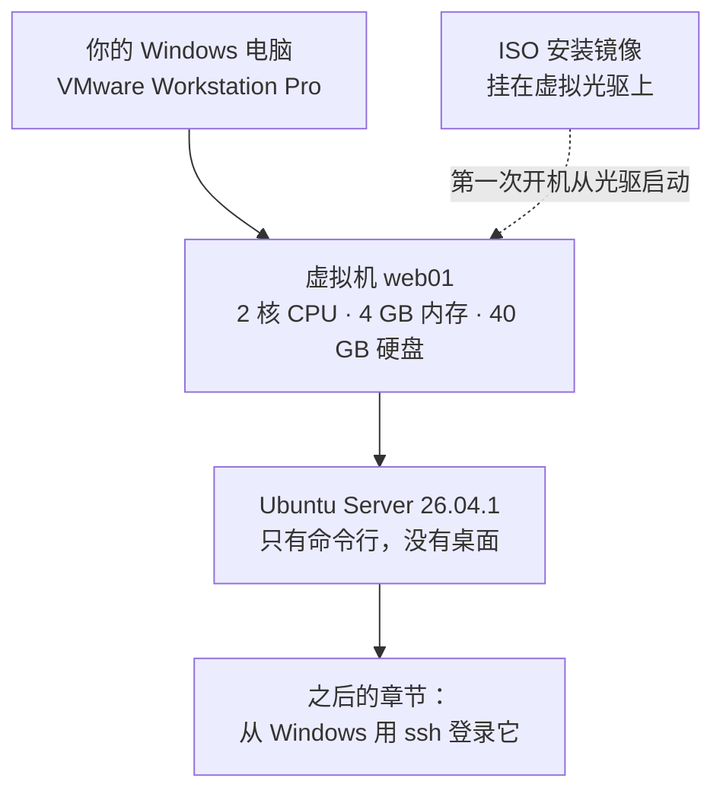

几个词先说清楚：

| 词 | 白话解释 | 在本章里 |
|---|---|---|
| 虚拟机（virtual machine） | 用软件模拟出来的一台电脑，有自己的 CPU、内存、硬盘、网卡，在里面装系统和在真机上一样 | VMware 里的 `web01` |
| 宿主机（host） | 运行虚拟机的那台真电脑 | 你的 Windows 电脑 |
| ISO 安装镜像（ISO image） | 把一张安装光盘做成的一个文件，扩展名 `.iso` | `ubuntu-26.04.1-live-server-amd64.iso` |
| 安装向导 subiquity | Ubuntu Server 的安装程序，全键盘操作、文字界面 | 1-1.6 节逐屏讲 |
| LVM（Logical Volume Manager，逻辑卷管理） | 在硬盘和分区之间加一层"可伸缩的空间池"，以后加硬盘、扩容不用重新分区 | 安装时默认启用 |

**和 Windows Server 的对照**

| 要做的事 | Windows Server | Ubuntu Server |
|---|---|---|
| 安装介质 | Windows Server 的 ISO | Ubuntu Server 的 ISO（`live-server`） |
| 安装界面 | 图形界面，鼠标点"下一步" | 文字界面，只能用键盘 |
| 要选的东西 | 版本（标准版/数据中心版）、"桌面体验"还是 Server Core、分区 | 安装类型、网络、镜像源、磁盘、用户名、要不要装 SSH 服务 |
| 管理员账号 | 装完设置 `Administrator` 的密码 | 不让用 root 直接登录，你建的用户靠 `sudo` 获得管理员权限（第 3-2 章） |
| 远程管理 | 远程桌面（mstsc） | ssh 命令行登录（第 1-2 章） |
| 不装桌面 | Server Core | Ubuntu Server 本来就没有桌面 |

**什么时候不该这样装**：云服务器（阿里云、腾讯云等）不用自己装系统，在控制台选"Ubuntu 26.04"镜像，几分钟就能拿到一台装好的服务器；本章的安装向导你在云上看不到。公司虚拟化平台（ESXi、Hyper-V 集群）上有现成模板的，也优先用模板。

---

## 1-1.2 准备 VMware Workstation Pro

> ⚠ 本节的 Broadcom 网站和 VMware 界面未实机验证，按 Broadcom 官方说明整理。

VMware Workstation Pro 从 2024 年 11 月起对个人和商业使用都免费，不需要许可证密钥（[Broadcom 官方说明](https://knowledge.broadcom.com/external/article?articleNumber=368667)）。当前版本是 26H1。

已经装好的，打开 VMware，菜单 **帮助 → 关于 VMware Workstation**，看到 26H1 就可以跳到 1-1.3。

还没装的：

1. 在浏览器打开 `https://support.broadcom.com`，注册一个免费账号并登录。第一次下载时要填一张贸易合规表（姓名、地址、国家），要填真实信息，否则审核不过，下载按钮是灰的。
2. 在产品下载里找到 **VMware Workstation Pro**，选 26H1 的 Windows 版，下载 `.exe` 安装程序。
3. 双击安装程序，一路默认安装，装完重启电脑。

**电脑开着 WSL2 时**：WSL2 会让 Windows 启动自己的虚拟化层（Hyper-V 平台）。VMware Workstation 检测到以后，会自动改用 Windows 的"虚拟机监控程序平台"（Windows Hypervisor Platform）来运行虚拟机。两者能同时用，虚拟机会稍慢一点，练习完全够用（[Broadcom 说明](https://knowledge.broadcom.com/external/article?legacyId=76918)）。

---

## 1-1.3 下载安装镜像，并检查文件是否完整

### 步骤

1. 在 Windows 上建一个放镜像的文件夹，例如 `D:\iso`。

2. 下载 Ubuntu Server 26.04.1 的安装镜像，两个地址任选一个，文件相同：

   | 来源 | 地址 |
   |---|---|
   | Ubuntu 官方 | `https://releases.ubuntu.com/26.04/ubuntu-26.04.1-live-server-amd64.iso` |
   | 清华大学镜像站（国内快） | `https://mirrors.tuna.tsinghua.edu.cn/ubuntu-releases/26.04/ubuntu-26.04.1-live-server-amd64.iso` |

   文件名里各部分的意思：`26.04.1` 是版本（26.04 的第 1 次维护更新），`live-server` 是服务器版，`amd64` 是 64 位 Intel/AMD 处理器。不要下成 `desktop`（桌面版）。

3. 检查文件大小。打开 PowerShell，进入下载目录：

   ```powershell
   PS C:\Users\zhang> cd D:\iso
   PS D:\iso> (Get-Item .\ubuntu-26.04.1-live-server-amd64.iso).Length
   ```

   实测输出：

   ```text
   2927861760
   ```

   `Get-Item` 取到文件对象，`.Length` 是它的字节数。官方文件是 2,927,861,760 字节（约 2.7 GB），一个字节都不能少。

4. 检查 SHA256 校验值。它是根据文件内容算出来的一串 64 位"指纹"，文件哪怕错了一个字节，算出来也完全不同。官方公布的值在 `https://releases.ubuntu.com/26.04/SHA256SUMS`，26.04.1 服务器版这一行是：

   ```text
   cc8a95cde20f6ced61a322420de00f10cc3c90ced545daa46cb9c1a117f1d927 *ubuntu-26.04.1-live-server-amd64.iso
   ```

   在 PowerShell 里算你下载的文件，并和官方值比较：

   ```powershell
   PS D:\iso> (Get-FileHash .\ubuntu-26.04.1-live-server-amd64.iso -Algorithm SHA256).Hash
   PS D:\iso> (Get-FileHash .\ubuntu-26.04.1-live-server-amd64.iso -Algorithm SHA256).Hash -eq "cc8a95cde20f6ced61a322420de00f10cc3c90ced545daa46cb9c1a117f1d927"
   ```

   | 部分 | 作用 |
   |---|---|
   | `Get-FileHash` | PowerShell 自带的计算文件校验值的命令 |
   | `-Algorithm SHA256` | 用 SHA256 算法，和官方公布的一致 |
   | `( ... ).Hash` | 只取结果里的校验值那一串，不要表格 |
   | `-eq "..."` | 和官方值比较，相同输出 `True`；PowerShell 比较字符串不分大小写 |

   实测输出（文件较大，要算十几秒到一分钟）：

   ```text
   CC8A95CDE20F6CED61A322420DE00F10CC3C90CED545DAA46CB9C1A117F1D927
   True
   ```

   **看到 `True` 就是文件完好。**

### 改坏一处试试：下载不完整的文件

我把镜像只保留前 1,500,000,000 字节（模拟下载到一半断了），再执行同样两条命令：

```text
1500000000
False
```

大小不对，校验结果是 `False`。这种文件拿去安装，会在安装中途报错，错误提示里会写 "The install media checksum verification failed"（安装介质校验失败）。所以**先校验再安装**，省得装到一半才发现。

---

## 1-1.4 在 VMware 里建虚拟机

> ⚠ 本节 VMware 界面未实机验证。菜单名按中文版 VMware Workstation 写，括号里是英文版的名称。

### 为什么选"稍后安装操作系统"

新建虚拟机向导第二步问你安装来源。如果直接选 ISO 文件，VMware 会尝试"简易安装"（Easy Install）：替你回答安装向导里的问题。这样你看不到安装过程，用户名、分区都按它的默认值来，出了问题也不知道是哪一步。所以选**稍后安装操作系统**，建好以后再把 ISO 挂到虚拟光驱上，自己走一遍安装向导。

### 步骤

1. 打开 VMware Workstation，菜单 **文件 → 新建虚拟机**（File → New Virtual Machine）。
2. "欢迎使用新建虚拟机向导"：选 **典型(推荐)**（Typical），点 **下一步**。
3. "安装客户机操作系统"：选 **稍后安装操作系统**（I will install the operating system later），点 **下一步**。
4. "选择客户机操作系统"：
   - 客户机操作系统选 **Linux**；
   - 版本选 **Ubuntu 64 位**（Ubuntu 64-bit）。

   这一项决定 VMware 给虚拟机配哪种虚拟硬件（网卡型号、磁盘控制器），选错了系统也能装，但可能缺驱动。
5. "命名虚拟机"：
   - 虚拟机名称：`web01`；
   - 位置：`D:\VM\web01`。虚拟机的所有文件（虚拟硬盘、配置、快照）都放在这里，选空间够的盘。
6. "指定磁盘容量"：
   - 最大磁盘大小：改成 **40** GB（默认值偏小）；
   - 选 **将虚拟磁盘拆分成多个文件**（Split virtual disk into multiple files）。

   40 GB 是"最大"大小，虚拟硬盘文件按实际用量增长，刚装好只占几 GB。
7. "已准备好创建虚拟机"：先不要点完成，点 **自定义硬件**（Customize Hardware），按下一节改硬件。

### 自定义硬件

在"硬件"窗口里逐项改：

| 左侧项目 | 改成 | 为什么 |
|---|---|---|
| 内存（Memory） | **4096 MB** | 官方要求用 ISO 安装至少 1.5 GB，建议 3 GB 以上（[系统要求](https://ubuntu.com/server/docs/reference/installation/system-requirements/)）；后面章节要跑网站和数据库，给 4 GB |
| 处理器（Processors） | 处理器数量 1，每个处理器的内核数量 **2** | 第 5 部分练进程和负载要用多核 |
| 新 CD/DVD (SATA) | 选 **使用 ISO 映像文件**（Use ISO image file），点"浏览"选 `D:\iso\ubuntu-26.04.1-live-server-amd64.iso`；勾选 **启动时连接**（Connect at power on） | 第一次开机从这张"光盘"启动安装程序 |
| 网络适配器（Network Adapter） | **NAT 模式**（NAT: Used to share the host's IP address） | 见下表 |
| 其他（USB、声卡、打印机） | 不用管 | 服务器用不到 |

网络模式怎么选：

| 模式 | 虚拟机的地址 | 谁能访问它 | 适合 |
|---|---|---|---|
| **NAT 模式**（本书用） | VMware 自己分配的内网地址，例如 `192.168.x.128` | 你这台 Windows 电脑能访问；同事的电脑访问不到 | 练习。家里、公司、笔记本连 Wi-Fi 都能用 |
| 桥接模式（Bridged） | 和你的电脑在同一个局域网，由公司路由器分配 | 局域网里的其他电脑都能访问 | 要让同事访问；公司网络限制接入设备时可能拿不到地址 |

改完点 **关闭**，回到向导点 **完成**。

8. 设置固件为 UEFI：在左侧选中 `web01`，点 **编辑虚拟机设置**（Edit virtual machine settings），切到 **选项**（Options）页，选 **高级**（Advanced），**固件类型**（Firmware type）选 **UEFI**，点 **确定**。

   新的物理服务器基本都是 UEFI 启动，虚拟机和它保持一致，第 7 部分讲分区时看到的布局才一样。如果这里是 BIOS，系统照样能装，区别是分区里没有 `/boot/efi`（见 1-1.6 第 8 屏）。

**看到什么算做对**：左侧列表里有 `web01`，右侧"设备"里显示内存 4 GB、处理器 2、硬盘 40 GB、CD/DVD 指向 Ubuntu 的 ISO、网络适配器 NAT。

---

## 1-1.5 开机，进入安装程序

1. 选中 `web01`，点 **开启此虚拟机**（Power on this virtual machine）。
2. 黑底白字的启动菜单出现，第一项是：

   ```text
   Try or Install Ubuntu Server
   ```

   直接按回车，或者等 30 秒自动进入（这是从镜像里的 `boot/grub/grub.cfg` 读到的：`set timeout=30`）。
3. 屏幕滚过一些启动信息，大约一分钟后出现语言选择界面，安装向导开始。

**键盘和鼠标**：安装向导不能用鼠标，所有操作靠键盘。

| 按键 | 作用 |
|---|---|
| 先在虚拟机窗口里点一下 | 让键盘输入进入虚拟机（或按 `Ctrl+G`） |
| `Ctrl+Alt` | 把键盘鼠标从虚拟机里"放出来"，回到 Windows |
| `↑` `↓` | 在选项之间移动 |
| `Tab` / `Shift+Tab` | 移到下一个 / 上一个可操作的项目 |
| `空格` | 勾选或取消勾选 `[ ]`，选中单选项 `( )` |
| `回车` | 按下当前高亮的按钮，例如 `[ Done ]` |
| `Esc` | 返回上一屏（和 `[ Back ]` 一样） |

当前选中的按钮会变成彩色：`[ Done ]`、`[ Continue ]` 是绿色，危险操作的 `[ Continue ]` 是红色，其他是灰色。

---

## 1-1.6 安装向导逐屏说明

以下截图来自 Ubuntu 26.04.1 镜像里的安装程序（subiquity 26.04.1）本身，在测试环境里用它的演示模式运行，虚拟硬件按 VMware 设置（40 GB 硬盘、网卡 `ens33`）。界面文字、选项、默认值、报错提示都是安装程序实际显示的。你的屏幕比截图大时，内容会居中，周围留白多一些。

### 第 1 屏 选择语言

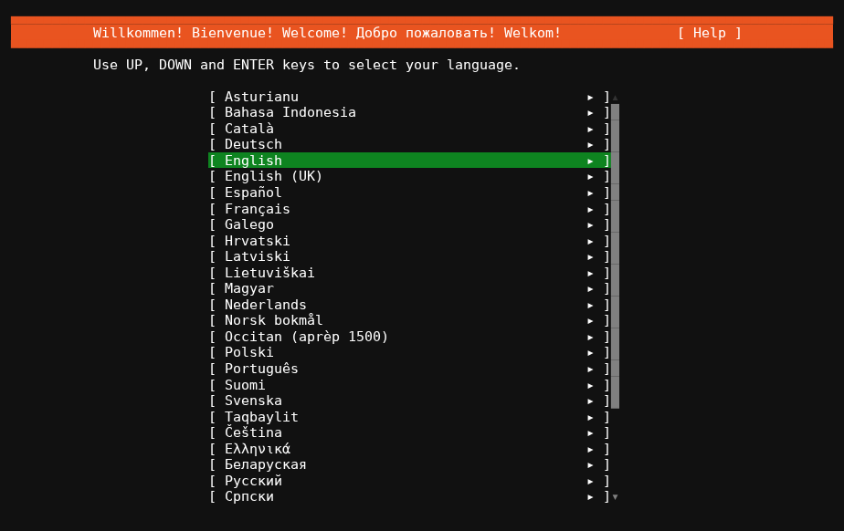

- 默认高亮的就是 **English**，直接按回车。
- 列表里**没有中文**。这是控制台的限制：服务器的文字控制台显示不了汉字，安装程序只列出控制台能显示的语言。服务器上用英文界面是常态，出错信息拿去搜索也更容易找到答案。

### 第 2 屏 键盘布局

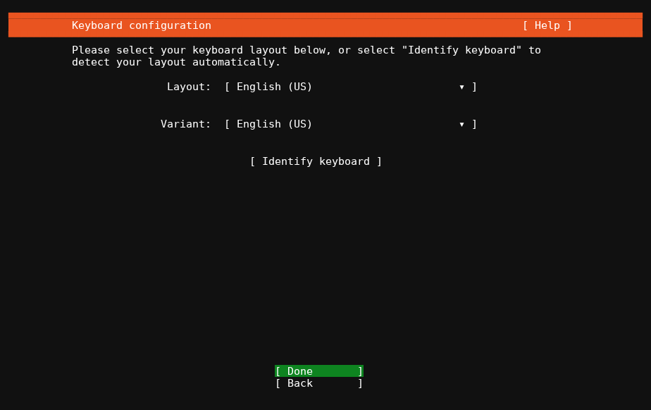

- Layout 和 Variant 都是 **English (US)**，中国大陆用的就是美式键盘布局，保持默认。
- 焦点默认在 `[ Done ]` 上，按回车。

> 这一屏前后可能多出一屏 **Installer update available**（安装程序有新版本）。选 **Continue without updating**（不更新，继续）。镜像自带的安装程序已经能正常安装，联网更新安装程序会多花时间，网络不好时还可能卡住。

### 第 3 屏 安装类型

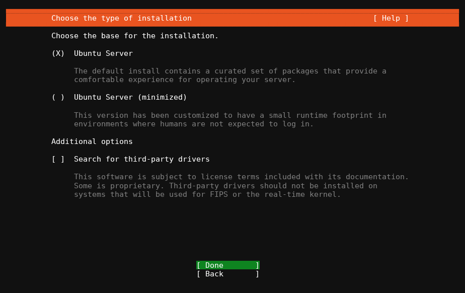

| 选项 | 说明 | 选不选 |
|---|---|---|
| **(X) Ubuntu Server** | 默认安装，带常用管理工具 | **选这个（默认）** |
| ( ) Ubuntu Server (minimized) | 最小安装，说明里写着"用于不需要人登录的环境"，很多常用命令要自己装 | 不选 |
| [ ] Search for third-party drivers | 搜索第三方驱动（显卡等） | 不勾，虚拟机用不到 |

焦点在 `[ Done ]`，按回车。

### 第 4 屏 网络

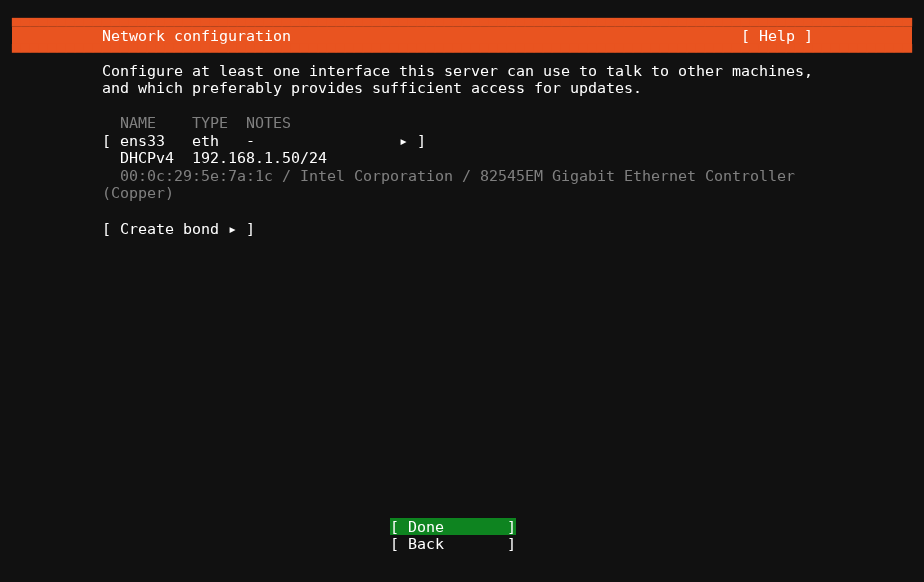

- `ens33` 是虚拟网卡的名字（VMware 的网卡在 Ubuntu 里通常叫这个）。
- 下面一行 `DHCPv4  192.168.1.50/24` 表示网卡已经通过 DHCP（自动分配地址）拿到了地址。**把这个地址记下来**，第 1-2 章从 Windows 登录服务器要用。
  - 截图里是本书统一的示例地址 `192.168.1.50`；你在 NAT 模式下看到的会是 VMware 分配的地址，例如 `192.168.80.128`，以你屏幕上的为准。
- 这里先用自动分配，第 6-1 章再改成固定 IP。

**看到什么算做对**：网卡下面有 `DHCPv4` 和一个地址。如果显示 `disabled` 或者没有地址，说明虚拟机没联网：按 `Ctrl+Alt` 回到 Windows，检查虚拟机设置里网络适配器是否勾选"已连接"、是不是 NAT 模式。没网也能装，只是不会下载更新。

焦点移到 `[ Done ]`，按回车。

### 第 5 屏 代理

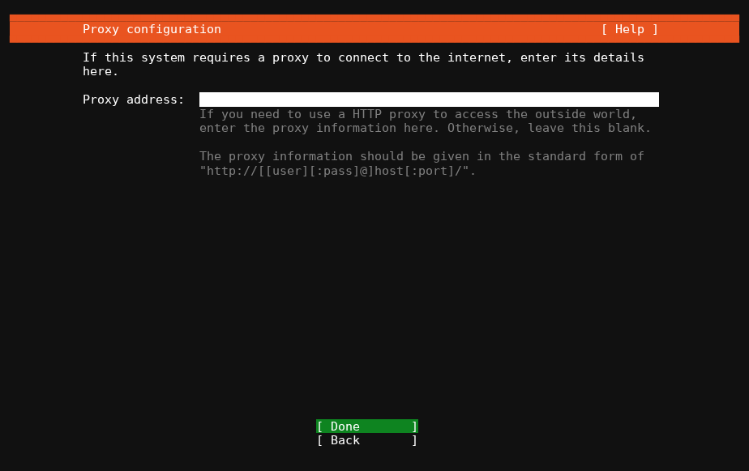

Proxy address 留空，直接 `[ Done ]`。只有公司规定上网必须经过代理服务器时才填，格式是 `http://代理地址:端口/`。

### 第 6 屏 镜像源

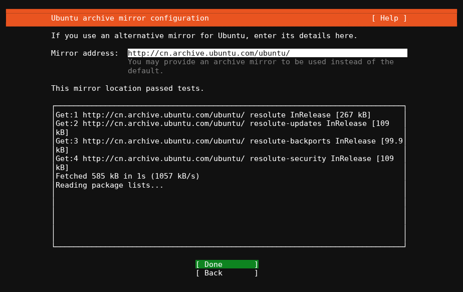

- 镜像源（mirror）是下载软件包的服务器。安装程序会根据你的 IP 判断所在国家，自动填中国的官方镜像 `http://cn.archive.ubuntu.com/ubuntu/`，然后测试能不能连上。
- 看到 **This mirror location passed tests.**（这个镜像地址通过了测试）就可以 `[ Done ]`。
- 如果测试很慢或失败，把地址改成国内大学的镜像，例如 `http://mirrors.tuna.tsinghua.edu.cn/ubuntu/`：用 `↑` 移到地址框，删掉原来的地址重新输入，等测试通过。
- 这里填的地址会写进装好的系统，以后 `apt` 装软件也用它（第 3-4 章讲怎么改）。

### 第 7 屏 磁盘：选择方案

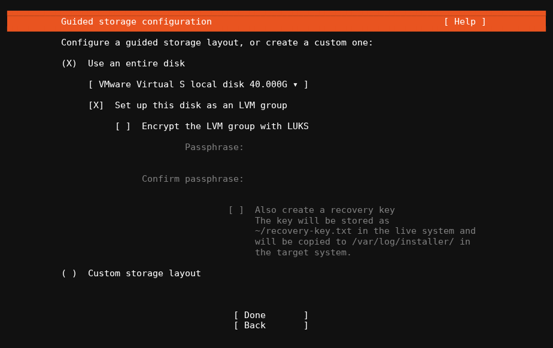

| 选项 | 说明 | 选不选 |
|---|---|---|
| **(X) Use an entire disk** | 使用整块硬盘，下面列出了 VMware 的 40 GB 虚拟硬盘 | **选（默认）** |
| **[X] Set up this disk as an LVM group** | 把硬盘设成 LVM 卷组 | **保持勾选（默认）** |
| [ ] Encrypt the LVM group with LUKS | 整盘加密，每次开机要输入密码 | 不勾。服务器重启后没人输密码就进不了系统 |
| ( ) Custom storage layout | 自己手动分区 | 不选 |

为什么要 LVM：以后硬盘不够用，可以加一块硬盘并入卷组，或者把虚拟硬盘调大，然后在线扩容，不用重新分区、不用停网站（第 7-4、7-5 章）。

按 `Tab` 移到 `[ Done ]`（大约按 5 次，`[ Done ]` 变绿），按回车。

### 第 8 屏 磁盘：确认分区摘要

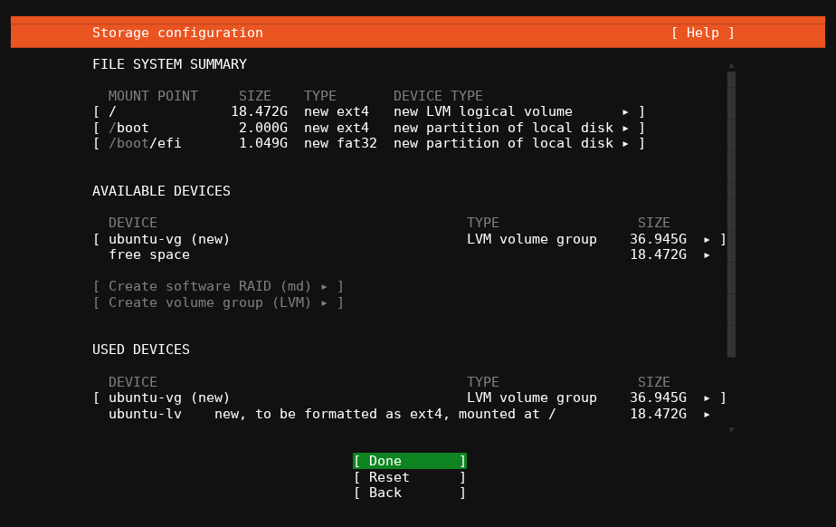

上半部分 FILE SYSTEM SUMMARY 是装好后的分区：

| 挂载点 | 大小 | 是什么 | Windows 里对应 |
|---|---|---|---|
| `/` | 18.472G | 根目录，系统和你的所有文件都在这里，在 LVM 逻辑卷 `ubuntu-lv` 上 | C 盘 |
| `/boot` | 2.000G | 放 Linux 内核和启动文件 | 无（Windows 放在系统分区里） |
| `/boot/efi` | 1.049G | UEFI 启动分区 | EFI 系统分区（100 MB 那个隐藏分区） |

**注意中间这两行：**

```text
[ ubuntu-vg (new)                             LVM volume group    36.945G  ▸ ]
  free space                                                      18.472G  ▸
```

卷组 `ubuntu-vg` 有 36.945G，根目录只用了 18.472G，**还有 18.472G 空着没分配**。这是安装程序的默认做法：根目录只分一部分，剩下的留着以后按需要分配。很多人装完发现 40 GB 的硬盘 `/` 只有 18 G 多，以为装错了，其实没错，第 7-4 章用一条命令就能把剩下的空间加给 `/`。

> 固件是 BIOS 时这一屏不同：没有 `/boot/efi`，`/` 是 18.996G（同样 40 GB 硬盘实测）。

确认无误，焦点移到 `[ Done ]`，按回车。

### 第 9 屏 确认格式化

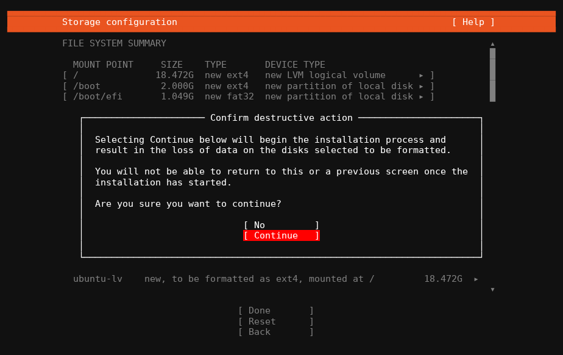

提示的意思：选 Continue 就开始安装，选中要格式化的硬盘上的数据会全部丢失，安装开始后不能再回到前面的屏幕。

新建的虚拟硬盘是空的，放心选 **[ Continue ]**（红色）回车。**在物理服务器上，这里一定要确认选中的是哪块盘。**

从这一刻起，安装程序在后台开始分区、复制文件，同时你继续填后面几屏。

### 第 10 屏 用户名和主机名

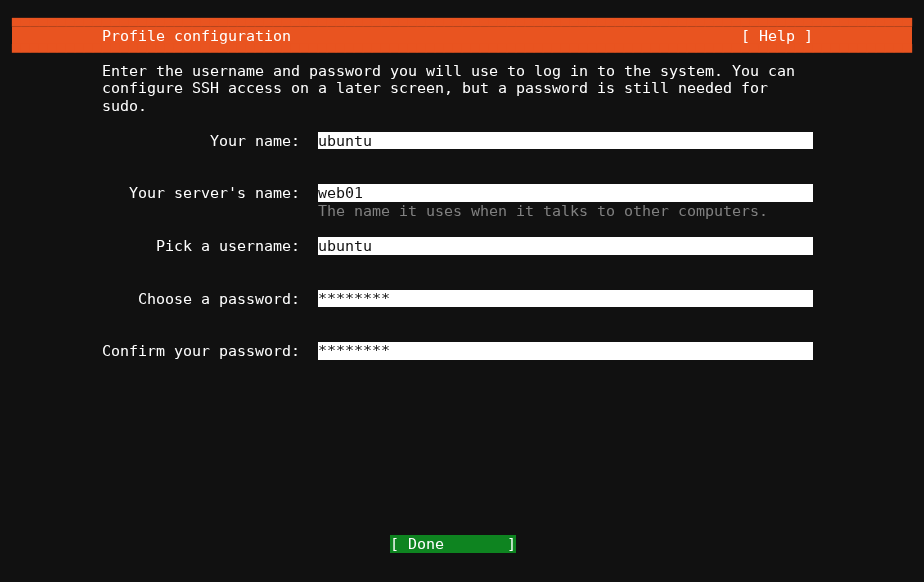

| 字段 | 填 | 说明 |
|---|---|---|
| Your name | `ubuntu` | 显示用的名字，可以随便填 |
| Your server's name | `web01` | 主机名，以后登录提示符里显示 `ubuntu@web01` |
| Pick a username | `ubuntu` | 登录用户名 |
| Choose a password | 自己定 | 输入时显示 `*` |
| Confirm your password | 再输一遍 | 两次必须相同 |

用 `Tab` 在字段之间移动。填完 `Tab` 到 `[ Done ]` 回车。

规则（从安装程序源码 `subiquity/ui/views/identity.py` 核实）：

| 字段 | 允许的写法 | 违反时 |
|---|---|---|
| 用户名 | 小写字母或 `_` 开头，后面是小写字母、数字、`_`、`-`，最长 32 个字符 | **大写字母根本输不进去**：输入 `Zhang`，框里只出现 `hang` |
| 用户名 | 不能用系统保留的名字，如 `root`、`admin`、`sudo`、`www-data` | 提示 `The username "admin" is reserved for use by the system.`，`[ Done ]` 按不下去 |
| 主机名 | 小写字母、数字、`-`（安装程序也接受 `_`，但 `_` 不符合网络主机名规范，不要用） | — |
| 密码 | 两次一致 | 提示 `Passwords do not match` |

**改坏一处试试**：用户名填 `admin`，第二次密码故意输错，界面是这样的：

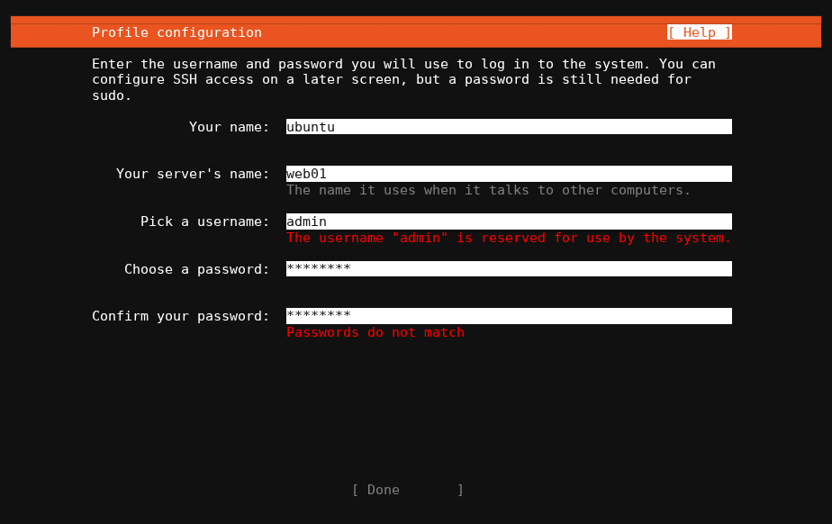

两行红色提示分别说明了原因。改成 `ubuntu`、把密码重新输对，提示消失，`[ Done ]` 才能按下。

> Windows 习惯用 `admin`、`Administrator` 当管理员账号名，这里不行。Ubuntu 里管理员权限不靠账号名，靠 `sudo`：安装时建的这个用户自动有 `sudo` 权限。

### 第 11 屏 Ubuntu Pro

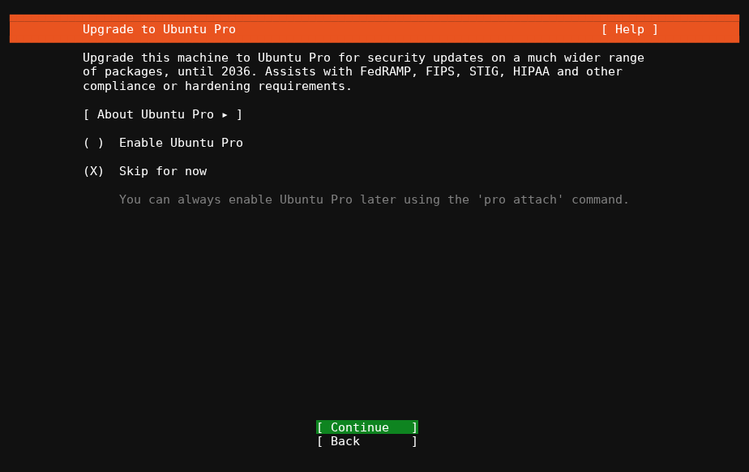

Ubuntu Pro 是 Canonical 的订阅服务，把安全更新扩展到更多软件包、支持期延长到 2036 年。26.04 LTS 本身的标准支持到 2031 年，练习用不到 Pro。

保持 **(X) Skip for now**（暂时跳过），`[ Continue ]` 回车。以后想开可以用 `pro attach` 命令。

### 第 12 屏 SSH（最重要的一屏）

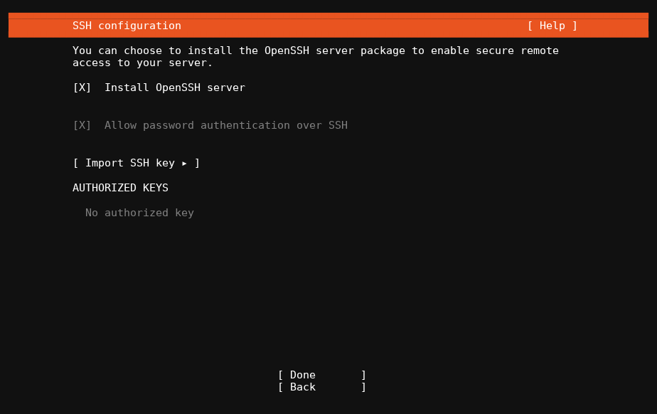

**`[ ] Install OpenSSH server` 默认没有勾选**，一定要按空格勾上，变成 `[X]`。

- OpenSSH server 是让你从 Windows 远程登录服务器的服务，作用相当于 Windows Server 的远程桌面服务。不装的话，第 1-2 章 ssh 登录会被拒绝，只能在 VMware 窗口里操作。
- `[X] Allow password authentication over SSH`（允许用密码通过 SSH 登录）保持勾选。第 1-3 章配好密钥登录后再关掉它。
- `Import SSH key` 不用管。

勾好后 `Tab` 到 `[ Done ]` 回车。

### 第 13 屏 推荐软件

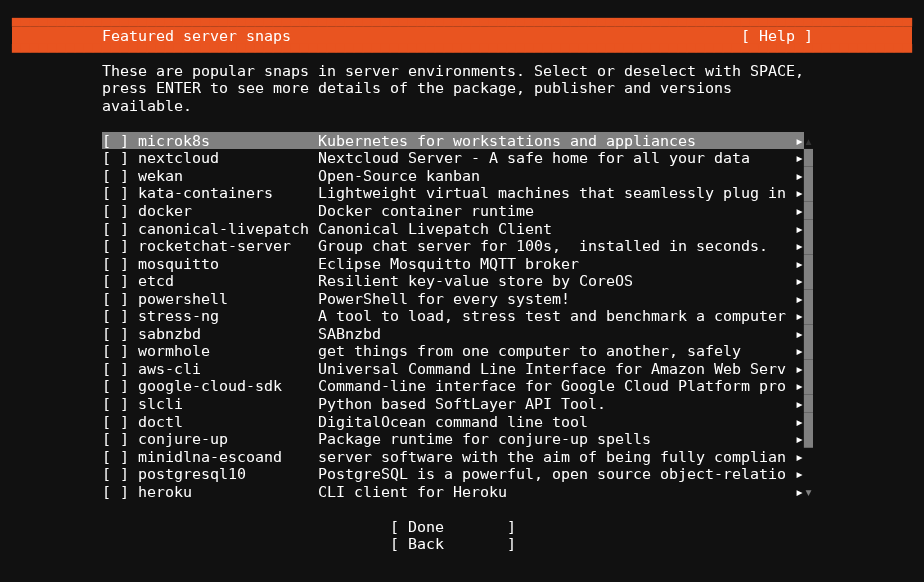

这里列出一些可以顺带装的软件（snap 软件包），例如 docker、microk8s。**一个都不勾**，直接 `Tab` 到 `[ Done ]` 回车。要用的软件以后用 `apt` 装，版本和来源更清楚（第 3-4 章）。

> 截图里的列表来自安装程序自带的示例数据；真实安装时列表从网上获取，内容会略有不同，没联网时这一屏可能是空的。

---

## 1-1.7 等待安装完成，重启

> ⚠ 本节的进度界面和重启过程未实机验证（测试环境里显示不了进度），标题文字从安装程序源码核实。

填完最后一屏，界面标题依次变化：

| 标题 | 在做什么 | 可能慢的原因 |
|---|---|---|
| Installing system | 分区、格式化、复制系统文件 | 宿主机硬盘慢 |
| Updating system | 联网下载并安装安全更新 | **网速慢或镜像源太远，最常见的"好像卡住了"** |
| Installation complete! | 装完了，出现 `[ Reboot Now ]` | — |
| An error occurred during installation | 出错了 | 看错误报告；最常见的原因是镜像文件损坏 |

**怎么判断是不是卡住了**：选 `[ View full log ]` 查看完整日志，看最后几行还在不在变。还在变就是在干活。停在 Updating system 很久、日志不动，多半是网络问题；可以先等，或者下次安装时在第 6 屏换国内镜像源。

装完以后：

1. 选 **[ Reboot Now ]** 回车。
2. 屏幕提示：

   ```text
   Please remove the installation medium, then press ENTER:
   ```

   意思是"请取出安装介质，然后按回车"。虚拟机里的做法：按 `Ctrl+Alt` 回到 Windows，**虚拟机 → 设置 → CD/DVD (SATA)**，取消勾选 **已连接** 和 **启动时连接**，点确定；再点回虚拟机窗口，按回车。

   不取出也大多能正常从硬盘启动，但如果下次开机又进了安装程序，就是光驱还在优先启动，按这一步取出即可。

---

## 1-1.8 第一次登录，确认装好了

> ⚠ 登录界面和 `ip`、`lsblk`、`df` 的输出未实机验证（测试环境不是真正开机的系统），按装好的系统文件和本章的分区方案给出；`cat /etc/os-release`、`lsb_release -a` 的输出是在 26.04.1 镜像的系统文件里实测的。

1. 重启后屏幕最后出现：

   ```text
   Ubuntu 26.04.1 LTS web01 tty1

   web01 login:
   ```

   第一行来自系统文件 `/etc/issue`（内容是 `Ubuntu 26.04.1 LTS \n \l`，`\n` 换成主机名，`\l` 换成终端名 `tty1`）。

   > 登录提示出现后，有时还会冒出几行 `cloud-init` 的信息，把提示冲上去。这是第一次开机的初始化输出，不是错误，直接按回车就能重新看到 `web01 login:`。

2. 输入用户名 `ubuntu` 回车，再输入密码回车。**输密码时屏幕上什么都不显示**，连 `*` 都没有，这是正常的，输完回车即可。

3. 登录成功后看到欢迎信息，第一行类似：

   ```text
   Welcome to Ubuntu 26.04.1 LTS (GNU/Linux 7.0.0-30-generic x86_64)
   ```

   `7.0.0-30-generic` 是 26.04.1 镜像自带的内核版本（镜像清单 `linux-image-7.0.0-30-generic 7.0.0-30.30`）。装的过程中如果下载了更新，这个数字会更大。最后一行是提示符：

   ```text
   ubuntu@web01:~$
   ```

   | 部分 | 意思 |
   |---|---|
   | `ubuntu` | 当前用户 |
   | `web01` | 主机名 |
   | `~` | 当前所在目录，`~` 表示你的家目录 `/home/ubuntu` |
   | `$` | 普通用户；管理员 root 的提示符是 `#` |

4. 逐条执行下面的命令，确认安装结果。

   **系统版本**

   ```bash
   ubuntu@web01:~$ cat /etc/os-release
   ```

   实测输出：

   ```text
   PRETTY_NAME="Ubuntu 26.04.1 LTS"
   NAME="Ubuntu"
   VERSION_ID="26.04"
   VERSION="26.04.1 LTS (Resolute Raccoon)"
   VERSION_CODENAME=resolute
   ID=ubuntu
   ID_LIKE=debian
   HOME_URL="https://www.ubuntu.com/"
   SUPPORT_URL="https://help.ubuntu.com/"
   BUG_REPORT_URL="https://bugs.launchpad.net/ubuntu/"
   PRIVACY_POLICY_URL="https://www.ubuntu.com/legal/terms-and-policies/privacy-policy"
   UBUNTU_CODENAME=resolute
   LOGO=ubuntu-logo
   ```

   `cat` 把文件内容显示出来，`/etc/os-release` 是记录系统版本的文件。看到 `26.04.1 LTS` 就对了。`resolute` 是 26.04 的代号，以后配置软件源时会用到。

   另一个查版本的命令：

   ```bash
   ubuntu@web01:~$ lsb_release -a
   ```

   实测输出：

   ```text
   Distributor ID:	Ubuntu
   Description:	Ubuntu 26.04.1 LTS
   Release:	26.04
   Codename:	resolute
   ```

   **主机名**

   ```bash
   ubuntu@web01:~$ hostname
   web01
   ```

   **IP 地址**

   ```bash
   ubuntu@web01:~$ ip -br addr
   ```

   `ip addr` 显示网卡地址，`-br`（brief）只显示简表，一个网卡一行。应该看到类似：

   ```text
   lo               UNKNOWN        127.0.0.1/8 ::1/128
   ens33            UP             192.168.1.50/24 fe80::20c:29ff:fe5e:7a1c/64
   ```

   `lo` 是本机回环网卡，每台机器都有；`ens33` 那一行的 `192.168.1.50` 应该和安装时第 4 屏记下的地址一样，状态是 `UP`。

   **磁盘和分区**

   ```bash
   ubuntu@web01:~$ lsblk
   ```

   `lsblk`（list block devices）列出硬盘和分区的树形结构。应该看到 `sda` 约 40G，下面三个分区，最大的那个分区下面挂着 `ubuntu--vg-ubuntu--lv`，挂载点 `/`。

   ```bash
   ubuntu@web01:~$ df -h /
   ```

   `df` 显示文件系统用量，`-h` 用 G、M 这样的单位，`/` 只看根目录。`Size` 一列大约 18G，这就是第 8 屏看到的 18.472G（`df` 按 1024 进位、并扣掉文件系统自身的开销，所以数字略小）。

5. 关机：

   ```bash
   ubuntu@web01:~$ sudo poweroff
   ```

   `sudo` 表示用管理员权限执行后面的命令，第一次用会要你输入自己的密码（安装时设的那个）。`poweroff` 是关机。等 VMware 显示"已关闭电源"。

---

## 1-1.9 拍一个快照

快照（snapshot）记录虚拟机此刻的完整状态。以后练习时把系统改坏了（第 9-2 章还会故意弄坏），可以一键恢复到这里，不用重装。

1. 虚拟机关机状态下，菜单 **虚拟机 → 快照 → 拍摄快照**（VM → Snapshot → Take Snapshot）。
2. 名称填 `01-刚装好`，描述可以写"Ubuntu 26.04.1，用户 ubuntu，已装 OpenSSH"，点 **拍摄快照**。
3. 以后要恢复：**虚拟机 → 快照 → 快照管理器**（Snapshot Manager），选中 `01-刚装好`，点 **转到**（Go To）。

> ⚠ 本节 VMware 界面未实机验证。关机后拍快照只保存硬盘，文件小、恢复快；开机时也能拍，会连内存一起保存。

**和 Windows Server 对照**：作用相当于 Hyper-V 的"检查点"。快照和备份是两回事：快照文件和虚拟机放在一起，宿主机硬盘坏了快照也没了。正式服务器的备份见第 9-1 章。

---

## 🧱 类比

装服务器像装修一间空房子：ISO 是装修队带来的材料和图纸，安装向导是装修队上门时问你的一串问题（用什么语言、水电怎么走、房间怎么隔），LVM 是可以移动的隔墙，以后房间不够大就把墙往外挪；快照是装修完拍的全景照，只不过这张照片能把房子"恢复"成拍照时的样子。

安装各环节和 Windows Server 的对照：

| 环节 | Windows Server | Ubuntu Server 26.04 |
|---|---|---|
| 启动安装 | 从 ISO 启动，"Windows 安装程序" | 从 ISO 启动，"Try or Install Ubuntu Server" |
| 选版本 | 标准版 / 数据中心版，有无桌面体验 | Ubuntu Server / minimized |
| 联网 | 装完在"网络和共享中心"设置 | 安装向导里就能看到网卡和地址 |
| 分区 | 自动建恢复分区、EFI 分区、MSR、C 盘 | 自动建 `/boot/efi`、`/boot`、LVM 上的 `/` |
| 补丁 | 装完跑 Windows 更新 | 安装时自动下载安全更新（Updating system） |
| 管理员 | `Administrator` + 密码 | 你建的用户 + `sudo` |
| 远程管理 | 启用远程桌面 | 勾选 Install OpenSSH server |
| 虚拟机工具 | 装 VMware Tools | 系统已自带 `open-vm-tools`（26.04.1 镜像清单里有 `open-vm-tools 2:13.0.10-1ubuntu1`），不用另装 |

---

## ⚠️ 踩坑警告

| 现象 | 原因 | 怎么改 |
|---|---|---|
| 装完 ssh 登录被拒绝（第 1-2 章会遇到），提示 `Connection refused` | 第 12 屏没勾 `Install OpenSSH server`，它默认是不勾的 | 在 VMware 窗口里登录，执行 `sudo apt install openssh-server`；或者恢复快照前重装时记得勾上 |
| 40 GB 硬盘，`df -h /` 只有 18G 左右 | 安装程序默认只把 LVM 卷组的一半分给 `/`（实测 36.945G 卷组，`/` 18.472G，空闲 18.472G） | 不是装错，第 7-4 章用 `lvextend` 把空闲空间加给 `/` |
| 用户名框里大写字母输不进去；填 `admin` 提示 reserved，`[ Done ]` 按不下 | 用户名只允许小写字母开头的小写字母、数字、`_`、`-`；`admin`、`root` 等是系统保留名 | 用 `ubuntu` 或自己名字的小写拼音 |
| 安装停在 Updating system 很久 | 正在联网下载安全更新，网速慢或镜像源远 | `[ View full log ]` 看日志是否还在滚动；下次在第 6 屏换国内镜像源 |
| 安装中途报错，提示 install media checksum verification failed | ISO 文件下载不完整或损坏 | 回到 1-1.3 用 `Get-FileHash` 校验，不是 `True` 就重新下载 |
| 重启后又进了安装程序 | 虚拟光驱还连着 ISO，并且优先从光驱启动 | 虚拟机设置里 CD/DVD 取消"已连接""启动时连接"，再重启 |
| 选了 ISO 后 VMware 自动装完，没看到安装向导 | 新建向导第 2 步选了 ISO，触发了"简易安装" | 新建时选"稍后安装操作系统"，再在硬件里挂 ISO |

---

## 🎯 动手练习

### 练习 1：做一张服务器登记表

不看本章内容，只用服务器上的命令，填出下面这张表：

| 项 | 值 |
|---|---|
| 系统版本 | |
| 主机名 | |
| 当前登录用户 | |
| `ens33` 的 IP 地址 | |
| `/` 的总大小 | |

**验收标准**：每一项都是你从命令输出里抄下来的，并且写出了用的是哪条命令；IP 地址和安装时第 4 屏看到的一致。"当前登录用户"本章没讲过命令，试试 `whoami`。

### 练习 2：确认卷组里还有空闲空间

本章说卷组里还有约 18 G 没分配。用命令亲眼看到它。

**验收标准**：执行一条命令（提示：LVM 的卷组叫 volume group，查看卷组的命令是这三个字母的缩写，要加 `sudo`），输出里能看到卷组 `ubuntu-vg`，并指出哪一列是空闲空间、大约多少。

卡住了看文末参考答案。

---

## 📌 一句话总结

先校验 ISO，再选稍后安装，记得勾 OpenSSH，装完拍快照。

## 下一章

[第 1-2 章 装好后先做的几件事](02-装好后先做的几件事.md)：从 Windows 用 ssh 登录这台服务器，更新系统，设置时区，检查时间同步。

---

<!-- 以下是参考答案，先自己动手，卡住了再往下翻 -->


## 参考答案

> ⚠ 本节命令输出未实机验证（取决于你的虚拟机），给出的是本章配置下应该看到的内容。

### 练习 1

| 项 | 命令 | 本章配置下的值 |
|---|---|---|
| 系统版本 | `cat /etc/os-release` 或 `lsb_release -a` | Ubuntu 26.04.1 LTS |
| 主机名 | `hostname` | web01 |
| 当前登录用户 | `whoami` | ubuntu |
| `ens33` 的 IP 地址 | `ip -br addr` | 你安装时第 4 屏记下的地址（本书示例 192.168.1.50） |
| `/` 的总大小 | `df -h /` | `Size` 列，约 18G |

```bash
ubuntu@web01:~$ whoami
ubuntu
```

思路：提示符 `ubuntu@web01` 其实已经告诉了你用户和主机名，`whoami`、`hostname` 是确认它的命令；以后写脚本时要用命令取值，不能靠眼睛看提示符。

### 练习 2

```bash
ubuntu@web01:~$ sudo vgs
```

`vgs` 是 volume group show 的意思，列出所有卷组。应该看到类似：

```text
  VG        #PV #LV #SN Attr   VSize   VFree
  ubuntu-vg   1   1   0 wz--n- <36.95g <18.48g
```

`VSize` 是卷组总大小（约 36.95g，对应安装界面的 36.945G），`VFree` 是还没分配的空间（约 18.48g，对应安装界面的 free space 18.472G）。要加 `sudo` 是因为读取磁盘的 LVM 信息需要管理员权限，不加会提示权限不足。

思路：安装界面第 8 屏的 AVAILABLE DEVICES 里 `ubuntu-vg` 和 `free space` 两行，就是 `vgs` 输出里的 `VSize` 和 `VFree`；第 7-4 章会用 `lvextend` 把 `VFree` 加到 `/` 上。
