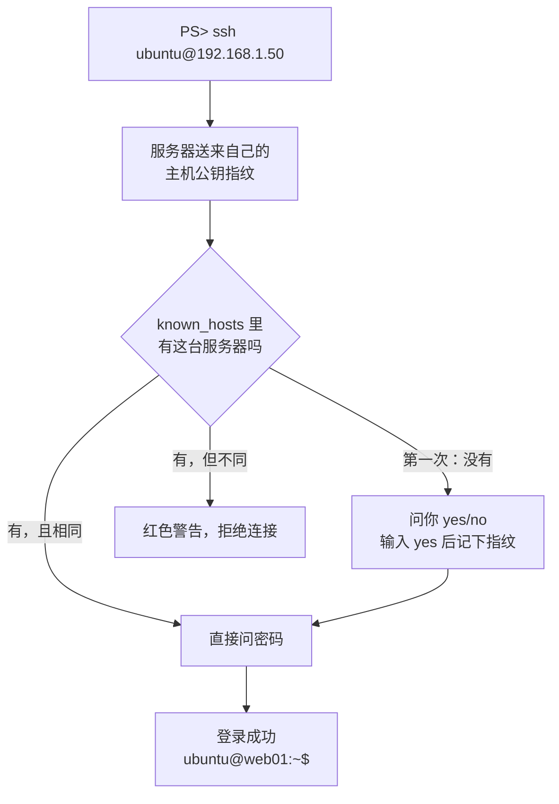

# 第 1-2 章 装好后先做的几件事

## 这一章解决什么问题

服务器装好了，但你一直在 VMware 的小黑窗口里操作：不能复制粘贴，字也小。系统里还有一百多个软件包等着打补丁，时区是伦敦时间（UTC），日志里的时间比北京时间晚 8 小时。这一章从 Windows 用 ssh 登录服务器，打完补丁、重启，把时区改成北京时间，确认时间同步在工作，最后拍一个快照。以后每装一台新服务器，都照这个顺序做一遍。

## 开始之前

- 上一章你已经会了：在 VMware 里装好 Ubuntu Server 26.04.1，记下了服务器 IP，拍了快照 `01-刚装好`。
- 需要的环境：
  - 虚拟机 `web01` 开着机（在 VMware 里点"开启此虚拟机"，等出现 `web01 login:`，不用在这里登录）；
  - Windows 上打开 PowerShell（开始菜单搜 PowerShell，或按 `Win + X` 选"终端"）。
- 本章的新概念有三个：**ssh 主机指纹**（known_hosts）、**apt 的"更新列表 → 升级"两步**、**chrony 时间同步**。

每一步都写明在哪里执行：

| 提示符 | 在哪里 |
|---|---|
| `PS C:\Users\zhang>` | 你的 Windows 电脑，PowerShell 窗口 |
| `ubuntu@web01:~$` | 已经用 ssh 登录的服务器 |

---

## 1-2.1 从 Windows 用 ssh 登录

### ssh 是什么

ssh（Secure Shell，安全外壳）是远程登录服务器的标准方式：你在 Windows 上敲命令，命令通过加密连接送到服务器执行，结果送回来显示。服务器上要运行 ssh 服务（上一章勾选的 OpenSSH server），Windows 10/11 自带 ssh 客户端，不用另外装软件。

| 要做的事 | Windows Server | Ubuntu Server |
|---|---|---|
| 远程管理 | 远程桌面 `mstsc`，看到整个桌面 | `ssh`，只有命令行窗口 |
| 服务器端 | 远程桌面服务，端口 3389 | OpenSSH 服务 `sshd`，端口 22 |
| 第一次连接 | 弹出"无法验证远程计算机的身份……证书" | 提示"无法确认主机的真实性……指纹"，要你输入 `yes` |

**什么时候不用 ssh**：服务器连不上网络、ssh 服务没起来、或者你把防火墙配错把自己挡在外面时，只能回到 VMware 窗口（物理机就是接显示器键盘，云服务器是控制台里的"VNC 登录"）操作。

### 第一次连接时发生了什么



主机指纹（host key fingerprint）是服务器身份的"指纹"，装系统时随机生成，每台服务器都不一样。Windows 第一次连接时把它记在 `C:\Users\zhang\.ssh\known_hosts` 文件里，以后每次连接都核对。如果哪天指纹变了，说明要么服务器重装了，要么有人冒充这台服务器，ssh 会拒绝连接（见 1-2.2）。

### 步骤

1. 在 PowerShell 里执行（`192.168.1.50` 换成你上一章记下的地址）：

   ```powershell
   PS C:\Users\zhang> ssh ubuntu@192.168.1.50
   ```

   `ubuntu@` 是用哪个用户登录，`@` 后面是服务器地址。不写用户名的话，ssh 会用你 Windows 的用户名 `zhang` 去登录，服务器上没有这个用户，会一直提示密码错误。

2. 第一次连接，实测输出：

   ```text
   The authenticity of host '192.168.1.50 (192.168.1.50)' can't be established.
   ED25519 key fingerprint is: SHA256:ZZ03peLqM5wV7se8PL4BhKzGsdsec5ZIAE31R6D6S/Q
   This key is not known by any other names.
   Are you sure you want to continue connecting (yes/no/[fingerprint])?
   ```

   意思是：无法确认这台主机的真实性，它的 ED25519 密钥指纹是 `SHA256:ZZ03…`，你确定要继续连接吗？

   **你的指纹和这里不一样**，每台服务器都不同。

3. （建议做一次）核对指纹。在 VMware 窗口里登录服务器，执行：

   ```bash
   ubuntu@web01:~$ ssh-keygen -lf /etc/ssh/ssh_host_ed25519_key.pub
   ```

   实测输出：

   ```text
   256 SHA256:ZZ03peLqM5wV7se8PL4BhKzGsdsec5ZIAE31R6D6S/Q root@web01 (ED25519)
   ```

   | 部分 | 作用 |
   |---|---|
   | `ssh-keygen` | 管理 ssh 密钥的工具 |
   | `-l` | 显示指纹（list） |
   | `-f 文件` | 指定要看的密钥文件 |
   | `/etc/ssh/ssh_host_ed25519_key.pub` | 服务器的 ED25519 主机公钥 |

   `SHA256:` 后面那串和 PowerShell 里显示的一致，就说明你连的确实是这台服务器。在公司内网自己装的虚拟机上可以省掉这一步；连别人交给你的服务器、云服务器时，最好先从控制台核对一次。

4. 回到 PowerShell，输入 `yes` 回车（只按 `y` 不行，必须是完整的 `yes`）：

   ```text
   Warning: Permanently added '192.168.1.50' (ED25519) to the list of known hosts.
   ubuntu@192.168.1.50's password:
   ```

   第一行表示指纹已经永久记进 known_hosts。第二行要你输入 `ubuntu` 用户的密码。**输密码时屏幕上什么都不显示**，输完回车。

5. 登录成功后看到欢迎信息，最后是提示符：

   ```text
   Welcome to Ubuntu 26.04.1 LTS (GNU/Linux 7.0.0-30-generic x86_64)

    * Documentation:  https://docs.ubuntu.com
    * Management:     https://landscape.canonical.com
    * Support:        https://ubuntu.com/pro

   Expanded Security Maintenance for Applications is not enabled.

   191 updates can be applied immediately.
   140 of these updates are standard security updates.
   To see these additional updates run: apt list --upgradable

   Enable ESM Apps to receive additional future security updates.
   See https://ubuntu.com/esm or run: sudo pro status

   ubuntu@web01:~$
   ```

   > 说明：这段欢迎信息里，前后两部分和"Expanded Security Maintenance……"是实测的；第一行的内核版本是你虚拟机的内核（测试环境显示的是测试机自己的内核，这里换成了 26.04.1 镜像自带的 `7.0.0-30-generic`）；"191 updates……140 of these……"两行的数字来自 1-2.3 节 `apt` 实测的结果（2026-11-28），你看到的数字取决于你装系统的日期。

   欢迎信息里要看的是中间那段：**有 191 个更新可以装，其中 140 个是安全更新**。下一节就装它们。ESM Apps 是 Ubuntu Pro 的付费内容，不用管。

6. 试几条命令，确认是在服务器上：

   ```bash
   ubuntu@web01:~$ hostname
   web01
   ```

   现在可以在 PowerShell 窗口里用鼠标选中文字复制，右键粘贴，比 VMware 窗口方便得多。

7. 退出登录：

   ```bash
   ubuntu@web01:~$ exit
   ```

   实测输出：

   ```text
   logout
   Connection to 192.168.1.50 closed.
   ```

   回到了 `PS C:\Users\zhang>`。

8. 再登录一次，这次不会再问 yes/no，直接问密码：

   ```powershell
   PS C:\Users\zhang> ssh ubuntu@192.168.1.50
   ```

   ```text
   ubuntu@192.168.1.50's password:
   ```

   以后每次登录都是这样。第 1-3 章配好密钥后，连密码也不用输了。

### 不登录，只执行一条命令

在 ssh 命令后面直接写命令，执行完马上回到 Windows：

```powershell
PS C:\Users\zhang> ssh ubuntu@192.168.1.50 uptime
```

实测输出：

```text
ubuntu@192.168.1.50's password:
 12:15:13 up 19 min,  0 users,  load average: 0.20, 0.35, 0.42
```

`uptime` 显示服务器当前时间、开机多久了、负载（第 5-6 章讲负载）。查个状态时这样用最快。

### 改坏一处试试

**① 密码输错**：连续输错 3 次，实测输出：

```text
ubuntu@192.168.1.50's password:
Permission denied, please try again.
ubuntu@192.168.1.50's password:
Permission denied, please try again.
ubuntu@192.168.1.50's password:
ubuntu@192.168.1.50: Permission denied (publickey,password).
```

`Permission denied, please try again.` 是"拒绝，请重试"。3 次都错，ssh 退出。最后括号里 `publickey,password` 是服务器允许的登录方式：密钥和密码。服务器上的日志会记下每次失败（第 8-1 章教你看，第 6-4 章用 fail2ban 自动封掉一直试密码的地址）：

```text
Failed password for ubuntu from 192.168.1.50 port 60006 ssh2
```

**② 服务器上没有运行 ssh 服务**：实测输出：

```text
ssh: connect to host 192.168.1.50 port 22: Connection refused
```

`Connection refused` 是"连接被拒绝"：网络是通的，但 22 端口上没有程序在接待。最常见的原因是安装时没勾 Install OpenSSH server。在 VMware 窗口里登录，执行 `sudo apt install openssh-server` 安装。

**③ 地址写错，或者虚拟机没开机、网络不通**：

```text
ssh: connect to host 192.168.1.51 port 22: Connection timed out
```

> ⚠ 这一条未实机验证（测试环境的网络构造不出超时），是 OpenSSH 的标准提示。

`Connection timed out` 是"连接超时"：发出去的请求根本没人回应。先检查地址对不对、虚拟机开没开；再在 PowerShell 里 `ping 192.168.1.50` 看网络通不通。等待超时要几十秒，按 `Ctrl+C` 可以提前放弃。

---

## 1-2.2 服务器重装后，ssh 报"主机身份已改变"

这个情况迟早会遇到：你把虚拟机删了重装（或者换了一台服务器用了同一个 IP），再 ssh 上去，就是一大段警告。

我在测试环境里重新生成了服务器的主机密钥（相当于重装），再连接，实测输出：

```text
@@@@@@@@@@@@@@@@@@@@@@@@@@@@@@@@@@@@@@@@@@@@@@@@@@@@@@@@@@@
@    WARNING: REMOTE HOST IDENTIFICATION HAS CHANGED!     @
@@@@@@@@@@@@@@@@@@@@@@@@@@@@@@@@@@@@@@@@@@@@@@@@@@@@@@@@@@@
IT IS POSSIBLE THAT SOMEONE IS DOING SOMETHING NASTY!
Someone could be eavesdropping on you right now (man-in-the-middle attack)!
It is also possible that a host key has just been changed.
The fingerprint for the ED25519 key sent by the remote host is
SHA256:Kmla+cAzEognuKLnUF9F8Le7wJUQU/txg6x5vDpQT68.
Please contact your system administrator.
Add correct host key in C:\Users\zhang/.ssh/known_hosts to get rid of this message.
Offending ECDSA key in C:\Users\zhang/.ssh/known_hosts:3
  remove with:
  ssh-keygen -f 'C:\Users\zhang/.ssh/known_hosts' -R '192.168.1.50'
Host key for 192.168.1.50 has changed and you have requested strict checking.
Host key verification failed.
```

> 测试环境是 Linux，文件路径显示的是 `/home/…/.ssh/known_hosts`，这里按 Windows 的路径改写。Windows 版 OpenSSH 显示路径时就是这种 `\` 和 `/` 混用的样子。

意思：**远程主机的身份变了！可能有人在搞鬼（中间人攻击），也可能只是主机密钥刚换过。** 文件第 3 行记的旧指纹和现在的不一致，连接被拒绝。

先判断是哪种情况：

| 情况 | 怎么办 |
|---|---|
| 你确实重装了这台服务器 / 换了机器 | 正常，删掉旧记录 |
| 没动过服务器，突然出现 | **不要删**，先联系管理员或从控制台核对指纹，可能真有问题 |

确认是重装导致的，删掉旧记录：

```powershell
PS C:\Users\zhang> ssh-keygen -R 192.168.1.50
```

实测输出：

```text
# Host 192.168.1.50 found: line 1
C:\Users\zhang/.ssh/known_hosts updated.
Original contents retained as C:\Users\zhang/.ssh/known_hosts.old
```

`-R 地址` 是从 known_hosts 里删掉这个地址的所有记录，原文件备份成 `known_hosts.old`。再 ssh 就会像第一次一样问 yes/no。

> 恢复 VMware 快照**不会**出现这个警告：快照恢复的是同一个系统，主机密钥没变。只有重装才会变。

---

## 1-2.3 更新系统：打补丁

### apt 更新分两步

apt 是 Ubuntu 的软件包管理工具，装软件、打补丁都靠它（第 3-4 章细讲）。打补丁分两步，顺序不能反：

| 步骤 | 命令 | 做什么 | Windows 里对应 |
|---|---|---|---|
| ① 更新列表 | `sudo apt update` | 从镜像源下载最新的"软件包清单"，看看有哪些新版本。**不装任何东西** | Windows 更新里的"检查更新" |
| ② 升级 | `sudo apt upgrade` | 按清单把已安装的软件包升级到新版本 | "下载并安装" |

只执行 ②，apt 手里还是旧清单，会说"没有可升级的"。

**什么时候不该马上全量升级**：正式服务器上跑着业务时，升级会重启一些服务（比如网站、数据库的进程），要选在访问少的时间，或者先在测试服务器上升级验证。新装的服务器还没有业务，直接升级。

### 步骤

1. 更新列表：

   ```bash
   ubuntu@web01:~$ sudo apt update
   ```

   第一次用 `sudo` 会要你输入**自己的密码**（就是 `ubuntu` 的登录密码，不是什么 root 密码）：

   ```text
   [sudo: authenticate] Password:
   ```

   > ⚠ 这一行提示未实机验证（测试环境不能用 sudo 提权）。26.04 的 `sudo` 是用 Rust 重写的 sudo-rs，提示文字和以前版本的 `[sudo] password for ubuntu:` 不同。

   输入密码后的实测输出（中间几十行 `Get:` 是逐个下载清单文件，这里只保留开头和结尾）：

   ```text
   Get:1 http://security.ubuntu.com/ubuntu resolute-security InRelease [137 kB]
   Get:2 http://cn.archive.ubuntu.com/ubuntu resolute InRelease [136 kB]
   Get:3 http://cn.archive.ubuntu.com/ubuntu resolute-updates InRelease [137 kB]
   Get:4 http://security.ubuntu.com/ubuntu resolute-security/main amd64 Packages [764 kB]
   Get:5 http://cn.archive.ubuntu.com/ubuntu resolute-backports InRelease [137 kB]
   Get:6 http://cn.archive.ubuntu.com/ubuntu resolute/main amd64 Packages [1480 kB]
   ……（中间是 Get:7 到 Get:59，共 53 行，格式相同）
   Get:60 http://cn.archive.ubuntu.com/ubuntu resolute-backports/multiverse amd64 c-n-f Metadata [120 B]
   Fetched 35.3 MB in 6s (5997 kB/s)
   Reading package lists... Done
   Building dependency tree... Done
   Reading state information... Done
   191 packages can be upgraded. Run 'apt list --upgradable' to see them.
   ```

   | 输出 | 意思 |
   |---|---|
   | `Get:` | 下载了一个清单文件 |
   | `Hit:` | 清单没变，不用重新下载（第二次执行时多数是 Hit） |
   | `cn.archive.ubuntu.com` | 安装时第 6 屏选的镜像源 |
   | `security.ubuntu.com` | 官方安全更新源，安全补丁最先在这里发布 |
   | `resolute`、`resolute-updates`、`resolute-security` | 26.04 的基础版本、一般更新、安全更新三个分支 |
   | `Fetched 35.3 MB in 6s` | 一共下载了 35.3 MB |
   | **`191 packages can be upgraded.`** | **有 191 个软件包可以升级** |

   **看到什么算做对**：最后一行是 `… packages can be upgraded` 或者 `All packages are up to date.`（已经全是最新的），并且没有 `Err:` 和 `Error:` 开头的行。

2. （可选）看看要升级哪些：

   ```bash
   ubuntu@web01:~$ apt list --upgradable
   ```

   不用 `sudo`，只读操作。实测输出的开头几行：

   ```text
   Listing... Done
   apt/resolute-updates,resolute-security 3.2.1ubuntu0.1 amd64 [upgradable from: 3.2.0]
   base-files/resolute-updates 14ubuntu6.3 amd64 [upgradable from: 14ubuntu6.2]
   bind9-dnsutils/resolute-updates,resolute-security 1:9.20.24-1ubuntu0.5 amd64 [upgradable from: 1:9.20.24-1ubuntu0.2]
   ```

   每行的格式：`软件包名/来自哪个分支 新版本 架构 [upgradable from: 当前版本]`。这次要升级的里面有几个值得注意：

   ```text
   linux-image-generic/resolute-updates,resolute-security 7.0.0-44.44 amd64 [upgradable from: 7.0.0-30.30]
   openssh-client/resolute-updates,resolute-security 1:10.2p1-2ubuntu3.8 amd64 [upgradable from: 1:10.2p1-2ubuntu3.5]
   sudo-rs/resolute-updates,resolute-security 0.2.13-0ubuntu1.2 amd64 [upgradable from: 0.2.13-0ubuntu1]
   tzdata/resolute-updates,resolute-security 2026f-0ubuntu0.26.04.1 all [upgradable from: 2026c-0ubuntu0.26.04.1]
   ```

   `linux-image-generic` 是内核，从 7.0.0-30 升到 7.0.0-44。**内核升级后要重启才生效**。

   列表很长，一屏放不下，可以用 `apt list --upgradable | less` 翻页看（`空格` 下一页，`q` 退出，第 2-3 章讲）。

3. 升级：

   ```bash
   ubuntu@web01:~$ sudo apt upgrade
   ```

   apt 先列出要做的事，最后问你是否继续。实测输出的最后一段：

   ```text
   Installing dependencies:
     linux-headers-7.0.0-44                            linux-main-modules-zfs-7.0.0-44-generic
     linux-headers-7.0.0-44-generic                    linux-modules-7.0.0-44-generic
     linux-image-7.0.0-44-generic                      linux-tools-7.0.0-44
     linux-main-modules-v4l2loopback-7.0.0-44-generic  linux-tools-7.0.0-44-generic

   Suggested packages:
     linux-tools

   Summary:
     Upgrading: 191, Installing: 8, Removing: 0, Not Upgrading: 0
   140 standard LTS security updates
     Download size: 364 MB
     Space needed: 278 MB / 83.3 GB available

   Continue? [Y/n]
   ```

   | 输出 | 意思 |
   |---|---|
   | `Installing dependencies:` | 为了升级，要新装的软件包。这里是新内核 7.0.0-44 的各个部分；旧内核 7.0.0-30 保留，新内核启动不了时还能选旧的 |
   | `Upgrading: 191, Installing: 8, Removing: 0` | 升级 191 个、新装 8 个、删除 0 个 |
   | `Download size: 364 MB` | 要下载 364 MB |
   | `Space needed: 278 MB / 83.3 GB available` | 要占用 278 MB 磁盘，后面是可用空间（测试环境的磁盘大，你的虚拟机会显示十几 GB） |
   | `Continue? [Y/n]` | 是否继续。大写的 `Y` 是默认值，直接回车就等于 `Y` |

   **注意看 `Removing:` 这个数字**。升级通常不删软件包，如果这里不是 0，先看清楚要删什么再决定。

   回车开始。屏幕会滚动很多行 `Get:`（下载）、`Unpacking`（解包）、`Setting up`（安装配置），在几百 MB、网速正常的情况下要几分钟。实测输出里和内核有关的几行：

   ```text
   Setting up linux-image-7.0.0-44-generic (7.0.0-44.44) ...
   Setting up linux-image-generic (7.0.0-44.44) ...
   update-initramfs: Generating /boot/initrd.img-7.0.0-44-generic
   ```

   升级的最后，可能会出现下面这段提示（来自 needrestart 程序，它在升级后检查哪些服务需要重启）：

   ```text
   Pending kernel upgrade!
   Running kernel version:
     7.0.0-30-generic
   Diagnostics:
     The currently running kernel version is not the expected kernel version 7.0.0-44-generic.

   Restarting the system to load the new kernel will not be handled automatically, so you should consider rebooting.
   ```

   > ⚠ 这段未实机验证（测试环境里 needrestart 不运行），文字从 needrestart 的 Ubuntu 界面源码 `NeedRestart/UI/Ubuntu.pm` 核实，版本号按本节的升级填入。

   意思：内核升级了，但正在运行的还是旧内核 7.0.0-30；系统不会自动重启，你应该考虑重启。用到了被升级的库的普通服务，needrestart 会自动重启它们（26.04 的默认设置），不用你管；只有内核必须整机重启。

   **看到什么算做对**：命令结束后回到提示符，最后几行没有 `Error:` 或 `E:` 开头的行。

4. 确认是否需要重启：

   ```bash
   ubuntu@web01:~$ cat /var/run/reboot-required
   ```

   ```text
   *** System restart required ***
   ```

   ```bash
   ubuntu@web01:~$ cat /var/run/reboot-required.pkgs
   ```

   实测输出：

   ```text
   linux-image-7.0.0-44-generic
   ```

   这两个文件是升级时自动创建的：第一个存在就说明需要重启，第二个记着是哪些软件包要求的。第一个文件的内容是从系统脚本 `/usr/share/update-notifier/notify-reboot-required` 核实的。

   如果显示 `No such file or directory`（文件不存在），说明这次升级不需要重启。

   以后 ssh 登录时，欢迎信息的末尾也会出现 `*** System restart required ***`，提醒你还没重启。

5. 重启：

   ```bash
   ubuntu@web01:~$ sudo reboot
   ```

   ssh 连接会马上断开：

   ```text
   Connection to 192.168.1.50 closed by remote host.
   Connection to 192.168.1.50 closed.
   ```

   > ⚠ 重启和重启后的输出未实机验证。

   这是正常的，服务器在重启。等 30 秒到 1 分钟（可以在 VMware 窗口里看到重新出现 `web01 login:`），再 ssh 登录。

6. 重启后确认新内核：

   ```bash
   ubuntu@web01:~$ uname -r
   ```

   `uname -r` 显示正在运行的内核版本。应该是：

   ```text
   7.0.0-44-generic
   ```

   再更新一次列表，确认没有剩下的：

   ```bash
   ubuntu@web01:~$ sudo apt update
   ```

   最后一行实测：

   ```text
   All packages are up to date.
   ```

### Windows Server 对照

| 环节 | Windows Server | Ubuntu Server |
|---|---|---|
| 检查更新 | 设置 → Windows 更新 → 检查更新 | `sudo apt update` |
| 安装更新 | 下载并安装 | `sudo apt upgrade` |
| 看要装什么 | 更新列表里的 KB 编号 | `apt list --upgradable`，按软件包名列出 |
| 是否要重启 | "需要重启"的提示 | `/var/run/reboot-required` 文件；登录欢迎信息 |
| 重启 | 开始 → 重启 | `sudo reboot` |
| 自动更新 | 组策略配置自动安装 | `unattended-upgrades`（第 3-5 章） |

最大的不同：Windows 更新只管系统和微软的软件；apt 管的是系统里**所有**通过 apt 装的软件，以后装的 nginx、MySQL 也一起升级。

---

## 1-2.4 主机名：看和改

安装时已经填了 `web01`。这一节学会看和改，以后克隆虚拟机、接手别人的服务器时用得上。

### 看主机名

```bash
ubuntu@web01:~$ hostname
web01
```

```bash
ubuntu@web01:~$ hostnamectl
```

> ⚠ `hostnamectl` 的输出未实机验证（测试环境没有 systemd），下面只列出你要看的几行：

```text
 Static hostname: web01
  Virtualization: vmware
Operating System: Ubuntu 26.04.1 LTS
          Kernel: Linux 7.0.0-44-generic
```

`hostnamectl` 一次显示主机名、是不是虚拟机、系统版本和内核，接手一台陌生服务器时先看它。

主机名存在两个文件里，实测内容：

```bash
ubuntu@web01:~$ cat /etc/hostname
web01
ubuntu@web01:~$ cat /etc/hosts
127.0.0.1 localhost
127.0.1.1 web01
```

`/etc/hosts` 的作用和 Windows 的 `C:\Windows\System32\drivers\etc\hosts` 一样：把名字对应到 IP。`127.0.1.1 web01` 这一行让系统能找到自己的名字。

### 改主机名

假设要改成 `web02`（练习时改完再改回 `web01`，本书后面一直用 `web01`）：

1. 改主机名：

   ```bash
   ubuntu@web01:~$ sudo hostnamectl set-hostname web02
   ```

   `set-hostname` 同时改掉正在使用的主机名和 `/etc/hostname`。没有输出就是成功。

2. 同步改 `/etc/hosts` 里的那一行：

   ```bash
   ubuntu@web01:~$ sudo sed -i 's/^127.0.1.1 .*/127.0.1.1 web02/' /etc/hosts
   ```

   `sed -i` 直接修改文件：把以 `127.0.1.1 ` 开头的那一行整行换成 `127.0.1.1 web02`（第 2-5 章讲 sed）。不改这一行的话，以后每次 `sudo` 都要先等几秒，并且提示无法解析主机名。

3. 确认：

   ```bash
   ubuntu@web01:~$ hostname
   web02
   ubuntu@web01:~$ grep 127.0.1.1 /etc/hosts
   127.0.1.1 web02
   ```

   **提示符里还是 `web01`**，因为提示符是登录时生成的。`exit` 退出再 ssh 登录，就变成 `ubuntu@web02:~$` 了。

> 改主机名重启后会不会被改回去？不会。有些云服务器上，cloud-init（开机初始化程序）每次开机会按云平台的设置重写主机名，需要额外配置；用本书方式安装的系统，安装程序已经在 cloud-init 配置里写了 `preserve_hostname: true`（保留主机名），并在第一次开机后禁用了 cloud-init（从安装程序源码 `subiquity/models/subiquity.py` 核实）。

| 要做的事 | Windows Server | Ubuntu Server |
|---|---|---|
| 看主机名 | `hostname`，或"系统属性" | `hostname`、`hostnamectl` |
| 改主机名 | 系统属性 → 更改，**必须重启** | `sudo hostnamectl set-hostname 新名字`，立即生效，不用重启 |

---

## 1-2.5 时区：改成北京时间

### 为什么要改

装好的系统时区是 UTC（协调世界时，Coordinated Universal Time，就是"零时区"，比北京时间晚 8 小时）。在 26.04.1 镜像的系统文件里实测：

```bash
ubuntu@web01:~$ date
Sat Nov 28 12:19:34 UTC 2026
```

这时北京时间是晚上 8 点 19 分，服务器却显示中午 12 点 19 分。不改的话，日志时间、定时任务的执行时间都差 8 小时，排查问题时很容易看错（"凌晨 2 点执行的备份"实际是北京时间上午 10 点）。

**什么时候保持 UTC**：服务器分布在多个国家、日志要统一汇总分析的大系统，常常统一用 UTC。只服务国内业务的服务器，用北京时间更方便。

### 步骤

1. 看当前时区：

   ```bash
   ubuntu@web01:~$ timedatectl
   ```

   > ⚠ `timedatectl` 的输出未实机验证（测试环境没有 systemd），格式如下：

   ```text
                  Local time: Sat 2026-11-28 12:19:34 UTC
              Universal time: Sat 2026-11-28 12:19:34 UTC
                    RTC time: Sat 2026-11-28 12:19:34
                   Time zone: Etc/UTC (UTC, +0000)
   System clock synchronized: yes
                 NTP service: active
             RTC in local TZ: no
   ```

   | 行 | 意思 |
   |---|---|
   | Local time | 按本机时区显示的时间 |
   | Universal time | UTC 时间 |
   | RTC time | 主板硬件时钟（虚拟机里是 VMware 模拟的） |
   | Time zone | 时区，`+0000` 是和 UTC 差 0 小时 |
   | System clock synchronized | 系统时间是否已经和网络时间同步，应该是 `yes` |

2. 找北京时间的时区名。Linux 的时区名是"洲/城市"格式，中国用 `Asia/Shanghai`（没有 `Asia/Beijing`）：

   ```bash
   ubuntu@web01:~$ timedatectl list-timezones | grep -i shanghai
   Asia/Shanghai
   ```

   > ⚠ 未实机验证。`list-timezones` 列出全部时区（几百个），`grep -i shanghai` 从中筛出含 shanghai 的行，`-i` 忽略大小写。

3. 设置时区：

   ```bash
   ubuntu@web01:~$ sudo timedatectl set-timezone Asia/Shanghai
   ```

   没有输出就是成功。它做的事是把 `/etc/localtime` 指向时区文件 `/usr/share/zoneinfo/Asia/Shanghai`。

4. 确认：

   ```bash
   ubuntu@web01:~$ date
   Sat Nov 28 20:19:34 CST 2026
   ```

   实测输出（测试环境里用同样的方式设置时区后）：时间变成 20:19，时区缩写变成 `CST`（China Standard Time，中国标准时间）。

   ```bash
   ubuntu@web01:~$ ls -l /etc/localtime
   lrwxrwxrwx 1 root root 33 Nov 28 20:19 /etc/localtime -> /usr/share/zoneinfo/Asia/Shanghai
   ```

   `->` 表示 `/etc/localtime` 是一个链接，指向上海时区文件。

   要临时看 UTC 时间，用 `date -u`：

   ```bash
   ubuntu@web01:~$ date -u
   Sat Nov 28 12:19:34 UTC 2026
   ```

   **看到什么算做对**：`date` 显示 `CST`，时间和你 Windows 右下角的时间一致（秒数可能差一点）。

### 改坏一处试试

时区名写错，比如写成 `Asia/Beijing`：

```bash
ubuntu@web01:~$ sudo timedatectl set-timezone Asia/Beijing
Failed to set time zone: Invalid or not installed time zone 'Asia/Beijing'
```

> ⚠ 未实机验证。时区名必须是 `list-timezones` 列表里有的，大小写也要对。

| 要做的事 | Windows Server | Ubuntu Server |
|---|---|---|
| 看时区 | `tzutil /g` | `timedatectl` |
| 设时区 | `tzutil /s "China Standard Time"` | `sudo timedatectl set-timezone Asia/Shanghai` |
| 时区名格式 | "China Standard Time" | `Asia/Shanghai` |

---

## 1-2.6 时间同步：确认 chrony 在工作

### 为什么要关心

服务器时间不准会带来实际问题：HTTPS 证书校验失败（证书看起来"还没生效"或"已过期"）、多台服务器的日志对不上、定时任务提前或推迟执行。

Ubuntu 26.04 用 **chrony** 自动和网络时间服务器对时（25.10 起取代了以前的 systemd-timesyncd），默认使用 Canonical 的时间服务器，并且用 **NTS**（Network Time Security，网络时间安全）加密对时，防止有人伪造时间（[Ubuntu 文档](https://ubuntu.com/server/docs/explanation/networking/about-time-synchronisation/)）。它装好就在运行，你要做的是**确认它在正常工作**。

chrony 的时间服务器配置在这个文件里，26.04.1 实测内容：

```bash
ubuntu@web01:~$ cat /etc/chrony/sources.d/ubuntu-ntp-pools.sources
```

```text
pool 1.ntp.ubuntu.com iburst maxsources 1 nts prefer
pool 2.ntp.ubuntu.com iburst maxsources 1 nts prefer
pool 3.ntp.ubuntu.com iburst maxsources 1 nts prefer
pool 4.ntp.ubuntu.com iburst maxsources 1 nts prefer
pool ntp-bootstrap.ubuntu.com iburst maxsources 1 nts certset 1
```

每行是一组时间服务器，`nts` 表示使用加密对时。现在先不改它；公司内网有自己的时间服务器时，第 6-1 章讲怎么换。

### 步骤

1. 看时间来源：

   ```bash
   ubuntu@web01:~$ chronyc sources
   ```

   `chronyc` 是 chrony 的控制命令，`sources` 列出正在使用的时间服务器。实测输出：

   ```text
   MS Name/IP address         Stratum Poll Reach LastRx Last sample
   ===============================================================================
   ^+ ntp-nts-2.ps5.canonical.>     2   6    17    32   +110us[+1110us] +/-   38ms
   ^+ ntp-nts-3.ps5.canonical.>     2   6    17    32  +4325us[+5325us] +/-   42ms
   ^* ntp-nts-2.ps6.canonical.>     2   6    17    31   -684us[ +316us] +/-   29ms
   ^+ ntp-nts-3.ps6.canonical.>     2   6    17    31  -1320us[ -320us] +/-   32ms
   ^- ntp-nts-1.ps6.canonical.>     2   6    17    32   -405us[ +596us] +/-   31ms
   ```

   只看两处：

   | 看哪里 | 意思 | 正常的样子 |
   |---|---|---|
   | 第 2 个字符 | `*` 当前正在用的最佳服务器；`+` 可用、参与计算；`-` 可用但没采用；`?` 连不上；`x` 时间可能有错 | **至少有一行是 `*`** |
   | Reach | 最近 8 次对时是否成功，用八进制记录，`377` 表示 8 次全部成功，刚启动时是 `1`、`3`、`7`、`17` 这样逐渐增加 | 不是 `0` |
   | Last sample | 本机和这台服务器的时间差，`us` 是微秒，`ms` 是毫秒 | 毫秒级就很准了 |

   `chronyc sources -v` 会在表头上面多打印一段图解，说明每一列的含义，忘了的时候用它。

2. 看同步状态：

   ```bash
   ubuntu@web01:~$ chronyc tracking
   ```

   实测输出：

   ```text
   Reference ID    : 5BBD5B70 (ntp-nts-2.ps6.canonical.com)
   Stratum         : 3
   Ref time (UTC)  : Sat Nov 28 12:18:23 2026
   System time     : 0.000293945 seconds fast of NTP time
   Last offset     : +0.001000121 seconds
   RMS offset      : 0.001000121 seconds
   Frequency       : 0.000 ppm slow
   Residual freq   : -17.487 ppm
   Skew            : 1000000.000 ppm
   Root delay      : 0.054729443 seconds
   Root dispersion : 31.748989105 seconds
   Update interval : 2.0 seconds
   Leap status     : Normal
   ```

   > 测试环境里 chrony 以"只测量、不调整系统时钟"的方式运行，并且刚启动不到一分钟，所以 Skew、Root dispersion 很大；真实服务器运行一段时间后这两个值很小。

   只看三行：

   | 行 | 意思 | 正常的样子 |
   |---|---|---|
   | Reference ID | 当前对时的服务器，和 `sources` 里标 `*` 的那台一致 | 有服务器名 |
   | System time | 本机时间比网络时间快（fast）或慢（slow）多少秒 | 小于 0.01 秒 |
   | Leap status | 同步状态 | `Normal`；如果是 `Not synchronised` 就是没同步上 |

3. （可选）确认用的是加密对时：

   ```bash
   ubuntu@web01:~$ sudo chronyc -N authdata
   ```

   > ⚠ 未实机验证（测试环境里这条命令没有权限）。`authdata` 显示每台服务器的认证方式，`Mode` 一列是 `NTS` 就是加密对时。`-N` 显示服务器名而不是 IP。

### 改坏一处试试：时间服务器连不上

公司网络禁止访问外网的 123 端口（NTP）或 4460 端口（NTS 建立连接用）时，`chronyc sources` 会是这样：每行前面是 `^?`，Reach 是 `0`，没有 `*`；`chronyc tracking` 的 Leap status 是 `Not synchronised`。

> ⚠ 这种情况未实机验证。处理办法：问网络管理员公司内部的时间服务器地址，按第 6-1 章改成内部服务器。

| 要做的事 | Windows Server | Ubuntu Server |
|---|---|---|
| 时间同步服务 | Windows Time 服务（w32time） | chrony（`chronyd`） |
| 看同步状态 | `w32tm /query /status` | `chronyc tracking` |
| 看时间服务器 | `w32tm /query /peers` | `chronyc sources` |
| 加入域的服务器 | 自动和域控制器对时 | 没有域的概念，在配置文件里指定时间服务器 |

---

## 1-2.7 拍快照

做完这些，服务器是"打好补丁、时间正确"的干净状态，后面所有章节都从这里开始。

1. 关机：

   ```bash
   ubuntu@web01:~$ sudo poweroff
   ```

   ssh 会断开（`Connection to 192.168.1.50 closed by remote host.`）。

2. 在 VMware 里等虚拟机显示已关闭，**虚拟机 → 快照 → 拍摄快照**，名称 `02-已更新`，描述写"已升级到 7.0.0-44 内核，时区 Asia/Shanghai"。

3. 再开机，等出现 `web01 login:` 后，就可以继续从 Windows ssh 登录了。

> ⚠ VMware 界面未实机验证。

---

## 🧱 类比

ssh 主机指纹像小区门禁登记：第一次来访，保安登记你的身份证（输入 `yes` 记进 known_hosts）；以后每次来都核对，发现身份证号变了，保安不放行（REMOTE HOST IDENTIFICATION HAS CHANGED）。如果确实是换了新身份证，就去物业把旧登记删掉（`ssh-keygen -R`）。

`apt update` 和 `apt upgrade` 像超市进货：先拿到最新的供货价目表（update），对照店里现有的货，再决定把哪些换成新货（upgrade）。只拿着去年的价目表去进货，以为什么都是最新的。

---

## ⚠️ 踩坑警告

| 现象 | 原因 | 怎么改 |
|---|---|---|
| `ssh 192.168.1.50` 一直提示密码错误 | 没写用户名，ssh 用你的 Windows 用户名 `zhang` 去登录，服务器上没有这个用户 | 写成 `ssh ubuntu@192.168.1.50` |
| `Connection refused` | 服务器没有运行 ssh 服务，多半是安装时没勾 OpenSSH | 在 VMware 窗口登录，`sudo apt install openssh-server` |
| `WARNING: REMOTE HOST IDENTIFICATION HAS CHANGED!`，连不上 | 重装了服务器，主机密钥变了，和 known_hosts 里记的不一致 | 确认确实是重装后，`ssh-keygen -R 192.168.1.50`，再连接 |
| `sudo apt upgrade` 说没有可升级的，但欢迎信息说有一百多个更新 | 没先执行 `sudo apt update`，apt 还在用旧清单 | 先 `sudo apt update`，再 `sudo apt upgrade` |
| 升级完 `uname -r` 还是旧内核 | 内核升级必须重启才生效 | `sudo reboot`，重启后再看 |
| 日志里的时间比北京时间晚 8 小时 | 默认时区是 UTC | `sudo timedatectl set-timezone Asia/Shanghai` |
| 设置时区报 `Invalid or not installed time zone` | 时区名写错，中国是 `Asia/Shanghai`，没有 `Asia/Beijing` | 用 `timedatectl list-timezones \| grep -i shanghai` 查准确的名字 |
| 登录欢迎信息里出现 `Failed to connect to https://changelogs.ubuntu.com/meta-release-lts. Check your Internet connection or proxy settings` | 服务器访问不了外网，检查新版本失败（测试环境断网时实测出现过） | 不影响使用。服务器本来就不需要外网时可以忽略；需要外网就检查网络和代理 |

---

## 🎯 动手练习

### 练习 1：从 Windows 一条命令查服务器时间

不登录服务器，在 PowerShell 里用**一条** ssh 命令，显示服务器当前的北京时间和 UTC 时间。

**验收标准**：PowerShell 里输入一次密码后，连续显示两行时间，第一行带 `CST`、第二行带 `UTC`，两者相差 8 小时；执行完回到 `PS C:\Users\zhang>`，没有进入服务器的提示符。提示：两条命令可以用 `;` 连起来，整段命令要用引号括起来。

### 练习 2：服务器体检表

ssh 登录服务器，用命令回答下面四个问题，并写出用的命令：

1. 正在运行的内核版本是多少？
2. 现在还需不需要重启？
3. 时区是什么？
4. chrony 当前在和哪台时间服务器对时？

**验收标准**：内核版本是升级后的新版本（本章是 `7.0.0-44-generic`）；"需不需要重启"的回答有命令输出作为依据；时区是 `Asia/Shanghai`；时间服务器的名字和 `chronyc sources` 里标 `*` 的那台一致。

卡住了看文末参考答案。

---

## 📌 一句话总结

先核对指纹再 ssh，update 后再 upgrade，重启生效，时区改上海，chrony 看星号。

## 下一章

[第 1-3 章 用密钥登录，关掉密码登录](03-密钥登录.md)：每次输密码既麻烦又不安全，配好密钥后免密码登录，再禁止密码登录。

---

<!-- 以下是参考答案，先自己动手，卡住了再往下翻 -->


## 参考答案

### 练习 1

```powershell
PS C:\Users\zhang> ssh ubuntu@192.168.1.50 "date; date -u"
```

输出（时间以你执行时为准）：

```text
ubuntu@192.168.1.50's password:
Sat Nov 28 20:19:34 CST 2026
Sat Nov 28 12:19:34 UTC 2026
```

> ⚠ 未实机验证（`ssh 地址 命令` 的用法已在 1-2.1 节实测，两条 `date` 的输出也已分别实测）。

思路：ssh 后面跟的命令会被送到服务器上执行；`;` 让两条命令依次执行；加引号是为了让 PowerShell 把 `date; date -u` 整个当成一个参数交给 ssh，不加引号的话 PowerShell 会把 `;` 当成自己的命令分隔符，第二条 `date -u` 会在 Windows 上执行而报错。

### 练习 2

```bash
ubuntu@web01:~$ uname -r
7.0.0-44-generic
ubuntu@web01:~$ cat /var/run/reboot-required
cat: /var/run/reboot-required: No such file or directory
ubuntu@web01:~$ timedatectl
（看 Time zone 一行：Asia/Shanghai (CST, +0800)）
ubuntu@web01:~$ chronyc tracking
（看 Reference ID 一行括号里的服务器名）
```

> ⚠ 未实机验证（重启后的状态测试环境做不到）。

思路：

1. `uname -r` 显示正在运行的内核。
2. `/var/run/reboot-required` 不存在说明不需要重启（重启时这个文件会被清掉，因为 `/var/run` 里的文件只存在内存中，关机就没了）。
3. `timedatectl` 的 Time zone 行；也可以 `ls -l /etc/localtime` 看它指向哪个时区文件。
4. `chronyc tracking` 的 Reference ID，或 `chronyc sources` 里第 2 个字符是 `*` 的那一行，两者是同一台服务器。
