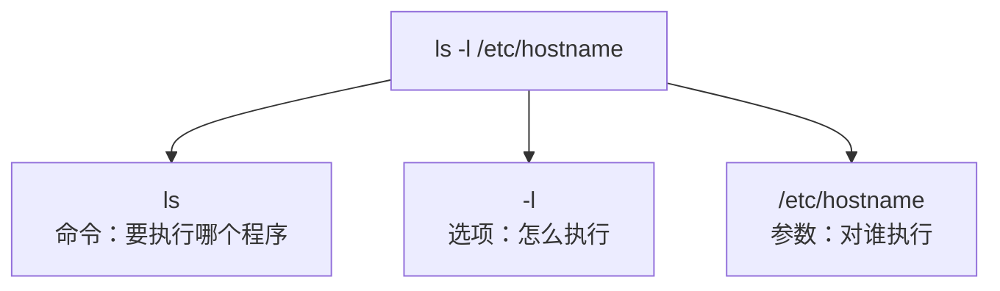

# 第 2-1 章 命令行基本功：命令格式、补全、历史、查帮助

## 这一章解决什么问题

服务器上没有鼠标、没有菜单，什么都靠敲命令。刚开始最耗时间的不是"不会"，而是：路径敲错一个字母、同一条长命令反复敲、忘了某个参数怎么写只好去网上搜。这一章把命令行的"手感"练出来：看懂一条命令由哪几部分组成，用 Tab 让系统替你补全，用历史记录把敲过的命令找回来，忘了用法时在服务器上当场查到。后面每一章都要敲命令，这一章的习惯会一直用下去。

## 开始之前

- 上一章你已经会了：用 `ssh web01` 免密码登录服务器。
- 需要的环境，二选一：
  - VMware 里的 `web01`，从 PowerShell `ssh web01` 登录；
  - **或者 WSL 里的 Ubuntu 26.04**（第二部分各章都可以在 WSL 里练，见 2-1.1 节）。
- 本章的新概念有三个：**命令的组成**（命令、选项、参数）、**Tab 补全和命令历史**、**查帮助的三种方法**（`--help`、`man`、`type`）。

本章的输出都在 Ubuntu 26.04.1 的系统里实测（升级到 2026-11-28 的版本）。测试环境里 `ls -l` 显示的属组是数字，下文已按真实系统改成 `root`；时间以你执行时为准。

---

## 2-1.1 （可选）在 WSL 里装一个 Ubuntu 26.04 练习

> ⚠ 本节在 Windows 上的操作和输出未实机验证，按微软和 Ubuntu 的官方文档整理（[WSL 基本命令](https://learn.microsoft.com/windows/wsl/basic-commands)、[Ubuntu on WSL](https://ubuntu.com/wsl/docs/latest/howto/install-ubuntu-wsl2/)）。

第二部分讲的是命令行本身，这些命令在 WSL 的 Ubuntu 里和在服务器上用法相同。WSL 打开就能用，适合零碎时间练习。

1. 在 PowerShell 里看有哪些 Ubuntu 版本可以装：

   ```powershell
   PS C:\Users\zhang> wsl --list --online
   ```

   在列出的名字里找 `Ubuntu-26.04`。26.04 刚发布的一段时间，这个名字不在列表里，用它安装会报 "Invalid distribution name"；后来才加进去。

2. 安装：

   ```powershell
   PS C:\Users\zhang> wsl --install Ubuntu-26.04
   ```

   第一次在这台电脑上用 WSL 时，它会先启用 Windows 的相关功能，可能要求重启电脑，重启后再执行一次。

3. 安装完成后自动打开 Ubuntu，要你建一个 Linux 用户（用户名规则和第 1-1 章一样：小写字母开头），再设密码。这个用户和你的 Windows 账号无关。

4. 以后打开它：

   ```powershell
   PS C:\Users\zhang> wsl -d Ubuntu-26.04
   ```

   或者在 Windows 终端的下拉菜单里选 Ubuntu-26.04。

**WSL 和服务器不一样的地方**（遇到时本书会标出来）：

| 项 | 服务器 `web01` | WSL |
|---|---|---|
| 提示符里的主机名 | `ubuntu@web01` | 你的 Windows 电脑名，例如 `zhang@ZHANG-PC` |
| 你的 C 盘 | 没有 | `/mnt/c`，D 盘是 `/mnt/d` |
| 关掉窗口 | 服务器照常运行 | 一会儿后整个 WSL 停止 |
| 服务、网络、磁盘 | 本书第四、六、七部分在这里练 | 和服务器不同，**不要**在 WSL 里练这些 |

下文的提示符都按服务器写成 `ubuntu@web01:~$`，在 WSL 里看到的是你自己的用户名和电脑名，不影响命令。

---

## 2-1.2 读懂提示符

登录后光标前面的这段叫**提示符**（prompt），表示"可以输入命令了"：

```text
ubuntu@web01:~$
```

| 部分 | 意思 |
|---|---|
| `ubuntu` | 当前用户 |
| `@web01` | 在哪台机器上。同时开着几台服务器的窗口时，靠它分清是哪一台，**执行重启、删除这类命令前先看一眼** |
| `:~` | 当前所在的目录。`~` 是你的家目录 `/home/ubuntu`；进了别的目录会显示路径，例如 `ubuntu@web01:/etc$` |
| `$` | 普通用户。如果变成 `#`，说明你现在是管理员 root，敲错命令后果更严重 |

提示符的样子由家目录里的 `.bashrc` 文件定义（第 2-6 章讲），Ubuntu 默认把 `ubuntu@web01` 显示成绿色、目录显示成蓝色。

你敲命令的这个程序叫 **bash**，它负责读你输入的命令、找到对应的程序、执行、把结果显示出来。这类程序统称 **shell**（外壳）。

| | Windows Server | Ubuntu Server |
|---|---|---|
| 命令行程序 | PowerShell、cmd | bash（默认的 shell） |
| 提示符 | `PS C:\Users\zhang>` | `ubuntu@web01:~$` |
| 当前目录显示 | 完整路径 | 家目录显示为 `~` |
| 管理员标志 | 窗口标题"管理员:" | 提示符末尾 `#` |

---

## 2-1.3 一条命令由哪几部分组成

### 最小例子

```bash
ubuntu@web01:~$ ls -l /etc/hostname
```

实测输出：

```text
-rw-r--r-- 1 root root 6 Nov 28 12:01 /etc/hostname
```

拆开：



| 部分 | 名称 | 本例 | 作用 |
|---|---|---|---|
| 第一个词 | 命令（command） | `ls` | list，列出文件 |
| `-` 开头的 | 选项（option） | `-l` | long，用长格式显示（权限、属主、大小、时间） |
| 其余的 | 参数（argument） | `/etc/hostname` | 要列出的文件 |

各部分之间用**空格**分开。不加选项、不加参数也能执行，`ls` 就是列出当前目录：

```bash
ubuntu@web01:~$ ls
```

家目录里还没有普通文件，所以什么都不显示。

### 选项的几种写法

**短选项**：一个 `-` 加一个字母。几个短选项可以合在一起写，下面两种写法结果相同（实测）：

```bash
ubuntu@web01:~$ ls -l -a
ubuntu@web01:~$ ls -la
```

```text
total 16
drwxr-x--- 4 ubuntu ubuntu  104 Nov 28 12:33 .
drwxr-xr-x 4 root   root     34 Nov 28 12:04 ..
-rw------- 1 ubuntu ubuntu   56 Nov 28 12:14 .bash_history
-rw-r--r-- 1 ubuntu ubuntu  220 Nov 28 12:48 .bash_logout
-rw-r--r-- 1 ubuntu ubuntu 3771 Nov 28 12:48 .bashrc
drwx------ 2 ubuntu ubuntu   34 Nov 28 12:05 .cache
-rw-r--r-- 1 ubuntu ubuntu  807 Nov 28 12:48 .profile
drwx------ 2 ubuntu ubuntu   29 Nov 28 12:33 .ssh
```

`-a` 是 all，连 `.` 开头的隐藏文件也显示。刚才 `ls` 什么都没显示，是因为家目录里的文件全是隐藏文件。上一章建的 `.ssh` 也在这里。

**长选项**：两个 `-` 加一个单词，更好懂，写脚本时推荐用。`--all` 就是 `-a`：

```bash
ubuntu@web01:~$ ls --all
```

```text
.
..
.bash_history
.bash_logout
.bashrc
.cache
.profile
.ssh
```

**带值的选项**：有些选项后面要跟一个值，例如第 1-2 章的 `ssh-keygen -t ed25519`、`date -d yesterday`：

```bash
ubuntu@web01:~$ date -d yesterday +%F
2026-11-27
```

`-d yesterday` 是"显示昨天"，`+%F` 是格式"年-月-日"（`date` 的 `+` 格式是它特有的写法）。

### 大小写和空格都不能错

Linux 区分大小写，空格决定了哪里是命令、哪里是选项。故意写错几处，实测：

| 你输入的 | 结果 | 原因 |
|---|---|---|
| `LS` | `LS: command not found` | 没有叫 `LS` 的命令，只有 `ls` |
| `ls-l` | `ls-l: command not found` | 少了空格，整个 `ls-l` 被当成命令名 |
| `ls - l` | `ls: cannot access '-': No such file or directory`<br/>`ls: cannot access 'l': No such file or directory` | 多了空格，`-` 和 `l` 被当成两个文件名 |
| `ls /etc/hostnam` | `ls: cannot access '/etc/hostnam': No such file or directory` | 文件名少一个字母，找不到 |
| `ls -z` | `error: unexpected argument '-z' found` | `ls` 没有 `-z` 这个选项 |

`command not found` 是"命令找不到"，`No such file or directory` 是"没有这个文件或目录"。这两句以后会经常见到，看到就先检查拼写。

服务器上没装的命令，Ubuntu 会提示怎么装，实测：

```bash
ubuntu@web01:~$ tree
Command 'tree' not found, but can be installed with:
sudo apt install tree
```

### 每条命令都有一个"退出码"

命令执行完会留下一个数字，表示成功还是失败，用 `echo $?` 查看上一条命令的退出码。实测：

```bash
ubuntu@web01:~$ ls /etc/hostname
/etc/hostname
ubuntu@web01:~$ echo $?
0
ubuntu@web01:~$ ls /etc/hostnam
ls: cannot access '/etc/hostnam': No such file or directory
ubuntu@web01:~$ echo $?
2
ubuntu@web01:~$ LS
LS: command not found
ubuntu@web01:~$ echo $?
127
```

`0` 是成功，不是 0 就是失败；`127` 专门表示"命令找不到"。现在知道有这回事就行，第 2-7 章写脚本时，靠它判断上一步有没有成功。

### 26.04 的一个变化：部分基础命令是 Rust 重写的

Ubuntu 26.04 把 `ls`、`date` 等基础命令换成了用 Rust 语言重写的版本（uutils），`cp`、`mv`、`rm` 仍是原来的 GNU 版本。实测：

```bash
ubuntu@web01:~$ ls --version
ls (uutils coreutils) 0.10.0
ubuntu@web01:~$ cp --version | head -1
cp (GNU coreutils) 9.7
```

日常用法相同。区别在报错和帮助的文字：上面 `ls -z` 的报错 `error: unexpected argument '-z' found` 就是新版的写法，网上的老教程里是 `ls: invalid option -- 'z'`。两种都见到时不要奇怪。

**什么时候不要用短选项合写**：写进脚本、交给别人维护的命令，用长选项（`--all`、`--human-readable`）更容易看懂；自己在命令行里临时敲，用合写的短选项更快。

---

## 2-1.4 Tab 补全：少敲字、不敲错

### 补全文件名

1. 输入 `ls /etc/hostn`，**不要回车**，按一下 `Tab` 键。实测，命令行自动变成：

   ```text
   ubuntu@web01:~$ ls /etc/hostname
   ```

   `/etc` 下以 `hostn` 开头的只有 `hostname` 一个，bash 直接补全。回车执行：

   ```text
   /etc/hostname
   ```

2. 输入 `ls /etc/host`，按一次 `Tab` 没反应（以 `host` 开头的不止一个），**再按一次** `Tab`，实测列出所有候选：

   ```text
   ubuntu@web01:~$ ls /etc/host
   host.conf    hostname     hosts        hosts.allow  hosts.deny
   ubuntu@web01:~$ ls /etc/host
   ```

   列完后你刚才敲的内容还在，接着再敲一两个字母（比如 `s`），再按 `Tab`，直到只剩一个。

### 补全命令名

输入 `his` 按 `Tab`，实测补成：

```text
ubuntu@web01:~$ history
```

忘了命令全名时，敲开头几个字母按两次 `Tab`，就能看到所有以它开头的命令。

**规律**：按一次 `Tab` 补全唯一的匹配；有多个匹配时按两次 `Tab` 列出来。**按了 `Tab` 没补全，本身就是提示**：要么拼错了，要么这个文件根本不存在。养成"敲几个字母就按 Tab"的习惯，`No such file or directory` 会少很多。

> Ubuntu 还会补全选项和参数，例如 `systemctl` 的服务名、`apt install` 的软件包名（第 3-4、4-1 章会用到）。

---

## 2-1.5 命令历史：找回敲过的命令

bash 会记住你敲过的命令，存在家目录的 `.bash_history` 文件里，退出登录再进来还在。

### 上下键

按 `↑` 显示上一条命令，再按显示更早的，`↓` 往回翻。找到后可以直接回车执行，也可以用 `←` `→` 移动光标改一改再执行。这是用得最多的方法。

### `history`：列出历史

实测（刚登录、依次敲了几条命令后）：

```bash
ubuntu@web01:~$ history
    1  clear
    2  ls /etc/hostname
    3  hostname
    4  date
    5  whoami
    6  history
```

每条前面是编号。用 `!编号` 重新执行某一条，实测：

```bash
ubuntu@web01:~$ !3
hostname
web01
```

bash 先把展开后的命令（`hostname`）显示一遍，再执行。`!!` 是"上一条命令"，实测：

```bash
ubuntu@web01:~$ date
Sat Nov 28 12:50:20 UTC 2026
ubuntu@web01:~$ !!
date
Sat Nov 28 12:50:20 UTC 2026
```

`!!` 最常见的用法是：敲完一条命令才发现忘了加 `sudo`，接着输入 `sudo !!`，就等于在上一条命令前面补上 `sudo` 再执行一次。

历史很长时，只看最后几条：`history | tail -5`（`|` 和 `tail` 在第 2-3、2-5 章讲）。

### `Ctrl+R`：按关键字搜索历史

记得命令里的某几个字，但不记得是第几条：

1. 按 `Ctrl+R`，提示符变成搜索模式。
2. 输入 `host`，实测立即显示最近一条包含 `host` 的命令：

   ```text
   (reverse-i-search)`host': hostname
   ```

3. 不是要找的这条，**再按 `Ctrl+R`** 找更早的一条，实测：

   ```text
   (reverse-i-search)`host': ls /etc/hostname
   ```

4. 找到了按回车直接执行；按 `→` 或 `←` 把它放到命令行上、修改后再执行；不想要了按 `Ctrl+G` 退出搜索。

### 历史的两条默认规则

Ubuntu 默认的 `.bashrc` 里有这一行（实测，第 13 行）：

```text
HISTCONTROL=ignoreboth
```

它上面的注释写着：连续重复的命令只记一次；**以空格开头的命令不记入历史**。有时命令里不得不带密码（比如连数据库），在命令最前面多敲一个空格，它就不会留在 `.bash_history` 里。

默认最多记 1000 条（`HISTSIZE=1000`），文件里最多保留 2000 条（`HISTFILESIZE=2000`）。

| | Windows PowerShell | bash |
|---|---|---|
| 上一条命令 | `↑` | `↑` |
| 列出历史 | `Get-History` | `history` |
| 搜索历史 | `Ctrl+R` | `Ctrl+R` |
| 历史存在哪 | `%APPDATA%\Microsoft\Windows\PowerShell\PSReadLine\ConsoleHost_history.txt` | `~/.bash_history` |

---

## 2-1.6 必会的几个快捷键

| 按键 | 作用 | 什么时候用 |
|---|---|---|
| `Ctrl+C` | 中断正在执行的命令；或者放弃正在敲的这一行 | 命令卡住、执行太久、敲错了不想要了 |
| `Ctrl+L` | 清屏（和 `clear` 命令一样） | 屏幕太乱 |
| `Ctrl+A` / `Ctrl+E` | 光标跳到行首 / 行尾 | 长命令前面要补 `sudo` |
| `Ctrl+U` | 删除光标前面的所有内容 | 整行重敲 |
| `Ctrl+W` | 删除光标前面的一个词 | 删掉敲错的一个参数 |
| `Ctrl+D` | 在空行上按：退出登录（和 `exit` 一样） | 退出 ssh |

### 改坏一处试试：命令"卡住了"

**情况 1：命令一直在执行。** `sleep 100` 会等待 100 秒什么都不做，模拟一条执行很久的命令。按 `Ctrl+C`，实测：

```text
ubuntu@web01:~$ sleep 100
^C
ubuntu@web01:~$
```

`^C` 表示你按了 `Ctrl+C`，命令被中断，回到提示符。

**情况 2：引号没配对。** 敲了 `echo 'hello` 就回车（少了后面的 `'`），实测：

```text
ubuntu@web01:~$ echo 'hello
>
```

提示符变成了 `>`：bash 认为你的命令还没敲完，在等你补上另一个引号。这时按 `Ctrl+C`，实测：

```text
> ^C
ubuntu@web01:~$
```

回到正常提示符。**看到 `>` 提示符就检查引号和括号是不是没配对。**

**情况 3：屏幕"死了"，敲什么都没反应。** 很可能是不小心按了 `Ctrl+S`，它会暂停终端输出（Windows 里按 `Ctrl+S` 是保存，很容易顺手按到）。按 `Ctrl+Q` 恢复，期间敲的字会一起出现。

> ⚠ 情况 3 未实机验证（测试环境的终端模拟不了），这是 Linux 终端的默认设置。

**复制粘贴**：在 Windows 的 PowerShell 或 Windows 终端窗口里，用鼠标选中文字就是复制（或选中后按 `Ctrl+C`），右键或 `Ctrl+V` 粘贴。注意：**没有选中文字时按 `Ctrl+C`，是中断服务器上的命令，不是复制。**

> ⚠ 复制粘贴的行为取决于你用的终端程序和设置，未实机验证。

---

## 2-1.7 忘了用法：在服务器上查帮助

不用每次都上网搜。服务器上有三种查法，从快到全：

| 方法 | 用途 | 例子 |
|---|---|---|
| `命令 --help` | 快速看选项列表 | `ls --help` |
| `man 命令` | 看完整手册 | `man ls` |
| `type 命令` | 看这个命令到底是什么 | `type ls` |

### `--help`：最快

```bash
ubuntu@web01:~$ ls --help
```

实测输出的开头：

```text
List directory contents.
Ignore files and directories starting with a '.' by default

Usage: ls [OPTION]... [FILE]...

Options:
      --help
          Print help information.
      --format <format>
          Set the display format.
  -C
          Display the files in columns.
  -l, --long
          Display detailed information.
```

`Usage:` 这一行是用法格式：`[ ]` 里的可以省略，`...` 表示可以写多个。`ls [OPTION]... [FILE]...` 就是"选项可有可无、可以多个，文件可有可无、可以多个"。

帮助太长一屏放不下时，接 `| less` 翻页看：`ls --help | less`，`空格` 下一页，`q` 退出（第 2-3 章讲 less）。

**改坏一处试试**：把 `--help` 拼错成 `--hlep`，实测：

```text
error: unexpected argument '--hlep' found

  tip: a similar argument exists: '--help'
```

新版命令会提示"有一个相似的选项 `--help`"。

### `man`：完整手册

```bash
ubuntu@web01:~$ man ls
```

实测，第一屏：

```text
LS(1)                            General Commands Manual                            LS(1)

NAME
       ls - List directory contents.  Ignore files and directories starting with a '.' by
       default

SYNOPSIS
       ls  [--help]  [--format]  [-C  ]  [-l|--long]  [-x ] [-T|--tabsize] [-m ] [--zero]
       ……

DESCRIPTION
       List  directory contents.  Ignore files and directories starting with a '.' by de-
       fault

 Manual page ls(1) line 1 (press h for help or q to quit)
```

| 按键 | 作用 |
|---|---|
| `空格` / `b` | 下一页 / 上一页 |
| `/` 加关键字，回车 | 搜索，例如 `/size` 找和大小有关的选项；`n` 跳到下一个匹配 |
| `q` | 退出，回到提示符 |

最下面一行就提示了：`press h for help or q to quit`（按 h 看帮助，按 q 退出）。

只想知道一个命令是干什么的，用 `whatis`，实测：

```bash
ubuntu@web01:~$ whatis ls cp date
ls (1)               - List directory contents. Ignore files and directories ...
cp (1)               - copy files and directories
date (1)             - Print or set the system date and time
```

不知道命令叫什么，只知道要做什么，用 `man -k 关键字` 搜，实测：

```bash
ubuntu@web01:~$ man -k hostname
freehostent (3)      - get network hostnames and addresses
gethostname (2)      - get/set hostname
getipnodebyaddr (3)  - get network hostnames and addresses
getipnodebyname (3)  - get network hostnames and addresses
hostname (1)         - show or set the system's host name
```

括号里的数字是手册的分类：`(1)` 是普通命令，`(8)` 是管理员命令，`(2)` `(3)` 是给程序员看的编程接口，**你只需要看 (1) 和 (8)**。

### `type`：这个命令是什么

实测：

```bash
ubuntu@web01:~$ type ls cd ll cp
ls is aliased to `ls --color=auto'
cd is a shell builtin
ll is aliased to `ls -alF'
cp is /usr/bin/cp
```

| 结果 | 意思 | 查帮助用 |
|---|---|---|
| `is aliased to` | 别名：你敲的 `ls` 实际执行的是 `ls --color=auto`（带颜色显示）。`ll` 是 Ubuntu 预设的别名，等于 `ls -alF` | 查它背后那个命令 |
| `is a shell builtin` | bash 自带的命令，没有单独的程序文件 | `help cd`（不是 `man cd`、`cd --help`） |
| `is /usr/bin/cp` | 一个程序文件，在 `/usr/bin` 目录里 | `cp --help`、`man cp` |

`cd`、`history`、`echo` 都是 bash 自带的，用 `help` 查，实测：

```bash
ubuntu@web01:~$ help cd
cd: cd [-L|[-P [-e]]] [-@] [dir]
    Change the shell working directory.

    Change the current directory to DIR.  The default DIR is the value of the
    HOME shell variable. If DIR is "-", it is converted to $OLDPWD.
```

`which` 只回答"程序文件在哪"，实测：

```bash
ubuntu@web01:~$ which ls cp
/usr/bin/ls
/usr/bin/cp
```

`which ls` 告诉你 `/usr/bin/ls`，却不会告诉你 `ls` 其实是个别名。**想知道"敲这个词到底会执行什么"，用 `type`。**

| 要做的事 | Windows PowerShell | bash |
|---|---|---|
| 快速帮助 | `命令 -?` | `命令 --help` |
| 完整手册 | `Get-Help 命令 -Full` | `man 命令` |
| 按关键字找命令 | `Get-Command *host*` | `man -k host` |
| 这个命令是什么、在哪 | `Get-Command 命令` | `type 命令` |
| 别名 | `dir` 是 `Get-ChildItem` 的别名 | `ll` 是 `ls -alF` 的别名 |

**什么时候查帮助不够**：`man` 写的是"每个选项是什么意思"，不告诉你"遇到某个问题该用哪条命令"。后一种问题还是要查本书或搜索；查到一条命令后，再用 `--help` 或 `man` 核对参数含义，别照抄看不懂的命令。

---

## 🧱 类比

bash 像一个只听口令的助手：口令的第一个词是要做的事（命令），带 `-` 的是做法要求（选项），最后是对象（参数），词与词之间必须停顿（空格），说错一个字它就说"听不懂"（command not found）。Tab 补全是助手帮你把话说完；历史记录是助手的记事本；`man` 是每件事的操作手册。

---

## ⚠️ 踩坑警告

| 现象 | 原因 | 怎么改 |
|---|---|---|
| `LS: command not found`、`ls-l: command not found` | 大小写错了，或者命令和选项之间少了空格（实测） | Linux 区分大小写；命令、选项、参数之间都要空格 |
| `ls - l` 报 `cannot access '-'`、`cannot access 'l'` | `-` 和 `l` 之间多了空格，被当成两个文件名（实测） | 选项是一个整体：`-l` |
| 提示符变成 `>`，敲什么都不执行 | 引号或括号没配对，bash 在等你写完（实测） | `Ctrl+C` 放弃这一行，检查引号后重敲 |
| 在 Windows 终端里想复制，按 `Ctrl+C` 却把服务器上的命令中断了 | 没选中文字时 `Ctrl+C` 发给了服务器 | 先用鼠标选中再复制；或者右键菜单 |
| `man cd` 说没有手册 | `cd` 是 bash 自带命令，没有单独的手册页 | 先 `type cd` 看是什么，自带命令用 `help cd` |
| 照老教程看报错信息，和屏幕上的对不上 | 26.04 的 `ls`、`date` 等换成了 Rust 版（uutils），报错文字变了（实测 `ls --version` 是 uutils 0.10.0） | 以屏幕上的为准，意思是一样的 |

---

## 🎯 动手练习

### 练习 1：不看本章，查出 `df` 的用法

`df` 是查看磁盘剩余空间的命令（第 7-2 章细讲）。只用服务器上的帮助，回答：

1. `df` 是程序文件、别名还是 bash 自带命令？
2. 哪个选项能让大小显示成 `G`、`M` 这样容易读的单位？它的长选项怎么写？
3. 用这个选项只查看根目录 `/` 的空间，执行出来。

**验收标准**：三个问题都写出了你用的命令；第 3 问的输出里 `Size`、`Used`、`Avail` 几列显示为带 `G` 或 `M` 的数字。

### 练习 2：用历史记录省力

1. 依次执行 `hostname`、`whoami`、`date`、`uptime`。
2. 不重新敲字母，**用三种不同的方法**各重新执行一次 `whoami`。

**验收标准**：三种方法都成功显示了 `ubuntu`；说得出每种方法是什么（提示：本章讲过 `↑`、`!编号`、`Ctrl+R` 三种）。

卡住了看文末参考答案。

---

## 📌 一句话总结

命令、选项、参数用空格隔开；多按 Tab，善用 ↑ 和 Ctrl+R，忘了就 --help。

## 下一章

[第 2-2 章 目录和文件：看、建、复制、移动、删除](02-目录和文件.md)：知道 Linux 的文件都放在哪，学会在目录间移动、建文件、复制和删除，删除前怎么确认不删错。

---

<!-- 以下是参考答案，先自己动手，卡住了再往下翻 -->


## 参考答案

### 练习 1

```bash
ubuntu@web01:~$ type df
df is /usr/bin/df
ubuntu@web01:~$ df --help | less
ubuntu@web01:~$ df -h /
```

1. `type df` 显示 `/usr/bin/df`，是程序文件。
2. `df --help` 里找到 `-h, --human-readable`：用 1024 进位，显示成 `1K`、`234M`、`2G` 这样的单位。在 `less` 里输入 `/human` 回车可以直接跳到这一行；或者 `man df` 里同样用 `/human` 搜索。
3. `df -h /` 的输出类似：

   ```text
   Filesystem                         Size  Used Avail Use% Mounted on
   /dev/mapper/ubuntu--vg-ubuntu--lv   18G  4.6G   13G  27% /
   ```

> ⚠ 第 3 问的输出未实机验证（取决于你的虚拟机），`df -h` 的列名是标准格式。`type df`、`df --help` 里选项的写法请以你屏幕上的为准。

思路：先 `type` 确定查帮助的方式（程序文件用 `--help`/`man`，自带命令用 `help`），再在帮助里按关键字搜，不要从头读到尾。

### 练习 2

| 方法 | 操作 |
|---|---|
| 上下键 | 按 `↑` 三次（`uptime` → `date` → `whoami`），回车 |
| `!编号` | 先 `history` 看 `whoami` 是第几条，例如 `   12  whoami`，再输入 `!12` 回车 |
| `Ctrl+R` | 按 `Ctrl+R`，输入 `who`，显示 `(reverse-i-search)`who': whoami`，回车 |

思路：命令少时用 `↑` 最快；知道大概是哪条时 `history` 加 `!编号`；记得命令里的关键字时 `Ctrl+R` 最直接，越久远的命令越适合用它。
