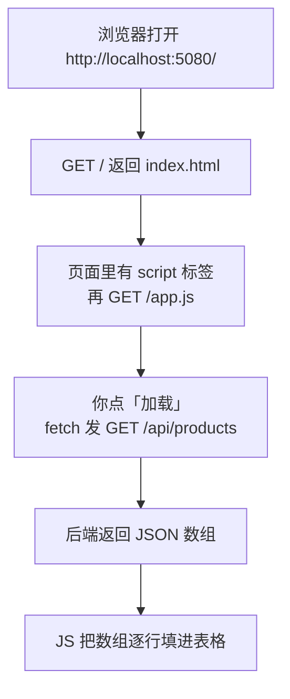

# 第 1 章 页面打开，点一下按钮，把产品列表显示出来

## 这一章解决什么问题

你写好了一个返回 JSON 的接口，现在要一张普通的 HTML 页面把它显示成表格。页面不跳转、不刷新，只把表格内容换掉。本章做出这个最小闭环：后端 Minimal API 出数据，前端 `fetch` 取数据，JavaScript 填表格。

## 开始之前

- 需要：Visual Studio 2026（勾选「ASP.NET 和 Web 开发」工作负载，自带 .NET 10 SDK）、Chrome 或 Edge。
- 不需要：Node.js、npm、打包工具、数据库。整本教程只有 HTML 文件和 JS 文件，浏览器直接执行。
- 本章新概念 3 个：**静态文件（wwwroot）**、**fetch + await**、**JSON 字段名小写开头**。

## 正文

### 1.1 全貌：一张页面会发几次请求

🖼 图解：



这张图里一共 3 次请求，都发到同一个网站 `localhost:5080`：

| 请求 | 谁处理 | 返回什么 |
|---|---|---|
| `GET /` | 静态文件中间件 | `wwwroot/index.html` |
| `GET /app.js` | 静态文件中间件 | `wwwroot/app.js` |
| `GET /api/products` | 你写的 `MapGet` | JSON 文本 |

页面和接口在同一个网站（同源，same-origin，指协议 + 域名 + 端口三者相同），所以前端可以直接写 `/api/products`，不用写完整地址，也不会碰到跨域（CORS）问题。本教程一直保持这种结构。

### 1.2 建项目

**方法一：Visual Studio 2026**（⚠️ 本段界面操作未实机验证，菜单名以你的 VS 为准）

1. 「文件 → 新建 → 项目」，搜索并选择 **ASP.NET Core 空**（英文版叫 ASP.NET Core Empty），下一步。
2. 项目名称填 `FetchDemo`，下一步。
3. 框架选 **.NET 10.0**；**取消勾选「配置 HTTPS」**（本教程只用 http，少一个证书提示），创建。
4. 在「解决方案资源管理器」里右键项目 →「添加 → 新建文件夹」，命名为 `wwwroot`。

**方法二：命令行**（已实机验证，在你想放项目的目录执行）：

```powershell
dotnet new web -n FetchDemo
```

两种方法得到的项目一样。然后打开 `Properties/launchSettings.json`，把端口改成 5080，后面所有章节都按这个地址写。整个文件替换成：

```json
{
  "$schema": "https://json.schemastore.org/launchsettings.json",
  "profiles": {
    "http": {
      "commandName": "Project",
      "dotnetRunMessages": true,
      "launchBrowser": true,
      "applicationUrl": "http://localhost:5080",
      "environmentVariables": {
        "ASPNETCORE_ENVIRONMENT": "Development"
      }
    }
  }
}
```

> 端口不改也能跑，只是浏览器地址和本教程不一样。页面里的 fetch 用相对地址，不受端口影响。

### 1.3 后端：一个返回列表的接口

把 `Program.cs` 整个替换成：

```csharp
// code/ch01/FetchDemo/Program.cs
var builder = WebApplication.CreateBuilder(args);
var app = builder.Build();

// 访问 / 时自动改成 /index.html。必须写在 UseStaticFiles 前面，否则不生效
app.UseDefaultFiles();
// 让浏览器能直接下载 wwwroot 里的 html、js、css
app.UseStaticFiles();

// 数据先放内存，程序一重启就恢复成这 5 条
var products = new List<Product>
{
    new() { Id = 1, Code = "P001", Name = "彩超主机 X1", Price = 268000m },
    new() { Id = 2, Code = "P002", Name = "凸阵探头 C5", Price = 32000m },
    new() { Id = 3, Code = "P003", Name = "线阵探头 L12", Price = 28500m },
    new() { Id = 4, Code = "P004", Name = "耦合剂 250ml", Price = 12.5m },
    new() { Id = 5, Code = "P005", Name = "便携彩超 M3", Price = 156000m },
};

// 直接返回 List，框架会把它序列化成 JSON 数组
app.MapGet("/api/products", () => products);

app.Run();

class Product
{
    public int Id { get; set; }
    public string Code { get; set; } = "";
    public string Name { get; set; } = "";
    public decimal Price { get; set; }
}
```

先只启动后端验证接口。VS 里工具栏的启动配置选 **http**，按 `Ctrl+F5`（不调试运行）；命令行则在 `FetchDemo` 目录执行 `dotnet run`。控制台会显示：

```text
info: Microsoft.Hosting.Lifetime[14]
      Now listening on: http://localhost:5080
info: Microsoft.Hosting.Lifetime[0]
      Application started. Press Ctrl+C to shut down.
```

浏览器地址栏打开 `http://localhost:5080/api/products`，看到：

```json
[{"id":1,"code":"P001","name":"彩超主机 X1","price":268000},{"id":2,"code":"P002","name":"凸阵探头 C5","price":32000},{"id":3,"code":"P003","name":"线阵探头 L12","price":28500},{"id":4,"code":"P004","name":"耦合剂 250ml","price":12.5},{"id":5,"code":"P005","name":"便携彩超 M3","price":156000}]
```

🔍 注意字段名：C# 里是 `Id`、`Name`，JSON 里变成了 `id`、`name`。这是 ASP.NET Core 的默认规则（驼峰命名，camelCase：首字母小写），因为 JavaScript 的习惯就是小写开头。**前端取值必须用小写**，1.6 节会演示写错的后果。

### 1.4 概念一：静态文件（wwwroot）

**白话定义**：`wwwroot` 文件夹里的文件，浏览器按路径原样下载，后端不做任何处理。

**场景**：价格查询页的 HTML、JS、CSS、图标都放这里，和接口一起发布，一个网站搞定。

**反例（什么时候不该用）**：需要按登录用户显示不同内容的文件（比如每人一份的工资单 PDF）。静态文件谁知道地址谁就能下载，这类文件要走接口，在接口里先校验身份。

在 `wwwroot` 里新建 `index.html`（VS：右键 wwwroot →「添加 → 新建项」→ 选「HTML 页」）：

```html
<!-- code/ch01/FetchDemo/wwwroot/index.html -->
<!DOCTYPE html>
<html lang="zh-CN">
<head>
  <meta charset="utf-8">
  <title>产品列表</title>
</head>
<body>
  <h1>产品列表</h1>
  <button id="btnLoad">加载</button>
  <table border="1">
    <thead>
      <tr><th>Id</th><th>编码</th><th>名称</th><th>价格</th></tr>
    </thead>
    <tbody id="rows"></tbody>
  </table>
  <!-- 放在 body 最后：此时上面的按钮和表格已经存在，脚本才找得到它们 -->
  <script src="app.js"></script>
</body>
</html>
```

再新建 `wwwroot/app.js`（VS：右键 wwwroot →「添加 → 新建项」→ 选「JavaScript 文件」）。内容在下一节。

`Program.cs` 里和静态文件有关的只有两行：

| 代码 | 作用 | 不写会怎样 |
|---|---|---|
| `app.UseDefaultFiles();` | 请求 `/` 时改成请求 `/index.html` | 打开 `http://localhost:5080/` 得到 404，但 `/index.html` 能打开 |
| `app.UseStaticFiles();` | 把 wwwroot 里的文件发给浏览器 | 所有 html、js 都是 404 |

### 1.5 概念二：fetch + await

**白话定义**：`fetch(地址)` 在不刷新页面的情况下向服务器发一个 HTTP 请求；`await` 让代码停在这一行，等结果回来再往下走。

**场景**：报表页的「查询」按钮，点了只刷新表格，筛选条件、滚动位置都保持不动。

**反例（什么时候不该用）**：「导出 Excel」这类下载文件的功能。用 `<a href="/api/export">` 让浏览器自己下载更简单，fetch 拿到文件内容后还得自己处理保存。

`wwwroot/app.js` 的完整内容：

```javascript
// code/ch01/FetchDemo/wwwroot/app.js
async function loadProducts() {
  // 相对地址：页面和接口在同一个网站，不用写 http://localhost:5080
  const response = await fetch('/api/products');
  // 把响应正文从 JSON 文本解析成数组；读正文也要等，所以也要 await
  const products = await response.json();

  const tbody = document.getElementById('rows');
  tbody.innerHTML = ''; // 先清空，否则点两次会出现两份数据
  for (const p of products) {
    const tr = document.createElement('tr');
    // 字段名小写开头：C# 的 Name 到了 JSON 里变成 name
    for (const value of [p.id, p.code, p.name, p.price]) {
      const td = document.createElement('td');
      // 用 textContent 不用 innerHTML：名称里就算有 <b> 也只当文字显示
      td.textContent = value;
      tr.appendChild(td);
    }
    tbody.appendChild(tr);
  }
}

document.getElementById('btnLoad').addEventListener('click', loadProducts);
```

运行（`Ctrl+F5`），浏览器打开 `http://localhost:5080/`，点「加载」，表格出现 5 行：

```text
1  P001  彩超主机 X1    268000
2  P002  凸阵探头 C5    32000
3  P003  线阵探头 L12   28500
4  P004  耦合剂 250ml   12.5
5  P005  便携彩超 M3    156000
```

再点一次「加载」，仍然是 5 行，因为每次都先执行了 `tbody.innerHTML = ''`。

🔍 逐行拆解关键点：

| 代码 | 为什么这样写 |
|---|---|
| `async function loadProducts()` | 函数里要用 `await`，函数前就必须加 `async` |
| `await fetch('/api/products')` | `fetch` 立刻返回一个"以后会有结果"的对象（Promise，承诺对象），`await` 等它变成真正的响应 |
| `await response.json()` | 响应头先到、正文后到，读正文是第二次等待 |
| `addEventListener('click', loadProducts)` | 传函数本身，不加括号。写成 `loadProducts()` 会在页面加载时立刻执行一次，点击反而没反应 |

用到的几个页面操作函数（DOM，Document Object Model，浏览器给 JS 用的页面对象接口）：

| 函数 | 作用 |
|---|---|
| `document.getElementById('rows')` | 按 id 找到页面元素 |
| `document.createElement('tr')` | 新建一个元素，此时还没放到页面上 |
| `tr.appendChild(td)` | 把元素放进另一个元素里，放进页面后才显示 |
| `td.textContent = 值` | 设置元素里的文字 |

### 1.6 改坏几处试试

每次改完保存，浏览器按 `Ctrl+F5` 强制刷新，然后按 `F12` 打开「控制台（Console）」看报错。

**改坏一：字段名写成大写。** 把 `p.code, p.name` 改成 `p.Code, p.Name`。

现象：表格有 5 行，但编码和名称两列是空的，控制台**没有任何报错**。

原因：JSON 里没有 `Code` 这个字段，JavaScript 读不存在的属性不会报错，只会得到 `undefined`，`textContent` 设成 `undefined` 就是空白。这是最难发现的一类错误，看到"行数对、某列空"先查字段名大小写。

**改坏二：删掉 fetch 前面的 await。** 把 `const response = await fetch` 改成 `const response = fetch`。

现象：点「加载」没反应，控制台报：

```text
Uncaught (in promise) TypeError: response.json is not a function
```

原因：没有 `await`，`response` 拿到的是 Promise 对象，不是响应，它没有 `json()` 方法。

**改坏三：调换两行中间件的顺序。** 把 `app.UseStaticFiles();` 移到 `app.UseDefaultFiles();` 上面，重新运行。

现象：打开 `http://localhost:5080/` 显示 404，但 `http://localhost:5080/index.html` 正常。

原因：请求按顺序经过中间件。`UseStaticFiles` 先看到 `/`，wwwroot 里没有叫 `/` 的文件，放行；等到 `UseDefaultFiles` 把路径改成 `/index.html` 时，后面已经没有中间件负责发文件了。

**改坏四：双击 index.html 直接用浏览器打开。** 在文件夹里双击 `wwwroot/index.html`，地址栏变成 `file:///...`，点「加载」。

现象：控制台报：

```text
Fetch API cannot load file:///api/products. URL scheme "file" is not supported.
Uncaught (in promise) TypeError: Failed to fetch
```

原因：页面不是从网站打开的，相对地址 `/api/products` 被解释成本机磁盘路径。页面必须通过 `http://localhost:5080/` 打开。

## 🧱 类比

本章 `fetch` 的过程像打电话订货：`fetch` 是拨号下单，`await fetch` 是等对方接电话，`await response.json()` 是等对方把清单念完。电话接通不等于清单念完，所以要等两次。

## ⚠️ 踩坑警告

| 现象 | 原因 | 怎么改 |
|---|---|---|
| 表格行数对，某一列全空，控制台无报错 | JS 里用了大写字段名 `p.Name`，JSON 里是 `name` | 一律小写开头；不确定就在地址栏直接打开接口看 JSON |
| 改了 app.js，页面行为没变 | 浏览器用了缓存里的旧 app.js | `Ctrl+F5` 强制刷新；或 F12 →「网络（Network）」勾选「停用缓存（Disable cache）」并保持 F12 打开 |
| 控制台 `Failed to fetch` | 页面用 `file:///` 打开；或者后端没在运行 | 通过 `http://localhost:5080/` 打开页面，确认 VS 控制台窗口还开着 |
| 打开首页 404，`/index.html` 却正常 | `UseDefaultFiles` 写在了 `UseStaticFiles` 后面，或漏写 | 两行按 1.4 节顺序写 |

## 🎯 动手练习

**练习 1：加一列库存。** 给 `Product` 加 `int Stock` 属性，5 条数据各给一个库存数，页面表格多显示一列「库存」。

验收标准：打开 `http://localhost:5080/api/products` 能看到 `"stock":3` 这样的字段；页面表格第 5 列显示库存数字，不是空白。

**练习 2：打开页面就自动加载。** 不点按钮，页面打开就显示 5 行数据；按钮保留，点了重新加载。

验收标准：`Ctrl+F5` 刷新页面后不做任何操作，表格就有 5 行；再点「加载」还是 5 行，不会变成 10 行。

卡住了看文末参考答案。

## 📌 一句话总结

接口返回 JSON，页面用 `await fetch` 取回，按小写字段名填表。

## 下一章

用户要按名称搜索、按 Id 查一条，查不到时页面要说清楚：第 2 章讲查询字符串和路由参数。

---

<!-- 以下是参考答案，先自己动手，卡住了再往下翻 -->


## 参考答案

### 练习 1

思路：C# 加属性，JSON 自动多一个小写的 `stock` 字段；前端表头加一格，取值数组加一个 `p.stock`。

`Program.cs`：

```csharp
// code/ch01/Answer1-Stock/Program.cs
var builder = WebApplication.CreateBuilder(args);
var app = builder.Build();

app.UseDefaultFiles();
app.UseStaticFiles();

var products = new List<Product>
{
    new() { Id = 1, Code = "P001", Name = "彩超主机 X1", Price = 268000m, Stock = 3 },
    new() { Id = 2, Code = "P002", Name = "凸阵探头 C5", Price = 32000m, Stock = 12 },
    new() { Id = 3, Code = "P003", Name = "线阵探头 L12", Price = 28500m, Stock = 8 },
    new() { Id = 4, Code = "P004", Name = "耦合剂 250ml", Price = 12.5m, Stock = 400 },
    new() { Id = 5, Code = "P005", Name = "便携彩超 M3", Price = 156000m, Stock = 0 },
};

app.MapGet("/api/products", () => products);

app.Run();

class Product
{
    public int Id { get; set; }
    public string Code { get; set; } = "";
    public string Name { get; set; } = "";
    public decimal Price { get; set; }
    // 新加的属性，JSON 里会叫 stock
    public int Stock { get; set; }
}
```

`wwwroot/index.html`：

```html
<!-- code/ch01/Answer1-Stock/wwwroot/index.html -->
<!DOCTYPE html>
<html lang="zh-CN">
<head>
  <meta charset="utf-8">
  <title>产品列表</title>
</head>
<body>
  <h1>产品列表</h1>
  <button id="btnLoad">加载</button>
  <table border="1">
    <thead>
      <tr><th>Id</th><th>编码</th><th>名称</th><th>价格</th><th>库存</th></tr>
    </thead>
    <tbody id="rows"></tbody>
  </table>
  <script src="app.js"></script>
</body>
</html>
```

`wwwroot/app.js`：

```javascript
// code/ch01/Answer1-Stock/wwwroot/app.js
async function loadProducts() {
  const response = await fetch('/api/products');
  const products = await response.json();

  const tbody = document.getElementById('rows');
  tbody.innerHTML = '';
  for (const p of products) {
    const tr = document.createElement('tr');
    // 多取一个 p.stock（小写 s）
    for (const value of [p.id, p.code, p.name, p.price, p.stock]) {
      const td = document.createElement('td');
      td.textContent = value;
      tr.appendChild(td);
    }
    tbody.appendChild(tr);
  }
}

document.getElementById('btnLoad').addEventListener('click', loadProducts);
```

### 练习 2

思路：`<script>` 放在 body 最后，执行时表格已经存在，在文件末尾直接调用一次 `loadProducts()` 即可。`Program.cs`、`index.html` 不变，只改 `app.js`：

```javascript
// code/ch01/Answer2-AutoLoad/wwwroot/app.js
async function loadProducts() {
  const response = await fetch('/api/products');
  const products = await response.json();

  const tbody = document.getElementById('rows');
  tbody.innerHTML = '';
  for (const p of products) {
    const tr = document.createElement('tr');
    for (const value of [p.id, p.code, p.name, p.price]) {
      const td = document.createElement('td');
      td.textContent = value;
      tr.appendChild(td);
    }
    tbody.appendChild(tr);
  }
}

document.getElementById('btnLoad').addEventListener('click', loadProducts);
// 脚本在 body 最后执行，表格已经存在，直接调一次就是"打开即加载"
loadProducts();
```
