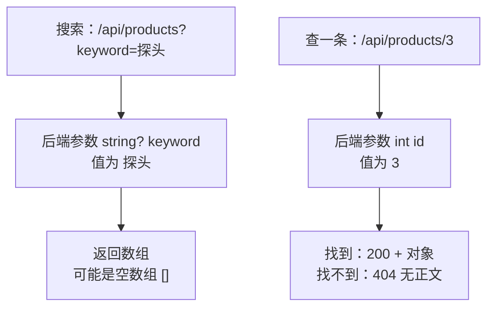

# 第 2 章 按条件查询、按 Id 查一条，查不到要说清楚

## 这一章解决什么问题

第 1 章只能一次拿全部数据。实际页面总要按名称搜索，或者输入编号查一条。查不到的时候，页面不能一片空白，要明确告诉用户"没有这条"。本章解决这三件事。

## 开始之前

- 上一章你已经会了：用 `MapGet` 返回 JSON，用 `await fetch` 取回并填表。
- 环境：在第 1 章的 `FetchDemo` 项目上直接改，或打开仓库里的 `code/ch02/FetchDemo`。
- 本章新概念 3 个：**查询字符串参数**、**路由参数 + 404**、**URLSearchParams**。

## 正文

### 2.1 两种传参方式放在一起看

🖼 图解：



| 方式 | 地址长什么样 | 适合 | 查不到时 |
|---|---|---|---|
| 查询字符串（query string） | `?keyword=探头&minPrice=100` | 可选的筛选条件，可以有多个，也可以都不传 | 返回空数组 `[]`，状态码 200 |
| 路由参数（route parameter） | `/api/products/3` | 定位唯一的一条数据 | 返回 404 |

区别的理由：搜索"没结果"是正常结果，所以是 200 + 空数组；按 Id 查"这条不存在"是请求的目标不存在，HTTP 规定用 404 表示。前端按状态码分支，比解析正文里的提示文字可靠。

### 2.2 后端：两个接口

`Program.cs` 整个替换成：

```csharp
// code/ch02/FetchDemo/Program.cs
var builder = WebApplication.CreateBuilder(args);
var app = builder.Build();

app.UseDefaultFiles();
app.UseStaticFiles();

var products = new List<Product>
{
    new() { Id = 1, Code = "P001", Name = "彩超主机 X1", Price = 268000m },
    new() { Id = 2, Code = "P002", Name = "凸阵探头 C5", Price = 32000m },
    new() { Id = 3, Code = "P003", Name = "线阵探头 L12", Price = 28500m },
    new() { Id = 4, Code = "P004", Name = "耦合剂 250ml", Price = 12.5m },
    new() { Id = 5, Code = "P005", Name = "便携彩超 M3", Price = 156000m },
};

// keyword 来自查询字符串 ?keyword=xxx；写成 string? 表示可以不传
app.MapGet("/api/products", (string? keyword) =>
    string.IsNullOrWhiteSpace(keyword)
        ? products
        : products.Where(p => p.Name.Contains(keyword)).ToList());

// {id:int} 是路由参数，只匹配整数；/api/products/abc 不会进到这里
app.MapGet("/api/products/{id:int}", (int id) =>
{
    var product = products.FirstOrDefault(p => p.Id == id);
    // 查不到返回 404，前端靠状态码区分"没有"和"出错"
    return product is null ? Results.NotFound() : Results.Ok(product);
});

app.Run();

class Product
{
    public int Id { get; set; }
    public string Code { get; set; } = "";
    public string Name { get; set; } = "";
    public decimal Price { get; set; }
}
```

**概念一：查询字符串参数。**

- **白话定义**：处理函数的参数如果不在路由模板里、类型是 `string`、`int` 这种简单类型，Minimal API 就去地址 `?` 后面按名字找值。
- **场景**：价格申请列表按"申请人""状态""日期范围"筛选，几个条件都可以不填。
- **反例（什么时候不该用）**：要提交一整张表单、或者内容很长（比如几百个 Id）。地址长度有限制，而且查询字符串会进服务器日志和浏览器历史，不适合放大量数据和敏感数据。这种情况用第 3 章的 POST + JSON。

**概念二：路由参数 + 404。**

- **白话定义**：路由模板里 `{id:int}` 这一段会被取出来交给同名参数；`:int` 是约束，只有整数才匹配这个接口。
- **场景**：从列表点进"申请单详情"，地址是 `/api/applications/1024`。
- **反例（什么时候不该用）**：可选条件。路由参数是地址的一部分，不能省略，`/api/products/` 后面什么都不写就匹配不到这个接口。

启动后先在浏览器地址栏直接测接口：

| 打开的地址 | 实测结果 |
|---|---|
| `/api/products?keyword=探头` | 200，`[{"id":2,...凸阵探头 C5...},{"id":3,...线阵探头 L12...}]` |
| `/api/products?keyword=不存在` | 200，`[]` |
| `/api/products/2` | 200，`{"id":2,"code":"P002","name":"凸阵探头 C5","price":32000}` |
| `/api/products/99` | 404，没有正文 |
| `/api/products/abc` | 404（`:int` 约束不满足，根本没进这个接口） |

🔍 `Results.Ok(product)` 和 `Results.NotFound()` 都返回 `IResult` 类型，所以三元表达式两边类型一致，能编译。第 1 章直接返回 `List` 也行，是因为那个接口只有一种结果；有两种以上结果时就用 `Results.Xxx()`。

### 2.3 前端：搜索框和查一条

`wwwroot/index.html`：

```html
<!-- code/ch02/FetchDemo/wwwroot/index.html -->
<!DOCTYPE html>
<html lang="zh-CN">
<head>
  <meta charset="utf-8">
  <title>产品列表</title>
</head>
<body>
  <h1>产品列表</h1>
  <p>
    名称包含：<input id="keyword">
    <button id="btnSearch">查询</button>
  </p>
  <p>
    按 Id 查：<input id="productId" type="number">
    <button id="btnGetOne">查一条</button>
  </p>
  <!-- 加载中、没有数据、查不到，都显示在这一行 -->
  <p id="msg"></p>
  <table border="1">
    <thead>
      <tr><th>Id</th><th>编码</th><th>名称</th><th>价格</th></tr>
    </thead>
    <tbody id="rows"></tbody>
  </table>
  <script src="app.js"></script>
</body>
</html>
```

`wwwroot/app.js`：

```javascript
// code/ch02/FetchDemo/wwwroot/app.js
const msg = document.getElementById('msg');

// 把产品数组画成表格行；查列表和查一条都用它
function renderRows(products) {
  const tbody = document.getElementById('rows');
  tbody.innerHTML = '';
  for (const p of products) {
    const tr = document.createElement('tr');
    for (const value of [p.id, p.code, p.name, p.price]) {
      const td = document.createElement('td');
      td.textContent = value;
      tr.appendChild(td);
    }
    tbody.appendChild(tr);
  }
}

async function search() {
  const keyword = document.getElementById('keyword').value.trim();
  // URLSearchParams 负责编码：关键字里有 & # 空格 也不会把地址弄乱
  const query = new URLSearchParams({ keyword });
  msg.textContent = '加载中…';
  const response = await fetch('/api/products?' + query);
  const products = await response.json();
  renderRows(products);
  msg.textContent = products.length === 0 ? '没有符合条件的产品' : `共 ${products.length} 条`;
}

async function getOne() {
  const id = document.getElementById('productId').value;
  if (id === '') {
    msg.textContent = '请先输入 Id';
    return;
  }
  msg.textContent = '加载中…';
  const response = await fetch('/api/products/' + id);
  // 404 的响应没有正文，必须先判断状态码，再决定要不要 .json()
  if (response.status === 404) {
    renderRows([]);
    msg.textContent = `没有 Id 为 ${id} 的产品`;
    return;
  }
  const product = await response.json();
  renderRows([product]); // 单个对象包成数组，复用同一个画表函数
  msg.textContent = '找到 1 条';
}

document.getElementById('btnSearch').addEventListener('click', search);
document.getElementById('btnGetOne').addEventListener('click', getOne);
search(); // 打开页面先显示全部
```

**概念三：URLSearchParams。**

- **白话定义**：浏览器自带的类，把 `{ keyword: '探头' }` 这样的对象拼成正确编码的 `keyword=%E6%8E%A2%E5%A4%B4`。
- **场景**：任何带用户输入的查询条件。用户输入什么字符都不会把地址拼坏。
- **反例（什么时候不该用）**：路由参数部分，比如 `/api/products/3` 里的 `3`。它不是 `?` 后面的内容。值是纯数字时直接拼接；可能有特殊字符时用 `encodeURIComponent(值)` 单独编码。

### 2.4 跑起来看结果

`Ctrl+F5` 运行，打开 `http://localhost:5080/`。以下是实测：

| 操作 | 页面提示 | 表格 |
|---|---|---|
| 打开页面 | 共 5 条 | 5 行 |
| 名称填「探头」，点查询 | 共 2 条 | P002、P003 |
| 名称填「不存在」，点查询 | 没有符合条件的产品 | 空 |
| Id 为空，点查一条 | 请先输入 Id | 不变 |
| Id 填 3，点查一条 | 找到 1 条 | P003 |
| Id 填 99，点查一条 | 没有 Id 为 99 的产品 | 空 |

🔍 查 99 时 F12 控制台会出现一行红字：

```text
Failed to load resource: the server responded with a status of 404 (Not Found)
```

这是浏览器对所有 4xx/5xx 响应的自动记录，不是你的代码报错，可以忽略。判断代码有没有出错，看有没有 `Uncaught` 开头的红字。

F12 →「网络（Network）」面板里点那条请求，可以看到实际发出的地址。搜索「探头」时实际地址是 `/api/products?keyword=%E6%8E%A2%E5%A4%B4`，中文已经被编码。

### 2.5 改坏几处试试

**改坏一：手工拼查询字符串。** 把

```javascript
const response = await fetch('/api/products?' + query);
```

改成

```javascript
const response = await fetch('/api/products?keyword=' + keyword);
```

名称框填 `#`，点查询。

现象：页面显示"共 5 条"，应该是"没有符合条件的产品"。

原因：`#` 在地址里表示"页内锚点"，浏览器把 `#` 及后面的内容截掉，实际发出的是 `?keyword=`，后端收到空字符串，返回全部。`&`、`+`、`%` 也有类似问题。用 `URLSearchParams` 时实际发出的是 `?keyword=%23`，结果正确。

**改坏二：去掉 404 判断。** 删掉 `getOne` 里 `if (response.status === 404) { ... }` 整段，Id 填 99 查一条。

现象：页面一直停在"加载中…"，控制台报：

```text
Uncaught (in promise) SyntaxError: Failed to execute 'json' on 'Response': Unexpected end of JSON input
```

原因：404 响应正文是空的，空字符串不是合法 JSON，`response.json()` 抛异常，后面更新提示的代码都没执行。

**改坏三：去掉 `:int` 约束。** 把路由改成 `"/api/products/{id}"`，重新运行，地址栏打开 `/api/products/abc`。

现象：状态码从 404 变成 400，页面显示：

```text
Microsoft.AspNetCore.Http.BadHttpRequestException: Failed to bind parameter "int id" from "abc".
```

原因：没有约束时这个接口会接收任何值，进来后 `abc` 转不成 `int`，框架返回 400。两种都能用，区别在语义：`:int` 表示"这种地址不存在"（404），不加表示"地址对了但参数格式错"（400）。本教程用 `:int`，前端只需处理 404 一种情况。

## 🧱 类比

查询字符串像在档案室窗口说"给我所有带'探头'两个字的档案"，没有就给你一个空文件夹；路由参数像报档案编号"3 号"，没有这个编号，管理员直接说"查无此档"。

## ⚠️ 踩坑警告

| 现象 | 原因 | 怎么改 |
|---|---|---|
| 页面上加了条件，结果还是全部数据 | 前端参数名和后端参数名不一致（比如前端发 `name=探头`，后端参数叫 `keyword`），后端没收到值，当作不传。参数名不区分大小写，`Keyword` 能收到 | 两边名字对齐；F12 网络面板看实际发出的地址 |
| 某些关键字搜索结果不对，比如带 `#`、`&`、`+` | 手工拼接查询字符串，没编码 | 用 `URLSearchParams` |
| 查不到时报 `Unexpected end of JSON input` | 对 404 这种没有正文的响应调了 `.json()` | 先判断 `response.status`，再读正文 |
| 数字条件不填时接口返回 400 `Failed to bind parameter "Nullable<decimal> ..." from ""` | 发了 `?minPrice=`（空字符串），空字符串转不成数字 | 没填的条件不要放进查询字符串 |

## 🎯 动手练习

**练习 1：按回车也能查询。** 在名称框里按回车，效果和点「查询」一样。

验收标准：名称框填「探头」后直接按回车，页面显示"共 2 条"。

**练习 2：加"最低价格"条件。** 后端 `/api/products` 增加可选参数 `minPrice`，只返回价格大于等于它的产品；前端加一个数字输入框。两个条件可以同时用，也可以都不填。

验收标准：

- 只填最低价格 30000：共 3 条（P001、P002、P005）。
- 名称「探头」+ 最低价格 30000：共 1 条（P002）。
- 清空最低价格再查：不报错，按名称正常查询。

卡住了看文末参考答案。

## 📌 一句话总结

筛选用查询字符串回空数组，定位一条用路由参数回 404。

## 下一章

用户要在页面上新增产品，填错了要看到哪一栏错了：第 3 章讲 POST 提交 JSON 和后端校验。

---

<!-- 以下是参考答案，先自己动手，卡住了再往下翻 -->


## 参考答案

### 练习 1

思路：给输入框监听 `keydown` 事件，按键是 `Enter` 时调用同一个 `search` 函数。只改 `app.js`：

```javascript
// code/ch02/Answer1-Enter/wwwroot/app.js
const msg = document.getElementById('msg');

// 把产品数组画成表格行；查列表和查一条都用它
function renderRows(products) {
  const tbody = document.getElementById('rows');
  tbody.innerHTML = '';
  for (const p of products) {
    const tr = document.createElement('tr');
    for (const value of [p.id, p.code, p.name, p.price]) {
      const td = document.createElement('td');
      td.textContent = value;
      tr.appendChild(td);
    }
    tbody.appendChild(tr);
  }
}

async function search() {
  const keyword = document.getElementById('keyword').value.trim();
  // URLSearchParams 负责编码：关键字里有 & # 空格 也不会把地址弄乱
  const query = new URLSearchParams({ keyword });
  msg.textContent = '加载中…';
  const response = await fetch('/api/products?' + query);
  const products = await response.json();
  renderRows(products);
  msg.textContent = products.length === 0 ? '没有符合条件的产品' : `共 ${products.length} 条`;
}

async function getOne() {
  const id = document.getElementById('productId').value;
  if (id === '') {
    msg.textContent = '请先输入 Id';
    return;
  }
  msg.textContent = '加载中…';
  const response = await fetch('/api/products/' + id);
  // 404 的响应没有正文，必须先判断状态码，再决定要不要 .json()
  if (response.status === 404) {
    renderRows([]);
    msg.textContent = `没有 Id 为 ${id} 的产品`;
    return;
  }
  const product = await response.json();
  renderRows([product]); // 单个对象包成数组，复用同一个画表函数
  msg.textContent = '找到 1 条';
}

document.getElementById('btnSearch').addEventListener('click', search);
document.getElementById('btnGetOne').addEventListener('click', getOne);
// 在输入框里按回车，效果等于点「查询」
document.getElementById('keyword').addEventListener('keydown', (e) => {
  if (e.key === 'Enter') search();
});
search(); // 打开页面先显示全部
```

### 练习 2

思路：后端用 `IEnumerable<Product>` 逐个叠加条件，跟拼 SQL 的 `WHERE 1=1 AND ...` 一个思路；前端只有填了值才 `append` 进查询字符串，避免发空字符串导致 400。

`Program.cs`：

```csharp
// code/ch02/Answer2-MinPrice/Program.cs
var builder = WebApplication.CreateBuilder(args);
var app = builder.Build();

app.UseDefaultFiles();
app.UseStaticFiles();

var products = new List<Product>
{
    new() { Id = 1, Code = "P001", Name = "彩超主机 X1", Price = 268000m },
    new() { Id = 2, Code = "P002", Name = "凸阵探头 C5", Price = 32000m },
    new() { Id = 3, Code = "P003", Name = "线阵探头 L12", Price = 28500m },
    new() { Id = 4, Code = "P004", Name = "耦合剂 250ml", Price = 12.5m },
    new() { Id = 5, Code = "P005", Name = "便携彩超 M3", Price = 156000m },
};

// 两个查询条件都可以不传：decimal? 没传时是 null
app.MapGet("/api/products", (string? keyword, decimal? minPrice) =>
{
    IEnumerable<Product> result = products;
    if (!string.IsNullOrWhiteSpace(keyword))
        result = result.Where(p => p.Name.Contains(keyword));
    if (minPrice is not null)
        result = result.Where(p => p.Price >= minPrice);
    return result.ToList();
});

// {id:int} 是路由参数，只匹配整数；/api/products/abc 不会进到这里
app.MapGet("/api/products/{id:int}", (int id) =>
{
    var product = products.FirstOrDefault(p => p.Id == id);
    // 查不到返回 404，前端靠状态码区分"没有"和"出错"
    return product is null ? Results.NotFound() : Results.Ok(product);
});

app.Run();

class Product
{
    public int Id { get; set; }
    public string Code { get; set; } = "";
    public string Name { get; set; } = "";
    public decimal Price { get; set; }
}
```

`wwwroot/index.html`：

```html
<!-- code/ch02/Answer2-MinPrice/wwwroot/index.html -->
<!DOCTYPE html>
<html lang="zh-CN">
<head>
  <meta charset="utf-8">
  <title>产品列表</title>
</head>
<body>
  <h1>产品列表</h1>
  <p>
    名称包含：<input id="keyword">
    最低价格：<input id="minPrice" type="number">
    <button id="btnSearch">查询</button>
  </p>
  <p>
    按 Id 查：<input id="productId" type="number">
    <button id="btnGetOne">查一条</button>
  </p>
  <!-- 加载中、没有数据、查不到，都显示在这一行 -->
  <p id="msg"></p>
  <table border="1">
    <thead>
      <tr><th>Id</th><th>编码</th><th>名称</th><th>价格</th></tr>
    </thead>
    <tbody id="rows"></tbody>
  </table>
  <script src="app.js"></script>
</body>
</html>
```

`wwwroot/app.js`：

```javascript
// code/ch02/Answer2-MinPrice/wwwroot/app.js
const msg = document.getElementById('msg');

// 把产品数组画成表格行；查列表和查一条都用它
function renderRows(products) {
  const tbody = document.getElementById('rows');
  tbody.innerHTML = '';
  for (const p of products) {
    const tr = document.createElement('tr');
    for (const value of [p.id, p.code, p.name, p.price]) {
      const td = document.createElement('td');
      td.textContent = value;
      tr.appendChild(td);
    }
    tbody.appendChild(tr);
  }
}

async function search() {
  const keyword = document.getElementById('keyword').value.trim();
  const minPrice = document.getElementById('minPrice').value;
  const query = new URLSearchParams({ keyword });
  // 没填就不传：传空字符串给 decimal? 会得到 400
  if (minPrice !== '') query.append('minPrice', minPrice);
  msg.textContent = '加载中…';
  const response = await fetch('/api/products?' + query);
  const products = await response.json();
  renderRows(products);
  msg.textContent = products.length === 0 ? '没有符合条件的产品' : `共 ${products.length} 条`;
}

async function getOne() {
  const id = document.getElementById('productId').value;
  if (id === '') {
    msg.textContent = '请先输入 Id';
    return;
  }
  msg.textContent = '加载中…';
  const response = await fetch('/api/products/' + id);
  // 404 的响应没有正文，必须先判断状态码，再决定要不要 .json()
  if (response.status === 404) {
    renderRows([]);
    msg.textContent = `没有 Id 为 ${id} 的产品`;
    return;
  }
  const product = await response.json();
  renderRows([product]); // 单个对象包成数组，复用同一个画表函数
  msg.textContent = '找到 1 条';
}

document.getElementById('btnSearch').addEventListener('click', search);
document.getElementById('btnGetOne').addEventListener('click', getOne);
search(); // 打开页面先显示全部
```
