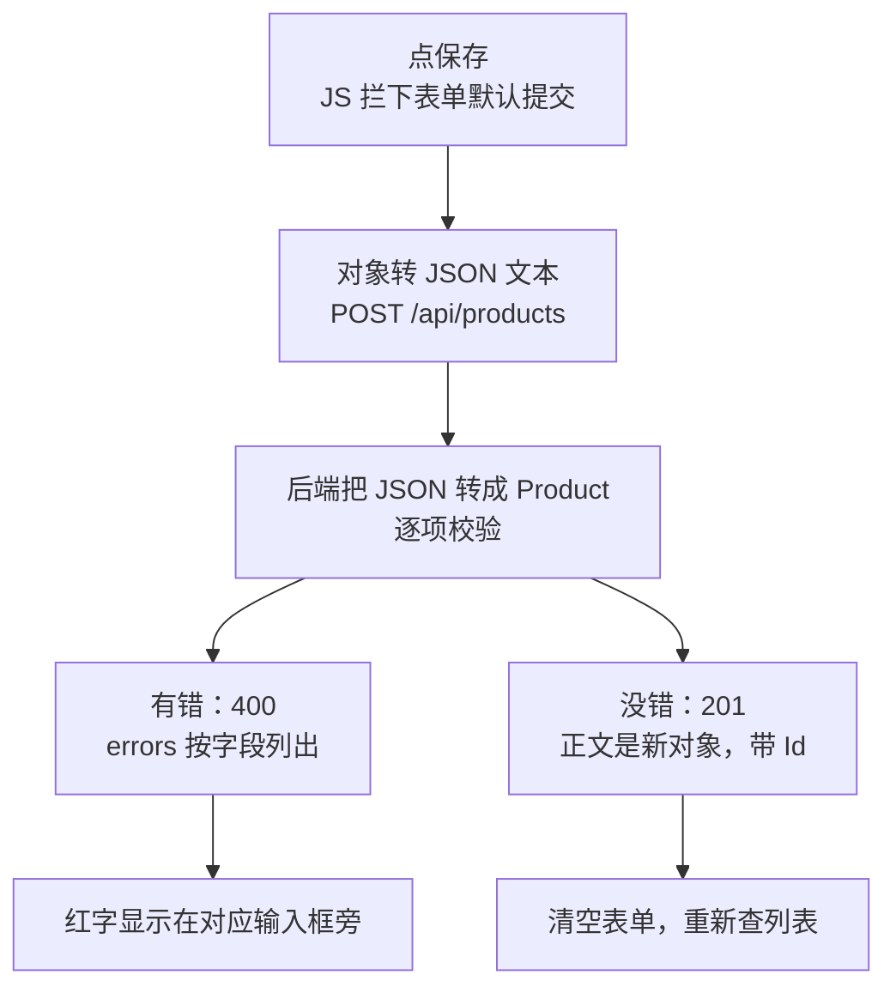

# 第 3 章 新增一条数据，填错了要知道是哪一栏

## 这一章解决什么问题

页面上填一张表单，点「保存」，数据进到后端，列表里多一行。填错了（编码重复、价格为 0），后端拒绝，并且页面要在出错的那一栏旁边显示红字，不能只弹一个"保存失败"。

## 开始之前

- 上一章你已经会了：GET 带查询条件、按状态码区分 200 和 404。
- 环境：在第 2 章的项目上改，或打开 `code/ch03/FetchDemo`。本章页面去掉了"查一条"，只保留搜索，让代码短一些。
- 本章新概念 3 个：**fetch 发 POST + JSON 正文**、**后端从正文绑定对象 + 201**、**校验失败返回 400 + 字段错误**。

## 正文

### 3.1 全貌：一次保存的来回

🖼 图解：



### 3.2 后端：MapPost 和校验

`Program.cs` 整个替换成：

```csharp
// code/ch03/FetchDemo/Program.cs
var builder = WebApplication.CreateBuilder(args);
var app = builder.Build();

app.UseDefaultFiles();
app.UseStaticFiles();

var products = new List<Product>
{
    new() { Id = 1, Code = "P001", Name = "彩超主机 X1", Price = 268000m },
    new() { Id = 2, Code = "P002", Name = "凸阵探头 C5", Price = 32000m },
    new() { Id = 3, Code = "P003", Name = "线阵探头 L12", Price = 28500m },
    new() { Id = 4, Code = "P004", Name = "耦合剂 250ml", Price = 12.5m },
    new() { Id = 5, Code = "P005", Name = "便携彩超 M3", Price = 156000m },
};

app.MapGet("/api/products", (string? keyword) =>
    string.IsNullOrWhiteSpace(keyword)
        ? products
        : products.Where(p => p.Name.Contains(keyword)).ToList());

app.MapGet("/api/products/{id:int}", (int id) =>
{
    var product = products.FirstOrDefault(p => p.Id == id);
    return product is null ? Results.NotFound() : Results.Ok(product);
});

// 参数是类（不是 string/int），框架就从请求正文里按 JSON 反序列化
app.MapPost("/api/products", (Product input) =>
{
    // 键用小写字段名，前端拿到后能直接对应到输入框
    var errors = new Dictionary<string, string[]>();
    if (string.IsNullOrWhiteSpace(input.Code))
        errors["code"] = ["编码必填"];
    else if (products.Any(p => p.Code == input.Code))
        errors["code"] = ["编码已存在"];
    if (string.IsNullOrWhiteSpace(input.Name))
        errors["name"] = ["名称必填"];
    if (input.Price <= 0)
        errors["price"] = ["价格必须大于 0"];

    // 有错就返回 400，正文里带上每个字段的错误
    if (errors.Count > 0)
        return Results.ValidationProblem(errors);

    // Id 由后端分配，前端传了也覆盖掉
    input.Id = products.Count == 0 ? 1 : products.Max(p => p.Id) + 1;
    products.Add(input);
    // 201 Created：告诉前端"建好了，新数据在这个地址"，正文是新对象
    return Results.Created($"/api/products/{input.Id}", input);
});

app.Run();

class Product
{
    public int Id { get; set; }
    public string Code { get; set; } = "";
    public string Name { get; set; } = "";
    public decimal Price { get; set; }
}
```

**概念二：后端从正文绑定对象 + 201。**

- **白话定义**：处理函数的参数是一个类（这里是 `Product`），Minimal API 就读请求正文，按 JSON 反序列化成这个类的对象。JSON 字段名大小写不敏感，`code` 能对上 `Code`。
- **场景**：新增一张价格申请单，十几个字段一次提交。
- **反例（什么时候不该用）**：直接把实体类当输入，前端就能顺带传任何属性。本例的 `Id` 由后端覆盖，所以没事；如果类里有"审批状态""创建人"这类不该由前端决定的字段，应该另建一个只含可填字段的输入类。

成功时返回 `Results.Created(地址, 对象)`，状态码 201，响应头 `Location: /api/products/6` 指向新数据，正文是带了新 Id 的对象。前端要显示"已新增 Id 6"，就从正文里取。

**概念三：校验失败返回 400 + 字段错误。**

- **白话定义**：`Results.ValidationProblem(字典)` 返回状态码 400，正文是标准格式（RFC 9110 定义的"问题详情"，Problem Details）的 JSON，其中 `errors` 就是你传的字典。
- **场景**：编码重复、必填项为空、金额不合理。凡是"用户改一下输入就能通过"的错误。
- **反例（什么时候不该用）**：不是用户输入问题的错误，比如数据库连不上。那是服务器的错，应该是 500，不要用 400 告诉用户"你填错了"。

用实测的一次请求看清格式。什么都不填直接点保存，前端发出：

```json
{"code":"","name":"","price":0}
```

后端返回 400，正文：

```json
{"type":"https://tools.ietf.org/html/rfc9110#section-15.5.1","title":"One or more validation errors occurred.","status":400,"errors":{"code":["编码必填"],"name":["名称必填"],"price":["价格必须大于 0"]}}
```

🔍 `errors` 的键原样输出（这里是小写的 `code`），值是字符串数组，因为一个字段可能同时有多条错误。前端只需要读 `errors`，`type`、`title` 不用管。

> 为什么校验写在后端，不只在前端用 `required` 属性挡一下：前端的检查用户可以绕过（F12 改页面、直接调接口）；"编码已存在"这类要查数据才知道的规则，前端也做不了。前端检查只是让用户少等一次，后端检查才是最终把关。

### 3.3 前端：表单提交

`wwwroot/index.html`：

```html
<!-- code/ch03/FetchDemo/wwwroot/index.html -->
<!DOCTYPE html>
<html lang="zh-CN">
<head>
  <meta charset="utf-8">
  <title>产品列表</title>
  <style>
    .err { color: red; }
  </style>
</head>
<body>
  <h1>产品列表</h1>

  <h2>新增产品</h2>
  <form id="addForm">
    <p>编码：<input id="code"> <span class="err" id="err-code"></span></p>
    <p>名称：<input id="name"> <span class="err" id="err-name"></span></p>
    <p>价格：<input id="price" type="number" step="0.01"> <span class="err" id="err-price"></span></p>
    <!-- type="submit"：点它或在输入框里按回车，都会触发表单的 submit 事件 -->
    <button type="submit">保存</button>
  </form>

  <h2>列表</h2>
  <p>
    名称包含：<input id="keyword">
    <button id="btnSearch">查询</button>
  </p>
  <p id="msg"></p>
  <table border="1">
    <thead>
      <tr><th>Id</th><th>编码</th><th>名称</th><th>价格</th></tr>
    </thead>
    <tbody id="rows"></tbody>
  </table>
  <script src="app.js"></script>
</body>
</html>
```

`wwwroot/app.js`：

```javascript
// code/ch03/FetchDemo/wwwroot/app.js
const msg = document.getElementById('msg');

function renderRows(products) {
  const tbody = document.getElementById('rows');
  tbody.innerHTML = '';
  for (const p of products) {
    const tr = document.createElement('tr');
    for (const value of [p.id, p.code, p.name, p.price]) {
      const td = document.createElement('td');
      td.textContent = value;
      tr.appendChild(td);
    }
    tbody.appendChild(tr);
  }
}

async function search() {
  const keyword = document.getElementById('keyword').value.trim();
  const query = new URLSearchParams({ keyword });
  const response = await fetch('/api/products?' + query);
  const products = await response.json();
  renderRows(products);
  msg.textContent = products.length === 0 ? '没有符合条件的产品' : `共 ${products.length} 条`;
}

// 清掉上一次的红字，否则改对了旧错误还挂在那里
function clearErrors() {
  for (const span of document.querySelectorAll('.err')) span.textContent = '';
}

// errors 形如 { code: ['编码已存在'], price: ['价格必须大于 0'] }
function showErrors(errors) {
  for (const [field, messages] of Object.entries(errors)) {
    document.getElementById('err-' + field).textContent = messages.join('；');
  }
}

async function addProduct(e) {
  // 阻止浏览器按传统方式提交表单：不阻止的话页面会整页刷新，fetch 白发
  e.preventDefault();
  clearErrors();

  const product = {
    code: document.getElementById('code').value.trim(),
    name: document.getElementById('name').value.trim(),
    // 输入框的值永远是字符串，转成数字再发；空字符串转出来是 0，交给后端校验
    price: Number(document.getElementById('price').value),
  };

  const response = await fetch('/api/products', {
    method: 'POST',
    // 告诉后端正文是 JSON；不写这行后端返回 415
    headers: { 'Content-Type': 'application/json' },
    // 对象必须先转成 JSON 文本，fetch 不会自动转
    body: JSON.stringify(product),
  });

  // response.ok 表示状态码在 200–299 之间
  if (!response.ok) {
    const problem = await response.json();
    showErrors(problem.errors);
    return;
  }

  const created = await response.json();
  document.getElementById('addForm').reset(); // 成功后清空表单
  await search(); // 重新查列表，新数据才会出现
  msg.textContent = `已新增：${created.code} ${created.name}（Id ${created.id}）`;
}

document.getElementById('addForm').addEventListener('submit', addProduct);
document.getElementById('btnSearch').addEventListener('click', search);
search();
```

**概念一：fetch 发 POST + JSON 正文。**

- **白话定义**：`fetch` 的第二个参数是选项对象，`method` 指定请求方法，`headers` 写请求头，`body` 是正文文本。
- **场景**：新增、提交审批这类"要把一批数据交给后端"的操作。
- **反例（什么时候不该用）**：上传文件。文件要用 `FormData` 作为 body，并且**不要**手工写 `Content-Type`，本教程不展开。

三个选项缺一不可：

| 选项 | 作用 | 漏掉的后果（实测） |
|---|---|---|
| `method: 'POST'` | 请求方法 | 默认是 GET，带正文的 GET 不允许发送，报 `TypeError: Failed to execute 'fetch' on 'Window': Request with GET/HEAD method cannot have body.` |
| `headers: { 'Content-Type': 'application/json' }` | 声明正文格式 | 后端返回 415 |
| `body: JSON.stringify(product)` | 正文必须是文本 | 发出去的是 `[object Object]`，后端返回 400 |

另外两行支撑代码：

| 代码 | 为什么需要 |
|---|---|
| `e.preventDefault()` | `<form>` 的默认行为是整页提交并刷新。不拦住，JS 后面的显示逻辑都来不及看 |
| `response.ok` | 状态码 200–299 时为 `true`。比写 `status === 201` 宽松，后端以后改成返回 200 前端也不用改 |

### 3.4 跑起来看结果

`Ctrl+F5` 运行，打开 `http://localhost:5080/`。以下是实测：

| 操作 | 实测结果 |
|---|---|
| 什么都不填，点保存 | 三个输入框旁边分别出现：编码必填 / 名称必填 / 价格必须大于 0 |
| 编码 P002、名称 凸阵探头 C6、价格 30000 | 只有编码旁出现"编码已存在"，另外两栏没有红字 |
| 编码 P006、名称 腔内探头 E8、价格 41000，在价格框按回车 | 红字全消失，表单清空，列表变成 6 行，提示"已新增：P006 腔内探头 E8（Id 6）" |

失败的两次，F12 控制台会有一行 `Failed to load resource: the server responded with a status of 400 (Bad Request)`，和第 2 章一样，是浏览器的记录，不是代码错误。

> 数据存在内存里，重新运行程序后 P006 就没了，又是 5 条。这是本教程有意的简化。

### 3.5 改坏几处试试

**改坏一：注释掉 `e.preventDefault();`**，填正确数据点保存。

现象：页面整页刷新，地址栏变成 `http://localhost:5080/?`，"已新增"提示看不到。实测这一次请求还是到了后端（刷新后列表 6 条），但浏览器在页面跳走时也可能直接取消还没完成的 fetch，结果不可预测。

**改坏二：注释掉 `headers` 那一行。**

现象：控制台出现：

```text
Failed to load resource: the server responded with a status of 415 (Unsupported Media Type)
Uncaught (in promise) SyntaxError: Failed to execute 'json' on 'Response': Unexpected end of JSON input
```

原因：没写 `Content-Type` 时，fetch 发字符串正文默认标成 `text/plain`，后端只接受 JSON，返回 415（不支持的媒体类型）且没有正文；前端对空正文调 `.json()`，又报一次错。

**改坏三：`body: JSON.stringify(product)` 改成 `body: product`。**

现象：控制台出现：

```text
Failed to load resource: the server responded with a status of 400 (Bad Request)
Uncaught (in promise) SyntaxError: Unexpected token 'M', "Microsoft."... is not valid JSON
```

原因：fetch 把对象转成字符串 `[object Object]` 发出去。后端解析 JSON 失败，返回 400，正文是一段异常文本：

```text
Microsoft.AspNetCore.Http.BadHttpRequestException: Failed to read parameter "Product input" from the request body as JSON.
 ---> System.Text.Json.JsonException: The JSON value could not be converted to Product. Path: $ | LineNumber: 0 | BytePositionInLine: 1.
```

注意这个 400 和校验失败的 400 **不是一回事**：它根本没进你的处理函数，正文也不是 JSON（开发环境下是异常文本），所以前端 `.json()` 失败。第 4 章会写一个统一的请求函数，把这类"非 JSON 的错误响应"也处理掉。

**改坏四：价格不转数字。** 把 `price: Number(...)` 改成 `price: document.getElementById('price').value`。

现象：价格填 41000 时**照样成功**；价格不填时，前端报 `Unexpected token 'M'`，后端异常文本里是 `The JSON value could not be converted to System.Decimal. Path: $.price`。

原因：ASP.NET Core 默认允许把 `"41000"` 这种带引号的数字读成数字，所以平时看不出问题；空字符串 `""` 转不成数字，在反序列化阶段就失败，用户看不到"价格必须大于 0"的友好提示。转成数字再发，空值变成 0，才能走到你写的校验。

## 🧱 类比

后端校验像柜台收表：不合格的表退回来，并用红笔在每个填错的栏目旁边写上原因（400 + errors）；合格的表收下，给你一张回执，上面有受理编号（201 + 新 Id）。

## ⚠️ 踩坑警告

| 现象 | 原因 | 怎么改 |
|---|---|---|
| 点保存后页面闪一下、地址多了 `?` | 没有 `e.preventDefault()`，表单按传统方式提交 | 在 submit 处理函数第一行调用 |
| 415 Unsupported Media Type | 没写 `Content-Type: application/json` | 补上请求头 |
| 400，前端报 `Unexpected token 'M' ... is not valid JSON` | 正文不是合法 JSON，或字段类型对不上（如空字符串给数字字段），没进到处理函数 | `JSON.stringify` 发送；数字字段先 `Number()`；F12 网络面板看「响应」里的异常文本 |
| 改对了输入，旧的红字还在 | 没清掉上一次的错误 | 每次提交前先 `clearErrors()` |

## 🎯 动手练习

**练习 1：加一条校验规则。** 名称超过 20 个字时，后端拒绝，名称旁显示"名称不能超过 20 个字"。前端代码不用改。

验收标准：名称填 21 个字、其他正确，点保存后名称旁出现该红字，列表不变；改成正常名称再保存，红字消失，新增成功。

**练习 2：连续录入。** 新增成功后，光标自动回到"编码"框，用户可以直接录下一条。

验收标准：新增成功后不点鼠标，直接打字，字出现在编码框里。

卡住了看文末参考答案。

## 📌 一句话总结

POST 发 JSON 文本，后端校验失败回 400 带 errors，前端按字段显示。

## 下一章

用户还要删除数据，各种错误也要统一处理：第 4 章讲 DELETE 和一个所有请求共用的 api() 函数。

---

<!-- 以下是参考答案，先自己动手，卡住了再往下翻 -->


## 参考答案

### 练习 1

思路：前端的 `showErrors` 只认 `errors` 里的键，所以后端多一条规则、用同一个键 `name`，前端自动显示。用 `else if` 是为了名称为空时只报"必填"。只改 `Program.cs`：

```csharp
// code/ch03/Answer1-NameLength/Program.cs
var builder = WebApplication.CreateBuilder(args);
var app = builder.Build();

app.UseDefaultFiles();
app.UseStaticFiles();

var products = new List<Product>
{
    new() { Id = 1, Code = "P001", Name = "彩超主机 X1", Price = 268000m },
    new() { Id = 2, Code = "P002", Name = "凸阵探头 C5", Price = 32000m },
    new() { Id = 3, Code = "P003", Name = "线阵探头 L12", Price = 28500m },
    new() { Id = 4, Code = "P004", Name = "耦合剂 250ml", Price = 12.5m },
    new() { Id = 5, Code = "P005", Name = "便携彩超 M3", Price = 156000m },
};

app.MapGet("/api/products", (string? keyword) =>
    string.IsNullOrWhiteSpace(keyword)
        ? products
        : products.Where(p => p.Name.Contains(keyword)).ToList());

app.MapGet("/api/products/{id:int}", (int id) =>
{
    var product = products.FirstOrDefault(p => p.Id == id);
    return product is null ? Results.NotFound() : Results.Ok(product);
});

// 参数是类（不是 string/int），框架就从请求正文里按 JSON 反序列化
app.MapPost("/api/products", (Product input) =>
{
    // 键用小写字段名，前端拿到后能直接对应到输入框
    var errors = new Dictionary<string, string[]>();
    if (string.IsNullOrWhiteSpace(input.Code))
        errors["code"] = ["编码必填"];
    else if (products.Any(p => p.Code == input.Code))
        errors["code"] = ["编码已存在"];
    if (string.IsNullOrWhiteSpace(input.Name))
        errors["name"] = ["名称必填"];
    // 新规则：用 else if，名称为空时只提示"必填"，不同时提示长度
    else if (input.Name.Length > 20)
        errors["name"] = ["名称不能超过 20 个字"];
    if (input.Price <= 0)
        errors["price"] = ["价格必须大于 0"];

    // 有错就返回 400，正文里带上每个字段的错误
    if (errors.Count > 0)
        return Results.ValidationProblem(errors);

    // Id 由后端分配，前端传了也覆盖掉
    input.Id = products.Count == 0 ? 1 : products.Max(p => p.Id) + 1;
    products.Add(input);
    // 201 Created：告诉前端"建好了，新数据在这个地址"，正文是新对象
    return Results.Created($"/api/products/{input.Id}", input);
});

app.Run();

class Product
{
    public int Id { get; set; }
    public string Code { get; set; } = "";
    public string Name { get; set; } = "";
    public decimal Price { get; set; }
}
```

### 练习 2

思路：`reset()` 只清空值，不移动光标；成功后对编码框调用 `focus()`。只改 `app.js`：

```javascript
// code/ch03/Answer2-Focus/wwwroot/app.js
const msg = document.getElementById('msg');

function renderRows(products) {
  const tbody = document.getElementById('rows');
  tbody.innerHTML = '';
  for (const p of products) {
    const tr = document.createElement('tr');
    for (const value of [p.id, p.code, p.name, p.price]) {
      const td = document.createElement('td');
      td.textContent = value;
      tr.appendChild(td);
    }
    tbody.appendChild(tr);
  }
}

async function search() {
  const keyword = document.getElementById('keyword').value.trim();
  const query = new URLSearchParams({ keyword });
  const response = await fetch('/api/products?' + query);
  const products = await response.json();
  renderRows(products);
  msg.textContent = products.length === 0 ? '没有符合条件的产品' : `共 ${products.length} 条`;
}

// 清掉上一次的红字，否则改对了旧错误还挂在那里
function clearErrors() {
  for (const span of document.querySelectorAll('.err')) span.textContent = '';
}

// errors 形如 { code: ['编码已存在'], price: ['价格必须大于 0'] }
function showErrors(errors) {
  for (const [field, messages] of Object.entries(errors)) {
    document.getElementById('err-' + field).textContent = messages.join('；');
  }
}

async function addProduct(e) {
  // 阻止浏览器按传统方式提交表单：不阻止的话页面会整页刷新，fetch 白发
  e.preventDefault();
  clearErrors();

  const product = {
    code: document.getElementById('code').value.trim(),
    name: document.getElementById('name').value.trim(),
    // 输入框的值永远是字符串，转成数字再发；空字符串转出来是 0，交给后端校验
    price: Number(document.getElementById('price').value),
  };

  const response = await fetch('/api/products', {
    method: 'POST',
    // 告诉后端正文是 JSON；不写这行后端返回 415
    headers: { 'Content-Type': 'application/json' },
    // 对象必须先转成 JSON 文本，fetch 不会自动转
    body: JSON.stringify(product),
  });

  // response.ok 表示状态码在 200–299 之间
  if (!response.ok) {
    const problem = await response.json();
    showErrors(problem.errors);
    return;
  }

  const created = await response.json();
  document.getElementById('addForm').reset(); // 成功后清空表单
  document.getElementById('code').focus(); // 光标回到第一个输入框，方便连续录入
  await search(); // 重新查列表，新数据才会出现
  msg.textContent = `已新增：${created.code} ${created.name}（Id ${created.id}）`;
}

document.getElementById('addForm').addEventListener('submit', addProduct);
document.getElementById('btnSearch').addEventListener('click', search);
search();
```
