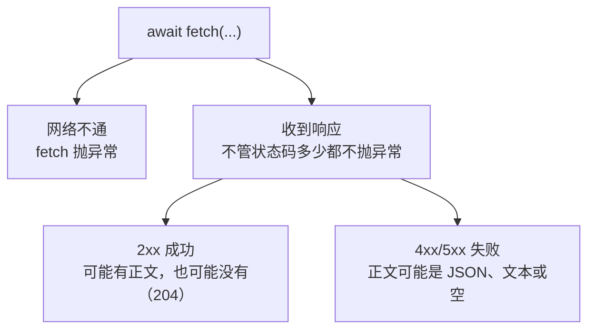

# 第 4 章 删除一条数据，并把各种错误统一处理

## 这一章解决什么问题

第 3 章最后几个"改坏"暴露了一个问题：每个 fetch 调用都要自己判断状态码、自己防备"没有正文""正文不是 JSON""服务器没开"。功能一多，总有一处漏掉。本章先加上删除功能，再写一个所有请求共用的 `api()` 函数，把这些判断集中在一个地方。

## 开始之前

- 上一章你已经会了：POST 提交 JSON、按字段显示 400 校验错误。
- 环境：在第 3 章的项目上改，或打开 `code/ch04/FetchDemo`。
- 本章新概念 2 个：**DELETE 与 204**、**统一请求函数 api()**。

## 正文

### 4.1 一次请求可能出现的所有结果

🖼 图解：



把前几章遇到过的情况列在一起：

| 情况 | 状态码 | 正文 | 第几章遇到 |
|---|---|---|---|
| 查询成功 | 200 | JSON | 第 1 章 |
| 新增成功 | 201 | JSON | 第 3 章 |
| 删除成功 | 204 | 空 | 本章 |
| 校验失败 | 400 | JSON（`application/problem+json`） | 第 3 章 |
| 请求格式错（如正文不是 JSON） | 400 | 开发环境下是异常文本 | 第 3 章改坏三 |
| 查不到 | 404 | 空 | 第 2 章 |
| 后端代码抛异常 | 500 | 开发环境下是异常文本 | 本章练习 2 |
| 后端没启动 | 无 | 无，fetch 直接抛 `TypeError: Failed to fetch` | 第 1 章改坏四 |

只有最后一种会让 `fetch` 抛异常。**404、500 对 fetch 来说都是"成功收到了响应"**，不检查状态码就会被当成成功。

### 4.2 后端：MapDelete

在第 3 章 `Program.cs` 的 `app.Run();` 前面加下面这个接口，其余不变（完整文件见 `code/ch04/FetchDemo/Program.cs`）：

```csharp
app.MapDelete("/api/products/{id:int}", (int id) =>
{
    // RemoveAll 返回删掉了几条：0 条说明这个 Id 本来就不存在
    var removed = products.RemoveAll(p => p.Id == id);
    // 204 No Content：删掉了，没有要返回的内容
    return removed == 0 ? Results.NotFound() : Results.NoContent();
});
```

**概念一：DELETE 与 204。**

- **白话定义**：HTTP 方法 DELETE 表示删除地址指向的资源；成功后没有内容可返回，用 204 No Content。
- **场景**：删除一条草稿状态的价格申请。
- **反例（什么时候不该用）**：需要保留痕迹的数据，比如已审批的单据。这类业务通常是"作废"，改状态字段而不是真删除，接口应该是修改（第 5 章的 PUT），不是 DELETE。

先用浏览器 F12 控制台测（地址栏不能发 DELETE）。打开 `http://localhost:5080/`，F12 →「控制台（Console）」，粘贴回车：

```javascript
(await fetch('/api/products/3', { method: 'DELETE' })).status
```

第一次返回 `204`，再执行一次返回 `404`。

> 控制台里可以直接写顶层 `await`，`.js` 文件里不行（除非是模块脚本），所以 app.js 里总要包在 `async function` 里。

### 4.3 前端：统一请求函数 api()

`api()` 放在单独的文件 `wwwroot/api.js` 里，第 5 章原样复用：

```javascript
// code/ch04/FetchDemo/wwwroot/api.js
// 页面里所有请求共用；先于 app.js 加载
// 所有请求都走这个函数：成功返回数据（没有正文时返回 null），失败抛出 Error
async function api(method, url, data) {
  const options = { method, headers: {} };
  if (data !== undefined) {
    options.headers['Content-Type'] = 'application/json';
    options.body = JSON.stringify(data);
  }

  let response;
  try {
    response = await fetch(url, options);
  } catch {
    // fetch 只在网络不通时抛异常；404、500 这些不会进这里
    throw new Error('连不上服务器，请确认后端程序在运行');
  }

  // 先按文本读：204、404 没有正文，开发环境的 400/500 可能是纯文本，都不能直接 .json()
  const text = await response.text();
  const isJson = (response.headers.get('Content-Type') ?? '').includes('json');
  const body = isJson && text ? JSON.parse(text) : null;

  if (response.ok) return body;

  let message = `服务器出错（状态码 ${response.status}）`;
  if (response.status === 400) message = '输入有误，请看红字提示';
  if (response.status === 404) message = '这条数据不存在，可能已被删除';
  const error = new Error(message);
  error.errors = body?.errors ?? {}; // 校验错误按字段带出去，没有就是空对象
  throw error;
}
```

`wwwroot/index.html`（比第 3 章多了"删除产品"一栏，并且先加载 api.js）：

```html
<!-- code/ch04/FetchDemo/wwwroot/index.html -->
<!DOCTYPE html>
<html lang="zh-CN">
<head>
  <meta charset="utf-8">
  <title>产品列表</title>
  <style>
    .err { color: red; }
  </style>
</head>
<body>
  <h1>产品列表</h1>

  <h2>新增产品</h2>
  <form id="addForm">
    <p>编码：<input id="code"> <span class="err" id="err-code"></span></p>
    <p>名称：<input id="name"> <span class="err" id="err-name"></span></p>
    <p>价格：<input id="price" type="number" step="0.01"> <span class="err" id="err-price"></span></p>
    <button type="submit">保存</button>
  </form>

  <h2>删除产品</h2>
  <p>
    Id：<input id="deleteId" type="number">
    <button id="btnDelete">删除</button>
  </p>

  <h2>列表</h2>
  <p>
    名称包含：<input id="keyword">
    <button id="btnSearch">查询</button>
  </p>
  <p id="msg"></p>
  <table border="1">
    <thead>
      <tr><th>Id</th><th>编码</th><th>名称</th><th>价格</th></tr>
    </thead>
    <tbody id="rows"></tbody>
  </table>
  <!-- 顺序不能反：app.js 一加载就会调用 api.js 里的 api() -->
  <script src="api.js"></script>
  <script src="app.js"></script>
</body>
</html>
```

两个 `<script>` 标签加载的普通脚本共用同一个全局作用域，所以 app.js 能直接调用 api.js 里定义的 `api`。

`wwwroot/app.js`：

```javascript
// code/ch04/FetchDemo/wwwroot/app.js
const msg = document.getElementById('msg');

function renderRows(products) {
  const tbody = document.getElementById('rows');
  tbody.innerHTML = '';
  for (const p of products) {
    const tr = document.createElement('tr');
    for (const value of [p.id, p.code, p.name, p.price]) {
      const td = document.createElement('td');
      td.textContent = value;
      tr.appendChild(td);
    }
    tbody.appendChild(tr);
  }
}

async function search() {
  const keyword = document.getElementById('keyword').value.trim();
  const query = new URLSearchParams({ keyword });
  try {
    const products = await api('GET', '/api/products?' + query);
    renderRows(products);
    msg.textContent = products.length === 0 ? '没有符合条件的产品' : `共 ${products.length} 条`;
  } catch (err) {
    msg.textContent = err.message;
  }
}

function clearErrors() {
  for (const span of document.querySelectorAll('.err')) span.textContent = '';
}

function showErrors(errors) {
  for (const [field, messages] of Object.entries(errors)) {
    document.getElementById('err-' + field).textContent = messages.join('；');
  }
}

async function addProduct(e) {
  e.preventDefault();
  clearErrors();
  const product = {
    code: document.getElementById('code').value.trim(),
    name: document.getElementById('name').value.trim(),
    price: Number(document.getElementById('price').value),
  };
  try {
    const created = await api('POST', '/api/products', product);
    document.getElementById('addForm').reset();
    await search();
    msg.textContent = `已新增：${created.code} ${created.name}（Id ${created.id}）`;
  } catch (err) {
    showErrors(err.errors ?? {});
    msg.textContent = err.message;
  }
}

async function deleteProduct() {
  const id = document.getElementById('deleteId').value;
  if (id === '') {
    msg.textContent = '请先输入要删除的 Id';
    return;
  }
  // confirm 弹出确认框，点「取消」返回 false
  if (!confirm(`确定删除 Id ${id} 吗？`)) return;
  try {
    await api('DELETE', '/api/products/' + id); // 成功时是 204，api 返回 null，不用接
    await search();
    msg.textContent = `已删除 Id ${id}`;
  } catch (err) {
    msg.textContent = err.message;
  }
}

document.getElementById('addForm').addEventListener('submit', addProduct);
document.getElementById('btnDelete').addEventListener('click', deleteProduct);
document.getElementById('btnSearch').addEventListener('click', search);
search();
```

**概念二：统一请求函数 api()。**

- **白话定义**：一个包住 fetch 的函数，约定只有两种结果：成功就返回数据，失败就抛出带中文提示的 `Error`。调用方只写一个 `try/catch`。
- **场景**：一个页面有查询、新增、删除、修改，以后还有审批、导出。每个按钮都只关心"成功怎么显示、失败怎么显示"。
- **反例（什么时候不该用）**：只有一两个 fetch 的小页面，直接写更直观；下载文件、读流式数据这类不是 JSON 的请求，也不要硬塞进这个函数，它会把正文按文本读掉。

🔍 拆解 `api()` 的三道关：

| 关口 | 代码 | 处理了 4.1 节的哪些情况 |
|---|---|---|
| 网络 | `try { await fetch } catch { throw ... }` | 后端没启动 |
| 正文 | 先 `text()`，响应头是 JSON 且不为空才 `JSON.parse` | 204 和 404 的空正文、异常文本 |
| 状态码 | `response.ok` 为 false 就 `throw`，并把 `errors` 挂在异常上 | 400、404、500 |

调用方都变成同一个写法（下面是写法示意，中文部分换成实际内容）：

```javascript
try {
  const 结果 = await api('方法', '地址', 数据);
  // 只写成功的显示
} catch (err) {
  // 只写失败的显示：err.message 是中文提示，err.errors 是字段错误
}
```

`addProduct` 也改成用 `api()`：和第 3 章相比，不再自己写 `headers`、`JSON.stringify`、`response.ok`。

### 4.4 跑起来看结果

`Ctrl+F5` 运行，打开 `http://localhost:5080/`。以下是实测：

| 操作 | 页面提示 | 列表 |
|---|---|---|
| 新增：编码 P002，名称 x，价格 1 | 输入有误，请看红字提示（编码旁：编码已存在） | 5 条 |
| 删除 Id 为空，点删除 | 请先输入要删除的 Id | 5 条 |
| 删除 Id 填 3，点删除，确认框点「确定」 | 已删除 Id 3 | 4 条 |
| 再点一次删除 Id 3 | 这条数据不存在，可能已被删除 | 4 条 |
| 关掉运行程序的控制台窗口（或在其中按 `Ctrl+C`），页面不刷新，再点查询 | 连不上服务器，请确认后端程序在运行 | 不变 |

第 3 章"正文不是 JSON"的情况现在也不会再出 `Uncaught` 报错了。在 F12 控制台执行（`api` 是 app.js 里的全局函数，控制台能直接调用）：

```javascript
try { await api('POST', '/api/products', 'abc'); } catch (e) { e.message }
```

结果是 `'输入有误，请看红字提示'`。后端返回的仍是 400 + `text/plain` 异常文本，但 `api()` 看到响应头不是 JSON，就不去解析了。

### 4.5 改坏几处试试

**改坏一：不看状态码。** 把 api.js 里的 `if (response.ok) return body;` 改成 `return body;`，删除 Id 99。

现象：页面显示"已删除 Id 99"，但根本没有这条数据。

原因：404 不会让 fetch 抛异常，不检查 `response.ok`，失败就被当成成功。这是 fetch 最常见的误用。

**改坏二：直接读 JSON。** 把

```javascript
  const text = await response.text();
  const isJson = (response.headers.get('Content-Type') ?? '').includes('json');
  const body = isJson && text ? JSON.parse(text) : null;
```

改成

```javascript
  const body = await response.json();
```

删除 Id 3。

现象：页面提示变成 `Failed to execute 'json' on 'Response': Unexpected end of JSON input`，列表还是 5 条；刷新页面后变成 4 条。

原因：删除其实成功了，但 204 没有正文，`.json()` 抛异常，进了 `catch`，后面的 `search()` 没执行。用户看到报错，以为没删掉，再点一次就会得到 404。

## 🧱 类比

`api()` 像公司的收发室：所有寄出和收到的件都经过它，它负责检查"有没有退件、包裹是不是空的、地址对不对"，各部门只管拆开能用的东西，不用每人都学一遍检查流程。

## ⚠️ 踩坑警告

| 现象 | 原因 | 怎么改 |
|---|---|---|
| 操作明明失败了，页面却显示成功 | fetch 对 404、500 不抛异常，代码没检查 `response.ok` | 所有请求走 `api()`，在一处检查 |
| 删除成功，页面却报 `Unexpected end of JSON input` | 对 204 空正文调了 `.json()` | 先 `text()`，有内容且是 JSON 再解析 |
| 页面报 `Unexpected token 'M', "Microsoft."... is not valid JSON` | 开发环境下 400/500 的正文是异常文本，不是 JSON | 解析前看 `Content-Type` 响应头 |
| 页面一打开就提示 `api is not defined` | index.html 里 app.js 写在了 api.js 前面，app.js 末尾的 `search()` 执行时 `api` 还没定义 | api.js 的 `<script>` 放在前面 |
| 开发时 500 能在 F12 里看到异常详情，发布后只剩一个 500、正文为空 | 异常详情页只在 Development 环境开启，发布后是 Production 环境，不对外暴露异常 | 前端只依赖状态码给提示；排查时看服务器日志，不要指望响应正文 |

## 🎯 动手练习

**练习 1：把"按 Id 查一条"加回来。** 页面增加第 2 章的"按 Id 查一条"，这次用 `api()` 写。

验收标准：Id 填 1 显示 1 行、提示"找到 1 条"；Id 填 99 表格清空、提示"这条数据不存在，可能已被删除"；控制台没有 `Uncaught` 开头的报错。代码里不出现 `response.status`。

**练习 2：测试服务器出错。** 后端加一个 `GET /api/boom` 接口，里面直接 `throw` 一个异常；页面加一个「测试服务器出错」按钮调用它。

验收标准：点按钮后提示"服务器出错（状态码 500）"，控制台没有 `Uncaught` 开头的报错。`api()` 函数本身不用改。

卡住了看文末参考答案。

## 📌 一句话总结

fetch 遇到 404、500 不抛异常，状态码和空正文统一交给 api() 判断。

## 下一章

用户要直接在表格每一行上点「编辑」「删除」：第 5 章讲 PUT 修改和表格按钮的点击处理。

---

<!-- 以下是参考答案，先自己动手，卡住了再往下翻 -->


## 参考答案

### 练习 1

思路：404 已经被 `api()` 变成异常，`getOne` 只剩"成功显示一行、失败清空并显示提示"两条路。`Program.cs`、`api.js` 不变。

`wwwroot/index.html`：

```html
<!-- code/ch04/Answer1-GetOne/wwwroot/index.html -->
<!DOCTYPE html>
<html lang="zh-CN">
<head>
  <meta charset="utf-8">
  <title>产品列表</title>
  <style>
    .err { color: red; }
  </style>
</head>
<body>
  <h1>产品列表</h1>

  <h2>新增产品</h2>
  <form id="addForm">
    <p>编码：<input id="code"> <span class="err" id="err-code"></span></p>
    <p>名称：<input id="name"> <span class="err" id="err-name"></span></p>
    <p>价格：<input id="price" type="number" step="0.01"> <span class="err" id="err-price"></span></p>
    <button type="submit">保存</button>
  </form>

  <h2>按 Id 查一条</h2>
  <p>
    Id：<input id="productId" type="number">
    <button id="btnGetOne">查一条</button>
  </p>

  <h2>删除产品</h2>
  <p>
    Id：<input id="deleteId" type="number">
    <button id="btnDelete">删除</button>
  </p>

  <h2>列表</h2>
  <p>
    名称包含：<input id="keyword">
    <button id="btnSearch">查询</button>
  </p>
  <p id="msg"></p>
  <table border="1">
    <thead>
      <tr><th>Id</th><th>编码</th><th>名称</th><th>价格</th></tr>
    </thead>
    <tbody id="rows"></tbody>
  </table>
  <!-- 顺序不能反：app.js 一加载就会调用 api.js 里的 api() -->
  <script src="api.js"></script>
  <script src="app.js"></script>
</body>
</html>
```

`wwwroot/app.js`：

```javascript
// code/ch04/Answer1-GetOne/wwwroot/app.js
const msg = document.getElementById('msg');

function renderRows(products) {
  const tbody = document.getElementById('rows');
  tbody.innerHTML = '';
  for (const p of products) {
    const tr = document.createElement('tr');
    for (const value of [p.id, p.code, p.name, p.price]) {
      const td = document.createElement('td');
      td.textContent = value;
      tr.appendChild(td);
    }
    tbody.appendChild(tr);
  }
}

async function search() {
  const keyword = document.getElementById('keyword').value.trim();
  const query = new URLSearchParams({ keyword });
  try {
    const products = await api('GET', '/api/products?' + query);
    renderRows(products);
    msg.textContent = products.length === 0 ? '没有符合条件的产品' : `共 ${products.length} 条`;
  } catch (err) {
    msg.textContent = err.message;
  }
}

function clearErrors() {
  for (const span of document.querySelectorAll('.err')) span.textContent = '';
}

function showErrors(errors) {
  for (const [field, messages] of Object.entries(errors)) {
    document.getElementById('err-' + field).textContent = messages.join('；');
  }
}

async function addProduct(e) {
  e.preventDefault();
  clearErrors();
  const product = {
    code: document.getElementById('code').value.trim(),
    name: document.getElementById('name').value.trim(),
    price: Number(document.getElementById('price').value),
  };
  try {
    const created = await api('POST', '/api/products', product);
    document.getElementById('addForm').reset();
    await search();
    msg.textContent = `已新增：${created.code} ${created.name}（Id ${created.id}）`;
  } catch (err) {
    showErrors(err.errors ?? {});
    msg.textContent = err.message;
  }
}

async function getOne() {
  const id = document.getElementById('productId').value;
  if (id === '') {
    msg.textContent = '请先输入 Id';
    return;
  }
  try {
    // 404 由 api 统一变成异常，这里不用再判断状态码
    const product = await api('GET', '/api/products/' + id);
    renderRows([product]);
    msg.textContent = '找到 1 条';
  } catch (err) {
    renderRows([]);
    msg.textContent = err.message;
  }
}

async function deleteProduct() {
  const id = document.getElementById('deleteId').value;
  if (id === '') {
    msg.textContent = '请先输入要删除的 Id';
    return;
  }
  // confirm 弹出确认框，点「取消」返回 false
  if (!confirm(`确定删除 Id ${id} 吗？`)) return;
  try {
    await api('DELETE', '/api/products/' + id); // 成功时是 204，api 返回 null，不用接
    await search();
    msg.textContent = `已删除 Id ${id}`;
  } catch (err) {
    msg.textContent = err.message;
  }
}

document.getElementById('addForm').addEventListener('submit', addProduct);
document.getElementById('btnDelete').addEventListener('click', deleteProduct);
document.getElementById('btnGetOne').addEventListener('click', getOne);
document.getElementById('btnSearch').addEventListener('click', search);
search();
```

### 练习 2

思路：未处理的异常由 ASP.NET Core 变成 500；`api()` 里"其他状态码"那条默认提示已经覆盖它，前端只需要调用，`api.js` 不变。

`Program.cs`：

```csharp
// code/ch04/Answer2-Error500/Program.cs
var builder = WebApplication.CreateBuilder(args);
var app = builder.Build();

app.UseDefaultFiles();
app.UseStaticFiles();

var products = new List<Product>
{
    new() { Id = 1, Code = "P001", Name = "彩超主机 X1", Price = 268000m },
    new() { Id = 2, Code = "P002", Name = "凸阵探头 C5", Price = 32000m },
    new() { Id = 3, Code = "P003", Name = "线阵探头 L12", Price = 28500m },
    new() { Id = 4, Code = "P004", Name = "耦合剂 250ml", Price = 12.5m },
    new() { Id = 5, Code = "P005", Name = "便携彩超 M3", Price = 156000m },
};

app.MapGet("/api/products", (string? keyword) =>
    string.IsNullOrWhiteSpace(keyword)
        ? products
        : products.Where(p => p.Name.Contains(keyword)).ToList());

app.MapGet("/api/products/{id:int}", (int id) =>
{
    var product = products.FirstOrDefault(p => p.Id == id);
    return product is null ? Results.NotFound() : Results.Ok(product);
});

// 参数是类（不是 string/int），框架就从请求正文里按 JSON 反序列化
app.MapPost("/api/products", (Product input) =>
{
    // 键用小写字段名，前端拿到后能直接对应到输入框
    var errors = new Dictionary<string, string[]>();
    if (string.IsNullOrWhiteSpace(input.Code))
        errors["code"] = ["编码必填"];
    else if (products.Any(p => p.Code == input.Code))
        errors["code"] = ["编码已存在"];
    if (string.IsNullOrWhiteSpace(input.Name))
        errors["name"] = ["名称必填"];
    if (input.Price <= 0)
        errors["price"] = ["价格必须大于 0"];

    // 有错就返回 400，正文里带上每个字段的错误
    if (errors.Count > 0)
        return Results.ValidationProblem(errors);

    // Id 由后端分配，前端传了也覆盖掉
    input.Id = products.Count == 0 ? 1 : products.Max(p => p.Id) + 1;
    products.Add(input);
    // 201 Created：告诉前端"建好了，新数据在这个地址"，正文是新对象
    return Results.Created($"/api/products/{input.Id}", input);
});

app.MapDelete("/api/products/{id:int}", (int id) =>
{
    // RemoveAll 返回删掉了几条：0 条说明这个 Id 本来就不存在
    var removed = products.RemoveAll(p => p.Id == id);
    // 204 No Content：删掉了，没有要返回的内容
    return removed == 0 ? Results.NotFound() : Results.NoContent();
});

// 故意抛异常，用来测试前端对 500 的处理
app.MapGet("/api/boom", () =>
{
    throw new InvalidOperationException("测试用的异常");
});

app.Run();

class Product
{
    public int Id { get; set; }
    public string Code { get; set; } = "";
    public string Name { get; set; } = "";
    public decimal Price { get; set; }
}
```

`wwwroot/index.html`：

```html
<!-- code/ch04/Answer2-Error500/wwwroot/index.html -->
<!DOCTYPE html>
<html lang="zh-CN">
<head>
  <meta charset="utf-8">
  <title>产品列表</title>
  <style>
    .err { color: red; }
  </style>
</head>
<body>
  <h1>产品列表</h1>

  <h2>新增产品</h2>
  <form id="addForm">
    <p>编码：<input id="code"> <span class="err" id="err-code"></span></p>
    <p>名称：<input id="name"> <span class="err" id="err-name"></span></p>
    <p>价格：<input id="price" type="number" step="0.01"> <span class="err" id="err-price"></span></p>
    <button type="submit">保存</button>
  </form>

  <h2>删除产品</h2>
  <p>
    Id：<input id="deleteId" type="number">
    <button id="btnDelete">删除</button>
  </p>

  <h2>列表</h2>
  <p>
    名称包含：<input id="keyword">
    <button id="btnSearch">查询</button>
    <button id="btnBoom">测试服务器出错</button>
  </p>
  <p id="msg"></p>
  <table border="1">
    <thead>
      <tr><th>Id</th><th>编码</th><th>名称</th><th>价格</th></tr>
    </thead>
    <tbody id="rows"></tbody>
  </table>
  <!-- 顺序不能反：app.js 一加载就会调用 api.js 里的 api() -->
  <script src="api.js"></script>
  <script src="app.js"></script>
</body>
</html>
```

`wwwroot/app.js`：

```javascript
// code/ch04/Answer2-Error500/wwwroot/app.js
const msg = document.getElementById('msg');

function renderRows(products) {
  const tbody = document.getElementById('rows');
  tbody.innerHTML = '';
  for (const p of products) {
    const tr = document.createElement('tr');
    for (const value of [p.id, p.code, p.name, p.price]) {
      const td = document.createElement('td');
      td.textContent = value;
      tr.appendChild(td);
    }
    tbody.appendChild(tr);
  }
}

async function search() {
  const keyword = document.getElementById('keyword').value.trim();
  const query = new URLSearchParams({ keyword });
  try {
    const products = await api('GET', '/api/products?' + query);
    renderRows(products);
    msg.textContent = products.length === 0 ? '没有符合条件的产品' : `共 ${products.length} 条`;
  } catch (err) {
    msg.textContent = err.message;
  }
}

function clearErrors() {
  for (const span of document.querySelectorAll('.err')) span.textContent = '';
}

function showErrors(errors) {
  for (const [field, messages] of Object.entries(errors)) {
    document.getElementById('err-' + field).textContent = messages.join('；');
  }
}

async function addProduct(e) {
  e.preventDefault();
  clearErrors();
  const product = {
    code: document.getElementById('code').value.trim(),
    name: document.getElementById('name').value.trim(),
    price: Number(document.getElementById('price').value),
  };
  try {
    const created = await api('POST', '/api/products', product);
    document.getElementById('addForm').reset();
    await search();
    msg.textContent = `已新增：${created.code} ${created.name}（Id ${created.id}）`;
  } catch (err) {
    showErrors(err.errors ?? {});
    msg.textContent = err.message;
  }
}

async function deleteProduct() {
  const id = document.getElementById('deleteId').value;
  if (id === '') {
    msg.textContent = '请先输入要删除的 Id';
    return;
  }
  // confirm 弹出确认框，点「取消」返回 false
  if (!confirm(`确定删除 Id ${id} 吗？`)) return;
  try {
    await api('DELETE', '/api/products/' + id); // 成功时是 204，api 返回 null，不用接
    await search();
    msg.textContent = `已删除 Id ${id}`;
  } catch (err) {
    msg.textContent = err.message;
  }
}

document.getElementById('addForm').addEventListener('submit', addProduct);
document.getElementById('btnDelete').addEventListener('click', deleteProduct);
// 不用新写错误处理：api 里"其他状态码"那条分支已经覆盖了 500
document.getElementById('btnBoom').addEventListener('click', async () => {
  try {
    await api('GET', '/api/boom');
  } catch (err) {
    msg.textContent = err.message;
  }
});
document.getElementById('btnSearch').addEventListener('click', search);
search();
```
