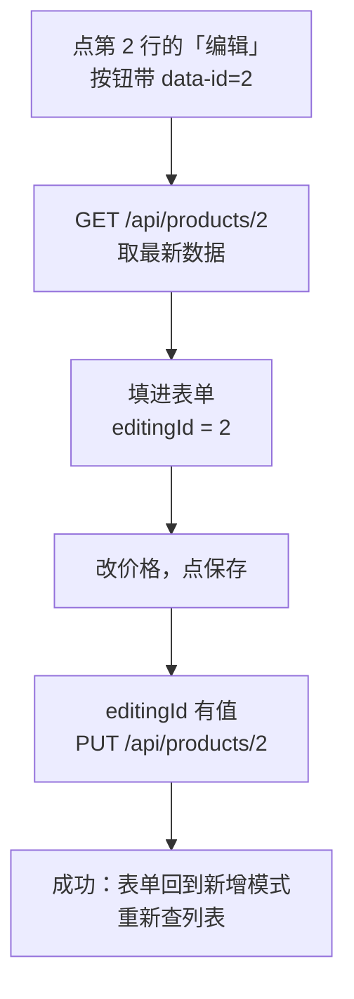

# 第 5 章 在表格行上点「编辑」「删除」，修改一条数据

## 这一章解决什么问题

前几章删除要手工输入 Id，用户不会这么用。日常页面是每一行后面有「编辑」「删除」按钮：点编辑，上面的表单填好这一行的数据，改完保存；点删除，确认后这一行消失。本章做出这个完整的增删改查页面。

## 开始之前

- 上一章你已经会了：DELETE 返回 204，所有请求走 `api()`。
- 环境：在第 4 章的项目上改，或打开 `code/ch05/FetchDemo`。本章去掉了"按 Id 删除"一栏，删除改到表格行上。
- 本章新概念 3 个：**PUT 修改**、**表单的新增/修改两种模式**、**事件委托（event delegation）**。

## 正文

### 5.1 全貌：点「编辑」到保存完成

🖼 图解：



### 5.2 后端：MapPut 和共用的校验

在第 4 章 `Program.cs` 上改三处，完整文件见 `code/ch05/FetchDemo/Program.cs`。

① `MapPost` 里的校验代码换成调用 `Validate`：

```csharp
app.MapPost("/api/products", (Product input) =>
{
    var errors = Validate(input, null);
    if (errors.Count > 0)
        return Results.ValidationProblem(errors);

    input.Id = products.Count == 0 ? 1 : products.Max(p => p.Id) + 1;
    products.Add(input);
    return Results.Created($"/api/products/{input.Id}", input);
});
```

② 在 `MapPost` 后面加 `MapPut`：

```csharp
// PUT：地址里的 id 决定改哪一条，正文是修改后的完整数据
app.MapPut("/api/products/{id:int}", (int id, Product input) =>
{
    var product = products.FirstOrDefault(p => p.Id == id);
    // 可能在你打开编辑之后，别人已经把它删了
    if (product is null)
        return Results.NotFound();

    var errors = Validate(input, id);
    if (errors.Count > 0)
        return Results.ValidationProblem(errors);

    product.Code = input.Code;
    product.Name = input.Name;
    product.Price = input.Price;
    return Results.Ok(product);
});
```

③ 在 `app.Run();` 后面、`class Product` 前面加校验函数：

```csharp
// 新增和修改共用一套规则。selfId 是正在修改的那条，查重时要排除它自己
Dictionary<string, string[]> Validate(Product input, int? selfId)
{
    var errors = new Dictionary<string, string[]>();
    if (string.IsNullOrWhiteSpace(input.Code))
        errors["code"] = ["编码必填"];
    else if (products.Any(p => p.Code == input.Code && p.Id != selfId))
        errors["code"] = ["编码已存在"];
    if (string.IsNullOrWhiteSpace(input.Name))
        errors["name"] = ["名称必填"];
    if (input.Price <= 0)
        errors["price"] = ["价格必须大于 0"];
    return errors;
}
```

**概念一：PUT 修改。**

- **白话定义**：PUT 表示"用正文里的数据整体替换地址指向的那一条"。地址里的 Id 决定改哪条，正文里的 Id 不用。
- **场景**：修改一张未提交的价格申请单，表单上所有字段一起提交。
- **反例（什么时候不该用）**：只改一个字段的操作，比如"审批通过"只改状态。用 PUT 就得把整条数据都传回来，前端可能拿着旧数据把别人刚改过的字段覆盖掉。这类操作单独做一个接口，比如 `POST /api/applications/3/approve`。

🔍 校验抽成 `Validate`，是因为新增和修改用同一套规则。查重多了 `p.Id != selfId`：修改 P002 时编码没变，不排除自己就会查到它自己（5.5 节演示）。PUT 先判断 404 再校验，数据都不存在了，校验没有意义。`Validate` 写在 `app.Run();` 后面也能被调用，因为顶层语句里的本地函数在整个文件可见。

### 5.3 前端：两种模式和行按钮

`wwwroot/api.js` 和第 4 章一样，不用改。`wwwroot/index.html`：

```html
<!-- code/ch05/FetchDemo/wwwroot/index.html -->
<!DOCTYPE html>
<html lang="zh-CN">
<head>
  <meta charset="utf-8">
  <title>产品列表</title>
  <style>
    .err { color: red; }
  </style>
</head>
<body>
  <h1>产品列表</h1>

  <!-- 同一张表单：新增模式和修改模式共用 -->
  <h2 id="formTitle">新增产品</h2>
  <form id="productForm">
    <p>编码：<input id="code"> <span class="err" id="err-code"></span></p>
    <p>名称：<input id="name"> <span class="err" id="err-name"></span></p>
    <p>价格：<input id="price" type="number" step="0.01"> <span class="err" id="err-price"></span></p>
    <button type="submit">保存</button>
  </form>

  <h2>列表</h2>
  <p>
    名称包含：<input id="keyword">
    <button id="btnSearch">查询</button>
  </p>
  <p id="msg"></p>
  <table border="1">
    <thead>
      <tr><th>Id</th><th>编码</th><th>名称</th><th>价格</th><th>操作</th></tr>
    </thead>
    <tbody id="rows"></tbody>
  </table>
  <!-- 顺序不能反：app.js 一加载就会调用 api.js 里的 api() -->
  <script src="api.js"></script>
  <script src="app.js"></script>
</body>
</html>
```

`wwwroot/app.js` 整个替换成：

```javascript
// code/ch05/FetchDemo/wwwroot/app.js
const msg = document.getElementById('msg');
const form = document.getElementById('productForm');
let editingId = null; // null = 新增模式；有值 = 正在修改这个 Id

function renderRows(products) {
  const tbody = document.getElementById('rows');
  tbody.innerHTML = '';
  for (const p of products) {
    const tr = document.createElement('tr');
    for (const value of [p.id, p.code, p.name, p.price]) {
      const td = document.createElement('td');
      td.textContent = value;
      tr.appendChild(td);
    }
    const ops = document.createElement('td');
    // 这里可以用 innerHTML：拼进去的只有后端给的数字 id，没有用户输入的文字
    // data-action、data-id 给文件末尾的统一点击处理用
    ops.innerHTML =
      `<button data-action="edit" data-id="${p.id}">编辑</button> ` +
      `<button data-action="delete" data-id="${p.id}">删除</button>`;
    tr.appendChild(ops);
    tbody.appendChild(tr);
  }
}

async function search() {
  const keyword = document.getElementById('keyword').value.trim();
  const query = new URLSearchParams({ keyword });
  try {
    const products = await api('GET', '/api/products?' + query);
    renderRows(products);
    msg.textContent = products.length === 0 ? '没有符合条件的产品' : `共 ${products.length} 条`;
  } catch (err) {
    msg.textContent = err.message;
  }
}

function clearErrors() {
  for (const span of document.querySelectorAll('.err')) span.textContent = '';
}

function showErrors(errors) {
  for (const [field, messages] of Object.entries(errors)) {
    document.getElementById('err-' + field).textContent = messages.join('；');
  }
}

// 回到新增模式
function resetForm() {
  editingId = null;
  form.reset();
  clearErrors();
  document.getElementById('formTitle').textContent = '新增产品';
}

// 点「编辑」：先从后端取最新数据再填表，列表里的可能已经过时
async function startEdit(id) {
  try {
    const p = await api('GET', '/api/products/' + id);
    editingId = id;
    clearErrors();
    document.getElementById('code').value = p.code;
    document.getElementById('name').value = p.name;
    document.getElementById('price').value = p.price;
    document.getElementById('formTitle').textContent = `修改产品（Id ${id}）`;
  } catch (err) {
    msg.textContent = err.message;
  }
}

async function removeProduct(id) {
  // confirm 弹出确认框，点「取消」返回 false
  if (!confirm('确定删除这条产品吗？')) return;
  try {
    await api('DELETE', '/api/products/' + id);
    if (editingId === id) resetForm(); // 正在改的那条被删了，表单也要回到新增模式
    await search();
    msg.textContent = `已删除 Id ${id}`;
  } catch (err) {
    msg.textContent = err.message;
  }
}

async function save(e) {
  e.preventDefault();
  clearErrors();
  const product = {
    code: document.getElementById('code').value.trim(),
    name: document.getElementById('name').value.trim(),
    price: Number(document.getElementById('price').value),
  };
  try {
    let text;
    if (editingId === null) {
      const created = await api('POST', '/api/products', product);
      text = `已新增：${created.code} ${created.name}（Id ${created.id}）`;
    } else {
      const updated = await api('PUT', '/api/products/' + editingId, product);
      text = `已修改：${updated.code} ${updated.name}（Id ${updated.id}）`;
    }
    resetForm();
    await search();
    msg.textContent = text;
  } catch (err) {
    showErrors(err.errors ?? {});
    msg.textContent = err.message;
  }
}

// 整个表格只挂一个点击处理：按钮是每次查询后新画的，挂在按钮上会跟着丢
document.getElementById('rows').addEventListener('click', (e) => {
  const button = e.target.closest('button'); // 点在按钮上才处理
  if (button === null) return;
  const id = Number(button.dataset.id); // data-id 读出来是字符串，转成数字
  if (button.dataset.action === 'edit') startEdit(id);
  if (button.dataset.action === 'delete') removeProduct(id);
});

form.addEventListener('submit', save);
document.getElementById('btnSearch').addEventListener('click', search);
search();
```

**概念二：表单的新增/修改两种模式。**

- **白话定义**：用一个变量 `editingId` 记住表单当前在干什么。`null` 是新增，保存时 POST；有值是修改，保存时 PUT 到这个 Id。
- **场景**：字段一样的新增和修改共用一张表单，不用画两遍。
- **反例（什么时候不该用）**：新增和修改字段差别大的情况。比如新增时要选"产品类型"，修改时类型不能改，还多出"停用原因"。硬共用一张表单会写满 `if (editingId === null)`，不如分成两张。

🔍 模式切换只发生在三个地方：

| 时机 | 代码 | editingId |
|---|---|---|
| 点「编辑」，取到数据后 | `startEdit` | 设成这一行的 Id |
| 保存成功 | `save` 里调 `resetForm()` | 回到 `null` |
| 正在改的那条被删了 | `removeProduct` 里调 `resetForm()` | 回到 `null` |

`startEdit` 不用列表里已有的数据，而是重新 GET 一次：从列表显示到点编辑可能隔了很久，别人可能已经改过或删掉了。删掉了的话，`api()` 会抛"这条数据不存在"。

**概念三：事件委托。**

- **白话定义**：不给每个按钮挂点击处理，而是在它们共同的外层元素（这里是 `<tbody>`）上挂一个。点击会从按钮一层层往外传（冒泡，bubbling），外层收到后用 `e.target.closest('button')` 找出点的是哪个按钮。
- **场景**：表格每次查询都会重画，按钮被删掉又新建；外层的 `<tbody>` 一直在，挂在它上面的处理就一直有效。
- **反例（什么时候不该用）**：页面上固定存在、不会重画的单个按钮，比如「查询」。直接挂在按钮上更直白。

按钮用 `data-action`、`data-id` 两个自定义属性（data- 属性，HTML 允许任何以 `data-` 开头的属性，JS 用 `button.dataset.xxx` 读）说明"做什么、对哪条做"。`dataset` 读出来都是字符串，所以要 `Number()`，否则 `editingId === id` 会因为 `2 !== '2'` 不成立。

### 5.4 跑起来看结果

`Ctrl+F5` 运行，打开 `http://localhost:5080/`。以下是实测：

| 操作 | 表单标题 | 页面提示 | 列表 |
|---|---|---|---|
| 打开页面 | 新增产品 | 共 5 条 | 每行最后一列有「编辑」「删除」 |
| 点第 2 行「编辑」 | 修改产品（Id 2） | 共 5 条 | 表单填入 P002、凸阵探头 C5、32000 |
| 编码改成 P001，保存 | 修改产品（Id 2） | 输入有误，请看红字提示 | 编码旁：编码已存在 |
| 编码改回 P002，价格改成 30500，保存 | 新增产品 | 已修改：P002 凸阵探头 C5（Id 2） | 第 2 行价格变成 30500 |
| 点第 3 行「删除」，确认 | 新增产品 | 已删除 Id 3 | 4 条 |

再试"数据过时"：开两个浏览器标签页都打开这个页面。在标签页 A 删除第 4 行；切到标签页 B（不刷新），点第 4 行的「编辑」或「删除」，提示都是"这条数据不存在，可能已被删除"。

### 5.5 改坏几处试试

**改坏一：给每个按钮单独挂点击。** 把文件末尾"整个表格只挂一个点击处理"那段换成：

```javascript
for (const button of document.querySelectorAll('#rows button')) {
  button.addEventListener('click', () => {
    const id = Number(button.dataset.id);
    if (button.dataset.action === 'edit') startEdit(id);
    if (button.dataset.action === 'delete') removeProduct(id);
  });
}
```

现象：所有「编辑」「删除」点了都没反应，控制台也没有报错。

原因：这段代码执行时，`search()` 的请求还没回来，表格里一个按钮都没有，循环一次都没执行。就算等数据回来再挂，每次查询重画表格后，新按钮上也没有处理函数。事件委托挂在一直存在的 `<tbody>` 上，没有这两个问题。

**改坏二：查重不排除自己。** 后端 `Validate` 里删掉 `&& p.Id != selfId`。点第 2 行「编辑」，只改价格，保存。

现象：编码旁显示"编码已存在"，什么都改不了。

原因：数据里已经有 P002，就是它自己。修改时的唯一性检查必须排除正在修改的那条，SQL 里也是同样的道理（`WHERE Code = @Code AND Id <> @Id`）。

## 🧱 类比

事件委托像小区门卫：住户（按钮）经常搬进搬出，不可能每来一户就配一个专属保安；门卫守在大门（`<tbody>`），谁按铃就看门牌号（`data-id`），再决定帮他做什么（`data-action`）。

## ⚠️ 踩坑警告

| 现象 | 原因 | 怎么改 |
|---|---|---|
| 表格里的按钮点了没反应，控制台无报错 | 点击处理挂在了每个按钮上，挂的时候按钮还没画出来，或者表格重画后丢了 | 挂在 `<tbody>` 上用事件委托 |
| 修改时没改编码也提示"编码已存在" | 唯一性校验没排除当前这条 | 查重条件加 `Id != 当前Id` |
| 正在修改时把这条删了，再点保存提示"数据不存在" | 表单还停留在修改模式 | 删除成功后判断 `editingId === id`，是就 `resetForm()` |
| 表单里的普通按钮一点就触发保存 | `<form>` 里的 `<button>` 默认 `type="submit"` | 不是用来保存的按钮写 `type="button"` |

## 🎯 动手练习

**练习 1：取消编辑。** 表单里加一个「取消编辑」按钮，只在修改模式下显示；点了表单清空、标题回到"新增产品"、按钮隐藏。

验收标准：打开页面看不到「取消编辑」；点第 3 行编辑后出现；点它后表单清空、标题是"新增产品"、按钮消失，且**没有**发出保存请求（F12 网络面板里没有新的 POST/PUT）。

**练习 2：确认框显示名称。** 删除确认框从"确定删除这条产品吗？"改成显示这一行的名称，比如"确定删除「凸阵探头 C5」吗？"。

验收标准：点第 2 行「删除」，确认框文字是"确定删除「凸阵探头 C5」吗？"；点「取消」不删除，点「确定」删除。

卡住了看文末参考答案。

## 📌 一句话总结

行按钮靠 data-id 加事件委托，表单靠 editingId 决定 POST 还是 PUT。

## 下一章

用户要在手机上用这个页面：第 6 章讲手机适配，以及怎样用手机打开电脑上运行的网站。

---

<!-- 以下是参考答案，先自己动手，卡住了再往下翻 -->


## 参考答案

### 练习 1

思路：`hidden` 属性控制显示；进入修改模式时显示，`resetForm()` 里隐藏。按钮必须写 `type="button"`，否则它会触发表单的 submit。`Program.cs`、`api.js` 不变。

`wwwroot/index.html`：

```html
<!-- code/ch05/Answer1-Cancel/wwwroot/index.html -->
<!DOCTYPE html>
<html lang="zh-CN">
<head>
  <meta charset="utf-8">
  <title>产品列表</title>
  <style>
    .err { color: red; }
  </style>
</head>
<body>
  <h1>产品列表</h1>

  <!-- 同一张表单：新增模式和修改模式共用 -->
  <h2 id="formTitle">新增产品</h2>
  <form id="productForm">
    <p>编码：<input id="code"> <span class="err" id="err-code"></span></p>
    <p>名称：<input id="name"> <span class="err" id="err-name"></span></p>
    <p>价格：<input id="price" type="number" step="0.01"> <span class="err" id="err-price"></span></p>
    <button type="submit">保存</button>
    <!-- type="button"：表单里的按钮默认是 submit，不写会触发保存 -->
    <!-- hidden：新增模式下不显示 -->
    <button type="button" id="btnCancel" hidden>取消编辑</button>
  </form>

  <h2>列表</h2>
  <p>
    名称包含：<input id="keyword">
    <button id="btnSearch">查询</button>
  </p>
  <p id="msg"></p>
  <table border="1">
    <thead>
      <tr><th>Id</th><th>编码</th><th>名称</th><th>价格</th><th>操作</th></tr>
    </thead>
    <tbody id="rows"></tbody>
  </table>
  <!-- 顺序不能反：app.js 一加载就会调用 api.js 里的 api() -->
  <script src="api.js"></script>
  <script src="app.js"></script>
</body>
</html>
```

`wwwroot/app.js`：

```javascript
// code/ch05/Answer1-Cancel/wwwroot/app.js
const msg = document.getElementById('msg');
const form = document.getElementById('productForm');
let editingId = null; // null = 新增模式；有值 = 正在修改这个 Id

function renderRows(products) {
  const tbody = document.getElementById('rows');
  tbody.innerHTML = '';
  for (const p of products) {
    const tr = document.createElement('tr');
    for (const value of [p.id, p.code, p.name, p.price]) {
      const td = document.createElement('td');
      td.textContent = value;
      tr.appendChild(td);
    }
    const ops = document.createElement('td');
    // 这里可以用 innerHTML：拼进去的只有后端给的数字 id，没有用户输入的文字
    // data-action、data-id 给文件末尾的统一点击处理用
    ops.innerHTML =
      `<button data-action="edit" data-id="${p.id}">编辑</button> ` +
      `<button data-action="delete" data-id="${p.id}">删除</button>`;
    tr.appendChild(ops);
    tbody.appendChild(tr);
  }
}

async function search() {
  const keyword = document.getElementById('keyword').value.trim();
  const query = new URLSearchParams({ keyword });
  try {
    const products = await api('GET', '/api/products?' + query);
    renderRows(products);
    msg.textContent = products.length === 0 ? '没有符合条件的产品' : `共 ${products.length} 条`;
  } catch (err) {
    msg.textContent = err.message;
  }
}

function clearErrors() {
  for (const span of document.querySelectorAll('.err')) span.textContent = '';
}

function showErrors(errors) {
  for (const [field, messages] of Object.entries(errors)) {
    document.getElementById('err-' + field).textContent = messages.join('；');
  }
}

// 回到新增模式
function resetForm() {
  editingId = null;
  form.reset();
  clearErrors();
  document.getElementById('formTitle').textContent = '新增产品';
  document.getElementById('btnCancel').hidden = true;
}

// 点「编辑」：先从后端取最新数据再填表，列表里的可能已经过时
async function startEdit(id) {
  try {
    const p = await api('GET', '/api/products/' + id);
    editingId = id;
    clearErrors();
    document.getElementById('code').value = p.code;
    document.getElementById('name').value = p.name;
    document.getElementById('price').value = p.price;
    document.getElementById('formTitle').textContent = `修改产品（Id ${id}）`;
    document.getElementById('btnCancel').hidden = false;
  } catch (err) {
    msg.textContent = err.message;
  }
}

async function removeProduct(id) {
  // confirm 弹出确认框，点「取消」返回 false
  if (!confirm('确定删除这条产品吗？')) return;
  try {
    await api('DELETE', '/api/products/' + id);
    if (editingId === id) resetForm(); // 正在改的那条被删了，表单也要回到新增模式
    await search();
    msg.textContent = `已删除 Id ${id}`;
  } catch (err) {
    msg.textContent = err.message;
  }
}

async function save(e) {
  e.preventDefault();
  clearErrors();
  const product = {
    code: document.getElementById('code').value.trim(),
    name: document.getElementById('name').value.trim(),
    price: Number(document.getElementById('price').value),
  };
  try {
    let text;
    if (editingId === null) {
      const created = await api('POST', '/api/products', product);
      text = `已新增：${created.code} ${created.name}（Id ${created.id}）`;
    } else {
      const updated = await api('PUT', '/api/products/' + editingId, product);
      text = `已修改：${updated.code} ${updated.name}（Id ${updated.id}）`;
    }
    resetForm();
    await search();
    msg.textContent = text;
  } catch (err) {
    showErrors(err.errors ?? {});
    msg.textContent = err.message;
  }
}

// 整个表格只挂一个点击处理：按钮是每次查询后新画的，挂在按钮上会跟着丢
document.getElementById('rows').addEventListener('click', (e) => {
  const button = e.target.closest('button'); // 点在按钮上才处理
  if (button === null) return;
  const id = Number(button.dataset.id); // data-id 读出来是字符串，转成数字
  if (button.dataset.action === 'edit') startEdit(id);
  if (button.dataset.action === 'delete') removeProduct(id);
});

form.addEventListener('submit', save);
document.getElementById('btnCancel').addEventListener('click', resetForm);
document.getElementById('btnSearch').addEventListener('click', search);
search();
```

### 练习 2

思路：每次查询把结果存进 `currentProducts`，删除时按 Id 找到名称。不把名称放进 `data-name` 属性，因为 `renderRows` 里按钮是用 `innerHTML` 拼的，拼进用户输入的文字就有被当成 HTML 执行的风险。`Program.cs`、`index.html`、`api.js` 不变，只改 `app.js`：

```javascript
// code/ch05/Answer2-ConfirmName/wwwroot/app.js
const msg = document.getElementById('msg');
const form = document.getElementById('productForm');
let editingId = null; // null = 新增模式；有值 = 正在修改这个 Id
let currentProducts = []; // 最近一次查询结果，删除时按 Id 找名称

function renderRows(products) {
  const tbody = document.getElementById('rows');
  tbody.innerHTML = '';
  for (const p of products) {
    const tr = document.createElement('tr');
    for (const value of [p.id, p.code, p.name, p.price]) {
      const td = document.createElement('td');
      td.textContent = value;
      tr.appendChild(td);
    }
    const ops = document.createElement('td');
    // 这里可以用 innerHTML：拼进去的只有后端给的数字 id，没有用户输入的文字
    // data-action、data-id 给文件末尾的统一点击处理用
    ops.innerHTML =
      `<button data-action="edit" data-id="${p.id}">编辑</button> ` +
      `<button data-action="delete" data-id="${p.id}">删除</button>`;
    tr.appendChild(ops);
    tbody.appendChild(tr);
  }
}

async function search() {
  const keyword = document.getElementById('keyword').value.trim();
  const query = new URLSearchParams({ keyword });
  try {
    const products = await api('GET', '/api/products?' + query);
    currentProducts = products;
    renderRows(products);
    msg.textContent = products.length === 0 ? '没有符合条件的产品' : `共 ${products.length} 条`;
  } catch (err) {
    msg.textContent = err.message;
  }
}

function clearErrors() {
  for (const span of document.querySelectorAll('.err')) span.textContent = '';
}

function showErrors(errors) {
  for (const [field, messages] of Object.entries(errors)) {
    document.getElementById('err-' + field).textContent = messages.join('；');
  }
}

// 回到新增模式
function resetForm() {
  editingId = null;
  form.reset();
  clearErrors();
  document.getElementById('formTitle').textContent = '新增产品';
}

// 点「编辑」：先从后端取最新数据再填表，列表里的可能已经过时
async function startEdit(id) {
  try {
    const p = await api('GET', '/api/products/' + id);
    editingId = id;
    clearErrors();
    document.getElementById('code').value = p.code;
    document.getElementById('name').value = p.name;
    document.getElementById('price').value = p.price;
    document.getElementById('formTitle').textContent = `修改产品（Id ${id}）`;
  } catch (err) {
    msg.textContent = err.message;
  }
}

async function removeProduct(id) {
  // 名称从数组里取，不放进 data- 属性，避免把用户输入的文字拼进 HTML
  const product = currentProducts.find((p) => p.id === id);
  const name = product ? product.name : `Id ${id}`;
  if (!confirm(`确定删除「${name}」吗？`)) return;
  try {
    await api('DELETE', '/api/products/' + id);
    if (editingId === id) resetForm(); // 正在改的那条被删了，表单也要回到新增模式
    await search();
    msg.textContent = `已删除 Id ${id}`;
  } catch (err) {
    msg.textContent = err.message;
  }
}

async function save(e) {
  e.preventDefault();
  clearErrors();
  const product = {
    code: document.getElementById('code').value.trim(),
    name: document.getElementById('name').value.trim(),
    price: Number(document.getElementById('price').value),
  };
  try {
    let text;
    if (editingId === null) {
      const created = await api('POST', '/api/products', product);
      text = `已新增：${created.code} ${created.name}（Id ${created.id}）`;
    } else {
      const updated = await api('PUT', '/api/products/' + editingId, product);
      text = `已修改：${updated.code} ${updated.name}（Id ${updated.id}）`;
    }
    resetForm();
    await search();
    msg.textContent = text;
  } catch (err) {
    showErrors(err.errors ?? {});
    msg.textContent = err.message;
  }
}

// 整个表格只挂一个点击处理：按钮是每次查询后新画的，挂在按钮上会跟着丢
document.getElementById('rows').addEventListener('click', (e) => {
  const button = e.target.closest('button'); // 点在按钮上才处理
  if (button === null) return;
  const id = Number(button.dataset.id); // data-id 读出来是字符串，转成数字
  if (button.dataset.action === 'edit') startEdit(id);
  if (button.dataset.action === 'delete') removeProduct(id);
});

form.addEventListener('submit', save);
document.getElementById('btnSearch').addEventListener('click', search);
search();
```
