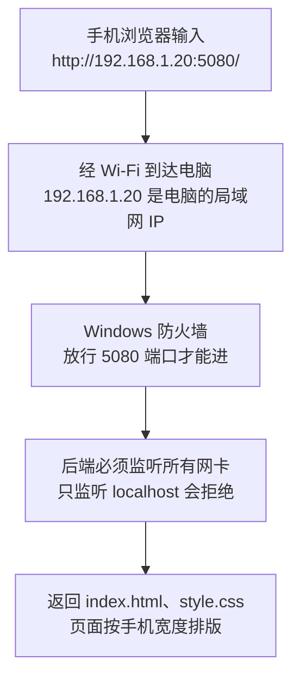

# 第 6 章 让页面在手机上能看、能点，并用手机打开它

## 这一章解决什么问题

第 5 章的页面在电脑上好用，用手机打开有两个问题：一是整页被缩得很小，字看不清，按钮要放大才点得中；二是手机根本打不开 `localhost:5080`。本章解决这两件事，接口和 JS 都不用改。

## 开始之前

- 上一章你已经会了：完整的增删改查页面，所有请求走 `api.js`。
- 环境：在第 5 章的项目上改，或打开 `code/ch06/FetchDemo`。`Program.cs`、`api.js`、`app.js` 和第 5 章完全相同。
- 需要：一台和电脑连同一个 Wi-Fi（同一局域网）的手机。没有手机也可以先用 Chrome/Edge 的手机模拟预览（6.3 节）。
- 本章新概念 3 个：**viewport 设置**、**CSS 媒体查询**、**后端监听局域网地址**。

## 正文

### 6.1 手机是怎么打开电脑上的网站的

🖼 图解：



在手机上输入 `localhost`，指的是手机自己，不是你的电脑。所以要用电脑的局域网 IP，并且让后端愿意接收从网卡进来的请求。

### 6.2 页面：viewport 和样式文件

`wwwroot/index.html`（和第 5 章比：`<head>` 里多了 viewport 一行，`<style>` 换成外部 `style.css`，`<table>` 去掉了 `border="1"`，边框改由 CSS 画）：

```html
<!-- code/ch06/FetchDemo/wwwroot/index.html -->
<!DOCTYPE html>
<html lang="zh-CN">
<head>
  <meta charset="utf-8">
  <!-- 让手机按屏幕实际宽度排版；没有这行，手机按约 980px 宽排版再整体缩小 -->
  <meta name="viewport" content="width=device-width, initial-scale=1">
  <title>产品列表</title>
  <link rel="stylesheet" href="style.css">
</head>
<body>
  <h1>产品列表</h1>

  <!-- 同一张表单：新增模式和修改模式共用 -->
  <h2 id="formTitle">新增产品</h2>
  <form id="productForm">
    <p>编码：<input id="code"> <span class="err" id="err-code"></span></p>
    <p>名称：<input id="name"> <span class="err" id="err-name"></span></p>
    <p>价格：<input id="price" type="number" step="0.01"> <span class="err" id="err-price"></span></p>
    <button type="submit">保存</button>
  </form>

  <h2>列表</h2>
  <p>
    名称包含：<input id="keyword">
    <button id="btnSearch">查询</button>
  </p>
  <p id="msg"></p>
  <table>
    <thead>
      <tr><th>Id</th><th>编码</th><th>名称</th><th>价格</th><th>操作</th></tr>
    </thead>
    <tbody id="rows"></tbody>
  </table>
  <!-- 顺序不能反：app.js 一加载就会调用 api.js 里的 api() -->
  <script src="api.js"></script>
  <script src="app.js"></script>
</body>
</html>
```

新建 `wwwroot/style.css`（VS：右键 wwwroot →「添加 → 新建项」→ 选「样式表」）：

```css
/* code/ch06/FetchDemo/wwwroot/style.css */

/* ===== 电脑和手机都生效的基础样式 ===== */
body { font-family: sans-serif; margin: 16px; }
.err { color: red; }
table { border-collapse: collapse; }
th, td { border: 1px solid #999; padding: 4px 8px; }

/* ===== 只在屏幕宽度 ≤ 600px 时生效：手机竖屏 ===== */
@media (max-width: 600px) {
  /* 输入框占满一行，手指好点；box-sizing 让 padding 算在 100% 以内，不会撑出屏幕 */
  input { width: 100%; box-sizing: border-box; padding: 8px; }
  /* 字号不小于 16px：iPhone 上小于 16px 的输入框一获得焦点，页面会自动放大 */
  input, button { font-size: 16px; }
  /* 按钮做高一点，手指按得准 */
  button { padding: 10px 16px; }

  /* 表格改成卡片：每一行一个方块，每个单元格占一行 */
  thead { display: none; }
  table, tbody, tr, td { display: block; }
  tr { border: 1px solid #999; margin-bottom: 12px; padding: 8px; }
  td { border: none; padding: 4px 0; }

  /* 表头藏起来了，在每个单元格前面补上列名。第几个 td 就是第几列 */
  td:nth-child(1)::before { content: "Id："; color: #666; }
  td:nth-child(2)::before { content: "编码："; color: #666; }
  td:nth-child(3)::before { content: "名称："; color: #666; }
  td:nth-child(4)::before { content: "价格："; color: #666; }
}
```

**概念一：viewport 设置。**

- **白话定义**：`<meta name="viewport" content="width=device-width, initial-scale=1">` 告诉手机浏览器：页面宽度就等于手机屏幕宽度，不要缩放。
- **场景**：任何要在手机上打开的页面，比如外勤人员在手机上查价格。
- **反例（什么时候不该用）**：页面根本没做手机样式、又必须在手机上看全貌（比如一张很宽的固定格式报表）。只加这一行，宽表格会超出屏幕要左右滑；不加的话手机至少会缩小显示全貌。所以 viewport 和下面的媒体查询要一起做。

**概念二：CSS 媒体查询。**

- **白话定义**：`@media (max-width: 600px) { ... }` 里的样式只在屏幕宽度不超过 600px 时生效。电脑上不生效，手机竖屏上生效。
- **场景**：同一个页面，电脑上显示表格，手机上把每一行变成一张卡片。
- **反例（什么时候不该用）**：手机和电脑要做的事情完全不同（比如手机只扫码录入，电脑做统计）。这时做两张不同的页面，比一张页面写满两套样式更好维护。

🔍 样式拆解：

| 样式 | 为什么 |
|---|---|
| `thead { display: none; }` | 卡片里不需要表头 |
| `table, tbody, tr, td { display: block; }` | 表格元素不再按行列排，变成从上到下的方块 |
| `td:nth-child(2)::before { content: "编码："; }` | 表头藏了，在单元格文字前面补上列名。`::before`（伪元素，pseudo-element，CSS 在元素内容前面插入的文字）不用改 JS |
| `input { width: 100%; box-sizing: border-box; }` | 输入框占满一行；`box-sizing` 让内边距算在 100% 里 |
| `input, button { font-size: 16px; }` | iPhone 上小于 16px 的输入框获得焦点时页面会自动放大（⚠️ 这是 iOS Safari 的行为，本机模拟环境无法验证） |
| `button { padding: 10px 16px; }` | 按钮做大，手指按得准 |

`app.js` 一行没改：`renderRows` 生成的还是 `<tr><td>`，只是 CSS 决定它们怎么摆。

### 6.3 先在电脑上预览手机效果

`Ctrl+F5` 运行，Chrome/Edge 打开 `http://localhost:5080/`，按 `F12` 打开开发者工具，再按 `Ctrl+Shift+M` 切换到设备模拟（device toolbar），顶部下拉框选一个手机型号，比如 iPhone 12 Pro。刷新页面。

以下是用 iPhone 13 尺寸（宽 390px）模拟实测的结果：

| 测量项 | 手机（390px 宽） | 电脑（1280px 宽） |
|---|---|---|
| 页面排版宽度 | 390（等于屏幕宽，没有横向滚动） | 1280 |
| 列表 | 每行一张卡片，表头隐藏，每项前面有"Id：""编码："等列名 | 普通表格 |
| 「编码」输入框 | 358 × 42（占满一行） | 206 × 24 |
| 「保存」「编辑」按钮 | 56 × 46 | 32 × 24 |

在模拟器里用鼠标点（相当于手指点）：点第 2 张卡片的「编辑」，表单填入 P002；价格改成 30500，点「保存」，提示"已修改：P002 凸阵探头 C5（Id 2）"；点第 3 张卡片的「删除」并确认，剩 4 张卡片。和电脑上的行为完全一样。

### 6.4 后端：监听局域网地址

**概念三：后端监听局域网地址。**

- **白话定义**：后端启动时要说清楚"在哪个地址上等请求"。`localhost` 只接收本机发来的请求；`*` 表示电脑上所有网卡都接收，局域网里的手机才能连进来。
- **场景**：开发时用手机实测页面，或者给同一办公室的同事临时演示。
- **反例（什么时候不该用）**：电脑连着公共 Wi-Fi（咖啡店、酒店）的时候。监听 `*` 后同一网络里的任何人都能打开你的页面、调你的接口，而本教程的接口没有登录验证。测完改回 `localhost`。正式发布到服务器则由 IIS 负责监听，不靠这个设置。

`Properties/launchSettings.json` 里 `applicationUrl` 从 `http://localhost:5080` 改成 `http://*:5080`：

```json
{
  "$schema": "https://json.schemastore.org/launchsettings.json",
  "profiles": {
    "http": {
      "commandName": "Project",
      "dotnetRunMessages": true,
      "launchBrowser": true,
      "applicationUrl": "http://*:5080",
      "environmentVariables": {
        "ASPNETCORE_ENVIRONMENT": "Development"
      }
    }
  }
}
```

重新运行，控制台显示（实测）：

```text
info: Microsoft.Hosting.Lifetime[14]
      Now listening on: http://[::]:5080
```

`[::]` 表示所有网卡（同时包括 IPv4 和 IPv6）。电脑上照样用 `http://localhost:5080/` 打开。

> ⚠️ 未实机验证：VS 按 `Ctrl+F5` 自动打开浏览器时，地址可能显示成带 `*` 或 `[::]` 的形式打不开。遇到时手工在地址栏输入 `http://localhost:5080/` 即可。

### 6.5 用手机打开

以下步骤需要 Windows 和真手机，⚠️ 本节未实机验证，界面文字以你的系统为准。

1. **查电脑的局域网 IP。** 开始菜单搜索 PowerShell 打开，执行 `ipconfig`，在正在使用的网卡（"无线局域网适配器 WLAN"或"以太网适配器"）下找 `IPv4 地址`，形如 `192.168.1.20`。
2. **放行防火墙。** 第一次以 `*` 运行时，Windows 可能弹出"Windows 安全中心警报"，勾选「专用网络」后点「允许访问」。没有弹窗、手机又打不开时，以**管理员身份**打开 PowerShell 执行：

   ```powershell
   netsh advfirewall firewall add rule name="FetchDemo 5080" dir=in action=allow protocol=TCP localport=5080
   ```

   测完要删掉这条规则时执行：

   ```powershell
   netsh advfirewall firewall delete rule name="FetchDemo 5080"
   ```

3. **手机连上和电脑同一个 Wi-Fi**，浏览器输入 `http://192.168.1.20:5080/`（换成你查到的 IP）。注意是 `http` 不是 `https`。

能看到卡片列表、能新增修改删除，就完成了。页面里所有 fetch 都是 `/api/...` 相对地址，会自动发到 `192.168.1.20:5080`，所以 JS 不用改。

### 6.6 改坏几处试试

以下三处都用 6.3 节的手机模拟实测。

**改坏一：删掉 viewport 那一行。**

现象：页面按 980px 宽排版，再缩到 0.4 倍左右塞进 390px 的屏幕；「保存」按钮在屏幕上只有约 13 × 10 像素，列表也变回表格。

原因：没有 viewport 时，手机浏览器假定这是给电脑设计的页面，按 980px 宽排版再整体缩小。屏幕宽度被当成 980，`max-width: 600px` 不成立，手机样式也一起失效了。

**改坏二：把 `max-width` 写成 `min-width`。**

现象：手机上是表格、按钮 32 × 24；电脑上反而变成卡片，输入框拉满整个屏幕宽。

原因：`min-width: 600px` 表示"宽度至少 600px 才生效"，正好反过来。记法：手机样式用 `max-width`。

**改坏三：去掉 `box-sizing: border-box;`。**

现象：页面能左右滑动，排版宽度 394px，比屏幕多 4px。

原因：默认情况下 `width: 100%` 只算内容区，左右 `padding: 8px` 和边框加在外面，输入框比屏幕宽一点点，整页出现横向滚动。

**改坏四：`applicationUrl` 改回 `http://localhost:5080`。**

现象：电脑上正常；用电脑的 IP 访问（实测）报 `Failed to connect ... Could not connect to server`，手机上显示"无法访问此网站"或类似提示。控制台显示 `Now listening on: http://localhost:5080`。

原因：只监听本机回环地址，从网卡进来的请求没人接收。

## 🧱 类比

viewport 像告诉印刷厂"按 A5 纸排版"，不说的话它按 A3 排好再缩印到 A5 上，字小得没法看。媒体查询像同一份稿子写两套版式：A3 用表格，A5 用卡片。

## ⚠️ 踩坑警告

| 现象 | 原因 | 怎么改 |
|---|---|---|
| 手机上整页很小，写的手机样式也不生效 | 缺少 viewport 那一行 | `<head>` 里加 `<meta name="viewport" content="width=device-width, initial-scale=1">` |
| 改了 style.css 手机上没变化 | 手机浏览器缓存了旧的 css | 手机浏览器里刷新，或清除该网站数据；电脑上模拟时勾选 F12 网络面板的「停用缓存」 |
| 手机上能左右滑动几像素 | 某个元素宽 100% 再加了 padding/边框 | 加 `box-sizing: border-box` |
| 手机打不开，电脑用 localhost 正常 | 后端只监听 localhost，或防火墙没放行 5080，或手机连的不是同一个 Wi-Fi（比如用了 4G/5G 流量） | 按 6.4、6.5 节逐项检查；先在电脑上用 `http://电脑IP:5080/` 打开，能开说明后端没问题，再查防火墙和手机网络 |
| 手机上输入 `https://电脑IP:5080/` 打不开 | 本教程只开了 http | 地址用 `http://` |

## 🎯 动手练习

**练习 1：手机上不显示 Id。** 手机卡片里去掉"Id：1"这一行，电脑上的表格仍然有 Id 列。只改 CSS。

验收标准：手机模拟下每张卡片从"编码"开始；切回电脑尺寸，表格第一列仍是 Id。

**练习 2：手机上「保存」按钮占满一行。** 只有「保存」变宽，卡片里的「编辑」「删除」大小不变。只改 CSS。

验收标准：手机模拟下「保存」和上面的输入框一样宽；「编辑」「删除」仍然并排；电脑上「保存」大小和原来一样。

卡住了看文末参考答案。

## 📌 一句话总结

加 viewport，用 max-width 媒体查询换卡片，后端监听 * 让手机连进来。

## 下一章

产品要配照片，外勤人员想在手机上直接拍照上传：第 7 章讲上传图片。

---

<!-- 以下是参考答案，先自己动手，卡住了再往下翻 -->


## 参考答案

### 练习 1

思路：第 1 个单元格在手机样式里整个 `display: none`，它前面补的"Id："也就跟着消失；规则写在 `@media` 里，电脑不受影响。只改 `style.css`：

```css
/* code/ch06/Answer1-HideId/wwwroot/style.css */

/* ===== 电脑和手机都生效的基础样式 ===== */
body { font-family: sans-serif; margin: 16px; }
.err { color: red; }
table { border-collapse: collapse; }
th, td { border: 1px solid #999; padding: 4px 8px; }

/* ===== 只在屏幕宽度 ≤ 600px 时生效：手机竖屏 ===== */
@media (max-width: 600px) {
  /* 输入框占满一行，手指好点；box-sizing 让 padding 算在 100% 以内，不会撑出屏幕 */
  input { width: 100%; box-sizing: border-box; padding: 8px; }
  /* 字号不小于 16px：iPhone 上小于 16px 的输入框一获得焦点，页面会自动放大 */
  input, button { font-size: 16px; }
  /* 按钮做高一点，手指按得准 */
  button { padding: 10px 16px; }

  /* 表格改成卡片：每一行一个方块，每个单元格占一行 */
  thead { display: none; }
  table, tbody, tr, td { display: block; }
  tr { border: 1px solid #999; margin-bottom: 12px; padding: 8px; }
  td { border: none; padding: 4px 0; }

  /* 表头藏起来了，在每个单元格前面补上列名。第几个 td 就是第几列 */
  /* 手机上不看 Id：整个单元格隐藏，它的 ::before 也就不显示了 */
  td:nth-child(1) { display: none; }
  td:nth-child(2)::before { content: "编码："; color: #666; }
  td:nth-child(3)::before { content: "名称："; color: #666; }
  td:nth-child(4)::before { content: "价格："; color: #666; }
}
```

### 练习 2

思路：用属性选择器 `button[type="submit"]` 只选中「保存」；写成 `button` 会把卡片里的按钮也拉成整行。只改 `style.css`：

```css
/* code/ch06/Answer2-FullSave/wwwroot/style.css */

/* ===== 电脑和手机都生效的基础样式 ===== */
body { font-family: sans-serif; margin: 16px; }
.err { color: red; }
table { border-collapse: collapse; }
th, td { border: 1px solid #999; padding: 4px 8px; }

/* ===== 只在屏幕宽度 ≤ 600px 时生效：手机竖屏 ===== */
@media (max-width: 600px) {
  /* 输入框占满一行，手指好点；box-sizing 让 padding 算在 100% 以内，不会撑出屏幕 */
  input { width: 100%; box-sizing: border-box; padding: 8px; }
  /* 字号不小于 16px：iPhone 上小于 16px 的输入框一获得焦点，页面会自动放大 */
  input, button { font-size: 16px; }
  /* 按钮做高一点，手指按得准 */
  button { padding: 10px 16px; }
  /* 只让「保存」占满一行；写成 button 会让卡片里的编辑、删除也变成整行 */
  button[type="submit"] { width: 100%; }

  /* 表格改成卡片：每一行一个方块，每个单元格占一行 */
  thead { display: none; }
  table, tbody, tr, td { display: block; }
  tr { border: 1px solid #999; margin-bottom: 12px; padding: 8px; }
  td { border: none; padding: 4px 0; }

  /* 表头藏起来了，在每个单元格前面补上列名。第几个 td 就是第几列 */
  td:nth-child(1)::before { content: "Id："; color: #666; }
  td:nth-child(2)::before { content: "编码："; color: #666; }
  td:nth-child(3)::before { content: "名称："; color: #666; }
  td:nth-child(4)::before { content: "价格："; color: #666; }
}
```
