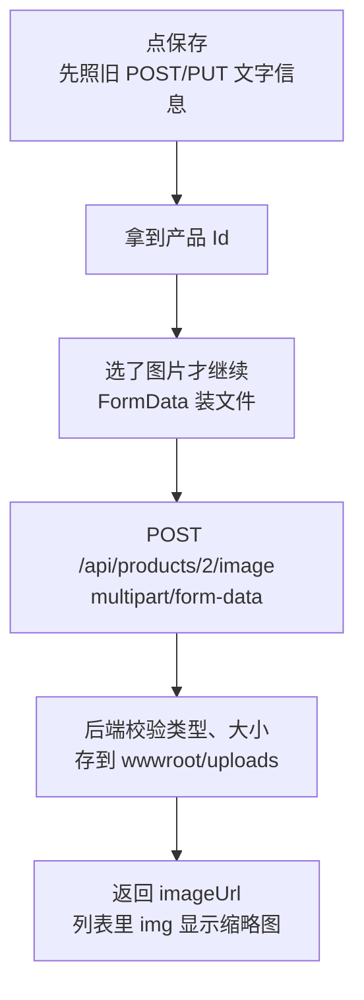

# 第 7 章 给产品上传一张图片

## 这一章解决什么问题

产品要配一张照片，列表里显示缩略图；外勤人员最好能在手机上直接拍照上传。前几章发的都是 JSON，文件没法放进 JSON 里。本章讲文件怎么从页面发到后端、后端怎么安全地存下来。

## 开始之前

- 上一章你已经会了：手机适配，用手机访问电脑上的网站。
- 环境：在第 6 章的项目上改，或打开 `code/ch07/FetchDemo`。准备一两张 2MB 以内的 jpg/png 图片。
- 本章新概念 3 个：**文件选择框 + FormData**、**后端 IFormFile 接收**、**安全存盘（自己生成文件名、限制类型和大小）**。

## 正文

### 7.1 全貌：保存一个带图片的产品

🖼 图解：



为什么分两步：新增产品时，保存之前还没有 Id，图片不知道该挂在哪条产品上。先存文字拿到 Id，再上传图片，两个接口各管一件事。

### 7.2 后端：接收文件的接口

在第 6 章 `Program.cs` 上改五处，完整文件见 `code/ch07/FetchDemo/Program.cs`。

① `class Product` 最后加一个属性：

```csharp
    // 图片访问地址；没上传过是 null
    public string? ImageUrl { get; set; }
```

② `MapPost` 新增产品时，在 `products.Add(input);` 前面加一行 `input.ImageUrl = null;`，不让前端自己填图片地址。

③ 在 `MapDelete` 后面、`app.Run();` 前面加上传接口：

```csharp
// 允许的扩展名和大小上限。扩展名统一转小写再比，P1.JPG 也能通过
string[] imageExtensions = [".jpg", ".jpeg", ".png", ".webp"];
const long MaxImageBytes = 2 * 1024 * 1024; // 2MB

// 参数类型是 IFormFile：框架从 multipart/form-data 正文里按名字 image 取出文件
app.MapPost("/api/products/{id:int}/image", async (int id, IFormFile? image) =>
{
    var product = products.FirstOrDefault(p => p.Id == id);
    if (product is null)
        return Results.NotFound();

    var errors = new Dictionary<string, string[]>();
    var ext = Path.GetExtension(image?.FileName ?? "").ToLowerInvariant();
    if (image is null || image.Length == 0)
        errors["image"] = ["请选择图片"];
    else if (!imageExtensions.Contains(ext))
        errors["image"] = ["只能上传 jpg、png、webp 图片"];
    else if (image.Length > MaxImageBytes)
        errors["image"] = ["图片不能超过 2MB"];
    if (errors.Count > 0)
        return Results.ValidationProblem(errors);

    // 文件名自己生成，不用用户的：用户的文件名可能重复、带中文空格，甚至带 ..\ 跳出目录
    var fileName = $"{Guid.NewGuid():N}{ext}";
    var folder = Path.Combine(app.Environment.WebRootPath, "uploads");
    Directory.CreateDirectory(folder); // 目录已存在时什么也不做
    await using (var stream = File.Create(Path.Combine(folder, fileName)))
    {
        await image!.CopyToAsync(stream);
    }

    DeleteUpload(product.ImageUrl); // 换图时删掉旧文件，不然 uploads 里越积越多
    product.ImageUrl = $"/uploads/{fileName}";
    return Results.Ok(product);
})
// 不加这一行，接收表单文件的接口会要求防伪令牌（antiforgery token）。7.5 节演示
.DisableAntiforgery();
```

④ `MapDelete` 改成删产品时顺带删它的图片文件：

```csharp
app.MapDelete("/api/products/{id:int}", (int id) =>
{
    var product = products.FirstOrDefault(p => p.Id == id);
    if (product is null)
        return Results.NotFound();
    products.Remove(product);
    DeleteUpload(product.ImageUrl); // 产品删了，它的图片文件也删掉
    // 204 No Content：删掉了，没有要返回的内容
    return Results.NoContent();
});
```

⑤ 在 `Validate` 函数后面加删除文件的函数：

```csharp
// 按 /uploads/xxx.jpg 这种地址删除 wwwroot 下的文件
void DeleteUpload(string? url)
{
    if (string.IsNullOrEmpty(url))
        return;
    var path = Path.Combine(app.Environment.WebRootPath, url.TrimStart('/'));
    File.Delete(path); // 文件不存在时不会报错
}
```

`PUT` 不用改：它只复制 Code、Name、Price 三个字段，`ImageUrl` 保持原样，所以只改文字时图片不会丢。

**概念二：后端 IFormFile 接收。**

- **白话定义**：处理函数的参数类型是 `IFormFile`，Minimal API 就从 `multipart/form-data`（多段表单，一个请求里可以装多个字段和文件）正文里按参数名取出文件。`FileName` 是用户电脑上的原文件名，`Length` 是字节数，`CopyToAsync` 把内容写到流里。
- **场景**：产品图片、报销单附件、合同扫描件。
- **反例（什么时候不该用）**：几百 MB 以上的大文件。`IFormFile` 会先把整个文件收完（大的先缓存到临时文件）才进你的函数，大文件应该分片上传或者直接传到文件存储服务。

`.DisableAntiforgery()` 是必须的。.NET 8 起，Minimal API 里接收表单（包括 `IFormFile`）的接口默认要求防伪令牌（antiforgery token，防止别的网站冒用用户身份提交表单的一种校验）。本教程没有登录，也没配防伪中间件，所以对这个接口关掉它。7.5 节演示不加的后果。

**概念三：安全存盘。**

- **白话定义**：保存上传文件时，文件名由后端生成；扩展名只接受白名单里的几种；大小设上限。
- **场景**：任何允许用户上传的功能。
- **反例（什么时候不该用）**：这三条在任何上传功能里都该做，没有"可以不做"的情况。需要说明的是它们的限度：只检查扩展名，挡不住把 exe 改名成 jpg 的人；对外公开的系统还要检查文件内容，或者把上传目录放到 wwwroot 外面、经接口读取。内部系统按本章做法即可。

🔍 先用 curl 测接口（Windows 10/11 自带 curl，在图片所在目录执行；`curl.exe` 是为了避开 PowerShell 里的同名别名）：

```powershell
curl.exe -F "image=@probe.png" http://localhost:5080/api/products/2/image
```

`-F` 表示按 `multipart/form-data` 发送，`image=` 是字段名，`@` 后面是文件。实测结果：

| 上传的内容 | 状态码 | 正文要点 |
|---|---|---|
| probe.png | 200 | `"imageUrl":"/uploads/14d870557d9348d5980d2e27f4c36668.png"` |
| 3MB 的 big.jpg | 400 | `"errors":{"image":["图片不能超过 2MB"]}` |
| note.txt | 400 | `"errors":{"image":["只能上传 jpg、png、webp 图片"]}` |
| 文件名 `探头 照片.PNG` | 200 | 扩展名转小写后通过，存成 `xxx.png` |
| 产品 Id 99 | 404 | 空 |

浏览器打开返回的 imageUrl（比如 `http://localhost:5080/uploads/14d8....png`）就能看到图片：它在 wwwroot 下，第 1 章的静态文件中间件直接提供。从 VS 运行时，文件存在项目目录的 `wwwroot\uploads` 里，在「解决方案资源管理器」里能看到。

同一产品再传一张图，旧文件会被 `DeleteUpload` 删掉，uploads 目录里始终只有一张。

### 7.3 前端：选文件、发 FormData

`wwwroot/api.js` 只改开头几行，让它认识 `FormData`：

```javascript
async function api(method, url, data) {
  const options = { method, headers: {} };
  if (data instanceof FormData) {
    // 上传文件：原样交给 fetch。Content-Type 由浏览器自动生成（里面带分隔符 boundary），不能手写
    options.body = data;
  } else if (data !== undefined) {
    options.headers['Content-Type'] = 'application/json';
    options.body = JSON.stringify(data);
  }
```

`wwwroot/index.html` 的表单里，「保存」按钮上面加图片一栏；表头在「价格」和「操作」之间加 `<th>图片</th>`：

```html
    <!-- accept 只是让选择框默认只显示图片；手机上会多出「拍照」选项。它拦不住别的文件，真正把关在后端 -->
    <p>图片：<input id="image" type="file" accept="image/*"> <span class="err" id="err-image"></span></p>
```

`wwwroot/style.css` 基础样式里加 `.thumb { width: 60px; height: 60px; object-fit: cover; }`（`object-fit: cover` 按比例裁剪，图片不会被压扁）；`@media` 里加 `.thumb { width: 120px; height: 120px; }`。

`wwwroot/app.js` 改三处。① `renderRows` 里，价格单元格之后、操作按钮之前加图片单元格：

```javascript
    const imgCell = document.createElement('td');
    if (p.imageUrl) {
      // 用 createElement 而不是拼 innerHTML：alt 里放的是用户填的名称
      const img = document.createElement('img');
      img.src = p.imageUrl; // 形如 /uploads/xxx.png，就是 wwwroot 里的静态文件
      img.alt = p.name;
      img.className = 'thumb';
      imgCell.appendChild(img);
    }
    tr.appendChild(imgCell);
```

② `startEdit` 填完价格后加一行 `document.getElementById('image').value = '';`，清掉上次选的文件，只改文字时不会误传旧图。

③ `save` 整个替换：

```javascript
async function save(e) {
  e.preventDefault();
  clearErrors();
  const product = {
    code: document.getElementById('code').value.trim(),
    name: document.getElementById('name').value.trim(),
    price: Number(document.getElementById('price').value),
  };
  // files 是用户选中的文件列表；没选时 files[0] 是 undefined
  const file = document.getElementById('image').files[0];

  // 第一步：照旧保存文字信息，拿到产品 Id
  let saved;
  let text;
  try {
    if (editingId === null) {
      saved = await api('POST', '/api/products', product);
      text = `已新增：${saved.code} ${saved.name}（Id ${saved.id}）`;
    } else {
      saved = await api('PUT', '/api/products/' + editingId, product);
      text = `已修改：${saved.code} ${saved.name}（Id ${saved.id}）`;
    }
  } catch (err) {
    showErrors(err.errors ?? {});
    msg.textContent = err.message;
    return;
  }

  // 第二步：选了图片才上传。新增时第一步才有 Id，所以必须分两步
  if (file !== undefined) {
    const formData = new FormData();
    formData.append('image', file); // 名字 image 必须和后端参数名一致
    try {
      await api('POST', `/api/products/${saved.id}/image`, formData);
    } catch (err) {
      // 文字已经存好了，只是图片没传上去：转到修改模式，重选图片再点保存即可
      await search();
      await startEdit(saved.id);
      showErrors(err.errors ?? {});
      msg.textContent = `产品已保存，但图片上传失败：${err.message}`;
      return;
    }
  }

  resetForm();
  await search();
  msg.textContent = text;
}
```

**概念一：文件选择框 + FormData。**

- **白话定义**：`<input type="file">` 让用户选文件，选中的文件在 `.files` 里；`FormData` 是浏览器自带的"多段表单"容器，`append(字段名, 文件)` 装进去，作为 fetch 的 body，浏览器按 `multipart/form-data` 发送。
- **场景**：需要和文件一起提交的任何操作。
- **反例（什么时候不该用）**：只有文字字段的普通提交。JSON 能表达数字、嵌套对象、数组，后端直接绑定成类；FormData 里的值全是字符串，没有文件就不要用它。

`FormData` 作为 body 时**不要写 Content-Type**。实测浏览器自动发出的是：

```text
multipart/form-data; boundary=----WebKitFormBoundaryG3pOZGUYIquaMRIt
```

后面的 `boundary` 是各段之间的分隔符，每次随机生成，只有浏览器知道，手写就漏掉了（7.5 节）。

### 7.4 跑起来看结果

`Ctrl+F5` 运行。以下是实测：

| 操作 | 页面提示 | 列表 |
|---|---|---|
| 第 2 行「编辑」，选 probe.png，保存 | 已修改：P002 凸阵探头 C5（Id 2） | 第 2 行出现 60×60 缩略图 |
| 再「编辑」第 2 行，只改价格，保存 | 已修改：… | 缩略图还在 |
| 新增 P006 并选图片，保存 | 已新增：P006 腔内探头 E8（Id 6） | 第 6 行带缩略图 |
| 新增 P007，图片选 note.txt，保存 | 产品已保存，但图片上传失败：输入有误，请看红字提示 | 第 7 行无图；表单转为"修改产品（Id 7）"，图片旁红字"只能上传 jpg、png、webp 图片" |
| 接着选 3MB 的 big.jpg，保存 | 同上，红字变成"图片不能超过 2MB" | 不变 |
| 接着选 probe.png，保存 | 已修改：P007 探头支架（Id 7） | 第 7 行出现缩略图 |

手机尺寸模拟（iPhone 13）下，文件框占满一行（358px 宽），卡片里的图片是 120×120，页面没有横向滚动。

> ⚠️ 未实机验证：真手机上点文件框，通常会出现「拍照」「照片图库」「选择文件」等选项。iPhone 拍的照片默认是 HEIC 格式，iOS 通过网页上传时一般会自动转成 JPEG；如果遇到"只能上传 jpg、png、webp 图片"，在手机设置里把相机格式改成「兼容性最佳」。

> 程序重启后，内存里的产品恢复成 5 条、都没有图片，但 `wwwroot\uploads` 里的文件还在。这是数据放内存的副作用，换成数据库后就没这个问题。

### 7.5 改坏几处试试

**改坏一：手写 Content-Type。** 在 api.js 的 FormData 分支里加一行 `options.headers['Content-Type'] = 'multipart/form-data';`，上传一张图片。

现象：提示"产品已保存，但图片上传失败：输入有误，请看红字提示"，但图片旁没有红字。F12 网络面板里响应是：

```text
Microsoft.AspNetCore.Http.BadHttpRequestException: Failed to read parameter "IFormFile image" from the request body as form.
 ---> System.IO.InvalidDataException: Missing content-type boundary.
```

原因：手写的头里没有 boundary，后端不知道各段从哪里分开。

**改坏二：字段名对不上。** 把 `formData.append('image', file)` 改成 `formData.append('file', file)`。

现象：图片旁红字"请选择图片"。

原因：后端参数叫 `image`，按名字找不到，`image` 是 null。和第 2 章查询字符串参数名对不上是同一个道理。

**改坏三：去掉 `.DisableAntiforgery()`。**

现象：提示"产品已保存，但图片上传失败：服务器出错（状态码 500）"。响应正文第一行：

```text
System.InvalidOperationException: Endpoint HTTP: POST /api/products/{id:int}/image contains anti-forgery metadata, but a middleware was not found that supports anti-forgery.
```

原因：接收表单的接口默认带防伪要求，而程序里没有防伪中间件。

**改坏四：直接用用户的文件名。** 把 `var fileName = $"{Guid.NewGuid():N}{ext}";` 改成 `var fileName = image!.FileName;`，然后用 curl 伪造一个文件名：

```powershell
curl.exe -F "image=@probe.png;filename=../index.png" http://localhost:5080/api/products/2/image
```

现象：返回 200，`"imageUrl":"/uploads/../index.png"`；文件被写到了 `wwwroot\index.png`，不在 uploads 里。

原因：文件名是请求里带来的，用户想写什么就写什么。`../` 跳出了 uploads 目录，换成 `../../` 还能继续往上跳，覆盖程序目录里的文件。此外两个人都传 `IMG_0001.jpg` 也会互相覆盖。自己生成文件名，这些问题都没有。

## 🧱 类比

FormData 像快递的分格箱：一格放单据（文字字段），一格放实物（文件），每格之间有隔板（boundary）。隔板的位置只有装箱的人知道，所以箱子上的标签必须让装箱的人（浏览器）自己贴。

## ⚠️ 踩坑警告

| 现象 | 原因 | 怎么改 |
|---|---|---|
| 400，`Missing content-type boundary` | 给 FormData 手写了 `Content-Type` | FormData 请求不写 Content-Type |
| 一直提示"请选择图片" | `append` 的字段名和后端参数名不一致 | 两边都叫 `image` |
| 500，`contains anti-forgery metadata, but a middleware was not found` | 接收 IFormFile 的接口没加 `.DisableAntiforgery()` | 加上；有登录的正式系统按官方文档配置防伪 |
| 上传后文件出现在奇怪的位置，或者别人的图被覆盖 | 用了 `image.FileName` 当保存的文件名 | 用 `Guid` 生成文件名，只保留检查过的扩展名 |
| 换了图片，列表里还显示旧图 | 新图用了和旧图相同的文件名，浏览器用了缓存 | 每次生成新文件名（本章做法），地址变了浏览器就会重新下载 |

## 🎯 动手练习

**练习 1：选好图片先预览。** 在文件框下面显示刚选的图片，还没保存就能看到；保存成功或点了其他行的「编辑」后预览消失。提示：`URL.createObjectURL(文件)` 能给本地文件生成一个临时地址。

验收标准：选 probe.png 后，表单下方立即出现图片；保存成功后预览消失。

**练习 2：删除图片。** 有图片的行多一个「删图」按钮，点击确认后只删图片、产品保留，uploads 里对应文件也被删除。

验收标准：第 2 行上传图片后出现「删图」；点它并确认后缩略图和按钮都消失，`wwwroot\uploads` 里没有这张图了；产品其他信息不变。

卡住了看文末参考答案。

## 📌 一句话总结

文件用 FormData 发、不写 Content-Type，后端 IFormFile 接收并自己起文件名。

## 下一章

视频动辄几十 MB，会撞上服务器大小限制，还要显示上传进度：第 8 章讲上传和播放视频。

---

<!-- 以下是参考答案，先自己动手，卡住了再往下翻 -->


## 参考答案

### 练习 1

思路：监听文件框的 `change` 事件，用 `createObjectURL` 显示；地址不用了就 `revokeObjectURL` 释放。`resetForm` 和 `startEdit` 都会清空文件框，所以两处都要清预览。`Program.cs`、`api.js`、`style.css` 不变。

`wwwroot/index.html`：

```html
<!-- code/ch07/Answer1-Preview/wwwroot/index.html -->
<!DOCTYPE html>
<html lang="zh-CN">
<head>
  <meta charset="utf-8">
  <!-- 让手机按屏幕实际宽度排版；没有这行，手机按约 980px 宽排版再整体缩小 -->
  <meta name="viewport" content="width=device-width, initial-scale=1">
  <title>产品列表</title>
  <link rel="stylesheet" href="style.css">
</head>
<body>
  <h1>产品列表</h1>

  <!-- 同一张表单：新增模式和修改模式共用 -->
  <h2 id="formTitle">新增产品</h2>
  <form id="productForm">
    <p>编码：<input id="code"> <span class="err" id="err-code"></span></p>
    <p>名称：<input id="name"> <span class="err" id="err-name"></span></p>
    <p>价格：<input id="price" type="number" step="0.01"> <span class="err" id="err-price"></span></p>
    <!-- accept 只是让选择框默认只显示图片；手机上会多出「拍照」选项。它拦不住别的文件，真正把关在后端 -->
    <p>图片：<input id="image" type="file" accept="image/*"> <span class="err" id="err-image"></span></p>
    <!-- 选好文件后在这里预览；hidden 表示一开始不显示 -->
    <p></p>
    <button type="submit">保存</button>
  </form>

  <h2>列表</h2>
  <p>
    名称包含：<input id="keyword">
    <button id="btnSearch">查询</button>
  </p>
  <p id="msg"></p>
  <table>
    <thead>
      <tr><th>Id</th><th>编码</th><th>名称</th><th>价格</th><th>图片</th><th>操作</th></tr>
    </thead>
    <tbody id="rows"></tbody>
  </table>
  <!-- 顺序不能反：app.js 一加载就会调用 api.js 里的 api() -->
  <script src="api.js"></script>
  <script src="app.js"></script>
</body>
</html>
```

`wwwroot/app.js`：

```javascript
// code/ch07/Answer1-Preview/wwwroot/app.js
const msg = document.getElementById('msg');
const form = document.getElementById('productForm');
let editingId = null; // null = 新增模式；有值 = 正在修改这个 Id

function renderRows(products) {
  const tbody = document.getElementById('rows');
  tbody.innerHTML = '';
  for (const p of products) {
    const tr = document.createElement('tr');
    for (const value of [p.id, p.code, p.name, p.price]) {
      const td = document.createElement('td');
      td.textContent = value;
      tr.appendChild(td);
    }
    const imgCell = document.createElement('td');
    if (p.imageUrl) {
      // 用 createElement 而不是拼 innerHTML：alt 里放的是用户填的名称
      const img = document.createElement('img');
      img.src = p.imageUrl; // 形如 /uploads/xxx.png，就是 wwwroot 里的静态文件
      img.alt = p.name;
      img.className = 'thumb';
      imgCell.appendChild(img);
    }
    tr.appendChild(imgCell);
    const ops = document.createElement('td');
    // 这里可以用 innerHTML：拼进去的只有后端给的数字 id，没有用户输入的文字
    // data-action、data-id 给文件末尾的统一点击处理用
    ops.innerHTML =
      `<button data-action="edit" data-id="${p.id}">编辑</button> ` +
      `<button data-action="delete" data-id="${p.id}">删除</button>`;
    tr.appendChild(ops);
    tbody.appendChild(tr);
  }
}

async function search() {
  const keyword = document.getElementById('keyword').value.trim();
  const query = new URLSearchParams({ keyword });
  try {
    const products = await api('GET', '/api/products?' + query);
    renderRows(products);
    msg.textContent = products.length === 0 ? '没有符合条件的产品' : `共 ${products.length} 条`;
  } catch (err) {
    msg.textContent = err.message;
  }
}

function clearErrors() {
  for (const span of document.querySelectorAll('.err')) span.textContent = '';
}

function showErrors(errors) {
  for (const [field, messages] of Object.entries(errors)) {
    document.getElementById('err-' + field).textContent = messages.join('；');
  }
}

// 回到新增模式
function resetForm() {
  editingId = null;
  form.reset();
  showPreview(undefined); // form.reset() 清掉了文件，预览也要跟着清
  clearErrors();
  document.getElementById('formTitle').textContent = '新增产品';
}

// 点「编辑」：先从后端取最新数据再填表，列表里的可能已经过时
async function startEdit(id) {
  try {
    const p = await api('GET', '/api/products/' + id);
    editingId = id;
    clearErrors();
    document.getElementById('code').value = p.code;
    document.getElementById('name').value = p.name;
    document.getElementById('price').value = p.price;
    document.getElementById('image').value = ''; // 清掉上一次选的文件，改文字时不会误传旧图
    showPreview(undefined);
    document.getElementById('formTitle').textContent = `修改产品（Id ${id}）`;
  } catch (err) {
    msg.textContent = err.message;
  }
}

async function removeProduct(id) {
  // confirm 弹出确认框，点「取消」返回 false
  if (!confirm('确定删除这条产品吗？')) return;
  try {
    await api('DELETE', '/api/products/' + id);
    if (editingId === id) resetForm(); // 正在改的那条被删了，表单也要回到新增模式
    await search();
    msg.textContent = `已删除 Id ${id}`;
  } catch (err) {
    msg.textContent = err.message;
  }
}

// 选了文件就显示预览，没选就隐藏
function showPreview(file) {
  const preview = document.getElementById('preview');
  // 上一次生成的临时地址不再用了，释放掉，否则浏览器一直占着那份内存
  if (preview.src) URL.revokeObjectURL(preview.src);
  if (file === undefined) {
    preview.removeAttribute('src');
    preview.hidden = true;
    return;
  }
  // 给本地文件生成一个 blob: 开头的临时地址，不用上传也能显示
  preview.src = URL.createObjectURL(file);
  preview.hidden = false;
}

async function save(e) {
  e.preventDefault();
  clearErrors();
  const product = {
    code: document.getElementById('code').value.trim(),
    name: document.getElementById('name').value.trim(),
    price: Number(document.getElementById('price').value),
  };
  // files 是用户选中的文件列表；没选时 files[0] 是 undefined
  const file = document.getElementById('image').files[0];

  // 第一步：照旧保存文字信息，拿到产品 Id
  let saved;
  let text;
  try {
    if (editingId === null) {
      saved = await api('POST', '/api/products', product);
      text = `已新增：${saved.code} ${saved.name}（Id ${saved.id}）`;
    } else {
      saved = await api('PUT', '/api/products/' + editingId, product);
      text = `已修改：${saved.code} ${saved.name}（Id ${saved.id}）`;
    }
  } catch (err) {
    showErrors(err.errors ?? {});
    msg.textContent = err.message;
    return;
  }

  // 第二步：选了图片才上传。新增时第一步才有 Id，所以必须分两步
  if (file !== undefined) {
    const formData = new FormData();
    formData.append('image', file); // 名字 image 必须和后端参数名一致
    try {
      await api('POST', `/api/products/${saved.id}/image`, formData);
    } catch (err) {
      // 文字已经存好了，只是图片没传上去：转到修改模式，重选图片再点保存即可
      await search();
      await startEdit(saved.id);
      showErrors(err.errors ?? {});
      msg.textContent = `产品已保存，但图片上传失败：${err.message}`;
      return;
    }
  }

  resetForm();
  await search();
  msg.textContent = text;
}

// 整个表格只挂一个点击处理：按钮是每次查询后新画的，挂在按钮上会跟着丢
document.getElementById('rows').addEventListener('click', (e) => {
  const button = e.target.closest('button'); // 点在按钮上才处理
  if (button === null) return;
  const id = Number(button.dataset.id); // data-id 读出来是字符串，转成数字
  if (button.dataset.action === 'edit') startEdit(id);
  if (button.dataset.action === 'delete') removeProduct(id);
});

document.getElementById('image').addEventListener('change', (e) => {
  showPreview(e.target.files[0]);
});
form.addEventListener('submit', save);
document.getElementById('btnSearch').addEventListener('click', search);
search();
```

### 练习 2

思路：后端加 `DELETE /api/products/{id}/image`，复用 `DeleteUpload`；前端只在有图时多画一个按钮，点击仍走事件委托，加一个 `delete-image` 分支。`api.js`、`index.html`、`style.css` 不变。

`Program.cs`：

```csharp
// code/ch07/Answer2-DeleteImage/Program.cs
var builder = WebApplication.CreateBuilder(args);
var app = builder.Build();

app.UseDefaultFiles();
app.UseStaticFiles();

var products = new List<Product>
{
    new() { Id = 1, Code = "P001", Name = "彩超主机 X1", Price = 268000m },
    new() { Id = 2, Code = "P002", Name = "凸阵探头 C5", Price = 32000m },
    new() { Id = 3, Code = "P003", Name = "线阵探头 L12", Price = 28500m },
    new() { Id = 4, Code = "P004", Name = "耦合剂 250ml", Price = 12.5m },
    new() { Id = 5, Code = "P005", Name = "便携彩超 M3", Price = 156000m },
};

app.MapGet("/api/products", (string? keyword) =>
    string.IsNullOrWhiteSpace(keyword)
        ? products
        : products.Where(p => p.Name.Contains(keyword)).ToList());

app.MapGet("/api/products/{id:int}", (int id) =>
{
    var product = products.FirstOrDefault(p => p.Id == id);
    return product is null ? Results.NotFound() : Results.Ok(product);
});

app.MapPost("/api/products", (Product input) =>
{
    var errors = Validate(input, null);
    if (errors.Count > 0)
        return Results.ValidationProblem(errors);

    input.Id = products.Count == 0 ? 1 : products.Max(p => p.Id) + 1;
    input.ImageUrl = null; // 图片只能走下面的上传接口，不接受前端直接填地址
    products.Add(input);
    return Results.Created($"/api/products/{input.Id}", input);
});

// PUT：地址里的 id 决定改哪一条，正文是修改后的完整数据
app.MapPut("/api/products/{id:int}", (int id, Product input) =>
{
    var product = products.FirstOrDefault(p => p.Id == id);
    // 可能在你打开编辑之后，别人已经把它删了
    if (product is null)
        return Results.NotFound();

    var errors = Validate(input, id);
    if (errors.Count > 0)
        return Results.ValidationProblem(errors);

    product.Code = input.Code;
    product.Name = input.Name;
    product.Price = input.Price;
    // 不改 ImageUrl：修改文字信息时，图片保持原样
    return Results.Ok(product);
});

app.MapDelete("/api/products/{id:int}", (int id) =>
{
    var product = products.FirstOrDefault(p => p.Id == id);
    if (product is null)
        return Results.NotFound();
    products.Remove(product);
    DeleteUpload(product.ImageUrl); // 产品删了，它的图片文件也删掉
    // 204 No Content：删掉了，没有要返回的内容
    return Results.NoContent();
});

// 允许的扩展名和大小上限。扩展名统一转小写再比，P1.JPG 也能通过
string[] imageExtensions = [".jpg", ".jpeg", ".png", ".webp"];
const long MaxImageBytes = 2 * 1024 * 1024; // 2MB

// 参数类型是 IFormFile：框架从 multipart/form-data 正文里按名字 image 取出文件
app.MapPost("/api/products/{id:int}/image", async (int id, IFormFile? image) =>
{
    var product = products.FirstOrDefault(p => p.Id == id);
    if (product is null)
        return Results.NotFound();

    var errors = new Dictionary<string, string[]>();
    var ext = Path.GetExtension(image?.FileName ?? "").ToLowerInvariant();
    if (image is null || image.Length == 0)
        errors["image"] = ["请选择图片"];
    else if (!imageExtensions.Contains(ext))
        errors["image"] = ["只能上传 jpg、png、webp 图片"];
    else if (image.Length > MaxImageBytes)
        errors["image"] = ["图片不能超过 2MB"];
    if (errors.Count > 0)
        return Results.ValidationProblem(errors);

    // 文件名自己生成，不用用户的：用户的文件名可能重复、带中文空格，甚至带 ..\ 跳出目录
    var fileName = $"{Guid.NewGuid():N}{ext}";
    var folder = Path.Combine(app.Environment.WebRootPath, "uploads");
    Directory.CreateDirectory(folder); // 目录已存在时什么也不做
    await using (var stream = File.Create(Path.Combine(folder, fileName)))
    {
        await image!.CopyToAsync(stream);
    }

    DeleteUpload(product.ImageUrl); // 换图时删掉旧文件，不然 uploads 里越积越多
    product.ImageUrl = $"/uploads/{fileName}";
    return Results.Ok(product);
})
// 不加这一行，接收表单文件的接口会要求防伪令牌（antiforgery token）。7.5 节演示
.DisableAntiforgery();

// 只删图片，产品保留
app.MapDelete("/api/products/{id:int}/image", (int id) =>
{
    var product = products.FirstOrDefault(p => p.Id == id);
    if (product is null)
        return Results.NotFound();
    DeleteUpload(product.ImageUrl);
    product.ImageUrl = null;
    return Results.Ok(product);
});

app.Run();

// 新增和修改共用一套规则。selfId 是正在修改的那条，查重时要排除它自己
Dictionary<string, string[]> Validate(Product input, int? selfId)
{
    var errors = new Dictionary<string, string[]>();
    if (string.IsNullOrWhiteSpace(input.Code))
        errors["code"] = ["编码必填"];
    else if (products.Any(p => p.Code == input.Code && p.Id != selfId))
        errors["code"] = ["编码已存在"];
    if (string.IsNullOrWhiteSpace(input.Name))
        errors["name"] = ["名称必填"];
    if (input.Price <= 0)
        errors["price"] = ["价格必须大于 0"];
    return errors;
}

// 按 /uploads/xxx.jpg 这种地址删除 wwwroot 下的文件
void DeleteUpload(string? url)
{
    if (string.IsNullOrEmpty(url))
        return;
    var path = Path.Combine(app.Environment.WebRootPath, url.TrimStart('/'));
    File.Delete(path); // 文件不存在时不会报错
}

class Product
{
    public int Id { get; set; }
    public string Code { get; set; } = "";
    public string Name { get; set; } = "";
    public decimal Price { get; set; }
    // 图片访问地址；没上传过是 null
    public string? ImageUrl { get; set; }
}
```

`wwwroot/app.js`：

```javascript
// code/ch07/Answer2-DeleteImage/wwwroot/app.js
const msg = document.getElementById('msg');
const form = document.getElementById('productForm');
let editingId = null; // null = 新增模式；有值 = 正在修改这个 Id

function renderRows(products) {
  const tbody = document.getElementById('rows');
  tbody.innerHTML = '';
  for (const p of products) {
    const tr = document.createElement('tr');
    for (const value of [p.id, p.code, p.name, p.price]) {
      const td = document.createElement('td');
      td.textContent = value;
      tr.appendChild(td);
    }
    const imgCell = document.createElement('td');
    if (p.imageUrl) {
      // 用 createElement 而不是拼 innerHTML：alt 里放的是用户填的名称
      const img = document.createElement('img');
      img.src = p.imageUrl; // 形如 /uploads/xxx.png，就是 wwwroot 里的静态文件
      img.alt = p.name;
      img.className = 'thumb';
      imgCell.appendChild(img);
    }
    tr.appendChild(imgCell);
    const ops = document.createElement('td');
    // 这里可以用 innerHTML：拼进去的只有后端给的数字 id，没有用户输入的文字
    // data-action、data-id 给文件末尾的统一点击处理用
    ops.innerHTML =
      `<button data-action="edit" data-id="${p.id}">编辑</button> ` +
      `<button data-action="delete" data-id="${p.id}">删除</button>`;
    // 有图片才显示「删图」按钮
    if (p.imageUrl) {
      ops.innerHTML += ` <button data-action="delete-image" data-id="${p.id}">删图</button>`;
    }
    tr.appendChild(ops);
    tbody.appendChild(tr);
  }
}

async function search() {
  const keyword = document.getElementById('keyword').value.trim();
  const query = new URLSearchParams({ keyword });
  try {
    const products = await api('GET', '/api/products?' + query);
    renderRows(products);
    msg.textContent = products.length === 0 ? '没有符合条件的产品' : `共 ${products.length} 条`;
  } catch (err) {
    msg.textContent = err.message;
  }
}

function clearErrors() {
  for (const span of document.querySelectorAll('.err')) span.textContent = '';
}

function showErrors(errors) {
  for (const [field, messages] of Object.entries(errors)) {
    document.getElementById('err-' + field).textContent = messages.join('；');
  }
}

// 回到新增模式
function resetForm() {
  editingId = null;
  form.reset();
  clearErrors();
  document.getElementById('formTitle').textContent = '新增产品';
}

// 点「编辑」：先从后端取最新数据再填表，列表里的可能已经过时
async function startEdit(id) {
  try {
    const p = await api('GET', '/api/products/' + id);
    editingId = id;
    clearErrors();
    document.getElementById('code').value = p.code;
    document.getElementById('name').value = p.name;
    document.getElementById('price').value = p.price;
    document.getElementById('image').value = ''; // 清掉上一次选的文件，改文字时不会误传旧图
    document.getElementById('formTitle').textContent = `修改产品（Id ${id}）`;
  } catch (err) {
    msg.textContent = err.message;
  }
}

async function removeProduct(id) {
  // confirm 弹出确认框，点「取消」返回 false
  if (!confirm('确定删除这条产品吗？')) return;
  try {
    await api('DELETE', '/api/products/' + id);
    if (editingId === id) resetForm(); // 正在改的那条被删了，表单也要回到新增模式
    await search();
    msg.textContent = `已删除 Id ${id}`;
  } catch (err) {
    msg.textContent = err.message;
  }
}

async function removeImage(id) {
  if (!confirm('确定删除这张图片吗？')) return;
  try {
    await api('DELETE', `/api/products/${id}/image`);
    await search();
    msg.textContent = `已删除 Id ${id} 的图片`;
  } catch (err) {
    msg.textContent = err.message;
  }
}

async function save(e) {
  e.preventDefault();
  clearErrors();
  const product = {
    code: document.getElementById('code').value.trim(),
    name: document.getElementById('name').value.trim(),
    price: Number(document.getElementById('price').value),
  };
  // files 是用户选中的文件列表；没选时 files[0] 是 undefined
  const file = document.getElementById('image').files[0];

  // 第一步：照旧保存文字信息，拿到产品 Id
  let saved;
  let text;
  try {
    if (editingId === null) {
      saved = await api('POST', '/api/products', product);
      text = `已新增：${saved.code} ${saved.name}（Id ${saved.id}）`;
    } else {
      saved = await api('PUT', '/api/products/' + editingId, product);
      text = `已修改：${saved.code} ${saved.name}（Id ${saved.id}）`;
    }
  } catch (err) {
    showErrors(err.errors ?? {});
    msg.textContent = err.message;
    return;
  }

  // 第二步：选了图片才上传。新增时第一步才有 Id，所以必须分两步
  if (file !== undefined) {
    const formData = new FormData();
    formData.append('image', file); // 名字 image 必须和后端参数名一致
    try {
      await api('POST', `/api/products/${saved.id}/image`, formData);
    } catch (err) {
      // 文字已经存好了，只是图片没传上去：转到修改模式，重选图片再点保存即可
      await search();
      await startEdit(saved.id);
      showErrors(err.errors ?? {});
      msg.textContent = `产品已保存，但图片上传失败：${err.message}`;
      return;
    }
  }

  resetForm();
  await search();
  msg.textContent = text;
}

// 整个表格只挂一个点击处理：按钮是每次查询后新画的，挂在按钮上会跟着丢
document.getElementById('rows').addEventListener('click', (e) => {
  const button = e.target.closest('button'); // 点在按钮上才处理
  if (button === null) return;
  const id = Number(button.dataset.id); // data-id 读出来是字符串，转成数字
  if (button.dataset.action === 'edit') startEdit(id);
  if (button.dataset.action === 'delete') removeProduct(id);
  if (button.dataset.action === 'delete-image') removeImage(id);
});

form.addEventListener('submit', save);
document.getElementById('btnSearch').addEventListener('click', search);
search();
```
