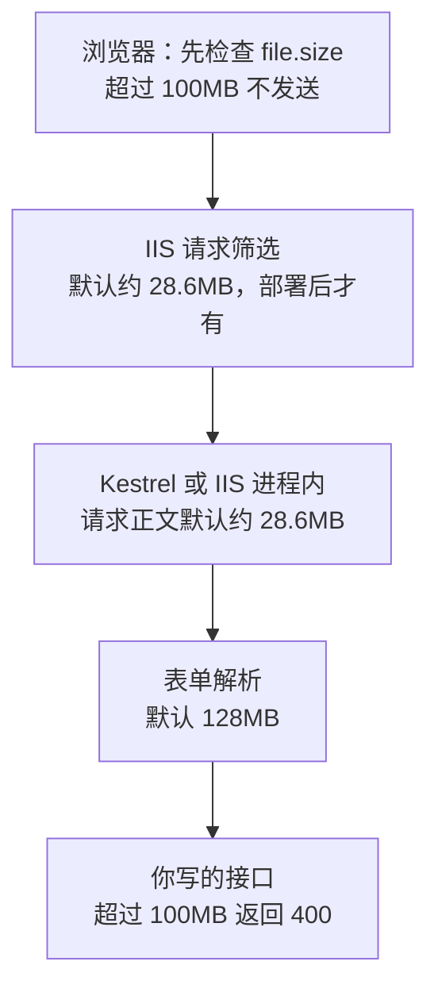

# 第 8 章 上传产品视频：大小限制、上传进度和在线播放

## 这一章解决什么问题

手机录 1 分钟视频就有几十 MB。照第 7 章的写法上传，超过约 28.6MB 就直接失败；就算能传，几十秒里页面没有任何反应，用户以为卡死了。本章把上限调到 100MB，显示上传进度，传完能在页面上播放、拖动进度条。

## 开始之前

- 上一章你已经会了：`FormData` 上传图片，后端 `IFormFile` 接收并安全存盘。
- 环境：在第 7 章的项目上改，或打开 `code/ch08/FetchDemo`。准备一段 100MB 以内的 mp4 或 webm 视频。
- 本章新概念 3 个：**多层大小限制**、**XMLHttpRequest 上传进度**、**video 播放与分段请求**。

## 正文

### 8.1 一个大文件要过几道关

🖼 图解：



**概念一：多层大小限制。**

- **白话定义**：一个上传请求要依次通过好几道大小检查，任何一道不过就失败，而且每道失败的表现不同。想放开上限，每一道都要放到够大。
- **场景**：产品演示视频、培训录像、现场施工录像。
- **反例（什么时候不该用）**：几百 MB 到几 GB 的文件。把各层上限一路调大，服务器要一直占着连接和磁盘缓存，网络一断就得从头再传。这种文件应该分片上传（拆成小块逐块传、可断点续传）或者直传到对象存储，不在本教程范围内。

实测每一层不放开时的表现：

| 关口 | 默认上限 | 超过时（实测） |
|---|---|---|
| Kestrel 请求正文 | 30,000,000 字节（约 28.6MB） | 40MB 文件：413 Payload Too Large，正文为空 |
| 表单解析（`FormOptions.MultipartBodyLengthLimit`） | 134,217,728 字节（128MB） | 把 Kestrel 调到 200MB 后传 130MB：400，`Multipart body length limit 134217728 exceeded.` |
| 你写的接口 | 你定（本章 100MB） | 105MB：400，`"errors":{"video":["视频不能超过 100MB"]}` |
| IIS 请求筛选 | 30,000,000 字节 | ⚠️ 未实机验证：IIS 直接返回 404.13 错误页，请求根本到不了程序 |

本章的取值：接口 100MB；Kestrel 110MB（多留 10MB 给表单的分隔符和其他字段，保证 100–110MB 的文件能走到接口，收到"视频不能超过 100MB"这个明确提示）；表单解析默认 128MB 已经够，不用动。

### 8.2 后端：放开限制，加视频接口

在第 7 章 `Program.cs` 上改五处，完整文件见 `code/ch08/FetchDemo/Program.cs`。

① 开头 `var builder = ...` 和 `var app = builder.Build();` 之间加：

```csharp
// 第一层限制：整个请求正文的大小。Kestrel 默认 30,000,000 字节（约 28.6MB），装不下一段手机视频
// 设成 110MB：比视频上限 100MB 多留一点，给表单的其他部分；超过 100MB 的由接口自己给出友好提示
builder.WebHost.ConfigureKestrel(options =>
{
    options.Limits.MaxRequestBodySize = 110 * 1024 * 1024;
});
// 部署到 IIS（进程内托管）时，上面那行不起作用，生效的是这一行；本机运行时这一行不起作用
builder.Services.Configure<IISServerOptions>(options =>
{
    options.MaxRequestBodySize = 110 * 1024 * 1024;
});
```

② `class Product` 最后加 `public string? VideoUrl { get; set; }`；`MapPost` 新增产品时在 `input.ImageUrl = null;` 后面加 `input.VideoUrl = null;`。③ `MapDelete` 里 `DeleteUpload(product.ImageUrl);` 后面加 `DeleteUpload(product.VideoUrl);`。

④ 在图片上传接口后面、`app.Run();` 前面加视频上传接口。它和图片接口逐行对应，只是参数名叫 `video`、扩展名和上限不同：

```csharp
// 视频：和图片同样的三条规矩（自己起文件名、白名单扩展名、限制大小），只是数值不同
string[] videoExtensions = [".mp4", ".webm", ".mov"];
const long MaxVideoBytes = 100 * 1024 * 1024; // 100MB

app.MapPost("/api/products/{id:int}/video", async (int id, IFormFile? video) =>
{
    var product = products.FirstOrDefault(p => p.Id == id);
    if (product is null)
        return Results.NotFound();

    var errors = new Dictionary<string, string[]>();
    var ext = Path.GetExtension(video?.FileName ?? "").ToLowerInvariant();
    if (video is null || video.Length == 0)
        errors["video"] = ["请选择视频"];
    else if (!videoExtensions.Contains(ext))
        errors["video"] = ["只能上传 mp4、webm、mov 视频"];
    else if (video.Length > MaxVideoBytes)
        errors["video"] = ["视频不能超过 100MB"];
    if (errors.Count > 0)
        return Results.ValidationProblem(errors);

    var fileName = $"{Guid.NewGuid():N}{ext}";
    var folder = Path.Combine(app.Environment.WebRootPath, "uploads");
    Directory.CreateDirectory(folder);
    await using (var stream = File.Create(Path.Combine(folder, fileName)))
    {
        await video!.CopyToAsync(stream);
    }

    DeleteUpload(product.VideoUrl);
    product.VideoUrl = $"/uploads/{fileName}";
    return Results.Ok(product);
})
.DisableAntiforgery();
```

⑤ 部署到 IIS 时还要放开 IIS 请求筛选（⚠️ 本步未实机验证）：发布后在网站目录 `web.config` 的 `<system.webServer>` 节点内加 `<security><requestFiltering><requestLimits maxAllowedContentLength="115343360" /></requestFiltering></security>`，单位是字节（110 × 1024 × 1024）。

🔍 用 curl 实测（在视频文件所在目录执行）`curl.exe -F "video=@demo.mp4" http://localhost:5080/api/products/2/video`，返回 200 和 `"videoUrl":"/uploads/113a1c6cbbee42368bf3a17574e1a87d.mp4"`。40MB 的文件现在也能传；105MB、120MB 的结果和 8.1 节表格一致；note.txt 返回"只能上传 mp4、webm、mov 视频"。

### 8.3 前端：带进度的上传

**概念二：XMLHttpRequest 上传进度。**

- **白话定义**：`XMLHttpRequest`（常简称 XHR）是 fetch 出现之前浏览器发请求的方式。它有一个 `xhr.upload.onprogress` 事件，上传过程中不断告诉你"已发多少字节、一共多少字节"。fetch 目前拿不到上传进度，所以只有这件事要用 XHR。
- **场景**：上传超过几 MB、要等好几秒以上的文件。
- **反例（什么时候不该用）**：普通的 JSON 请求和小图片。一两秒就完成，进度条一闪而过；XHR 的写法也比 fetch 啰嗦。其他请求继续用 `api()`。

在 `wwwroot/api.js` 末尾加 `upload` 函数。它的成功、失败约定和 `api()` 一样，调用方照样写 `try/catch`：

```javascript
// 上传文件并报告进度。fetch 拿不到"已经发出去多少"，所以这里用浏览器更早的 XMLHttpRequest
// 结果约定和 api() 一样：成功返回数据，失败抛出带 message、errors 的 Error，调用方照样 try/catch
function upload(url, formData, onProgress) {
  return new Promise((resolve, reject) => {
    const xhr = new XMLHttpRequest();
    xhr.open('POST', url);

    // 每发出去一批数据触发一次：loaded 是已发字节数，total 是总字节数
    xhr.upload.onprogress = (e) => {
      if (e.lengthComputable) onProgress(Math.round((e.loaded / e.total) * 100));
    };

    // 收到响应（不论状态码多少）时触发
    xhr.onload = () => {
      const isJson = (xhr.getResponseHeader('Content-Type') ?? '').includes('json');
      const body = isJson && xhr.responseText ? JSON.parse(xhr.responseText) : null;
      if (xhr.status >= 200 && xhr.status < 300) {
        resolve(body);
        return;
      }
      let message = `服务器出错（状态码 ${xhr.status}）`;
      if (xhr.status === 400) message = '输入有误，请看红字提示';
      if (xhr.status === 404) message = '这条数据不存在，可能已被删除';
      if (xhr.status === 413) message = '文件太大，服务器拒绝接收';
      const error = new Error(message);
      error.errors = body?.errors ?? {};
      reject(error);
    };

    // 网络不通、或者服务器中途断开连接时触发
    xhr.onerror = () => reject(new Error('上传中断：连不上服务器，或者被服务器断开'));

    // 和 fetch 一样，FormData 交给它自己处理，不要设置 Content-Type
    xhr.send(formData);
  });
}
```

`wwwroot/index.html` 的表单里，图片一栏下面加：

```html
    <!-- video/*：手机上会多出「录像」选项 -->
    <p>视频：<input id="video" type="file" accept="video/*"> <span class="err" id="err-video"></span></p>
    <!-- 上传视频时才显示 -->
    <p id="progressBox" hidden>
      <progress id="progress" max="100" value="0"></progress>
      <span id="progressText"></span>
    </p>
```

`</form>` 后面、「列表」标题前面加播放区：

```html
  <!-- 点某行的「播放」后在这里播；controls 显示播放、暂停、进度条、音量 -->
  <div id="playerBox" hidden>
    <h2 id="playerTitle"></h2>
    <video id="player" controls></video>
  </div>
```

`wwwroot/style.css` 的 `.thumb` 那行下面加 `#player { width: 100%; max-width: 480px; }`，视频最宽 480px，手机上不超过屏幕。

`wwwroot/app.js` 改五处。① 开头 `let editingId` 下面加一行：

```javascript
const MAX_VIDEO_BYTES = 100 * 1024 * 1024; // 和后端一致：100MB
```

② `renderRows` 里画完「删除」按钮后加「播放」按钮：

```javascript
    // 有视频才显示「播放」
    if (p.videoUrl) {
      ops.innerHTML += ` <button data-action="play" data-id="${p.id}">播放</button>`;
    }
```

③ `startEdit` 里清图片框的下一行加 `document.getElementById('video').value = '';`。

④ `save` 前面加两个函数。第 7 章 `save` 里的图片上传挪进了 `uploadFiles`：

```javascript
// 显示上传进度；percent 为 null 时隐藏进度条
function showProgress(percent) {
  const box = document.getElementById('progressBox');
  if (percent === null) {
    box.hidden = true;
    return;
  }
  box.hidden = false;
  document.getElementById('progress').value = percent;
  document.getElementById('progressText').textContent = `${percent}%`;
}

// 第二步：依次上传选中的图片和视频。任何一个失败都抛出 Error，由 save 统一处理
async function uploadFiles(id) {
  const image = document.getElementById('image').files[0];
  const video = document.getElementById('video').files[0];

  if (image !== undefined) {
    const formData = new FormData();
    formData.append('image', image);
    await api('POST', `/api/products/${id}/image`, formData);
  }

  if (video !== undefined) {
    // 先在浏览器里检查大小：不合格的文件不用等它传完 100MB 才被后端拒绝
    if (video.size > MAX_VIDEO_BYTES) {
      const error = new Error('输入有误，请看红字提示');
      error.errors = { video: ['视频不能超过 100MB'] };
      throw error;
    }
    const formData = new FormData();
    formData.append('video', video);
    showProgress(0);
    try {
      await upload(`/api/products/${id}/video`, formData, showProgress);
    } finally {
      showProgress(null); // 成功失败都要把进度条收起来
    }
  }
}
```

`save` 里删掉开头的 `const file = ...` 一行，再把"第二步：选了图片才上传"那整段 `if (file !== undefined) { ... }` 换成：

```javascript
  // 保存按钮在上传期间禁用：视频要传好一会儿，防止用户着急连点
  const button = form.querySelector('button[type="submit"]');
  button.disabled = true;
  try {
    await uploadFiles(saved.id);
  } catch (err) {
    // 文字已经存好了，只是文件没传上去：转到修改模式，重选文件再点保存即可
    await search();
    await startEdit(saved.id);
    showErrors(err.errors ?? {});
    msg.textContent = `产品已保存，但文件上传失败：${err.message}`;
    return;
  } finally {
    button.disabled = false;
  }
```

⑤ `save` 后面加 `play` 函数，并在文件末尾的事件委托里加一行 `if (button.dataset.action === 'play') play(id);`：

```javascript
// 点「播放」：取最新数据，把视频地址交给 video 元素
async function play(id) {
  try {
    const p = await api('GET', '/api/products/' + id);
    const player = document.getElementById('player');
    player.src = p.videoUrl; // 换 src 后浏览器自动开始加载，用户点播放键即可
    document.getElementById('playerTitle').textContent = `${p.code} ${p.name}`;
    document.getElementById('playerBox').hidden = false;
  } catch (err) {
    msg.textContent = err.message;
  }
}
```

### 8.4 播放：video 和分段请求

**概念三：video 播放与分段请求。**

- **白话定义**：`<video controls src="地址">` 由浏览器自己下载并播放视频。它不会一次下完整个文件，而是在请求头里带 `Range: bytes=起-止`，只要需要的那一段（分段请求，Range request）；服务器回 206 Partial Content。拖动进度条时，浏览器直接请求那个位置的数据。
- **场景**：产品演示、操作培训视频，点开即看，不用先下载。
- **反例（什么时候不该用）**：需要按网络好坏自动切换清晰度的长视频（几十分钟的录播课）。那要转码成多种码率的 HLS 等流媒体格式，单个 mp4 做不到。

wwwroot 里的静态文件默认支持分段请求，所以本章没有为播放写任何后端代码。实测点「播放」后浏览器发出的请求：

```text
GET /uploads/89fd4db1b0584bf39ae0623ad1547cd4.webm   Range: bytes=0-
206   Content-Range: bytes 0-347180/347181   Accept-Ranges: bytes
```

如果以后把视频放到 wwwroot 外面、用接口返回，`Results.File(路径, "video/mp4")` 默认**不**支持分段。实测同一个文件带 `Range: bytes=200000-` 请求：静态文件和加了 `enableRangeProcessing: true` 的 `Results.File` 都返回 206 和后半段 147181 字节；不加这个参数的返回 200 和整个文件 347181 字节，拖动进度条时没法只取后面那一段。

### 8.5 跑起来看结果

`Ctrl+F5` 运行。以下是实测：

| 操作 | 结果 |
|---|---|
| 第 2 行「编辑」，选 40MB 视频，保存（用 F12 网络限速模拟 10MB/s 上传） | 进度条从 2% 依次走到 97%，期间「保存」按钮是灰的；完成后进度条消失，提示"已修改：P002 凸阵探头 C5（Id 2）"，第 2 行出现「播放」 |
| 再给第 2 行传一段 10 秒的 webm，点「播放」 | 播放区显示"P002 凸阵探头 C5"，视频时长 10 秒；拖到第 7 秒能接着播 |
| 第 3 行「编辑」，选 105MB 视频，保存 | 没有发出上传请求，视频旁红字"视频不能超过 100MB" |
| 手机尺寸模拟（iPhone 13） | 视频文件框和播放器都是 358px 宽，页面没有横向滚动 |

本机上传很快，想看进度条慢慢走，在 F12 →「网络」顶部「无节流（No throttling）」下拉框里选「3G」等预设。

> ⚠️ 未实机验证：iPhone 录的视频是 .mov，Chrome 等浏览器不一定能播放其中的 HEVC 编码；需要各种浏览器都能播，就录成或转成 H.264 编码的 mp4。headless 测试浏览器不含 H.264 解码器，所以 8.5 节的播放用 webm 测试，mp4 只测了上传。

### 8.6 改坏几处试试

**改坏一：去掉 ① 里放开 Kestrel 限制的那几行**，上传 40MB 视频。

现象：提示"产品已保存，但文件上传失败：文件太大，服务器拒绝接收"。原因：40MB 超过 Kestrel 默认的约 28.6MB，返回 413。前端检查只认 100MB，拦不住它。前后端的上限要和服务器的各层限制一起改。

**改坏二：去掉 `uploadFiles` 里浏览器端的大小检查**，上传 105MB 视频。

现象：浏览器把 105MB 全部发出去之后，才由后端返回"视频不能超过 100MB"（实测在控制台绕过前端检查直接调用 `upload()`，结果相同）。

原因：后端要收完整个文件才知道它有多大。前端先查一下 `file.size`，用户就不用白等这 105MB 传完。前端检查只是省时间，后端检查必须保留，因为前端检查可以被绕过。

**改坏三：视频也用 `api()` 上传。** 把 `await upload(...)` 换成 `await api('POST', 视频地址, formData);`，限速后传 40MB。现象：上传成功，但进度条一直停在 0%，直到传完才消失。原因：fetch 不报告上传进度，`showProgress` 只在开始时被调用了一次。

## 🧱 类比

多层大小限制像寄大件：小区门卫、快递站、分拣中心、收件公司各有一个限重，最低的那个说了算。只跟收件公司说好了"100 公斤以内都收"，门卫那一关照样过不去。

## ⚠️ 踩坑警告

| 现象 | 原因 | 怎么改 |
|---|---|---|
| 小文件能传，大约 28MB 以上就 413 | Kestrel 请求正文默认 30,000,000 字节 | `ConfigureKestrel` 里调大 `MaxRequestBodySize` |
| 本机能传大文件，部署到 IIS 后又不行 | IIS 进程内托管时 Kestrel 设置不生效；IIS 请求筛选也有 30,000,000 字节的限制 | 同时设置 `IISServerOptions.MaxRequestBodySize` 和 web.config 的 `maxAllowedContentLength`（⚠️ 未实机验证） |
| 128MB 以上返回 400 `Multipart body length limit 134217728 exceeded` | 表单解析默认上限，请求没进到你的接口 | `builder.Build()` 之前加 `builder.Services.Configure<Microsoft.AspNetCore.Http.Features.FormOptions>(o => o.MultipartBodyLengthLimit = 200 * 1024 * 1024);`（实测 130MB 随后上传成功） |
| 上传大文件时页面没反应，用户反复点保存 | 用 fetch 上传看不到进度，按钮也没禁用 | 用 XHR 显示进度，上传期间 `button.disabled = true` |
| 用接口返回的视频不能拖动进度条 | `Results.File` 默认不处理 Range | 加 `enableRangeProcessing: true`，或把视频放在 wwwroot 里 |

## 🎯 动手练习

**练习 1：选好视频就显示大小。** 视频文件框旁边显示"已选：40.0 MB"；超过 100MB 时，不用点保存就出现红字"视频不能超过 100MB"。

验收标准：选 40MB 文件显示"已选：40.0 MB"、无红字；选 105MB 文件显示"已选：105.0 MB"和红字；点任意行「编辑」后这两处都清空。

**练习 2：关闭播放器。** 播放区加一个「关闭」按钮，点了视频停止、播放区隐藏。

验收标准：视频正在播放时点「关闭」，播放区消失，并且没有声音继续播放；再点「播放」能重新打开。

卡住了看文末参考答案。

## 📌 一句话总结

大文件要逐层放开大小限制，用 XHR 显示进度，video 靠 206 分段播放。

## 下一章

本教程到此结束：查询、新增、修改、删除、错误处理、手机访问、图片和视频上传，日常页面需要的操作都有了。数据要落到 SQL Server，把 `products` 换成 ADO.NET 或 Dapper 查询即可，前端代码不用改。

---

<!-- 以下是参考答案，先自己动手，卡住了再往下翻 -->


## 参考答案

### 练习 1

思路：监听视频框的 `change` 事件，用 `file.size` 换算成 MB 显示；和第 7 章练习 1 一样，`resetForm`、`startEdit` 清空文件框时也要清提示。`Program.cs`、`api.js`、`style.css` 不变。

`wwwroot/index.html`：

```html
<!-- code/ch08/Answer1-FileSize/wwwroot/index.html -->
<!DOCTYPE html>
<html lang="zh-CN">
<head>
  <meta charset="utf-8">
  <!-- 让手机按屏幕实际宽度排版；没有这行，手机按约 980px 宽排版再整体缩小 -->
  <meta name="viewport" content="width=device-width, initial-scale=1">
  <title>产品列表</title>
  <link rel="stylesheet" href="style.css">
</head>
<body>
  <h1>产品列表</h1>

  <!-- 同一张表单：新增模式和修改模式共用 -->
  <h2 id="formTitle">新增产品</h2>
  <form id="productForm">
    <p>编码：<input id="code"> <span class="err" id="err-code"></span></p>
    <p>名称：<input id="name"> <span class="err" id="err-name"></span></p>
    <p>价格：<input id="price" type="number" step="0.01"> <span class="err" id="err-price"></span></p>
    <!-- accept 只是让选择框默认只显示图片；手机上会多出「拍照」选项。它拦不住别的文件，真正把关在后端 -->
    <p>图片：<input id="image" type="file" accept="image/*"> <span class="err" id="err-image"></span></p>
    <!-- video/*：手机上会多出「录像」选项 -->
    <p>视频：<input id="video" type="file" accept="video/*"> <span id="videoSize"></span> <span class="err" id="err-video"></span></p>
    <!-- 上传视频时才显示 -->
    <p id="progressBox" hidden>
      <progress id="progress" max="100" value="0"></progress>
      <span id="progressText"></span>
    </p>
    <button type="submit">保存</button>
  </form>

  <!-- 点某行的「播放」后在这里播；controls 显示播放、暂停、进度条、音量 -->
  <div id="playerBox" hidden>
    <h2 id="playerTitle"></h2>
    <video id="player" controls></video>
  </div>

  <h2>列表</h2>
  <p>
    名称包含：<input id="keyword">
    <button id="btnSearch">查询</button>
  </p>
  <p id="msg"></p>
  <table>
    <thead>
      <tr><th>Id</th><th>编码</th><th>名称</th><th>价格</th><th>图片</th><th>操作</th></tr>
    </thead>
    <tbody id="rows"></tbody>
  </table>
  <!-- 顺序不能反：app.js 一加载就会调用 api.js 里的 api() -->
  <script src="api.js"></script>
  <script src="app.js"></script>
</body>
</html>
```

`wwwroot/app.js`：

```javascript
// code/ch08/Answer1-FileSize/wwwroot/app.js
const msg = document.getElementById('msg');
const form = document.getElementById('productForm');
let editingId = null; // null = 新增模式；有值 = 正在修改这个 Id
const MAX_VIDEO_BYTES = 100 * 1024 * 1024; // 和后端一致：100MB

function renderRows(products) {
  const tbody = document.getElementById('rows');
  tbody.innerHTML = '';
  for (const p of products) {
    const tr = document.createElement('tr');
    for (const value of [p.id, p.code, p.name, p.price]) {
      const td = document.createElement('td');
      td.textContent = value;
      tr.appendChild(td);
    }
    const imgCell = document.createElement('td');
    if (p.imageUrl) {
      // 用 createElement 而不是拼 innerHTML：alt 里放的是用户填的名称
      const img = document.createElement('img');
      img.src = p.imageUrl; // 形如 /uploads/xxx.png，就是 wwwroot 里的静态文件
      img.alt = p.name;
      img.className = 'thumb';
      imgCell.appendChild(img);
    }
    tr.appendChild(imgCell);
    const ops = document.createElement('td');
    // 这里可以用 innerHTML：拼进去的只有后端给的数字 id，没有用户输入的文字
    // data-action、data-id 给文件末尾的统一点击处理用
    ops.innerHTML =
      `<button data-action="edit" data-id="${p.id}">编辑</button> ` +
      `<button data-action="delete" data-id="${p.id}">删除</button>`;
    // 有视频才显示「播放」
    if (p.videoUrl) {
      ops.innerHTML += ` <button data-action="play" data-id="${p.id}">播放</button>`;
    }
    tr.appendChild(ops);
    tbody.appendChild(tr);
  }
}

async function search() {
  const keyword = document.getElementById('keyword').value.trim();
  const query = new URLSearchParams({ keyword });
  try {
    const products = await api('GET', '/api/products?' + query);
    renderRows(products);
    msg.textContent = products.length === 0 ? '没有符合条件的产品' : `共 ${products.length} 条`;
  } catch (err) {
    msg.textContent = err.message;
  }
}

function clearErrors() {
  for (const span of document.querySelectorAll('.err')) span.textContent = '';
}

function showErrors(errors) {
  for (const [field, messages] of Object.entries(errors)) {
    document.getElementById('err-' + field).textContent = messages.join('；');
  }
}

// 回到新增模式
function resetForm() {
  editingId = null;
  form.reset();
  showVideoSize(undefined); // form.reset() 清掉了文件，大小提示也要清
  clearErrors();
  document.getElementById('formTitle').textContent = '新增产品';
}

// 点「编辑」：先从后端取最新数据再填表，列表里的可能已经过时
async function startEdit(id) {
  try {
    const p = await api('GET', '/api/products/' + id);
    editingId = id;
    clearErrors();
    document.getElementById('code').value = p.code;
    document.getElementById('name').value = p.name;
    document.getElementById('price').value = p.price;
    document.getElementById('image').value = ''; // 清掉上一次选的文件，改文字时不会误传旧图
    document.getElementById('video').value = '';
    showVideoSize(undefined);
    document.getElementById('formTitle').textContent = `修改产品（Id ${id}）`;
  } catch (err) {
    msg.textContent = err.message;
  }
}

async function removeProduct(id) {
  // confirm 弹出确认框，点「取消」返回 false
  if (!confirm('确定删除这条产品吗？')) return;
  try {
    await api('DELETE', '/api/products/' + id);
    if (editingId === id) resetForm(); // 正在改的那条被删了，表单也要回到新增模式
    await search();
    msg.textContent = `已删除 Id ${id}`;
  } catch (err) {
    msg.textContent = err.message;
  }
}

// 选好视频后显示大小；超过上限马上提示，不用等点保存
function showVideoSize(file) {
  const sizeText = document.getElementById('videoSize');
  const err = document.getElementById('err-video');
  err.textContent = '';
  if (file === undefined) {
    sizeText.textContent = '';
    return;
  }
  // file.size 是字节数；除两次 1024 得到 MB，toFixed(1) 保留一位小数
  sizeText.textContent = `已选：${(file.size / 1024 / 1024).toFixed(1)} MB`;
  if (file.size > MAX_VIDEO_BYTES) err.textContent = '视频不能超过 100MB';
}

// 显示上传进度；percent 为 null 时隐藏进度条
function showProgress(percent) {
  const box = document.getElementById('progressBox');
  if (percent === null) {
    box.hidden = true;
    return;
  }
  box.hidden = false;
  document.getElementById('progress').value = percent;
  document.getElementById('progressText').textContent = `${percent}%`;
}

// 第二步：依次上传选中的图片和视频。任何一个失败都抛出 Error，由 save 统一处理
async function uploadFiles(id) {
  const image = document.getElementById('image').files[0];
  const video = document.getElementById('video').files[0];

  if (image !== undefined) {
    const formData = new FormData();
    formData.append('image', image);
    await api('POST', `/api/products/${id}/image`, formData);
  }

  if (video !== undefined) {
    // 先在浏览器里检查大小：不合格的文件不用等它传完 100MB 才被后端拒绝
    if (video.size > MAX_VIDEO_BYTES) {
      const error = new Error('输入有误，请看红字提示');
      error.errors = { video: ['视频不能超过 100MB'] };
      throw error;
    }
    const formData = new FormData();
    formData.append('video', video);
    showProgress(0);
    try {
      await upload(`/api/products/${id}/video`, formData, showProgress);
    } finally {
      showProgress(null); // 成功失败都要把进度条收起来
    }
  }
}

async function save(e) {
  e.preventDefault();
  clearErrors();
  const product = {
    code: document.getElementById('code').value.trim(),
    name: document.getElementById('name').value.trim(),
    price: Number(document.getElementById('price').value),
  };

  // 第一步：照旧保存文字信息，拿到产品 Id
  let saved;
  let text;
  try {
    if (editingId === null) {
      saved = await api('POST', '/api/products', product);
      text = `已新增：${saved.code} ${saved.name}（Id ${saved.id}）`;
    } else {
      saved = await api('PUT', '/api/products/' + editingId, product);
      text = `已修改：${saved.code} ${saved.name}（Id ${saved.id}）`;
    }
  } catch (err) {
    showErrors(err.errors ?? {});
    msg.textContent = err.message;
    return;
  }

  // 保存按钮在上传期间禁用：视频要传好一会儿，防止用户着急连点
  const button = form.querySelector('button[type="submit"]');
  button.disabled = true;
  try {
    await uploadFiles(saved.id);
  } catch (err) {
    // 文字已经存好了，只是文件没传上去：转到修改模式，重选文件再点保存即可
    await search();
    await startEdit(saved.id);
    showErrors(err.errors ?? {});
    msg.textContent = `产品已保存，但文件上传失败：${err.message}`;
    return;
  } finally {
    button.disabled = false;
  }

  resetForm();
  await search();
  msg.textContent = text;
}

// 点「播放」：取最新数据，把视频地址交给 video 元素
async function play(id) {
  try {
    const p = await api('GET', '/api/products/' + id);
    const player = document.getElementById('player');
    player.src = p.videoUrl; // 换 src 后浏览器自动开始加载，用户点播放键即可
    document.getElementById('playerTitle').textContent = `${p.code} ${p.name}`;
    document.getElementById('playerBox').hidden = false;
  } catch (err) {
    msg.textContent = err.message;
  }
}

// 整个表格只挂一个点击处理：按钮是每次查询后新画的，挂在按钮上会跟着丢
document.getElementById('rows').addEventListener('click', (e) => {
  const button = e.target.closest('button'); // 点在按钮上才处理
  if (button === null) return;
  const id = Number(button.dataset.id); // data-id 读出来是字符串，转成数字
  if (button.dataset.action === 'edit') startEdit(id);
  if (button.dataset.action === 'delete') removeProduct(id);
  if (button.dataset.action === 'play') play(id);
});

document.getElementById('video').addEventListener('change', (e) => {
  showVideoSize(e.target.files[0]);
});
form.addEventListener('submit', save);
document.getElementById('btnSearch').addEventListener('click', search);
search();
```

### 练习 2

思路：隐藏元素不会让视频停下，要先 `pause()`；再去掉 `src` 并 `load()`，让浏览器停止下载剩余数据。按钮在 `<form>` 外面，不会触发保存。`Program.cs`、`api.js`、`style.css` 不变。

`wwwroot/index.html`：

```html
<!-- code/ch08/Answer2-ClosePlayer/wwwroot/index.html -->
<!DOCTYPE html>
<html lang="zh-CN">
<head>
  <meta charset="utf-8">
  <!-- 让手机按屏幕实际宽度排版；没有这行，手机按约 980px 宽排版再整体缩小 -->
  <meta name="viewport" content="width=device-width, initial-scale=1">
  <title>产品列表</title>
  <link rel="stylesheet" href="style.css">
</head>
<body>
  <h1>产品列表</h1>

  <!-- 同一张表单：新增模式和修改模式共用 -->
  <h2 id="formTitle">新增产品</h2>
  <form id="productForm">
    <p>编码：<input id="code"> <span class="err" id="err-code"></span></p>
    <p>名称：<input id="name"> <span class="err" id="err-name"></span></p>
    <p>价格：<input id="price" type="number" step="0.01"> <span class="err" id="err-price"></span></p>
    <!-- accept 只是让选择框默认只显示图片；手机上会多出「拍照」选项。它拦不住别的文件，真正把关在后端 -->
    <p>图片：<input id="image" type="file" accept="image/*"> <span class="err" id="err-image"></span></p>
    <!-- video/*：手机上会多出「录像」选项 -->
    <p>视频：<input id="video" type="file" accept="video/*"> <span class="err" id="err-video"></span></p>
    <!-- 上传视频时才显示 -->
    <p id="progressBox" hidden>
      <progress id="progress" max="100" value="0"></progress>
      <span id="progressText"></span>
    </p>
    <button type="submit">保存</button>
  </form>

  <!-- 点某行的「播放」后在这里播；controls 显示播放、暂停、进度条、音量 -->
  <div id="playerBox" hidden>
    <h2 id="playerTitle"></h2>
    <video id="player" controls></video>
    <p><button id="btnClosePlayer">关闭</button></p>
  </div>

  <h2>列表</h2>
  <p>
    名称包含：<input id="keyword">
    <button id="btnSearch">查询</button>
  </p>
  <p id="msg"></p>
  <table>
    <thead>
      <tr><th>Id</th><th>编码</th><th>名称</th><th>价格</th><th>图片</th><th>操作</th></tr>
    </thead>
    <tbody id="rows"></tbody>
  </table>
  <!-- 顺序不能反：app.js 一加载就会调用 api.js 里的 api() -->
  <script src="api.js"></script>
  <script src="app.js"></script>
</body>
</html>
```

`wwwroot/app.js`：

```javascript
// code/ch08/Answer2-ClosePlayer/wwwroot/app.js
const msg = document.getElementById('msg');
const form = document.getElementById('productForm');
let editingId = null; // null = 新增模式；有值 = 正在修改这个 Id
const MAX_VIDEO_BYTES = 100 * 1024 * 1024; // 和后端一致：100MB

function renderRows(products) {
  const tbody = document.getElementById('rows');
  tbody.innerHTML = '';
  for (const p of products) {
    const tr = document.createElement('tr');
    for (const value of [p.id, p.code, p.name, p.price]) {
      const td = document.createElement('td');
      td.textContent = value;
      tr.appendChild(td);
    }
    const imgCell = document.createElement('td');
    if (p.imageUrl) {
      // 用 createElement 而不是拼 innerHTML：alt 里放的是用户填的名称
      const img = document.createElement('img');
      img.src = p.imageUrl; // 形如 /uploads/xxx.png，就是 wwwroot 里的静态文件
      img.alt = p.name;
      img.className = 'thumb';
      imgCell.appendChild(img);
    }
    tr.appendChild(imgCell);
    const ops = document.createElement('td');
    // 这里可以用 innerHTML：拼进去的只有后端给的数字 id，没有用户输入的文字
    // data-action、data-id 给文件末尾的统一点击处理用
    ops.innerHTML =
      `<button data-action="edit" data-id="${p.id}">编辑</button> ` +
      `<button data-action="delete" data-id="${p.id}">删除</button>`;
    // 有视频才显示「播放」
    if (p.videoUrl) {
      ops.innerHTML += ` <button data-action="play" data-id="${p.id}">播放</button>`;
    }
    tr.appendChild(ops);
    tbody.appendChild(tr);
  }
}

async function search() {
  const keyword = document.getElementById('keyword').value.trim();
  const query = new URLSearchParams({ keyword });
  try {
    const products = await api('GET', '/api/products?' + query);
    renderRows(products);
    msg.textContent = products.length === 0 ? '没有符合条件的产品' : `共 ${products.length} 条`;
  } catch (err) {
    msg.textContent = err.message;
  }
}

function clearErrors() {
  for (const span of document.querySelectorAll('.err')) span.textContent = '';
}

function showErrors(errors) {
  for (const [field, messages] of Object.entries(errors)) {
    document.getElementById('err-' + field).textContent = messages.join('；');
  }
}

// 回到新增模式
function resetForm() {
  editingId = null;
  form.reset();
  clearErrors();
  document.getElementById('formTitle').textContent = '新增产品';
}

// 点「编辑」：先从后端取最新数据再填表，列表里的可能已经过时
async function startEdit(id) {
  try {
    const p = await api('GET', '/api/products/' + id);
    editingId = id;
    clearErrors();
    document.getElementById('code').value = p.code;
    document.getElementById('name').value = p.name;
    document.getElementById('price').value = p.price;
    document.getElementById('image').value = ''; // 清掉上一次选的文件，改文字时不会误传旧图
    document.getElementById('video').value = '';
    document.getElementById('formTitle').textContent = `修改产品（Id ${id}）`;
  } catch (err) {
    msg.textContent = err.message;
  }
}

async function removeProduct(id) {
  // confirm 弹出确认框，点「取消」返回 false
  if (!confirm('确定删除这条产品吗？')) return;
  try {
    await api('DELETE', '/api/products/' + id);
    if (editingId === id) resetForm(); // 正在改的那条被删了，表单也要回到新增模式
    await search();
    msg.textContent = `已删除 Id ${id}`;
  } catch (err) {
    msg.textContent = err.message;
  }
}

// 显示上传进度；percent 为 null 时隐藏进度条
function showProgress(percent) {
  const box = document.getElementById('progressBox');
  if (percent === null) {
    box.hidden = true;
    return;
  }
  box.hidden = false;
  document.getElementById('progress').value = percent;
  document.getElementById('progressText').textContent = `${percent}%`;
}

// 第二步：依次上传选中的图片和视频。任何一个失败都抛出 Error，由 save 统一处理
async function uploadFiles(id) {
  const image = document.getElementById('image').files[0];
  const video = document.getElementById('video').files[0];

  if (image !== undefined) {
    const formData = new FormData();
    formData.append('image', image);
    await api('POST', `/api/products/${id}/image`, formData);
  }

  if (video !== undefined) {
    // 先在浏览器里检查大小：不合格的文件不用等它传完 100MB 才被后端拒绝
    if (video.size > MAX_VIDEO_BYTES) {
      const error = new Error('输入有误，请看红字提示');
      error.errors = { video: ['视频不能超过 100MB'] };
      throw error;
    }
    const formData = new FormData();
    formData.append('video', video);
    showProgress(0);
    try {
      await upload(`/api/products/${id}/video`, formData, showProgress);
    } finally {
      showProgress(null); // 成功失败都要把进度条收起来
    }
  }
}

async function save(e) {
  e.preventDefault();
  clearErrors();
  const product = {
    code: document.getElementById('code').value.trim(),
    name: document.getElementById('name').value.trim(),
    price: Number(document.getElementById('price').value),
  };

  // 第一步：照旧保存文字信息，拿到产品 Id
  let saved;
  let text;
  try {
    if (editingId === null) {
      saved = await api('POST', '/api/products', product);
      text = `已新增：${saved.code} ${saved.name}（Id ${saved.id}）`;
    } else {
      saved = await api('PUT', '/api/products/' + editingId, product);
      text = `已修改：${saved.code} ${saved.name}（Id ${saved.id}）`;
    }
  } catch (err) {
    showErrors(err.errors ?? {});
    msg.textContent = err.message;
    return;
  }

  // 保存按钮在上传期间禁用：视频要传好一会儿，防止用户着急连点
  const button = form.querySelector('button[type="submit"]');
  button.disabled = true;
  try {
    await uploadFiles(saved.id);
  } catch (err) {
    // 文字已经存好了，只是文件没传上去：转到修改模式，重选文件再点保存即可
    await search();
    await startEdit(saved.id);
    showErrors(err.errors ?? {});
    msg.textContent = `产品已保存，但文件上传失败：${err.message}`;
    return;
  } finally {
    button.disabled = false;
  }

  resetForm();
  await search();
  msg.textContent = text;
}

// 点「播放」：取最新数据，把视频地址交给 video 元素
async function play(id) {
  try {
    const p = await api('GET', '/api/products/' + id);
    const player = document.getElementById('player');
    player.src = p.videoUrl; // 换 src 后浏览器自动开始加载，用户点播放键即可
    document.getElementById('playerTitle').textContent = `${p.code} ${p.name}`;
    document.getElementById('playerBox').hidden = false;
  } catch (err) {
    msg.textContent = err.message;
  }
}

function closePlayer() {
  const player = document.getElementById('player');
  player.pause(); // 只隐藏不暂停，声音还会继续
  // 去掉 src 再 load()：停止下载剩下的视频数据
  player.removeAttribute('src');
  player.load();
  document.getElementById('playerBox').hidden = true;
}

// 整个表格只挂一个点击处理：按钮是每次查询后新画的，挂在按钮上会跟着丢
document.getElementById('rows').addEventListener('click', (e) => {
  const button = e.target.closest('button'); // 点在按钮上才处理
  if (button === null) return;
  const id = Number(button.dataset.id); // data-id 读出来是字符串，转成数字
  if (button.dataset.action === 'edit') startEdit(id);
  if (button.dataset.action === 'delete') removeProduct(id);
  if (button.dataset.action === 'play') play(id);
});

document.getElementById('btnClosePlayer').addEventListener('click', closePlayer);
form.addEventListener('submit', save);
document.getElementById('btnSearch').addEventListener('click', search);
search();
```
