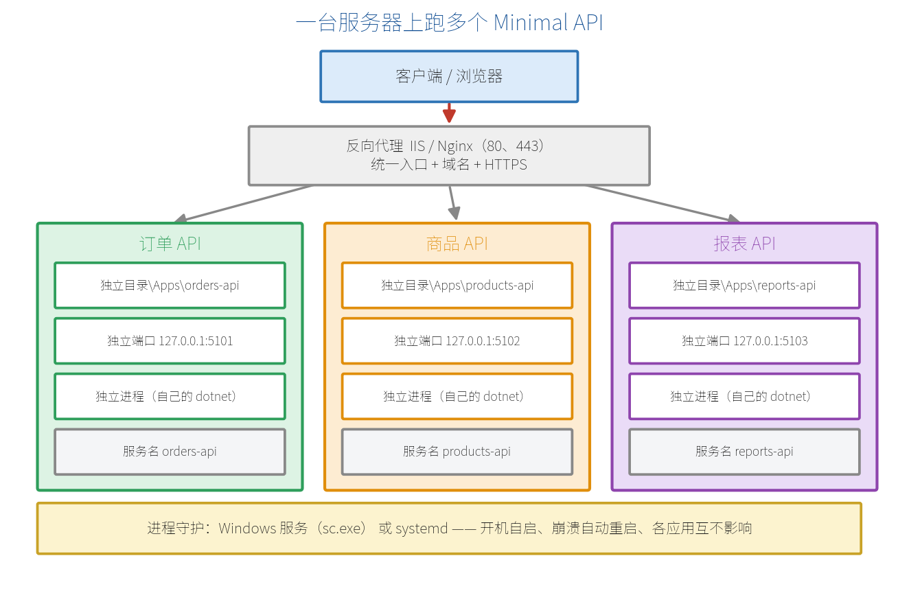
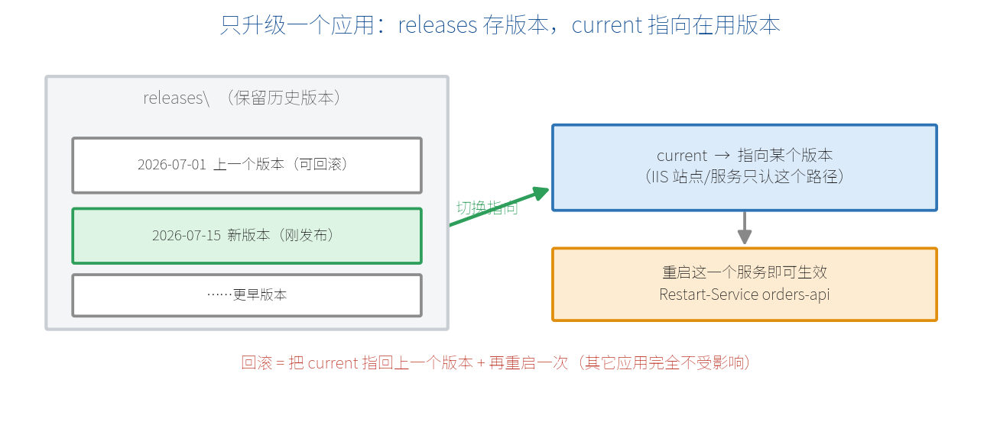

# 第8章　一台服务器部署多个 Minimal API：FDD + 独立目录 + 独立端口 + 服务托管

第7章把"一个应用怎么发布上线"走通了。但真实的内网服务器很少只跑一个 API：订单、商品、报表往往挤在同一台机器上。这一章讲**企业里最常见的那套组合**——框架依赖发布（FDD）、每个应用一个独立目录、各自占一个独立端口和独立进程，再交给 Windows 服务或 systemd 看管。

> **【先把三个问题说清楚】** 这是什么：把同一台服务器上的多个 Minimal API，按"一应用一目录、一端口、一进程、一服务"的约定各自独立部署。
> 目的是什么：让它们互不影响——单独升级、单独重启、单独回滚，出问题时能立刻定位到是哪一个。
> 最后得到什么：两个以上的 API 同时在一台机器上常驻运行，开机自启、崩溃自动重启，并且能只替换其中一个而不动其它。

> **【本章操作路线】** 判断该不该用这套方式 → 选 FDD 发布 → 定目录与端口台账 → 让应用监听自己的端口 → 注册成 Windows 服务或 systemd 单元 → 挂反向代理做统一入口 → 只升级/回滚一个应用 → 分层排错



## 8.1 为什么这套组合在企业里最常见

假设内网有一台 Windows Server，要跑三个 API：订单、商品、报表。它们由不同的人维护，上线节奏也不同。如果把三个应用塞进同一个进程，任何一个改动都要整体重启；如果全都靠 IIS 应用池托管，站点、应用池、绑定的对应关系一多就容易记混，排错时还要先分清是 IIS 层还是应用层的问题。

这套组合的做法很朴素：**三个应用彼此当成三台"虚拟的小服务器"**，各自有目录、端口、进程和服务名。

| 关注点 | 这套方式怎么解决 |
| --- | --- |
| 互相影响 | 独立进程。一个应用崩了，其它两个照常服务 |
| 单独上线 | 只替换那个应用的目录，只重启它自己的服务 |
| 定位问题 | 端口和服务名一一对应，`netstat` 一看就知道是谁 |
| 开机自启 | 交给 Windows 服务或 systemd，不依赖有人登录服务器 |
| 运行时升级 | FDD 模式下，服务器统一升级一次运行时，所有应用共享 |

**什么时候不该用它**（这条比优点更重要）：

- 需要按流量**自动扩缩容**、或要在多台机器间调度 → 该上容器和编排（第38章 Docker、第39章 CI/CD 是这条路的起点），不要在单机上手工堆进程。
- 全公司**只有一个** API，且团队已经很熟 IIS → 直接用第7章的 IIS 托管更省事，没必要引入服务注册这一层。
- 应用之间需要**共享内存状态** → 独立进程做不到，应该重新考虑架构（用数据库或缓存共享，见第30章）。

## 8.2 为什么选 FDD（框架依赖发布）

**FDD（Framework-Dependent Deployment，框架依赖发布）** 指发布包里**不带 .NET 运行时**，运行时由服务器统一安装。第7章 7.5 节比较过它和自包含发布，这里补上"多应用同居"这个视角下的取舍。

一台机器上有 5 个应用时，差别很直接：

| | FDD | 自包含 |
| --- | --- | --- |
| 单个应用发布包 | 几 MB | 几十 MB 起 |
| 5 个应用占用 | 只有一份运行时 | 5 份运行时各自一套 |
| 运行时打安全补丁 | 服务器升一次，全部生效 | 每个应用重新发布一遍 |
| 前置条件 | 服务器必须先装好运行时 | 无 |

所以多应用场景下 FDD 是默认选择。**什么时候不该用 FDD**：你无权改动服务器、装不了运行时，或者某个应用必须锁死在旧版本运行时上——这两种情况才用自包含。

示例8-1　把两个应用分别发布到独立目录

```bash
# 在 orders-api 项目目录（含 csproj）执行
dotnet publish -c Release -o C:\Apps\orders-api\releases\2026-07-15

# 在 products-api 项目目录执行
dotnet publish -c Release -o C:\Apps\products-api\releases\2026-07-15
```

- 不加 `-r` 和 `--self-contained`，默认就是 FDD。
- 输出目录直接写成**带日期的版本目录**，8.8 节的升级回滚会用到它。
- 发布产物里 `<项目名>.dll` 才是程序本体，用 `dotnet <项目名>.dll` 启动。

> **【预期结果】** 两个目录里各有一套 `*.dll`、`appsettings.json`、`*.runtimeconfig.json`；单个目录通常只有几 MB。

## 8.3 先定下目录与端口台账

这一步没有技术难度，但**是整套方案能不能长期维护的关键**。约定一旦松散，半年后没人说得清 5107 端口是谁。

推荐的目录结构（每个应用长得一模一样）：

```text
C:\Apps\
├─ orders-api\
│  ├─ current\        ← 正在运行的版本（服务指向这里）
│  ├─ releases\       ← 历史版本，按日期存放，用于回滚
│  └─ logs\           ← 日志单独放，便于给写权限
├─ products-api\
│  └─ ...（结构相同）
└─ reports-api\
   └─ ...（结构相同）
```

端口台账建议直接写进运维文档，跟着服务器走：

| 应用 | 端口 | 服务名 | 对外路径 |
| --- | --- | --- | --- |
| 订单 API | 127.0.0.1:5101 | orders-api | /orders |
| 商品 API | 127.0.0.1:5102 | products-api | /products |
| 报表 API | 127.0.0.1:5103 | reports-api | /reports |

- 端口从 5101 起连号，和默认的 5000/5001 拉开距离，避免和开发调试撞车。
- 只监听 `127.0.0.1`，公网入口交给反向代理（8.7 节），应用本身不直接暴露。

**什么时候不该这样规划**：如果这台机器上的应用会频繁增删（今天 3 个下周 8 个），手工维护台账很快会失真，那是该转向容器编排的信号。

## 8.4 让每个应用监听自己的端口

应用默认可能监听 5000。多应用同居时必须显式指定端口，否则第二个启动的会因端口被占直接失败。最省事的做法是用环境变量 `ASPNETCORE_URLS`，不用改代码。

示例8-2　指定环境和端口启动（本机先验证）

```bash
# 进入该应用的发布目录
cd C:\Apps\orders-api\current

# PowerShell：只影响当前终端及其子进程
$env:ASPNETCORE_ENVIRONMENT = "Production"
$env:ASPNETCORE_URLS = "http://127.0.0.1:5101"
dotnet OrdersApi.dll
```

启动后终端会打印监听地址，另开一个终端验证：

```bash
curl -i http://127.0.0.1:5101/health
```

**拆解运行结果**：终端出现下面两行，说明端口和环境都生效了。

```text
Now listening on: http://127.0.0.1:5101
Hosting environment: Production
```

`curl` 应返回 `HTTP/1.1 200 OK`，正文是第7章 7.2 节加的健康检查 JSON。看到 200，说明"这一个应用自己是好的"——后面配服务和代理时出问题，就不必怀疑应用本身。

**改坏一处试试**：把两个应用的 `ASPNETCORE_URLS` 都写成 5101，然后先后启动。第二个会启动失败，日志里是地址已被占用的错误（`Failed to bind to address ... address already in use`）。这就是 8.3 节要记端口台账的原因——**这个错误本身不难懂，难的是三个月后你不记得 5101 归谁**。

## 8.5 Windows：把应用注册成 Windows 服务

上面那种启动方式，终端一关进程就没了。要让它常驻并开机自启，就把它注册成 Windows 服务。

这里有一个**必须先做的代码改动**，漏掉它是最常见的失败原因：应用要能响应服务控制管理器（SCM）的启动和停止信号。

示例8-3　OrdersApi 的 Program.cs 增加服务托管支持

```csharp
// C:\src\orders-api\Program.cs
var builder = WebApplication.CreateBuilder(args);

// 让应用能被 Windows 服务管理器正确启动和停止；
// 不在服务里运行时（比如本机 dotnet run）这行不起作用，可以放心一直留着
builder.Services.AddWindowsService();

var app = builder.Build();

app.MapGet("/health", () => Results.Ok(new { status = "Healthy" }));

app.Run();
```

需要先装一个包：

```bash
dotnet add package Microsoft.Extensions.Hosting.WindowsServices
```

**拆解**：`AddWindowsService()` 把宿主的生命周期切换成 Windows 服务生命周期，同时默认把日志也写进 Windows 事件日志。加上它以后，`sc.exe start` 才能收到"我启动好了"的回应。

注册并启动服务：

示例8-4　用 sc.exe 注册服务（在管理员命令提示符执行）

```bash
sc.exe create orders-api ^
  binPath= "C:\Program Files\dotnet\dotnet.exe C:\Apps\orders-api\current\OrdersApi.dll" ^
  start= auto ^
  DisplayName= "Orders API"

sc.exe description orders-api "订单 API，监听 127.0.0.1:5101"
sc.exe start orders-api
sc.exe query orders-api
```

- `binPath=` 和 `start=` 后面**必须有一个空格**，这是 `sc.exe` 的老规矩，漏了会报参数错误。
- 服务默认以 LocalSystem 运行；生产环境建议改成专用低权限账户，并只给它 `current` 的读取权限和 `logs` 的写入权限。
- 环境变量对服务不能靠 `$env:` 临时设置。可以在项目里通过 `appsettings.Production.json` 固定端口，或用 `sc.exe`/注册表为该服务单独配置环境变量。

再给它配上失败自动重启：

```bash
# 第1次、第2次失败后 5 秒重启，之后每次也重启；失败计数每天清零
sc.exe failure orders-api reset= 86400 actions= restart/5000/restart/5000/restart/5000
```

第二个应用重复同一套动作，只换服务名、目录和端口。

> **【⚠️ 本节命令未实机验证】** `sc.exe` 相关命令需要在 Windows 服务器上执行，本书写作环境无法运行。示例8-3 的代码已实际编译通过；示例8-4 的参数依据 Microsoft 官方文档整理，请在测试机上先跑一遍再用于生产。

**改坏一处试试**：把示例8-3 里的 `AddWindowsService()` 注释掉再注册服务，`sc.exe start` 会等待很久然后报错（典型是错误 1053：服务未及时响应启动请求）。原因是应用按控制台程序的方式运行，从没告诉 SCM"我起来了"。

## 8.6 Linux：每个应用一个 systemd 单元

Linux 上的对应做法是给每个应用写一个 systemd 单元文件。第7章 7.8 节已经给了完整模板，这里只强调多应用时**必须逐个区分**的四处。

示例8-5　/etc/systemd/system/orders-api.service（只列关键差异）

```text
[Unit]
Description=Orders API

[Service]
WorkingDirectory=/opt/orders-api/current
ExecStart=/usr/bin/dotnet /opt/orders-api/current/OrdersApi.dll
Environment=ASPNETCORE_ENVIRONMENT=Production
Environment=ASPNETCORE_URLS=http://127.0.0.1:5101
Restart=always
RestartSec=5
User=orders-svc

[Install]
WantedBy=multi-user.target
```

四处必须各不相同：**单元文件名、WorkingDirectory、ExecStart 的 DLL 路径、ASPNETCORE_URLS 的端口**。建议 `User` 也各自独立，一个应用被攻破不至于影响其它。

启用和查看：

```bash
sudo systemctl daemon-reload
sudo systemctl enable --now orders-api
sudo systemctl status orders-api
sudo journalctl -u orders-api -f
```

如果想让 systemd 更准确地知道应用何时真正就绪、并让日志级别对上 journald，可以装 `Microsoft.Extensions.Hosting.Systemd` 并在代码里加 `builder.Services.AddSystemd();`。**这是可选项**——不加，上面的单元文件（默认 `Type=simple`）也能正常工作。

## 8.7 前面挂一个反向代理做统一入口

三个应用现在只监听 127.0.0.1，外部还访问不到。统一入口交给反向代理，两种常见分流方式：

| 方式 | 对外地址 | 适合 |
| --- | --- | --- |
| 按路径 | `api.example.com/orders` → 5101 | 只有一个域名/证书 |
| 按子域名 | `orders.example.com` → 5101 | 各应用独立域名、独立证书 |

Windows 上用 IIS 做反向代理需要安装 **URL Rewrite** 和 **ARR（Application Request Routing）** 两个扩展；Linux 上用 Nginx，配置见第7章 7.8 节的示例，把 `proxy_pass` 分别指向 5101/5102/5103 即可。

按路径分流时要注意：应用收到的路径可能带着 `/orders` 前缀，需要在代理侧去掉前缀，或让应用自己接受这个前缀——两边约定一致就行，不一致的表现是"代理能连通但一直 404"。

## 8.8 只升级或回滚其中一个应用

这一节回答一个很实际的问题：**改了订单 API，怎么只换它、不碰另外两个。**



关键是让服务始终指向 `current`，而 `current` 的内容可以整体替换。

示例8-6　升级订单 API 的完整步骤

```bash
# 1) 发布新版本到带日期的目录（不碰 current）
dotnet publish -c Release -o C:\Apps\orders-api\releases\2026-07-20

# 2) 停这一个服务（另外两个应用完全不受影响）
sc.exe stop orders-api

# 3) 用新版本替换 current 的内容
robocopy C:\Apps\orders-api\releases\2026-07-20 C:\Apps\orders-api\current /MIR

# 4) 起服务并验证
sc.exe start orders-api
curl -i http://127.0.0.1:5101/health
```

回滚就是把第 3 步的源目录换成上一个版本目录，再重启一次：

```bash
sc.exe stop orders-api
robocopy C:\Apps\orders-api\releases\2026-07-15 C:\Apps\orders-api\current /MIR
sc.exe start orders-api
```

- 一定**先停服务再覆盖**。进程还在跑时 DLL 被占用，覆盖会失败。
- `releases` 目录建议至少保留最近两三个版本，回滚时不用重新编译。
- Linux 上把 `current` 做成软链接（`ln -sfn releases/2026-07-20 current`）更干脆，切换就是改指向。

**什么时候不该用这种手工切换**：一天上线多次、或有多台服务器要同步时，手工步骤迟早出错，应该交给第39章的 CI/CD 流水线。

## 8.9 出问题时按这个顺序查

多应用环境的排错要点是**每次只增加一层变量**，从里往外：

1. 在服务器上手工 `dotnet <应用>.dll`（示例8-2 那样）能不能起来 → 排除应用自身和运行时问题。
2. `curl http://127.0.0.1:<端口>/health` 是否 200 → 排除端口和监听地址问题。
3. 服务是否处于运行状态（`sc.exe query <服务名>` / `systemctl status <服务名>`）→ 排除服务注册和权限问题。
4. 经反向代理访问是否 200 → 排除代理规则和前缀问题。
5. 从外网用正式域名访问是否 200 → 排除 DNS、证书、防火墙问题。
6. 确认这一步失败的**只有一个应用**还是全部 → 全部失败通常是代理或运行时，单个失败通常是那个应用自己的配置。

## ⚠️ 踩坑警告

| 现象 | 原因 | 怎么改 |
| --- | --- | --- |
| `sc.exe start` 后长时间无响应，最后报错 1053 | 代码里没加 `AddWindowsService()`，应用没告诉 SCM 已启动 | 按示例8-3 加上，重新发布后再启动服务 |
| 第二个应用启动失败，日志含 address already in use | 两个应用抢同一个端口（常见于都没指定、都用默认 5000） | 按 8.3 节台账为每个应用指定唯一端口 |
| `sc.exe create` 报参数错误 | `binPath=` / `start=` 等号后**缺少空格** | 写成 `binPath= "..."`，等号后留一个空格 |
| 覆盖 `current` 时提示文件被占用 | 服务还在运行，DLL 被进程锁定 | 先 `sc.exe stop`，再复制，最后 `start` |
| 服务能启动但读不到配置或写不了日志 | 服务账户对目录没有相应权限 | 给账户 `current` 读取权限、`logs` 写入权限 |
| 代理能连通但一直 404 | 按路径分流时前缀没处理一致 | 代理侧去掉前缀，或让应用接受该前缀，两边统一 |

## 🎯 动手练习

**练习 1：让两个应用在一台机器上同时跑起来**

用 `dotnet new web` 建两个项目（各加一个 `/health` 端点），分别 FDD 发布到两个独立目录，用 `ASPNETCORE_URLS` 指定 5101 和 5102，同时启动。

**验收标准**：两个终端各自打印出 `Now listening on: http://127.0.0.1:5101` 和 `...:5102`；两条 `curl` 命令分别返回 `HTTP/1.1 200 OK`；把 5101 那个进程停掉后，5102 的 `curl` 仍然返回 200。

**练习 2：给其中一个配上进程守护**

Windows 上按示例8-3 和示例8-4 把 5101 那个注册成服务并设为自动启动；Linux 上按示例8-5 写一个 systemd 单元。然后**主动杀掉进程**，观察它是否被自动拉起。

**验收标准**：`sc.exe query orders-api`（或 `systemctl status orders-api`）显示 RUNNING/active；手工结束进程后，等待约 5 秒再查，服务重新变为运行状态，`/health` 又能返回 200。

卡住了看文末参考答案。

## 📌 一句话总结

一应用一目录、一端口、一进程、一服务，谁坏了都不牵连别人。

## 下一章

接口部署好了，前端到底怎么调用它、跨域为什么被浏览器拦下来——下一章讲前后端最常用的交互操作。

---

<!-- 以下是参考答案，先自己动手，卡住了再往下翻 -->


## 参考答案

**练习 1 参考答案**

思路：两个应用唯一需要区分的就是**目录和端口**，代码可以完全一样。端口不写在代码里而用环境变量给，是为了同一份发布包能在不同机器上换端口。

```csharp
// C:\src\orders-api\Program.cs（products-api 内容相同，仅项目名不同）
var builder = WebApplication.CreateBuilder(args);

var app = builder.Build();

// 健康端点：部署验证的统一入口，返回值里带上端口便于确认是哪一个应用
app.MapGet("/health", (IConfiguration config) => Results.Ok(new
{
    status = "Healthy",
    urls = config["ASPNETCORE_URLS"]
}));

app.Run();
```

```bash
# 分别发布（各自在自己的项目目录里执行）
dotnet publish -c Release -o C:\Apps\orders-api\current
dotnet publish -c Release -o C:\Apps\products-api\current

# 终端 A
cd C:\Apps\orders-api\current
$env:ASPNETCORE_URLS = "http://127.0.0.1:5101"
dotnet OrdersApi.dll

# 终端 B
cd C:\Apps\products-api\current
$env:ASPNETCORE_URLS = "http://127.0.0.1:5102"
dotnet ProductsApi.dll

# 终端 C：验证两个都活着
curl -i http://127.0.0.1:5101/health
curl -i http://127.0.0.1:5102/health
```

停掉 5101 那个进程后再请求 5102，仍然是 200——这就是"独立进程"的价值：一个应用出问题不会拖垮另一个。

**练习 2 参考答案**

思路：先改代码让应用能被服务管理器控制，再注册服务，最后配失败重启策略。三步缺一不可——只注册不改代码会卡在启动超时，只改代码不配重启策略则崩溃后不会自愈。

```csharp
// C:\src\orders-api\Program.cs
var builder = WebApplication.CreateBuilder(args);

// 关键：切换到 Windows 服务生命周期，否则 sc.exe start 会超时报 1053
builder.Services.AddWindowsService();

var app = builder.Build();
app.MapGet("/health", () => Results.Ok(new { status = "Healthy" }));
app.Run();
```

```bash
dotnet add package Microsoft.Extensions.Hosting.WindowsServices
dotnet publish -c Release -o C:\Apps\orders-api\current
```

```bash
# 管理员命令提示符；注意等号后面都有一个空格
sc.exe create orders-api ^
  binPath= "C:\Program Files\dotnet\dotnet.exe C:\Apps\orders-api\current\OrdersApi.dll" ^
  start= auto ^
  DisplayName= "Orders API"

sc.exe failure orders-api reset= 86400 actions= restart/5000/restart/5000/restart/5000
sc.exe start orders-api
sc.exe query orders-api
```

Linux 版本：把示例8-5 的内容存为 `/etc/systemd/system/orders-api.service`，然后

```bash
sudo systemctl daemon-reload
sudo systemctl enable --now orders-api

# 杀掉进程验证自愈（Restart=always 生效）
sudo pkill -f OrdersApi.dll
sleep 6
systemctl status orders-api
curl -i http://127.0.0.1:5101/health
```

`Restart=always` 和 `RestartSec=5` 对应 Windows 的 `sc.exe failure ... restart/5000`，作用是一样的：崩了等 5 秒自动拉起。
