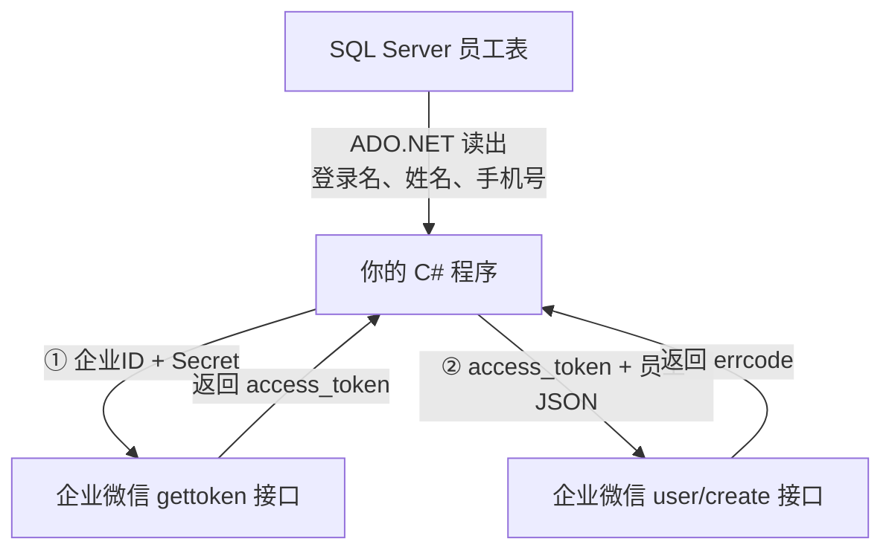

# 第 1 章 把数据库里的员工添加到企业微信

## 这一章解决什么问题

新员工入职后，HR 系统的员工表里已经有了登录名、姓名、手机号，管理员还要到企业微信后台再手工录一遍。人一多就容易漏录、录错。本章写一个 30 多行的 C# 控制台程序：从 SQL Server 读出一个员工，直接添加到企业微信通讯录。

## 开始之前

- 你已经会：用 ADO.NET（`SqlConnection` / `SqlCommand` / `SqlDataReader`）查询 SQL Server。本章不再解释这部分。
- 需要的环境：Visual Studio 2026、.NET 10 SDK、一个可以连接的 SQL Server、企业微信**管理员**账号。

### 第一步：企业微信后台准备

登录 [企业微信管理后台](https://work.weixin.qq.com)，记下两样东西，再做一项设置：

| 要做的事 | 后台位置 | 用途 |
|---|---|---|
| 记下**企业ID**（corpid） | 我的企业 → 企业信息 → 页面最下方 | 告诉企业微信"我是哪家企业" |
| 记下**通讯录同步 Secret** | 安全与管理 → 管理工具 → 通讯录同步 → 查看 Secret（会发到管理员的企业微信里） | 证明"我有权改这家企业的通讯录" |
| 把权限设为"**API 编辑通讯录**"，并在"**企业可信IP**"里填上运行程序那台电脑的公网 IP | 同上，通讯录同步页面 | 只读权限不能添加成员；不在可信 IP 里的电脑调不通接口 |

> 后台菜单名称偶尔会调整。找不到时，在后台搜索"通讯录同步"。

### 第二步：建员工表

在 SSMS 里执行下面的脚本。已经有员工表的话可以跳过，后面把 SQL 里的表名和列名换成你自己的即可。

```sql
-- code/ch01/sql/01-create-employee.sql
-- 在 SSMS 里执行。HRDB 只是示例库名，已有员工表可以跳过本脚本
IF DB_ID(N'HRDB') IS NULL
    CREATE DATABASE HRDB;
GO
USE HRDB;
GO
IF OBJECT_ID(N'dbo.Employee', N'U') IS NOT NULL
    DROP TABLE dbo.Employee;
GO
CREATE TABLE dbo.Employee (
    LoginName varchar(64)  NOT NULL PRIMARY KEY,  -- 登录名，用作企业微信 userid
    EmpName   nvarchar(50) NOT NULL,              -- 姓名
    Mobile    varchar(20)  NULL,                  -- 手机号
    Position  nvarchar(50) NULL                   -- 职务（练习 1 用）
);
GO
-- 手机号请换成真实可用的号码，企业微信会按手机号发邀请
INSERT INTO dbo.Employee (LoginName, EmpName, Mobile, Position) VALUES
    ('zhangsan', N'张三', '13800000000', N'销售'),
    ('lisi',     N'李四', '13900000000', N'采购主管');
GO
```

### 第三步：在 VS 里建项目

1. **文件 → 新建 → 项目 → 控制台应用**（C#），项目名填 `WeComCh01`，框架选 **.NET 10**。
2. 右键项目 → **管理 NuGet 程序包** → 浏览，安装下面两个包：

| 包 | 版本 | 为什么要装 |
|---|---|---|
| `Microsoft.Data.SqlClient` | 7.1.1 | ADO.NET 连接 SQL Server |
| `System.Security.Cryptography.Pkcs` | 10.0.14 | 程序不直接用它。SqlClient 默认带进来的旧版本有已知安全漏洞，编译会报 NU1903 警告，单独装新版本就没有了 |

HTTP 请求和 JSON 处理用的是 .NET 自带的 `HttpClient` 和 `System.Text.Json`，不用另外装包。

## 正文

### 1.1 整体流程



读数据库这一段你已经会了。本章只有两个新概念：

1. **access_token**：先拿到调用凭证。
2. **用匿名对象发 JSON**：把员工信息交给"创建成员"接口。

### 1.2 新概念一：access_token

**白话定义**：access_token（访问令牌）是企业微信发给你的一张临时通行证，有效期 2 小时。你先用企业ID和 Secret 换到它，之后调其他接口时只带这张通行证，不再带 Secret。

**业务场景**：你写的程序每天早上从 HR 库里找出昨天入职的员工，统一加进企业微信。程序启动时取一次 token，后面添加 10 个人都用这同一个 token。

**反例（什么时候不该这样做）**：不要每添加一个人就重新取一次 token。官方文档要求缓存 token，频繁调用 gettoken 会被频率拦截。另外，token 只能留在后台程序里，不能发给网页前端。

#### 💻 最小可运行代码

把 `Program.cs` 的内容整个换成下面的代码，填上你的企业ID和 Secret，按 F5 运行。

```csharp
// code/ch01/Step1-GetToken/Program.cs
using System.Text.Json.Nodes;

string corpId = "你的企业ID";
string secret = "通讯录同步的Secret";

using var http = new HttpClient();

// 用企业ID + Secret 换 access_token，后面调其他接口都要带上它
string tokenJson = await http.GetStringAsync(
    $"https://qyapi.weixin.qq.com/cgi-bin/gettoken?corpid={corpId}&corpsecret={secret}");
Console.WriteLine(tokenJson);

// 从返回的 JSON 里按字段名取出 access_token
string token = (string)JsonNode.Parse(tokenJson)!["access_token"]!;
Console.WriteLine("access_token = " + token);
```

#### 🔍 拆解运行结果

企业ID和 Secret 都正确时，第一行会打印类似下面的 JSON（格式来自[官方文档](https://developer.work.weixin.qq.com/document/path/91039)，token 的实际值是一长串字符）：

```json
{"errcode":0,"errmsg":"ok","access_token":"accesstoken000001","expires_in":7200}
```

> ⚠️ 本段未实机验证：成功的输出需要真实的企业ID和 Secret，编写时没有条件测试。

| 字段 | 含义 |
|---|---|
| `errcode` | 0 表示成功，不是 0 表示失败 |
| `errmsg` | 失败时写明原因 |
| `access_token` | 通行证本身，后面要用的就是它 |
| `expires_in` | 有效秒数，7200 秒就是 2 小时 |

关键行解释：

- `GetStringAsync`：发一个 GET 请求，把返回内容当字符串收回来。
- `JsonNode.Parse(tokenJson)!["access_token"]`：把字符串解析成 JSON，再按字段名取值，和 `reader["EmpName"]` 按列名取值是一个思路。这样不用先为返回结果定义一个类。
- 前面的 `(string)` 把取出来的 JSON 值转成 C# 字符串。

#### 改坏一处试试

把企业ID故意改成 `test`，再运行一次。下面是实际运行的输出：

```
{"errcode":40013,"errmsg":"invalid corpid, hint: [1793349321351092738206823], from ip: 13.221.73.176, more info at https://open.work.weixin.qq.com/devtool/query?e=40013"}
access_token = 
```

注意两点：

1. 企业ID错了，程序**没有报异常**。HTTP 请求本身是成功的，企业微信只是在 JSON 里用 `errcode: 40013` 告诉你失败了。
2. 第二行的 access_token 是空的，因为失败的返回里根本没有这个字段。如果你拿着空 token 继续往下走，下一个接口会报错，而且报的不是真正的原因（见 1.3）。

`from ip:` 后面就是企业微信看到的你的公网 IP。配置"企业可信IP"时填的就是它。

### 1.3 新概念二：用匿名对象发 JSON

**白话定义**：创建成员接口要求你 POST 一段 JSON 过去。C# 的匿名对象（`new { 属性 = 值 }`）可以直接序列化成 JSON，属性名原样变成 JSON 字段名。

**业务场景**：员工表里的一行数据，变成企业微信要的 `{"userid":"zhangsan","name":"张三","mobile":"13800000000","department":[1]}`。

**反例（什么时候不该这样做）**：同一个结构要在多个文件、多个方法里传来传去时，匿名对象就不合适了，因为它出了当前方法没法写类型名。那时应该定义一个正式的类，用 `[JsonPropertyName("userid")]` 标注 JSON 字段名。本章的程序只有一个文件，用匿名对象最省事。

#### 💻 最小可运行代码

把 `Program.cs` 整个换成下面的代码，改好连接串、企业ID、Secret，按 F5 运行。

```csharp
// code/ch01/Step2-AddMember/Program.cs
using System.Net.Http.Json;
using System.Text.Json.Nodes;
using Microsoft.Data.SqlClient;

string connStr = "Server=.;Database=HRDB;Integrated Security=True;TrustServerCertificate=True;";
string corpId = "你的企业ID";
string secret = "通讯录同步的Secret";
string loginName = "zhangsan";

// 1. 读数据库
using var conn = new SqlConnection(connStr);
conn.Open();
var cmd = new SqlCommand("SELECT EmpName, Mobile FROM dbo.Employee WHERE LoginName = @LoginName", conn);
cmd.Parameters.AddWithValue("@LoginName", loginName);
using var reader = cmd.ExecuteReader();
reader.Read();
string name = reader.GetString(0);
string mobile = reader.GetString(1);

// 2. 取 access_token
using var http = new HttpClient();
string tokenJson = await http.GetStringAsync(
    $"https://qyapi.weixin.qq.com/cgi-bin/gettoken?corpid={corpId}&corpsecret={secret}");
string token = (string)JsonNode.Parse(tokenJson)!["access_token"]!;

// 3. 添加成员
var user = new { userid = loginName, name, mobile, department = new[] { 1 } };
var resp = await http.PostAsJsonAsync(
    $"https://qyapi.weixin.qq.com/cgi-bin/user/create?access_token={token}", user);

// errcode 为 0 表示成功
Console.WriteLine(await resp.Content.ReadAsStringAsync());
```

#### 🔍 拆解运行结果

添加成功时，企业微信返回（格式来自[官方"创建成员"文档](https://developer.work.weixin.qq.com/document/path/90195)）：

```json
{"errcode":0,"errmsg":"created"}
```

> ⚠️ 本段未实机验证：成功的输出需要真实的企业ID、Secret 和可信 IP，编写时没有条件测试。

成功后打开管理后台 → 通讯录，能看到张三，员工本人会收到加入企业的邀请。

第 3 步匿名对象这一行最关键：

```csharp
var user = new { userid = loginName, name, mobile, department = new[] { 1 } };
```

| 写法 | 序列化后的 JSON 字段 | 说明 |
|---|---|---|
| `userid = loginName` | `"userid":"zhangsan"` | 登录名用作企业微信账号，企业内唯一 |
| `name` | `"name":"张三"` | 属性名和变量名相同时可以省略 `name = name` |
| `mobile` | `"mobile":"13800000000"` | 企业内唯一；手机号和邮箱至少要填一个 |
| `department = new[] { 1 }` | `"department":[1]` | 部门 ID 数组，1 是根部门 |

实际序列化出来的 JSON 是这样（实测）：

```json
{"userid":"zhangsan","name":"\u5F20\u4E09","mobile":"13800000000","department":[1]}
```

`\u5F20\u4E09` 就是"张三"。`System.Text.Json` 默认把中文写成转义形式，这仍然是合法的 JSON，企业微信收到后能正常识别。

最后一行把返回的 JSON 原样打印出来。要注意，企业微信出错时 **HTTP 状态码照样是 200**，所以不能靠"有没有抛异常"来判断成败，只能看 `errcode`。

#### 改坏一处试试

保留数据库部分不动，把企业ID改成 `test`，再运行。下面是实际运行的最后一行输出：

```
{"errcode":41001,"errmsg":"access_token missing, hint: [1793349333489060528437790], from ip: 13.221.73.176, more info at https://open.work.weixin.qq.com/devtool/query?e=41001"}
```

真正的原因是企业ID错了，但你看到的是"access_token missing"。原因是第 2 步取 token 失败后，程序没有检查，拿着空 token 去调了第 3 步。遇到 41001 时，先回到第 2 步把 `tokenJson` 打印出来，看真正的错误码。

再试一处：把 `userid = loginName` 改成 `UserId = loginName`。JSON 里的字段就变成了 `"UserId"`，跟企业微信要求的 `userid` 对不上，接口会认为你没传账号而报错。匿名对象里的属性名必须和企业微信文档里的字段名一模一样，包括大小写。

> ⚠️ 本段未实机验证：大写 `UserId` 具体返回哪个错误码，需要有效的 token 才能测出来。

## 🧱 类比

两个新概念都能在 ADO.NET 里找到对应的东西：

| 企业微信接口 | ADO.NET | 相同点 |
|---|---|---|
| 用 corpid + Secret 调 gettoken 换 access_token | 用连接串 `conn.Open()` 建立连接 | 先证明身份，后面的操作都基于这一次认证 |
| access_token 2 小时后过期 | 连接用完要释放，再用要重新打开 | 凭证有生命周期，不能永久持有 |
| 匿名对象的属性名必须等于 JSON 字段名 | `SqlParameter` 的名字必须等于存储过程的参数名 | 名字对不上，对方就当你没传 |
| 看返回 JSON 里的 `errcode` | 看存储过程的返回值或输出参数 | 调用"成功"不等于业务成功，要看返回的状态 |

## ⚠️ 踩坑警告

| 现象 | 原因 | 怎么改 |
|---|---|---|
| 返回 `errcode: 60020`，errmsg 里有 `not allow to access from your ip` | 运行程序的电脑 IP 不在"企业可信IP"里 | 把返回内容里 `from ip:` 后面的 IP 加到 通讯录同步 → 企业可信IP |
| 返回 `errcode: 60011`（没有权限） | 用了某个自建应用的 Secret；或通讯录同步只开了"读取"权限 | 换成"通讯录同步"的 Secret，权限改为"API 编辑通讯录" |
| 返回 `errcode: 41001 access_token missing` | 第 2 步取 token 失败了，程序没检查就继续往下走 | 打印 `tokenJson` 看真正原因，常见的是企业ID错（40013）或 Secret 错 |
| 同一个人运行第二次返回 `errcode: 60102` | 这个 userid 已经在企业微信里了 | 正常现象。要修改已有成员的信息，应调用 `user/update` 接口 |
| `reader.GetString(1)` 抛 `SqlNullValueException: Data is Null` | 这个员工的 Mobile 列是 NULL | 先在表里补上手机号；或读之前用 `reader.IsDBNull(1)` 判断 |
| `reader.GetString(0)` 抛 `InvalidOperationException` | 表里没有这个登录名，`reader.Read()` 返回了 false | 检查 `loginName` 是否写对；正式程序要判断 `reader.Read()` 的返回值 |

完整的错误码列表见[企业微信全局错误码](https://developer.work.weixin.qq.com/document/path/90313)。

> **安全提醒**：通讯录同步 Secret 能修改整个通讯录。练习时写在代码里没问题，代码不要提交到 Git 仓库。正式使用时，应改为从配置文件或环境变量读取。

## 🎯 动手练习

**练习 1：顺便把职务也带过去**

员工表里有 `Position`（职务）列。修改程序，把李四（`lisi`）连同职务一起添加到企业微信。企业微信"创建成员"接口里职务的字段名是 `position`。

验收标准：运行后打印 `{"errcode":0,"errmsg":"created"}`，在管理后台 → 通讯录里打开李四，职务显示"采购主管"。

**练习 2：让程序自己说清成败**

现在程序只是把 JSON 原样打印出来。改成：成功时打印 `添加成功`，失败时打印 `添加失败：错误码 错误说明`。

验收标准：对张三连续运行两次。第一次打印 `添加成功`，第二次打印以 `添加失败：60102` 开头的一行。

卡住了看文末参考答案。

## 📌 一句话总结

先用 Secret 换 access_token，再把员工信息用匿名对象 POST 给 user/create，看 errcode 判成败。

## 下一章

本教程只有这一章。批量同步时，在员工表加一列"已同步"标记，循环处理未同步的员工，token 只取一次。

---

<!-- 以下是参考答案，先自己动手，卡住了再往下翻 -->


## 参考答案

### 练习 1

思路：SQL 多查一列，匿名对象多加一个 `position` 属性。属性名就是企业微信文档里的字段名，所以写小写。

```csharp
// code/ch01/Answer1-Position/Program.cs
using System.Net.Http.Json;
using System.Text.Json.Nodes;
using Microsoft.Data.SqlClient;

string connStr = "Server=.;Database=HRDB;Integrated Security=True;TrustServerCertificate=True;";
string corpId = "你的企业ID";
string secret = "通讯录同步的Secret";
string loginName = "lisi";

// 1. 读数据库：多读一列 Position
using var conn = new SqlConnection(connStr);
conn.Open();
var cmd = new SqlCommand("SELECT EmpName, Mobile, Position FROM dbo.Employee WHERE LoginName = @LoginName", conn);
cmd.Parameters.AddWithValue("@LoginName", loginName);
using var reader = cmd.ExecuteReader();
reader.Read();
string name = reader.GetString(0);
string mobile = reader.GetString(1);
string position = reader.GetString(2);

// 2. 取 access_token
using var http = new HttpClient();
string tokenJson = await http.GetStringAsync(
    $"https://qyapi.weixin.qq.com/cgi-bin/gettoken?corpid={corpId}&corpsecret={secret}");
string token = (string)JsonNode.Parse(tokenJson)!["access_token"]!;

// 3. 添加成员：匿名对象里多一个 position，名字就是企业微信文档里的字段名
var user = new { userid = loginName, name, mobile, position, department = new[] { 1 } };
var resp = await http.PostAsJsonAsync(
    $"https://qyapi.weixin.qq.com/cgi-bin/user/create?access_token={token}", user);

// errcode 为 0 表示成功
Console.WriteLine(await resp.Content.ReadAsStringAsync());
```

### 练习 2

思路：返回的 JSON 和取 token 时一样，用 `JsonNode` 按字段名取出 `errcode` 和 `errmsg`，再用 if 判断。

```csharp
// code/ch01/Answer2-CheckResult/Program.cs
using System.Net.Http.Json;
using System.Text.Json.Nodes;
using Microsoft.Data.SqlClient;

string connStr = "Server=.;Database=HRDB;Integrated Security=True;TrustServerCertificate=True;";
string corpId = "你的企业ID";
string secret = "通讯录同步的Secret";
string loginName = "zhangsan";

// 1. 读数据库
using var conn = new SqlConnection(connStr);
conn.Open();
var cmd = new SqlCommand("SELECT EmpName, Mobile FROM dbo.Employee WHERE LoginName = @LoginName", conn);
cmd.Parameters.AddWithValue("@LoginName", loginName);
using var reader = cmd.ExecuteReader();
reader.Read();
string name = reader.GetString(0);
string mobile = reader.GetString(1);

// 2. 取 access_token
using var http = new HttpClient();
string tokenJson = await http.GetStringAsync(
    $"https://qyapi.weixin.qq.com/cgi-bin/gettoken?corpid={corpId}&corpsecret={secret}");
string token = (string)JsonNode.Parse(tokenJson)!["access_token"]!;

// 3. 添加成员
var user = new { userid = loginName, name, mobile, department = new[] { 1 } };
var resp = await http.PostAsJsonAsync(
    $"https://qyapi.weixin.qq.com/cgi-bin/user/create?access_token={token}", user);

// 4. 解析返回：出错时 HTTP 状态码照样是 200，只能看 errcode
JsonNode result = JsonNode.Parse(await resp.Content.ReadAsStringAsync())!;
int errcode = (int)result["errcode"]!;
string errmsg = (string)result["errmsg"]!;

if (errcode == 0)
    Console.WriteLine("添加成功");
else
    Console.WriteLine($"添加失败：{errcode} {errmsg}");
```

拿一个无效的 token 测试时，这段代码实际打印：

```
添加失败：40014 invalid access_token, hint: [1793349336194173756791354], from ip: 13.221.73.176, more info at https://open.work.weixin.qq.com/devtool/query?e=40014
```
