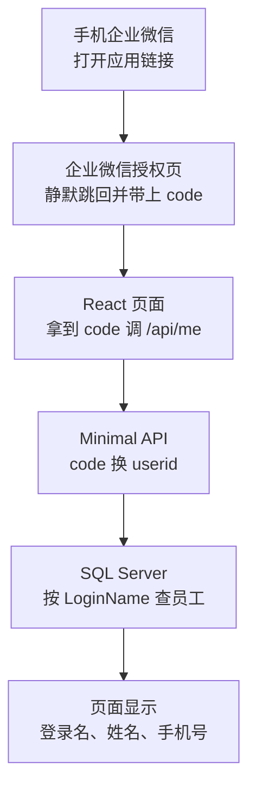

# 企业微信网页登录教程（React 19 + TypeScript + Minimal API + ADO.NET）

> 版本基线
> - 后端：.NET 10 + C# 14 + Visual Studio 2026｜ASP.NET Core Minimal API｜`Microsoft.Data.SqlClient 7.1.1`（另引用 `System.Security.Cryptography.Pkcs 10.0.14` 消除 NU1903 警告）
> - 前端：React 19 + TypeScript（`strict` 开启，禁止 `any`）｜Vite（`react-ts` 模板）｜VS Code｜Node.js LTS（具体版本写第 3 章时实测后填入）
> - 数据库：SQL Server，**SQL 登录**（用户名 + 密码），示例库 `HRDB`，表 `dbo.Employee`（沿用《企业微信添加成员教程》）
> - 部署：Windows Server + IIS，网站和 SQL Server 装在同一台机器上
> - 企业微信：自建应用｜OAuth2 网页授权（`snsapi_base` 静默授权）｜服务端 API `gettoken`、`auth/getuserinfo`
>
> 后端调用企业微信只用 .NET 自带的 `HttpClient`、`System.Text.Json`，不引入第三方 SDK。

---

## 这本教程写给谁

- 熟悉 C# 和 ADO.NET，能用 `SqlConnection` / `SqlCommand` / `SqlDataReader` 查 SQL Server。
- 没写过 ASP.NET Core Minimal API，React 刚开始学。
- 要做出这样一个东西：员工在手机企业微信里点开一个链接，页面自动认出"我是谁"，显示他在数据库里的**登录名、姓名、手机号**，不需要输入账号密码。

## 整体架构

React 打包后的静态文件放进 Minimal API 的 `wwwroot`，**同一个 IIS 站点、同一个域名**同时提供页面和接口。理由：不用处理跨域（CORS）；企业微信后台只需要配一个可信域名；服务器上只维护一个站点。

## 必须提前准备：已备案的域名

企业微信规定，网页授权的回调地址必须在应用的**可信域名**下；现在新建的自建应用，可信域名的 **ICP 备案主体必须与企业微信认证主体相同或有关联关系**。没有这样的域名，手机上会提示"redirect_uri 需使用应用可信域名"，身份拿不到。

你目前没有备案域名和 HTTPS 证书，所以：

| 阶段 | 需要域名吗 | 说明 |
| --- | --- | --- |
| 第 1–5 章 | 不需要 | 在开发电脑上就能完成并运行 |
| 第 6 章 | 不需要 | 用服务器 IP 访问，验证 IIS 部署成功 |
| 第 7 章 | **需要** | 讲怎么用公司主体买域名、办备案、申请免费证书；备案通常需要 1–3 周，建议现在就开始办 |
| 第 8 章 | **需要** | 企业微信后台配置 + 手机实测 |

**最短路径**：第 2、3、5、6 章，约 6 小时，做出"在服务器上用浏览器输入登录名就能看到员工信息"的页面（不含企业微信身份）。
**完整路径**：8 章 + 2 附录，按每天 2 小时约 2 周（不含等待备案的时间）。

---

## 进度

| 章节 | 状态 |
| --- | --- |
| 第 1 章 网页怎么知道"你是谁" | 📝 |
| 第 2 章 Minimal API 用 ADO.NET 读员工 | 📝 |
| 第 3 章 React 页面显示员工信息 | 📝 |
| 第 4 章 接入企业微信身份 | 📝 |
| 第 5 章 前后端合成一个站点 | 📝 |
| 第 6 章 部署到 Windows Server + IIS | 📝 |
| 第 7 章 域名、备案和 HTTPS 证书 | 📝 |
| 第 8 章 企业微信后台配置与手机实测 | 📝 |
| 附录 A 故障排查表 | 📝 |
| 附录 B 安全须知 | 📝 |

---

## 目录

### 第一部分 原理和准备

**第 1 章 网页怎么知道"你是谁"**（`docs/ch01-how-it-works.md`）
- 为什么手机浏览器自己拿不到身份：身份在企业微信手里，要走一次跳转
- 时序图：授权链接 → 带 code 跳回 → 服务器用 code 换 userid
- 三个凭证：企业ID（CorpID）、应用ID（AgentId）、应用 Secret，各放在哪、谁能看
- access_token：服务器调企业微信接口的通行证，有效期 2 小时
- 动手：在企业微信管理后台建自建应用，用浏览器调 `gettoken` 看到 access_token

### 第二部分 本地开发（先不碰企业微信）

**第 2 章 Minimal API 用 ADO.NET 读员工**（`docs/ch02-minimal-api-ado.md`）
- VS 2026 新建「ASP.NET Core 空」项目，看懂 `Program.cs` 那十几行
- 路由映射：`app.MapGet("/api/employees/{loginName}", ...)`
- 连接串放 `appsettings.json`（SQL 登录写法），用 `SqlDataReader` 读一行，返回匿名对象自动变成 JSON
- 查不到返回 404：`Results.NotFound()`
- 动手：浏览器访问 `/api/employees/zhangsan` 看到 JSON

**第 3 章 React 页面显示员工信息**（`docs/ch03-react-show-employee.md`）
- VS Code 用 Vite `react-ts` 模板建项目，看懂目录结构
- 用 TypeScript 类型 `Employee` 描述接口返回的 JSON
- `useState` + `useEffect` + `fetch` 取数据并显示
- Vite 开发代理：把 `/api` 转发到后端端口，开发时也不用处理跨域
- 动手：电脑浏览器打开页面，看到三项信息

**第 4 章 接入企业微信身份**（`docs/ch04-wecom-identity.md`）
- 后端新增 `GET /api/me?code=`：`gettoken` → `auth/getuserinfo` 拿 userid → 按 `LoginName` 查库
- 前端：地址栏没有 code 就跳到授权链接；有 code 就调 `/api/me`
- 授权链接怎么拼：`redirect_uri` 为什么必须 URL 编码，`#wechat_redirect` 为什么不能少
- 页面三种状态"加载中 / 成功 / 失败"用判别联合（discriminated union）类型表示
- 本地能验证到哪一步：用假 code 实测 40029 错误；成功路径要到第 8 章才能验证

### 第三部分 部署

**第 5 章 前后端合成一个站点**（`docs/ch05-single-site.md`）
- `npm run build` 把前端输出到后端的 `wwwroot`
- `UseDefaultFiles`、`UseStaticFiles`、`MapFallbackToFile`：分别起什么作用，少一个会怎样
- 生产环境配置 `appsettings.Production.json`：连接串、CorpID、AgentId、Secret
- VS 2026「发布 → 文件夹」生成发布包，看懂里面每个文件

**第 6 章 部署到 Windows Server + IIS**（`docs/ch06-iis-deploy.md`）
- 服务器管理器安装 IIS 角色（勾选哪些功能）
- 安装 .NET 10 Hosting Bundle，以及装完为什么要重启 IIS
- 新建网站，应用程序池选「无托管代码」，理由是什么
- SQL Server：开启「SQL Server 和 Windows 身份验证模式」，新建只读登录，只授权 `SELECT dbo.Employee`
- 复制发布包、给目录授权、在 `web.config` 打开 stdout 日志
- Windows 防火墙放行 80/443
- 动手：在电脑浏览器用 `http://服务器IP/api/employees/zhangsan` 验证

**第 7 章 域名、备案和 HTTPS 证书**（`docs/ch07-domain-https.md`）
- 为什么企业微信要求备案主体和企业一致
- 以公司主体购买域名、办理 ICP 备案的流程和时间（以接入商的要求为准）
- DNS 解析到服务器公网 IP；公司网络要做的端口映射
- 申请免费 HTTPS 证书并在 IIS 绑定 443 端口，设置到期自动续期
- 动手：电脑浏览器用 `https://你的域名/` 打开页面，地址栏显示锁标志

**第 8 章 企业微信后台配置与手机实测**（`docs/ch08-wecom-config.md`）
- 网页授权及 JS-SDK 可信域名：下载 `WW_verify_xxx.txt` 放到网站根目录完成校验
- 企业可信IP：填服务器的公网出口 IP，不填会报 60020
- 应用主页设为 `https://你的域名/`，设置可见范围
- 手机企业微信 → 工作台 → 打开应用，看到自己的登录名、姓名、手机号
- 改坏一处试试：删掉可信域名、换一个不在 Employee 表里的员工，分别看到什么

### 附录

**附录 A 故障排查表**（`docs/appendix-a-troubleshooting.md`）
- 企业微信：50001（跳转域名不在可信域名下）、40029（刷新页面导致 code 被重复使用）、60020（IP 不在可信列表）、40014（token 无效）
- IIS：500.30（应用启动失败）、500.19（没装 Hosting Bundle）、页面空白（静态文件路径问题）
- SQL Server：错误 18456 `Login failed for user`（没开混合验证模式 / 密码错 / 登录被禁用）

**附录 B 安全须知**（`docs/appendix-b-security.md`）
- Secret 只放在服务器，绝不进前端代码
- code 为什么只能用一次、5 分钟过期
- `appsettings.Production.json` 里的数据库密码怎么保护
- 什么时候需要加 Cookie 会话（本教程不加，保持代码最简）

---

## 代码

| 目录 | 内容 |
| --- | --- |
| `code/sql/` | 建 HRDB 示例库、Employee 表和只读 SQL 登录 |
| `code/ch02/` 起 | 每章的后端（`Backend/`）和前端（`Frontend/`）项目 |
